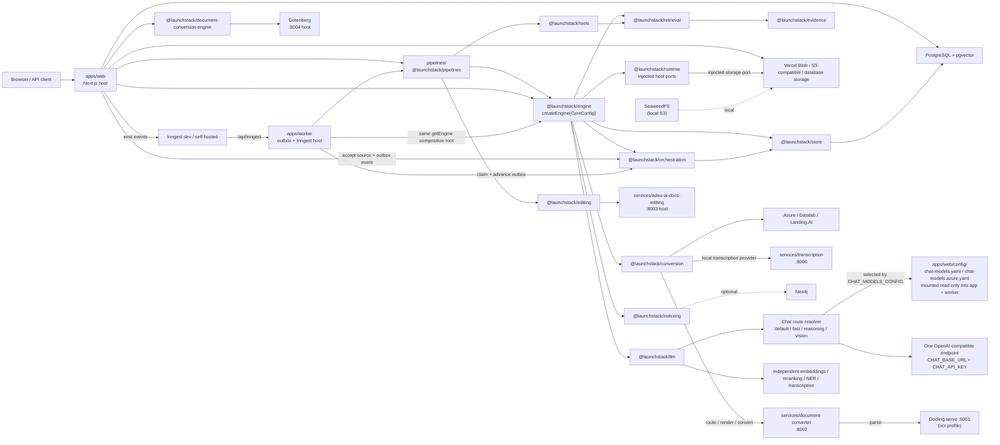

# Current Infrastructure Code Map

**Status:** Current repository inventory  
**Snapshot:** Working tree (feature-based package layout)  
**Reviewed:** 2026-10-12

> **Layout note.** This map follows the feature reorganization (ADR-008,
> recorded in the [feature-reorganization changeset](../../.changeset/feature-reorganization.md)),
> the transactional outbox and dedicated worker
> ([ADR-003](./ADR-003-transactional-outbox-and-worker.md)), and the compute
> service consolidation
> ([ADR-004](./ADR-004-compute-service-consolidation.md)). The ADRs record
> earlier decisions; the package and service paths below describe the current
> tree.

This document maps what is in the repository today. It distinguishes observed
runtime wiring from the intended architecture described elsewhere in the repo.
It is not a proposal to move code.

## Executive summary

Launchstack is a feature-organized monorepo:

- The pnpm workspace contains three applications (`apps/web`, `apps/worker`,
  and `apps/landing`), reusable bricks in `packages/`, and one compositions
  package in `pipelines/`.
- Three repository-owned compute runtimes live outside that workspace:
  `services/document-converter`, `services/transcription`, and
  `services/adeu-ai-docs-editing`.
- Docker Compose adds PostgreSQL/pgvector, SeaweedFS, Gotenberg, Inngest, and
  optionally Docling.
- Applications compose bricks directly or through `@launchstack/pipelines`.
  Pipelines may import bricks; bricks must never import pipelines.
  `@launchstack/engine` assembles the engine subsystems with `createEngine`.
- `apps/web` owns the UI, auth, command acceptance, synchronous reads, and
  infrastructure configuration. `apps/worker` consumes the transactional
  outbox and hosts the Inngest functions; `apps/landing` is the public site.

The product is therefore best understood as a modular monolith supported by
a durable worker and compute services, with a separate public-site application.

## Repository map

```text
.
├── apps/
│   ├── web/                    Next.js host, UI, API/BFF, composition root
│   ├── worker/                 Outbox consumer and Inngest serve endpoint
│   └── landing/                Public marketing site
├── packages/                   Reusable bricks
│   ├── runtime/                Host ports, actor context, errors, injected slots
│   ├── evidence/               Pure company-state and citation logic
│   ├── store/                  PostgreSQL/Drizzle, credentials, engine migrations
│   ├── llm/                    Model calls, behavior, embeddings, guardrails
│   ├── orchestration/          Source lifecycle, outbox, worker tick
│   ├── conversion/             EvidenceDocument conversion, OCR, transcription
│   ├── indexing/               Chunking, embedding, entity extraction, graph sync
│   ├── retrieval/              Hybrid retrieval, reranking, citations
│   ├── tools/                  Shared capabilities composed by verticals
│   ├── engine/                 createEngine aggregate
│   ├── editing/                Adeu tracked-changes client and wire contracts
│   ├── collab/                 Channels, meetings, signed HTTP protocol
│   ├── document-conversion-engine/ Gotenberg PDF client
│   ├── google-drive/           Drive and OAuth client
│   ├── schema-generator/       Versioned JSON Schema from feature contracts
│   └── design-tokens/          Private CSS design tokens
├── pipelines/                  @launchstack/pipelines; 13 vertical compositions
├── services/
│   ├── document-converter/     Node/Express routing, rendering, Docling parsing
│   ├── transcription/          Python/FastAPI Whisper and yt-dlp
│   └── adeu-ai-docs-editing/    Python/FastAPI DOCX editing
├── docker/                     Database, SeaweedFS, and reverse-proxy config
├── docker-compose*.yml         Local/self-hosted topology
├── scripts/                    CI policy, development, and operations tools
├── .github/workflows/          Workspace CI, app/worker images, package releases
└── docs/                       Product, deployment, and operations documentation
```

`pnpm-workspace.yaml` selects `apps/*`, `packages/*`, and `pipelines`.
`services/document-converter` has its own `package.json` and locked npm
install; the Python services have independent requirements files.

## Deployable applications and services

| Path                  | Runtime               | Responsibility                                                                                            | Main entry point                                       | Current deployment path                                                  |
| --------------------- | --------------------- | --------------------------------------------------------------------------------------------------------- | ------------------------------------------------------ | ------------------------------------------------------------------------ |
| `apps/web`            | Next.js 15 / Node 20  | Browser UI, first-party auth (better-auth), API/BFF, command acceptance, synchronous reads, engine composition | `src/app`, `src/middleware.ts`, `src/server/engine.ts` | `apps/web/Dockerfile`; GHCR image and Compose                            |
| `apps/worker`         | Node 20 / TypeScript | Durable outbox execution and Inngest functions                                                             | `src/main.ts`, `src/inngest.ts`                         | `apps/worker/Dockerfile`; GHCR image and Compose                         |
| `apps/landing`        | Next.js 15 / Node 20 | Public landing, pricing, contact, and deployment pages; no engine or database                              | `src/app`                                             | `apps/landing/Dockerfile`; production Compose overlay                    |
| `services/document-converter` | Express / Node 20 | Provider routing, vision classification, PDF page rendering, and Docling-backed parsing                | `src/server.ts` on `:8002`                             | Its Dockerfile; Compose default stack                                   |
| `services/transcription` | FastAPI / Python 3.12 | Audio/video transcription through Whisper and yt-dlp                                                  | `app/main.py` on `:8000`                               | Its Dockerfile; default Compose, opt-in in the production overlay        |
| `services/adeu-ai-docs-editing` | FastAPI / Python 3.12 | Authoritative tracked-changes Word editing and review workflow                                     | `app/main.py` on `:8000` (`:8003` on host)               | Its Dockerfile; Compose default stack                                   |

### Runtime endpoints

| Runtime                 | Implemented endpoints                                                                                                                                      |
| ----------------------- | ---------------------------------------------------------------------------------------------------------------------------------------------------------- |
| Document converter      | `GET /health`, `GET /readyz`, `POST /route`, `POST /render-pages`, `POST /convert`                                                                          |
| Transcription           | `GET /health`, `POST /transcribe`, `POST /download-and-transcribe`                                                                                        |
| Adeu docs editing       | `GET /health`; `POST /adeu/read`, `/adeu/review-items`, `/adeu/process-batch`, `/adeu/accept-all`, `/adeu/reject-all`, `/adeu/apply-edits-markdown`, `/adeu/diff` |
| Worker                  | `GET /healthz`, `GET /readyz`, Inngest serve endpoint `/api/inngest`                                                                                        |

These compute services do not host embeddings, reranking, or NER. Those
capabilities resolve independently through `@launchstack/llm`; Gotenberg is
the separate, off-the-shelf PDF-rendering service.

## Package boundaries

### `@launchstack/engine`

`packages/engine` is the aggregate, not a re-export-only facade.
`createEngine(CoreConfig)` assembles the engine subsystems; reusable engine
work is distributed across feature bricks:

- `@launchstack/runtime` — host ports, actor context, errors, and injected slots
- `@launchstack/evidence` — pure company-state logic and stable citation anchors
- `@launchstack/store` — PostgreSQL/Drizzle, credentials, credits, and engine migrations
- `@launchstack/llm` — chat routes, model behavior, structured output, embeddings, and guardrails
- `@launchstack/orchestration` — transactional source acceptance, outbox storage, and worker tick
- `@launchstack/conversion` — source conversion, OCR, transcription, and archive expansion
- `@launchstack/indexing` — chunking, embedding, entity extraction, and graph integration
- `@launchstack/retrieval` — scoped hybrid retrieval, reranking, and citations

Shared capabilities live in `@launchstack/tools`. Other bricks provide
tracked-changes editing (`@launchstack/editing`), channels and meetings
(`@launchstack/collab`), PDF rendering (`@launchstack/document-conversion-engine`),
Drive/OAuth (`@launchstack/google-drive`), generated wire schemas
(`@launchstack/schema-generator`), and private CSS tokens
(`@launchstack/design-tokens`).

`apps/web/src/server/engine.ts` builds configuration, registers provider and
feature slots, and calls `createEngine`. It supplies storage, credits, and
RAG ports, but no job-dispatch port: ingestion runs through the transactional
outbox. The worker boots this same composition root.

The engine spine receives injected configuration. ESLint prohibits environment
reads there except for designated transcription clients; editing and shared
tools retain environment access. Module-level slots remain part of the
configuration and HMR lifecycle, not a second composition tier.

### `@launchstack/pipelines`

`pipelines/` is one package containing 13 vertical compositions:

- client prospector
- company metadata
- connectors
- distribution
- email
- founder weekly review
- legal templates
- marketing
- proposals
- repository explainer
- repository workspace
- trend search
- Vantage

Pipelines may import bricks and read environment variables, but they may not
import Next.js, Clerk, React, or `apps/web` through `~/*`. Bricks must not
import `@launchstack/pipelines`; these tier and framework restrictions live in
`eslint.config.js`.

### `apps/web`

The web app is both the product host and the infrastructure composition root.
Its internal layers are:

| Area                                    | Responsibility                                                              |
| --------------------------------------- | --------------------------------------------------------------------------- |
| `src/app`                               | UI pages, layouts, and HTTP route handlers                                  |
| `src/server/engine.ts`                  | Engine configuration and singleton lifecycle                                |
| `src/server/storage`, `src/server/credits`, `src/server/rag` | Host implementations of injected engine ports                   |
| `src/server/inngest`                    | Event producers and function implementations registered by the worker        |
| `src/server/services`                   | Application services for documents/uploads                                  |
| `src/server/notes`                      | Notes and wiki-link domain logic                                            |
| `src/lib`                               | Shared browser/server utilities plus transitional legacy implementations    |
| `src/middleware.ts`                     | Session authentication, role routing, workspace routing, and direct DB lookup |

Hosts import feature bricks and pipeline subpaths directly. The worker
reuses the web composition root, but owns durable execution; the web app
accepts commands and performs synchronous reads.

## Product surface inside `apps/web`

The product routes group into these user-facing applications:

| Route family                               | Product surface                                                                                       |
| ------------------------------------------ | ----------------------------------------------------------------------------------------------------- |
| `apps/landing`: `/`, `/pricing`, `/contact`, `/deployment` | Public marketing and deployment guidance; the web app's `/` is an auth/workspace redirect |
| `/signin`, `/signup`, `/workspaces`        | Identity, registration, and workspace selection                                                       |
| `/employer/*`                              | The workspace: documents, settings (incl. People and access), statistics, upload, and tools — one app for every role |
| `/employee/*`                              | Redirects to the `/employer` twin (the separate employee area was removed, ADR-010)                    |
| `/employer/tools/marketing-pipeline`       | Marketing workflow UI                                                                                 |
| `/employer/tools/repo-explainer`           | Repository analysis UI                                                                                |

The HTTP route handlers group into:

- identity, users, companies, memberships (role + status), invitations, join links, groups, custom roles, folder/document grants, the audit log, and workspaces
- document upload, storage, versions, notes, graph entities, and retrieval
- document Q&A, predictive analysis, and research agents
- legal document generation and Adeu edits
- OCR configuration, execution, and benchmarking
- company metadata, client prospector, trend search, marketing, and repo explainer
- credits, metrics, health, and background-job event acceptance
- voice transcription and speech synthesis

This is a broad BFF/API surface inside one deployable application. Route URLs
do not need to change in order to reorganize the implementation behind them.

## Runtime flow



## Background jobs

`apps/worker/src/inngest.ts` registers the non-ingestion functions. Their
implementations remain in `apps/web/src/server/inngest/functions`:

| Function ID                  | Event                                  |
| ---------------------------- | -------------------------------------- |
| `trend-search-job`           | `trend-search/run.requested`           |
| `client-prospector-job`      | `client-prospector/run.requested`      |
| `predictive-analysis-job`    | `predictive-analysis/run.requested`    |
| `reindex-company-embeddings` | `company/reindex-embeddings.requested` |
| `modify-document`            | `document/modify.requested`            |
| `crawl-website`              | `website/crawl.requested`              |
| `google-drive-sync-reconciler` | Cron: `*/15 * * * *`                  |
| `founder-weekly-review-dispatcher` | `founder-weekly-review/dispatch.requested` |
| `founder-weekly-review-dispatch-reconciler` | Cron: `*/5 * * * *`        |
| `founder-weekly-review-generation` | `founder-weekly-review/generation.requested` |
| `repo-workspace-sync`        | `repo-workspace/sync.requested`        |
| `repo-workspace-poll-reconciler` | Cron: `*/30 * * * *`                |
| `repo-explainer-job`         | `repo-explainer/job.requested`         |
| `google-drive-sync`          | `google-drive/sync.requested`          |
| `google-drive-sync-cron`     | Cron: `*/15 * * * *`                   |
| `gmail-sync`                | `gmail/sync.requested`                |
| `gmail-sync-cron`           | Cron: `7,22,37,52 * * * *`             |
| `distribution-run`          | `distribution/run.requested`          |
| `brand-publish-due`          | Cron: `* * * * *`                      |
| `proposals-run`             | `proposals/run.requested`             |

Document extraction/indexing, company-state projection, note re-anchoring,
and note embedding use the PostgreSQL outbox instead of Inngest.

In development, start the web and worker separately with their `dev`
scripts; `pnpm --filter @launchstack/web inngest:dev` targets the worker's
`http://localhost:8020/api/inngest`. Docker's Inngest dev container calls
that same worker endpoint. The production overlay disables the dev server and
runs a self-hosted `inngest start` server on the same host instead, with its
history in Postgres and its queue in Redis; the reverse proxy does not route
`/api/inngest` (see `docs/runbooks/azure-lean-deploy.md`).

## Data and tenancy

- Engine Drizzle declarations live in `packages/store/src/db/schema.ts` and
  `packages/store/src/db/schema`; product declarations live in
  `apps/web/src/server/db/schema` and the pipeline verticals.
- Two migration sets share one database: the engine set
  (`packages/store/drizzle`) and the product set (`apps/web/drizzle`).
  Product tables reference engine tables; never the reverse, so
  `@launchstack/store` can be applied standalone by an embedding consumer.
- The runner and journal check live in `packages/store/scripts` and take
  `--set=engine|product`. `pnpm --filter @launchstack/web db:migrate`
  applies the engine set first, then the product set.
- The primary database is PostgreSQL with pgvector.
- Tenant ownership is mostly represented by `companyId`; current workspace
  selection also uses `userCompanyMemberships`.
- better-auth (in-process, same PostgreSQL) owns authentication. Middleware reads PostgreSQL directly to route on
  membership status (active / pending / none) and workspace selection; permissions and document
  scope are resolved per request by `requireWorkspaceContext` (ADR-010).
- Object storage is selected at runtime: Vercel Blob, S3-compatible storage, or
  a database fallback. Docker uses SeaweedFS as the S3-compatible implementation.
- Neo4j is optional for graph retrieval; PostgreSQL also stores knowledge-graph
  entities, mentions, and relationships.
- Chat reaches one OpenAI-compatible endpoint (`CHAT_BASE_URL`) that may serve
  many models. Operators assign models to the `default`, `fast`, `reasoning`,
  and `vision` routes in `apps/web/config/chat-models.yaml` or
  `apps/web/config/chat-models.azure.yaml`, selected by `CHAT_MODELS_CONFIG`;
  application features name a route, never a model id or an endpoint.
  Both files map `default` and `vision` to `primary`, `fast` to `fast`, and
  `reasoning` to `deep`. The default file uses `google/gemini-3.8-flash`;
  the Azure file uses a `gpt-6-luna` deployment id with the
  `openai/gpt-6-luna` preset. Model tiers differ by declared reasoning effort.
  `docker-compose.yml` mounts the whole `apps/web/config/` directory
  read-only into both app and worker. Compose accepts a config path relative
  to `apps/web`, and re-roots it for the worker; edit the file and restart
  both processes to apply a change, without rebuilding images.
- Model behavior — image input, reasoning mode, native structured output,
  accepted request parameters — is declared per model, never inferred from the
  model id. Specialized routes fail closed rather than substituting a model.
- Structured output is invocation behavior, not a route: models declaring a
  native mechanism use it, and every other model goes through a strict JSON
  prompt validated with Zod plus one repair attempt.
- Non-chat AI capabilities (OCR, embeddings, reranking, NER, transcription)
  keep independent configuration and never borrow the chat credential.

## Deployment modes

| Mode                 | Components                                                                        | Notes                                                                                                      |
| -------------------- | --------------------------------------------------------------------------------- | ---------------------------------------------------------------------------------------------------------- |
| Local pnpm           | Separate web, worker, and Inngest dev processes; externally supplied PostgreSQL and optional services | Web `dev` starts only Next.js; worker `dev` supplies durable execution |
| Docker default       | PostgreSQL, migrations, SeaweedFS, transcription, Adeu editing, document converter, Gotenberg, worker, app, Inngest | Compute dependencies order startup; they do not gate the app's health |
| Docker `ocr` profile | Default stack + Docling serve                                                     | Enables Docling-backed PDF/Office parsing; text-file ingestion works without it |
| Docker production    | App/worker GHCR images, database/storage, compute services, landing site, Caddy    | `docker-compose.prod.yml`; local Whisper and Inngest dev are opt-in |
| Package release      | Publishable bricks and `@launchstack/pipelines` built for Changesets publication  | `release.yml` validates exports and the engine tarball; design tokens and apps are private |

Local setup, CI, and the Docker `migrate` target use the same forward
migration runner, applying engine SQL before product SQL. The web
`db:migrate` script applies both sets. `drizzle-kit push` is banned on
deploy paths and enforced by `scripts/ci/check-no-push.mjs`. Data backfills
are separate, resumable, and never run on container boot.

## CI/CD coverage

| Workflow      | Covered                                                                                       | Not covered                                              |
| ------------- | --------------------------------------------------------------------------------------------- | -------------------------------------------------------- |
| `CI.yml`      | Forward migrations, workspace lint/typecheck, wire-schema checks, package/web tests, service tests, Compose ingestion smoke, migration gates, web/landing/package builds | Live provider behavior and production configuration |
| `docker.yml`  | Web migration/runner and worker image builds; GHCR publication; prebuilt web runner smoke on PRs | Compute-service and landing image publication; full Compose integration lives in CI |
| `release.yml` | Publishable bricks and pipelines build, Node ESM export checks, engine tarball validation, Changesets publication | Private apps, design tokens, and compute-service releases |

Next.js builds fail on TypeScript errors. Its per-build lint pass is
disabled; the separate workspace lint step in CI is the authority.

## Current sources of confusion and risk

| Finding                                              | Why it matters                                                                                                               |
| ---------------------------------------------------- | ---------------------------------------------------------------------------------------------------------------------------- |
| Services are outside the workspace                   | Recursive pnpm checks exclude them; CI must keep explicit Node/Python service jobs in sync                                  |
| Configuration slots are process-local               | App and worker must boot through the same configuration authority before touching providers, storage, or the database        |
| Worker reuses the web composition root               | Durable execution remains coupled to web modules and their transitive environment requirements                               |
| Chat YAML is cached at startup                       | Mounting live files avoids image rebuilds, but both app and worker need a restart to adopt the same route/model changes        |
| Chat and non-chat provider configuration is separate  | Embeddings, reranking, NER, OCR, and transcription need their own endpoint/credential configuration, not the chat credential    |
| Migration ownership spans two ledgers                | Product SQL must follow engine SQL even though both sets use the same PostgreSQL database                                     |
| Docling parsing is opt-in                            | The converter returns a typed unavailable error without its parse engine; text-file ingestion still works                    |
| Floating container versions                          | SeaweedFS and Inngest use `latest` images in the default Compose stack, reducing reproducibility                              |
| API surface is concentrated in the web app            | A broad BFF still requires consistent ownership, authorization, and permission-scoped retrieval                               |
| Historical records describe earlier layouts          | Read accepted ADRs as decision history; current package boundaries are the feature bricks and pipeline tier                   |

## What is intentionally not inferred

This inventory does not decide:

- which container tags, provider endpoints, and credentials production uses
- whether production enables local Whisper, Docling, or background Inngest verticals
- whether every route consistently enforces company/workspace scoping
- whether every optional integration is configured in a running deployment

Those require production configuration or an explicit product/operations
decision; the repository topology alone does not establish them.
