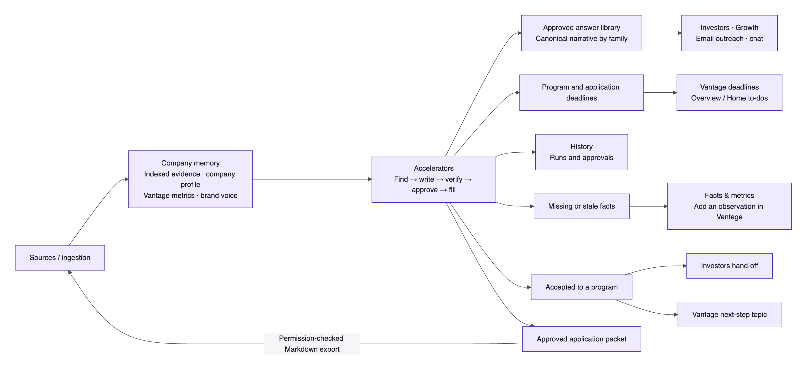
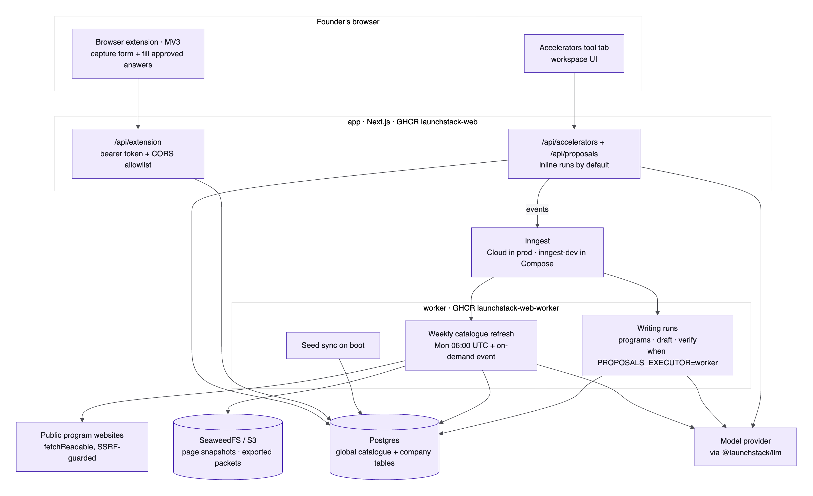
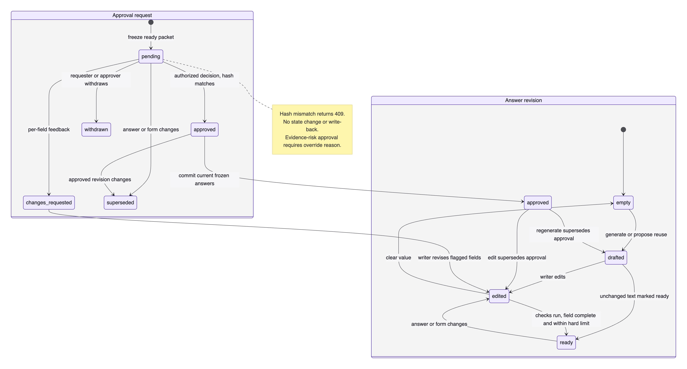
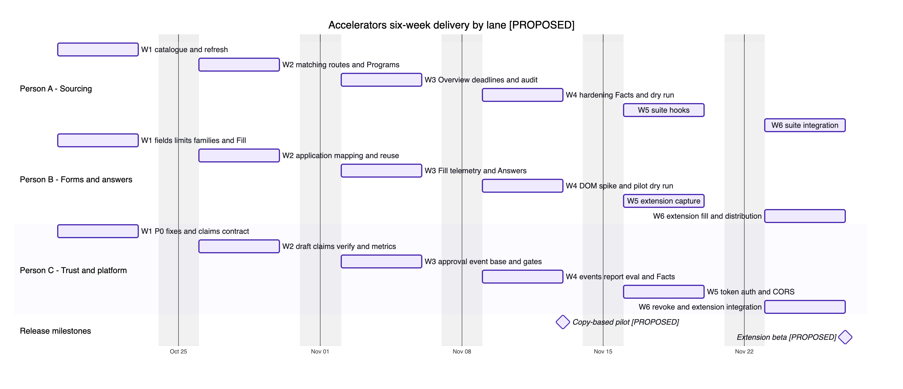

# Technical Design — Accelerators

Feature **Accelerators — program sourcing, application writing and autofill** · Author TBD · Date 2026-10-13 · Status **In review** · Brief [Feature Brief — Proposal Feature (Approved 2026-10-04)](https://docs.google.com/document/d/1Xf0B3lwtY6HzJVW0oVYifkRuxxKAppKtHdXonPXj4L0/edit?tab=t.0)

_Condensed for review. Full design, rationale and citations: [docs/design/accelerators/technical-design.md](https://github.com/Deodat-Lawson/LaunchStack/blob/kiendle/accelerators-technical-design/docs/design/accelerators/technical-design.md) (branch kiendle/accelerators-technical-design)._

> **Scope change from the brief, for TL ack** — Accelerator programs are the scope; grants stay frozen in Proposals, Grantable covers grants, and diagrams are out of v1. The unchanged kill test requires value beyond a one-off Claude draft plus documents through current permissioned evidence, provenance and repeatable founder review. Success remains the share of source-verified answers approved with edit ratio ≤ X, using founder evidence and reuse across near-identical forms.

## 1 Summary

Accelerators is a new tool tab in the LaunchStack workspace that finds suitable accelerator programs, prepares application answers from company evidence, links factual claims to their sources, gets founder approval and helps fill the program's form. Founders, writers and application admins use it; reviewers are secondary. Eight steps cover discovery, matching, typed forms, reuse-first answers, claim checks, frozen approval, copy and extension autofill. It shares Proposals and company memory, supplying narrative, deadlines, gaps, Sources packets and History activity across the suite. The founder always checks and submits in the portal. Everything new in this design is proposed until this review approves it; existing behaviour is described as it is today.

**Ship target** **2026-11-13 — copy-based pilot (P0–P3) [PROPOSED]:** prerequisite fixes, catalogue and matching, typed fields and limits, reuse, verification, approval, deadline to-dos, Facts & metrics, approved packet export and Fill mode. **2026-11-27 — extension beta (P4) [PROPOSED]:** MV3 capture and approved autofill, short-lived authentication, CORS, revocation, unmatched-field copy, Investors hand-off and Accelerators History.

## 2 Context and constraints

The feature extends Proposals and company memory.

**Builds on**

| Area                        | What exists                                                                                              | How we use it                                                |
| --------------------------- | -------------------------------------------------------------------------------------------------------- | ------------------------------------------------------------ |
| Proposals                   | Five company-scoped tables; funders, extract, draft, rewrite and review runs; inline or worker execution | Extend modules; share CRUD, runs, credits and library        |
| Extraction                  | Paste, static URL or Source; reject under 40 characters, clip at 60,000                                  | Add typed fields, independent character limits and families  |
| Company profile and Vantage | Sourced or manual facts; dated metrics, no approval boolean                                              | Preserve provenance; add Facts & metrics and confirmation    |
| Retrieval                   | Optional `DocumentScope`; omitted scope searches company-wide                                            | Scope executors, stored answers and derived text             |
| Evidence                    | Anchors and supersession; aging 30 days, stale 180 days                                                  | Preserve versions; metric aging 30 days, stale 90 [PROPOSED] |
| Web research                | Static guarded fetch; Exa and Serper are news-only                                                       | Quote-check known URLs; optional v1.1 discovery              |
| Worker and Inngest          | Durable registry, crons, ingestion outbox and worker Proposals runs                                      | Boot seed; weekly and requested refresh                      |
| Studio and History          | ToolFrame, Sources and History rail, internal links                                                      | New tab and filtered loader; no duplicate store              |
| Authorization and audit     | Owner, admin, member, viewer, guest; audit                                                               | Grantable `proposals.approve`; no founder role               |
| Sources and storage         | Markdown through ingestion; no PDF or DOCX                                                               | Approved Applications packets without wider visibility       |
| Voice, credits and metrics  | Shared voice, `proposal_writing` ledger and protected `pdr_` registry                                    | Evidence-led prose, shared metering, four metrics            |

**Prerequisite fixes (P0)**

1. **Permissioned drafting.** Carry `DocumentScope` through inline and worker retrieval. Current `runDraft` omits it (`pipelines/src/proposals/run.ts:399-405`).
2. **Export restriction.** The destination audience cannot exceed any cited Source audience. Protect both grants and accelerator exports, including derived prose (`apps/web/src/server/proposals/service.ts:499-533`).
3. **Text-bound approval.** An edit drops approval, invalidates the frozen revision and requires renewed review. Current PATCH preserves approval (`apps/web/src/server/proposals/service.ts:591-623`).
4. **Single-start and terminal runs.** A database compare-and-set, or CAS, claims a queued run before execution. Running work fails after 15 minutes; duplicate or late delivery cannot revive it or debit twice (`pipelines/src/proposals/run.ts:171-178`; `pipelines/src/proposals/db.ts:790-816`). Poll every two seconds only while queued or running, then stop.

**Not changing**

- Ingestion, outbox, indexing, retrieval, knowledge graph and Neo4j remain unchanged.
- Gotenberg and conversion stay unchanged, with Chromium JavaScript off. No server browser, PDF, DOCX or diagram generation is added.
- Authentication, membership and roles remain unchanged. Approvals adds no notification or email pipeline and implies no delivered email.
- Vantage keeps its schema. Observations are read-only inputs, not approved metrics.
- Grants.gov, `grant-search` and grant intake remain reachable but frozen. Legacy applications remain grants.
- Existing images, services, ports and volumes remain; only `apps/extension` is a new deployable.

## 3 Architecture/Design

P0 precedes private-evidence use. [Full contracts](https://github.com/Deodat-Lawson/LaunchStack/blob/kiendle/accelerators-technical-design/docs/design/accelerators/technical-design.md#36-data-model) remain authoritative.

### 3.1 Role in LaunchStack

Accelerators uses company knowledge for applications and returns approved answers across the suite. It shares Sources, facts, metrics and voice; approval never makes private evidence public, and downstream readers still need source access.

| Direction | Integration                                                                                                                       |
| --------- | --------------------------------------------------------------------------------------------------------------------------------- |
| Consumes  | Permissioned Sources and profile facts, dated Vantage observations and brand voice                                                |
| Supplies  | `latestApprovedAnswers(companyId, family)` for Investors intro drafts, Growth compose, email and chat, with consumer scope checks |
| Supplies  | Cycle-backed Overview and Home to-dos, plus `/api/vantage/deadlines`, without duplicate dates                                     |
| Supplies  | Company-scoped accelerator runs and approvals in History; grants remain separate                                                  |
| Supplies  | Gaps tied to applications, fields and claims in Facts & metrics, with Add observation in Vantage                                  |
| Supplies  | Accepted-program Investors link and a topic in a founder-selected Vantage agenda, `shared: false`                                 |
| Supplies  | Answer or gap context for chat through `?ask=`, within 4,000 characters; never auto-send                                          |
| Supplies  | Approved, citable Markdown Sources packet in Applications                                                                         |

### 3.2 The sub-app

Register `accelerators` in workspace types, pane IDs and StudioPanes. ToolNavProvider and ToolFrame host Find, Apply and Company. Use toolTabHref, ToolLink and useToolRouter at `/employer/documents?feature=accelerators&at=<path>`; legacy redirects preserve location. Resettable `/dev/accelerators` uses production contracts but stays development-only. Filter lists and counts by kind; reject grant IDs.

| Path                                  | Purpose                                    | Permission                                                                                          |
| ------------------------------------- | ------------------------------------------ | --------------------------------------------------------------------------------------------------- |
| `/`                                   | Readiness, deadlines, pipeline and actions | Member reads; edit starts work; approver queue remains restricted                                   |
| `/programs`                           | Catalogue filters and matching             | Member reads; `documents.edit` matches or refreshes                                                 |
| `/programs/:slug`                     | Terms, cycles, eligibility and form        | Member reads; edit starts applications or refreshes                                                 |
| `/applications`                       | Status and deadline list                   | Member reads; edit writes; approve records outcomes                                                 |
| `/applications/:id`                   | Typed answer editor and evidence           | Member reads; edit drafts, checks and requests approval                                             |
| `/answers`                            | Immutable approved family library          | Scoped member reads; edit reuses through an application                                             |
| `/approvals`, `/approvals/:requestId` | Queue and frozen review                    | `proposals.approve`; requester sees own status and withdrawal in editor                             |
| `/applications/:id/fill`              | Portal-order copy                          | Scoped reads; edit copies and logs; approve marks submitted                                         |
| Extension panel                       | Portal capture, preview and fill           | Session and edit permission mint token; bearer rechecks current permission                          |
| `/facts`                              | Sources, dates, freshness and gaps         | Member reads; settings edits; approve confirms; existing membership guard adds Vantage observations |

Use kit components, tokens, PageHeader, EmptyState, FitMeter, citations and pane overlays. The rail is 280px, resizes from 220–520px, collapses to 48px and becomes a drawer below 768px viewport width. The 44px toolbar moves tabs into a menu below 520px pane width. Padding is 32px horizontally, 24px above and 48px below; narrow panes use 16px horizontally and above. Full-height editors supply padding; narrow editors use outline and evidence sheets. Hidden panes retain state; shortcuts check `useToolActive()`.

### 3.3 User flows

Northwind Cold Chain illustrates flows, not seed sign-off. Reads start no writing runs; the run sheet shows steps, errors and credits, stopping terminal polling.

**Overview.** First visit shows readiness and next actions, never a fake pipeline; evidence gaps do not block browsing. Approvers record external submission and outcomes, including interviews, direct acceptance or decline, and withdrawal; hand-offs never send outreach or create meetings automatically.

**Programs.** Filter stage, geography, format, sector, deadline and terms, then explicitly match; unscored means Not matched yet. Eligibility stays separate from fit, saved choices survive, and refresh exposes errors and quote age.

**Program detail.** Inspect sourced terms and cycles, then select a batch and form. Seeds retain approximate warnings; exact questions come from page, paste, Source or capture, with changed fields reconciled rather than erasing answers or keeping obsolete approval.

**Application editor.** Outline, editor and evidence show typed answers, limits, reuse, claims and sources. Drafting, rewriting and editing follow the checks below; non-prose values and uploads stay separate, while ready and model review mean progress, not approval.

**Answers.** Approval publishes immutable family versions with provenance and as-of dates; legacy saves stay unapproved. Reuse in another application requires fresh checks and approval, tightening if needed; edits happen in applications, never approved library text.

**Approval review.** Review the frozen answers and evidence, accepting required fields or requesting changes; evidence overrides need reasons. The queue implies no email, and edits, withdrawal or hash conflicts remove fill authority while preserving history.

**Fill mode.** Copy approved plain text in portal order, logging only successful clipboard operations; failure allows manual selection. Warned unapproved copy grants no approval or extension access, and founders check, upload and submit before separately recording submission.

**Extension.** Connect to the company and capture structure, not credentials or responses; changed forms return to editing and approval. Preview leaves uncertain controls untouched, and explicit fill logs results without consequential clicks or submission.

**Facts & metrics.** Inspect original evidence dates and periods, correct or confirm facts, or add a sourced Vantage observation. Affected answers need verification and approval again; checking, confirmation and chat prefill cannot refresh old evidence.

### 3.4 System architecture and infrastructure

| Component                        | Runs in                                               | Deployed as                                                | Storage                                        | Reused/New                 |
| -------------------------------- | ----------------------------------------------------- | ---------------------------------------------------------- | ---------------------------------------------- | -------------------------- |
| UI, BFF and extension API        | Existing Next.js app                                  | GHCR `launchstack-web`                                     | Postgres                                       | Existing runtime; new code |
| Seed and refresh                 | Worker boot after migrations; refresh through Inngest | `launchstack-web-worker`                                   | Catalogue and S3 snapshots                     | New code                   |
| Writing                          | Inline `after()` or `proposalsRunJob`                 | Web or worker                                              | Company Proposals tables                       | Extended                   |
| Models and discovery             | LLM and tools through executor                        | Existing images                                            | Usage and opportunities                        | Reused; new v1.1 mode      |
| Packet export and ingestion      | Web plus outbox worker                                | Existing images                                            | Sources and S3                                 | Reused                     |
| Extension                        | User's Chrome                                         | MV3 bundle                                                 | Session token and local origin                 | New `apps/extension`       |
| Database, objects and migrations | Existing db, store and migrate services               | Postgres 16 with pgvector; SeaweedFS or S3; migrate target | Separate ledgers and public or company objects | Reused                     |
| Metrics                          | Existing app registry                                 | `/api/metrics`                                             | In-process registry                            | Extended                   |
| Edge and scheduling              | Caddy and Inngest                                     | Existing TLS; Cloud or development scheduler               | Existing configuration                         | Reused                     |

- Cloud checks credits and should use worker execution. Register signed worker `/api/inngest` with event and signing keys. Local worker is `:8020/api/inngest`, dashboard `:8288`; inline failover is never automatic.
- Defaults are self-hosted deployment and inline writing. Self-hosting records usage without balance refusal and keeps a local catalogue. Without Inngest, boot seed and inline Refresh now remain, weekly refresh stops and writing stays inline; undispatchable jobs are not acknowledged.
- Refresh off disables network refresh, not seed or company work. Air-gapped drafting and verification need a local OpenAI-compatible model; otherwise manual writing, reuse and copy remain unverified. The extension installs offline.
- Development keeps db, migrate, seaweedfs, worker, app, inngest-dev, transcription, adeu-docs-editing, gotenberg and document-converter. Docling-serve stays optional `ocr`, backfill and seed on-demand. Add no services or wildcard localhost CORS.

**Layering**

- Bricks cannot import pipelines; compositions use bricks and read-only sibling verticals. BFFs inject authorization and scope. Pipelines prohibit Next.js, React, Clerk and `~/*`; extension contracts prohibit server, database and model imports.

**New env vars:** Set optional `ACCELERATOR_REFRESH_ENABLED=true`, exact `EXTENSION_ALLOWED_ORIGINS` empty by default, and positive `EXTENSION_TOKEN_TTL_MINUTES=60`. Empty origins deny cross-origin access. Declare these in app env and its example, shared with worker. Reuse other configuration; extension origin is a browser option, never a secret bundle.

**CI and deployment changes**

- Add frozen-lockfile extension CI with typecheck, test, build and ZIP packaging. Private `@launchstack/extension` supplies those scripts, with no npm publication or browser service.
- Keep two existing Dockerfiles and GHCR images on pushes and `v*.*.*` tags. Add neither an extension image nor Vercel.
- Preserve Changesets; `v*` releases attach workflow-signed ZIP, SHA-256 and provenance. Exclude secrets and private-configuration source maps. Signing verifies artifacts, not Chrome unpacked installation.
- Cloud uses an unlisted store and actual allowlisted ID. Self-host installs configure API origin and manifest connectivity before installation or updates.
- Keep forward-only migrations and blocking schema-drift, migrations-apply, upgrade-from-release, order, parity and DML gates. Never rewrite shipped migrations or deploy `drizzle-kit push`.

Assume tens to low hundreds of programs and N weekly fast calls, not N multiplied by companies [INFERENCE]. Retain 10 snapshots per program and historical provenance; 100 programs with 10 snapshots of 2 MB need about 2 GB. Prune only unreferenced objects after successful replacement. Worker limits are 1 run per company, 8 globally and 1 retry; inline has no distributed cap. Replicas multiply process-local limits; shared or perimeter quotas need resolution, without new Redis.

### 3.5 Data model

Append product columns last under `pdr_ai_v2_`. IDs and hashes are 64 characters, actor subjects 256, companies bigint, slugs and timezones 128, names 256, titles 512, external IDs 1024 and captured keys 256. Enum widths are 16, 20 or 32; the linked schema defines dates, timestamps and constraints.

| Table                        | Scope                            | Key columns                                                                                                                                                                       | Lane     |
| ---------------------------- | -------------------------------- | --------------------------------------------------------------------------------------------------------------------------------------------------------------------------------- | -------- |
| `accelerator_programs`       | Global                           | Unique slug; URLs; quoted terms; in_person, remote, hybrid; locations, stages, sectors, rules; batches, rolling; active, paused, closed; seed_version; check, confirmation, error | A        |
| `accelerator_cycles`         | Global                           | Program, unique label; opens_at, deadline_at, deadline_tz, rolling, decision_by, starts_on; quote, URL, origin, capture and change                                                | A        |
| `accelerator_forms`          | Global                           | Program, optional cycle, origin, fields, content_hash, approximate, captured_at                                                                                                   | A        |
| `accelerator_page_snapshots` | Global                           | Unique program, URL, sha256; storage_key, fetched_at, status, bytes                                                                                                               | A        |
| `proposal_opportunities`     | Company                          | Program, cycle, catalogue source, identity, fit, human status                                                                                                                     | B with A |
| `proposal_applications`      | Company                          | Kind default grant; program, cycle, form_origin, form_hash; seed, page, paste, document, capture origins; interview, accepted; grants retain awarded                              | B        |
| `proposal_sections`          | Company                          | field_type default long_text; char_limit, options, family default other, field_key, limit_confirmed false; empty, drafted, edited, ready                                          | B        |
| `proposal_library_items`     | Company                          | family, as_of, approved_at, approved_by, source_program_id; legacy approval null                                                                                                  | B        |
| `proposal_runs`              | Company                          | Add programs, verify; queued, running, completed, failed; actor, input, steps, errors, credits                                                                                    | C        |
| `proposal_approval_requests` | Company and application          | Frozen packet, hash, requester, approver, decisions; pending, approved, changes_requested, withdrawn, superseded; reason, actor, time                                             | C        |
| `proposal_section_events`    | Company, application and section | Ten events; draft and generated hashes, verification, edit_ratio, actor, time                                                                                                     | C        |
| `extension_tokens`           | User and company                 | Unique sha256; expiry, last use, revocation, creation; no plaintext                                                                                                               | C        |

Global tables exclude company data. Validate company references; composite approval and event FKs enforce ownership, with one pending request per application. Decisions and library writes are transactional and idempotent. Company deletion cascades rows and tokens; applications cascade children but null library references. Intentional catalogue deletion nulls references; refresh retains omitted cycles. Sources deletion must erase objects, not rely on SQL cascades. Token maintenance prunes expired rows; audit retention may remain forever.

- Form hashes cover ordered field properties, excluding capture time. Raw captures remain in application `extracted` and sections; global capture requires reviewed company-free schema.
- Evidence preserves kind, anchor, version, sourceDate and freshness, plus native metric observation and period or profile path, value hash and source versions. Unknown dates are not fresh; native facts receive no fake anchors.
- Claims hold id, text, textHash, cites, needsEvidence, verdict, detail and verifiedAt. Verification binds hashes to checks, severity and native references; legacy rows remain unverified. First `generatedDraft` survives all edits, clearing and regeneration under section ACLs, never reaches the extension and cannot be reconstructed from hashes.
- MetadataFact adds server `confirmed_by`, `confirmed_at`, `value_hash` and optional original `as_of`; JSON schema advances from 1.1.0 to 1.2.0. Confirmation compares hashes, returns 409 on change and preserves provenance; changed values or sources invalidate it.

Migration order is **A1 catalogue; B1 field, application, opportunity, status and run contracts; B7 library; C8 approvals, events, composite keys and approved-to-ready DML; C11 tokens**. C10 consumes existing events. Update DTOs, grants, simulator, readiness and rendering together; never alias or backfill approval or generated baselines.

### 3.6 Sourcing pipeline

1. A reviewed seed upserts programs, cycles and approximate forms at boot by slug and seed_version. Newer extracted observations win; removal or closure needs review. Seeding needs no LLM or search key.
2. `accelerator-catalogue-refresh` runs Monday 06:00 UTC at `0 6 * * 1`, with independent steps and concurrency 2. Event `accelerators/program.refresh.requested` permits one refresh per program per hour; inline CAS reserves last_checked_at.
3. Fetch deduplicated curated public URLs through `fetchReadable`, guarding every redirect and limiting three redirects, 15 seconds and 2 MB. Login, JavaScript, truncated or empty pages cannot confirm closure or deadlines. Store exact UTF-8 text at `accelerators/pages/<slug>/<sha256>.txt` before usable metadata.
4. Cache only successfully processed hashes and recheck unchanged quotes. Changed pages receive one structured fast call per program, capped at 60,000 characters.
5. **Quote-check rule:** every value needs a matching-page verbatim quote supporting its units and date context; otherwise drop it. Nothing comes from model memory. Nulls preserve old values; no usable quotations means failure.
6. Commit changes and confirmation together. Partial checks retain errors, unattested ages, missing cycles and unsupported fields; failures preserve old values and continue other steps. Log counts, hashes and timing; charge platform usage, never companies.

Matching fixes one `now`, scopes evidence, includes open, upcoming and rolling cycles and excludes known expired dates. Predicates eq, in, gte, lte and exists return hard or soft pass, fail or unknown. Missing, conflicting or unstructured facts remain unknown; hard failures require Show ineligible. Fit uses batches of 20 and fast temperature 0.2 for stage, traction, sector, geography, format and terms; it cannot override eligibility. Upserts preserve choices; reads recompute eligibility. Cutoffs respect source timezone and daylight-saving rules, displayed locally. Unknown instants need confirmation, never assumed midnight or 23:59; rolling has no fake deadline.

Optional v1.1 discovery uses non-news Exa or Serper `/search`, retaining retries, deduplication and source reports. Missing keys disable discovery only; unreadable or no-apply hits drop. Results stay unverified company opportunities; catalogue promotion needs curator PR.

### 3.7 Writing pipeline

FormField covers long_text, short_text, url, email, number, date, select, multi_select, file and video, with keys, questions, guidance, required flags, distinct option values and labels, limits and confirmation. Prefer capture, public form, paste, then approximate seed; Source intake remains. Reconcile changed hashes without deleting drafts.

Families are closed: one_liner, what_building, problem, customer, traction, revenue, growth, competitors, differentiation, market, business_model, why_now, team, founder_history, equity_split, commitment, funding_raised, use_of_funds, location, prior_programs, tech, risks, impressive, idea_origin and other. Deterministic seed and label mapping precede fast classification; family alone cannot establish compatible guidance, period or perspective.

Character limits count UTF-16 `text.length`: 1,000 means 1,000 code units, with zero tolerance. Unconfirmed limits target floor(limit × 0.9), warning above headroom and blocking above the limit. Word limits allow 10% tolerance; unknown limits stay null, with no truncation. Non-prose mapping preserves provenance and allowed options. Ambiguity stays unresolved; files and video remain manual, and scripts are not uploads.

Reuse requires approval, access, current evidence, as-of dates and compatible questions. Copy fitting text unchanged for zero drafting credits, recording actual reuse without new approval; tighten over-limit text. Otherwise use one numbered evidence space for Sources, profile and Vantage. Voice cannot override direct first-person prose, units, periods or truth. Default handles drafting and rewriting; fast handles classification and checks. Bump and record prompt version and record model version; never invent projections, endorsements or commitments.

Claims bind sentence text and occurrence to hashes, preserving decimals, abbreviations and qualifiers. Edits invalidate changed claims; unchanged claims retain checks only with unchanged references and renewed scope and freshness. Verdicts are supported, unsupported, stale, conflict or unverified; section cites alone prove nothing.

| Check             | Rule and failure                                                                                             |
| ----------------- | ------------------------------------------------------------------------------------------------------------ |
| cited             | Require readable evidence; unsupported or unverified otherwise                                               |
| number            | Match cited numbers, units and periods; no unsupported calculations                                          |
| entailment        | Bounded fast check sees only selected evidence; never upgrades deterministic failure                         |
| superseded_source | Resolve current document and profile versions; superseded is stale, unavailable is unverified                |
| stale_metric      | Use latest defined observation; aging 30 days warns, stale 90 blocks [PROPOSED]; preserve historical periods |
| conflict          | Conflicts in assertions or overlapping periods block; never average                                          |

Deterministic findings cannot be downgraded. Required values and attachments, hard limits or ineligibility, expired cutoffs and unresolved trust block; approximate forms, uncertain eligibility, aging, words and style warn. Readiness remains 70% required sections and 30% checklist, with ready and currently approved answers fully credited, never authorized by score.

Freeze fields, order, form hash, text, evidence and checks in a canonical packet; sort object keys, preserve arrays and exclude its hash. Approval CRUD makes no model call. Decisions transactionally recheck permission, scope and hashes; 409 makes no approval, audit or library writes. Accept required fields or return named changes. override_reason permits evidence risk only, never access, ownership, hash or hard-form bypass, nor a supported verdict. Edits supersede requests; regeneration, edits and clearing produce drafted, edited and empty states. Submission rechecks packet, required fields, attachments, deadline, eligibility and evidence, stamping submitted_at once after founder report.

### 3.8 Browser extension

- The MV3 TypeScript worker owns API and tokens; content scripts use the active tab, with side-panel preview. Request activeTab, sidePanel, storage and scripting; host grants stay on-demand, with manual copy after denial.
- Issue at least 256 random bits, storing SHA-256 only, with 60-minute TTL and no refresh token. Spike external messaging with exact sender origin, extension ID and nonce [INFERENCE]. Secrets stay in trusted `chrome.storage.session`, never URLs, DOM, clipboard, local or sync storage. Restart or update requires reconnect; expiry or revocation returns 401, stale packets 409. Disconnect or company change clears state.
- Capture authorized active-tab labels, ARIA, types, order, required flags, maxlength and options. Prefer id or name, marking structural keys uncertain. Exclude hidden, password, authentication, payment and existing values; strip URL secrets and fragments. Multiple matches require selection; one step never proves completeness.
- Match approved values by key, then unique compatible label, family and type, never position. Changed constraints, ambiguity or differently populated controls stay unmatched. Native setters and input and change events require read-back; tab or URL changes stop filling. Log IDs, hashes and results only.
- Never submit, navigate Next or Continue, pay, consent, dispatch submit events, press Enter to submit or upload. Founders navigate and submit. HTML, Google Forms and Tally need spike confirmation [INFERENCE]; Typeform and Airtable are best-effort, while inaccessible frames and closed shadows remain manual.
- Cloud uses an unlisted store listing. Self-host uses a signed release ZIP with checksum, provenance and configurable API and manifest app origin. No listing owner is assumed, and offline installation does not require the store.

### 3.9 Security and operations

- **Scope:** Resolve actor, membership and current scope again, failing closed. Filter all evidence and hide inaccessible derived answers, not only chips. Apply this to library, packets, copy, fill, exports and consumers.
- **Export restriction:** Require every source and a destination audience no broader than each, otherwise 403 before upload. No redaction or ACL widening can bypass this; restricted packets need a pre-existing permitted destination.
- **Permission:** `proposals.approve` is owner-default and custom-role grantable, not owner-only. `documents.edit` writes and requests; `settings.manage` corrects. Requester or approver withdraws; token owner or company `members.manage` revokes.
- **Audit:** Transactionally record approval requests, decisions, withdrawal, submission, fact confirmation and token issuance or revocation. Events record drafted, reused, verified, edited, ready, approval_requested, approved, changes_requested, copied and filled. Never log answers, quotes or secrets.
- **Tokens and CORS:** Middleware bypass is not anonymous access; bearer routes validate expiry, revocation, live membership, edit permission, company and scope. Session-only issuance and revocation retain CSRF protection. Exact allowlisted preflight uses `Vary: Origin`, GET, POST and OPTIONS, with Authorization and Content-Type headers, no wildcard or cookie credentials. Per user, allow 10 issues and 20 revocations hourly; per token, allow 60 reads, 10 captures and 60 fill logs per minute. Return 429 before work; process-local limits need perimeter quotas.
- **SSRF:** Reject userinfo and internal ranges at every redirect; cloud egress blocks internal ranges too. DNS checks and fetching can still resolve differently. Pages are untrusted data; extraction has no tools, secrets or company evidence. Quotes prove provenance, not truth.
- **Metrics:** Register `pdr_accelerator_refresh_total` with updated, unchanged, partial, failed and debounced results; `pdr_accelerator_cycles_unconfirmed` flags open fixed cycles unconfirmed 14 days within 30 days of deadline. `pdr_accelerator_drafts_total` records reuse or generated; `pdr_extension_fill_fields_total` records filled or unmatched. Protect scraping and use bounded labels. Alert after eight days without enabled scheduled-refresh success, above 10% weekly failures, nonzero gauge, sustained unmatched increases, repeated token failures, hash 409 spikes or stale runs. Disabled scheduling still shows freshness warnings.

## 4 Impacts

**Graph changes** Only product SQL and JSON change (§3.5), not the graph or engine. Public snapshots are not Sources; approved exports reuse ingestion and existing retention.

**Provider interfaces touched** LLM, evidence and storage stay unchanged. Retrieval adds optional versionId; tools adds MetadataFact confirmation, schema 1.2.0 and non-news mode. Pipelines exports testEligibility, classifyFamily, segmentClaims, verifyClaims, latestApprovedAnswers and read-only latestMetricObservations. Give pipelines, tools and retrieval minor Changesets; keep authorization and CORS app-only, with no CLI or SDK.

**Public surface** Reads require scoped active membership. Every ID enforces company, kind and parent ownership.

| Prefix and actions                                                                                                    | Authorization                                                                           | Contract                                                                                    |
| --------------------------------------------------------------------------------------------------------------------- | --------------------------------------------------------------------------------------- | ------------------------------------------------------------------------------------------- |
| `/api/accelerators/programs*`: GET list or detail; POST match or refresh                                              | Member reads; documents.edit mutates                                                    | Catalogue, fit and rules; queued matching or debounced refresh                              |
| `/api/accelerators/applications*`: POST create, verify, approval-requests or `sections/:sid/copied`                   | documents.edit                                                                          | Cycle creation, checks, frozen request or actual copied hash                                |
| `/api/accelerators/answers`, `/facts`: GET                                                                            | Member                                                                                  | Scoped approved narrative, facts and gaps                                                   |
| `/api/accelerators/approvals`: GET                                                                                    | proposals.approve                                                                       | Authorized frozen queue                                                                     |
| `/api/accelerators/approval-requests*`: POST decision or withdraw                                                     | Approver; requester may withdraw                                                        | Hash-bound decision or withdrawal                                                           |
| `/api/company/profile/facts`: PATCH                                                                                   | settings.manage corrects; proposals.approve confirms                                    | Value edit or path, confirm and expectedValueHash                                           |
| `/api/proposals/applications/*`: CRUD, extract, draft, rewrite, review, export                                        | Member reads; documents.edit mutates; proposals.approve records submission and outcomes | Typed shared backend; ordinary title and notes still require edit                           |
| `/api/proposals/runs*`: GET                                                                                           | Scoped member                                                                           | Lifecycle and polling                                                                       |
| `/api/extension/token`: POST; `/api/extension/token/:id`: DELETE                                                      | Session and edit to issue; token owner or members.manage to revoke                      | One-time token or audited revocation                                                        |
| `/api/extension/forms`: POST; `applications?url=` or `applications/:id/answers`: GET; `applications/:id/filled`: POST | Bearer                                                                                  | Company capture, match, current approved answers and hash-bound fill logs, never submission |

**External services, and how they fail** Websites retain quotes and errors; portals require founder action. Store delays affect beta only, never justify unsigned substitutes. Models leave partial work unverified; search absence disables discovery only. Inngest exposes dispatch failures, not silent failover. S3 failure blocks confirmation or export links, not approval or copy. Runbooks inspect provenance, correct URLs by PR, flag disputed dates, disable bad refresh and revoke leaks before reconnection.

**Background jobs** Seed takes seconds. Refresh takes 10–60 seconds per program and 5–20 minutes per starter batch [INFERENCE], capped at 2 minutes per step and 1 hour per batch. Estimates are match 10–45 seconds, extract, rewrite or review 15–60 seconds, draft 1–5 minutes for 5–10 fields, and verify 5–30 seconds per field [INFERENCE]. Running work fails at 15 minutes; partial fields remain unapproved. Dispatch failures stay explicit, with no automatic approval, submission, email or upload. Credits are programs 2,000 per run [PROPOSED], standalone verify 500 per field [PROPOSED], reuse 0 [PROPOSED]; extract 1,000, generated draft 1,500 per section, rewrite 1,000 and review 2,000. Cloud returns 402 for insufficient balance and debits only success; global refresh charges platform usage.

## 5 Alternatives considered (Optional)

| OPTION                      | WHY IT WAS REJECTED                                 | WHAT WOULD CHANGE OUR MIND                                                                |
| --------------------------- | --------------------------------------------------- | ----------------------------------------------------------------------------------------- |
| Separate vertical           | Duplicates shared backend                           | Pilot demonstrates distortion of the shared model                                         |
| Extend Proposals screens    | Mixes frozen grant and accelerator navigation       | Explicitly reopened combined workflow                                                     |
| Tenant-only catalogue       | Repeated fetches and drifting public dates          | Tenant-specific data or self-host rejection                                               |
| Reuse grant search or crawl | Wrong queries, news mode and storage contract       | General typed program and catalogue interface                                             |
| Server headless browser     | Adds credentials, deployment and URL attack surface | Official scoped API or approved threat model and operational owner; founder still submits |
| Templates as authority      | Cannot prove the current exact form                 | Versioned machine-readable cycle forms                                                    |
| Continue grants investment  | Splits pilot; no verified production Grantable API  | Reopened scope and non-dilutive priority                                                  |
| Third-party autofill        | No verified permission, hash and no-submit contract | Maintained, audited provider protecting private data                                      |
| Do nothing                  | Does not test provenance, review or reuse           | Pilot loses to manual or model-plus-documents baseline, or applications are too rare      |

## 6 Failure modes

| WHAT BREAKS                                                                                         | BLAST RADIUS                         | HOW WE DETECT IT                             | FALLBACK                                                             |
| --------------------------------------------------------------------------------------------------- | ------------------------------------ | -------------------------------------------- | -------------------------------------------------------------------- |
| Venue network blocks outbound calls → air-gapped self-host                                          | Refresh, discovery and remote models | Errors and age                               | Seed, paste, local evidence or model; no fake confirmation           |
| Event page or rules change format mid-event → program changes mid-cycle                             | Date, rules, terms or form           | Quote and form diffs                         | Retain cycles and warnings; reconcile and reapprove                  |
| Repo is private, enormous, or barely committed → login or JavaScript portal, or thin evidence       | Missing form or support              | Empty fields and gaps                        | Seed, paste or capture; request evidence                             |
| Upload fails, or the video lands private → portal rejects or truncates, or fill targets wrong field | Wrong text or missing attachment     | Limits and read-back                         | 90% headroom, live maxlength, manual copy or uploads; founder checks |
| Wrong deadline or timezone                                                                          | Missed batch                         | Quotes and timezone audit                    | Confirm portal; never guess                                          |
| Stale reused metric                                                                                 | False current traction               | Versions and observations                    | Withhold; fresh evidence or explicit override                        |
| Unsupported claim marked supported                                                                  | False verified claim                 | Checks and seeded evaluation                 | Model downgrades only; exclude overrides from success                |
| Edit races approval                                                                                 | Unseen approved text                 | Transaction hash                             | 409 and new frozen review                                            |
| Source changes after approval                                                                       | Outdated citation                    | Current versions                             | Reverify and reapprove; preserve history                             |
| Inngest down or refresh absent                                                                      | Aging catalogue or stalled runs      | Ages and backlog                             | Seed or explicit retry; 15-minute stale failure                      |
| Token leak                                                                                          | Exposed approved company answers     | Audit and last use; detection not guaranteed | Revoke; enforce TTL and permissions; CORS insufficient               |
| DOM adapter change                                                                                  | Missed or misfilled controls         | Fixtures and read-back                       | Unmatched controls untouched; copy, never submit                     |
| Restricted evidence export                                                                          | Private quote or derived text leaks  | ACL and retrieval checks                     | 403; no redaction or widened ACL; scope all reads                    |
| Seed maintainer absent                                                                              | Unreviewed exceptions                | Age and audit queue                          | Name primary and backup before seed; use PRs                         |
| Duplicate or crashed executor                                                                       | Duplicate writes, credits or spinner | CAS and stale status                         | Single claimant; fail stale work and retry explicitly                |

**The worst thing this can do to a team** A wrong deadline loses a batch, or falsely verified metrics leave under the founder's name. Approval and manual submission do not eliminate either risk.

## 7 Verification

This is implementation acceptance, not a record of executed checks.

**Automated** Extend existing tests for contracts, deterministic checks, permissions, races, kind separation and terminal polling. Extension fixtures cover HTML, Google Forms and Tally, including read-back and no submission; API tests enforce token and CORS boundaries. Migration gates cover fresh installs and legacy upgrades; classification uses at least three real forms.

**End-to-end dry run** Use the actual make up stack and model with Northwind and a consenting pilot, separate writer and approver, stale metrics, superseded documents and restricted Sources. Refresh five sites: YC, Techstars, a16z speedrun, Antler and Entrepreneur First, recording provenance, dates and failures. Exercise cron and manual refresh, preserved matches, seed, paste and live team-owned Google or Tally forms, then draft, reuse, verify, approval races and copy. Local extension fixtures prove read-back, no submission and invalid-token rejection. Test readable export, broader-destination 403 with no Source, restricted-destination retrieval, fact 409, History and outcomes; retain run, packet and snapshot hashes. Never submit live forms.

**The check that catches the worst failure in §6** Weekly maintainer and backup audit flags missing dates and cycles unconfirmed more than 14 days within 30 days of deadline, comparing quotes, timezone and portal even without cron. Saved deadline fixtures and seeded stale, conflicting, superseded or invented-claim CI and pre-pilot model evaluation must identify exact failures. Neither nonexistent dates nor overrides can reset confirmation, create verified success or bypass 409.

**Instrumentation** Measure committed events and frozen packets, not readiness. Deduplicate generated candidates by company, application, section and generated_draft_hash. The denominator is reviewed cohort candidates supported and fresh at request; the numerator is matching approvals supported and fresh at decision with edit_ratio ≤ X. Overrides remain denominator-only; pending, changes-requested and withdrawn are unaccepted at cutoff. Show separate counts, the review and gap funnel, reuse, manual and non-prose results, and founder-recorded outcomes. At approval, compute UTF-16 Levenshtein distance from first generated to approved text divided by max(lengths, 1), in [0,1]. Never reset the baseline; incomparable values yield null. Include four protected metrics and catalogue ages, errors and exceptions. TLs set X, cohort and cutoff.

## 8 Team Assignment (After Approval)

Build P0 first, P1 Sourcing and P2 Forms in parallel, then P3 Trust and P4 Extension. Foundations may overlap P0; private-evidence use cannot.

| Lane                 | Owner    | Scope                                                                                                        |
| -------------------- | -------- | ------------------------------------------------------------------------------------------------------------ |
| A · Sourcing         | Person A | Components 1–2: catalogue, matching, jobs, Programs and Overview; host integration, Facts PR and suite hooks |
| B · Forms & answers  | Person B | Components 3–4 and 7–8: field and library model, editor, Answers, Fill and extension                         |
| C · Trust & platform | Person C | Components 5–6 and P0: claims, run integration, approval, events, permission, audit and extension auth       |

A owns Program and Cycle, B owns fields and families, and C owns trust, runs and auth. Own marked blocks, review cross-block changes and update callers and simulator together. Serialize rebased migrations; C8 events precede B8 telemetry. Monday 30-minute contracts sessions meet Oct 19, Oct 26, Nov 2, Nov 9, Nov 16 and Nov 23. Each unit is one PR with tests, contracts and docs; dry run records evidence.

| Week          | Person A · Sourcing                                                      | Person B · Forms & answers                                    | Person C · Trust & platform                                          | Friday goal                                                          |
| ------------- | ------------------------------------------------------------------------ | ------------------------------------------------------------- | -------------------------------------------------------------------- | -------------------------------------------------------------------- |
| 1 · Oct 19–23 | A1 Catalogue schema; A2 Seed; A3 Quote extractor; A4 Refresh             | B1 Form model; B2 UTF-16 limits; B3 Families; B4 Fill stretch | C1 Scope; C2 Atomic runs; C3 Edit and export; C4 Claims segmentation | P0 fixed; refresh and typed foundations; stretch not required        |
| 2 · Oct 26–30 | A5 Matching; A6 Routes and simulator; A7 Program screens                 | B5 Cycle application; B6 Non-prose; B7 Reuse library          | C5 Claim drafts with B; C6 Verify; C7 Metrics                        | Find, draft, reuse and inspect dated claims; ready is not approval   |
| 3 · Nov 2–6   | A8 Overview deadlines; A9 Catalogue audit                                | B8 Copy telemetry; B9 Answers library                         | C8 Approval backend; C9 Review and gates                             | Frozen approval enables Fill; pending or changed answers cannot pass |
| 4 · Nov 9–13  | A10 Discovery and hardening; shared Facts & metrics with C, A integrates | B10 DOM spike; shared dry run                                 | C10 Events and evaluation; shared Facts; all three dry run           | Nov 13 pilot after actual dry run, trust and success gates           |
| 5 · Nov 16–20 | A11 Suite hooks                                                          | B11 Extension capture                                         | C11 Token and CORS                                                   | Nov 20 capture and session tokens integrated on controlled forms     |
| 6 · Nov 23–27 | A11 Suite integration                                                    | B11 Fill and distribution                                     | C11 Revocation integration                                           | Nov 27 beta distribution, revocation and hooks complete              |

| Milestone                           | Date                  | Exit                                                                                                                            |
| ----------------------------------- | --------------------- | ------------------------------------------------------------------------------------------------------------------------------- |
| Prerequisites and typed foundations | 2026-10-23            | Scope, CAS, edit and export evidence; retained refresh data; legacy grants load                                                 |
| Trust path                          | 2026-11-06            | Custom-role approval, unauthorized denial, hash invalidation and currently approved Fill                                        |
| Copy-based pilot                    | 2026-11-13 [PROPOSED] | Dry run, seeded errors, checked deadlines and limits, safe founder export and copy, agreed success rule; extension not required |
| Extension beta                      | 2026-11-27 [PROPOSED] | Approved fill, unmatched untouched, invalid tokens denied, no submission, distribution and suite links                          |

Seed delays block A2; approval policy blocks C8 and pilot. Extension decisions or listing block only B11 and beta. Callers wait for schema; no bypasses or stubs.

## 9 Open questions

| QUESTION                                                                      | WHO DECIDES              | BY WHEN                                   |
| ----------------------------------------------------------------------------- | ------------------------ | ----------------------------------------- |
| Acknowledge accelerator-only scope, frozen grants, diagrams excluded          | Timothy Lin + TLs        | Before Week 1, Oct 19                     |
| Starter list, primary and backup maintainer; illustrations are not approval   | Product                  | Before seed merge; Oct 19 session target  |
| Default proposals.approve: owner, custom-role grantable and not owner-only?   | TLs                      | Oct 30, before Week 3 approval            |
| Copy-first pilot with later beta, or extension first; proceed with extension? | TLs                      | Nov 6, before spike and commitment        |
| Global catalogue acceptable in self-hosting?                                  | TLs                      | Oct 19, before schema merge               |
| Chrome Web Store account and unlisted listing owner                           | TLs                      | Nov 13, before beta distribution          |
| Confirm ship dates, X and acceptance rule                                     | TLs                      | Oct 23, before reporting criteria         |
| Approve metric aging at 30 days, stale at 90 [PROPOSED]                       | Product + pilot founders | Oct 30, before approval and fill          |
| Non-news discovery in v1 or optional v1.1?                                    | Product                  | Nov 6, before discovery and hardening     |
| Self-host Inngest requirement: boot seed, no weekly, inline fallback?         | TLs                      | Oct 19, before refresh and fallback merge |

---

LaunchStack / Technical Design
