# Technical Design — Accelerators

Feature **Accelerators — program sourcing, application writing and autofill** · Author TBD · Date 2026-10-13 · Status **In review** · Brief [Feature Brief — Proposal Feature (Approved 2026-10-04)](https://docs.google.com/document/d/1Xf0B3lwtY6HzJVW0oVYifkRuxxKAppKtHdXonPXj4L0/edit?tab=t.0)

> **Scope change from the brief, for TL ack** — [PROPOSED] This design covers accelerator programs only. The existing grants tool in Proposals is frozen, not removed. Diagram generation is out of v1. The brief's kill test and success signal are unchanged: the pilot must prove value beyond a one-off draft from Claude plus a folder of documents, using current, permissioned company evidence, claim provenance and repeatable review; the signal is the share of source-verified answers the founder approves with an edit ratio ≤ X. Grantable covers the grants workflow. Our edge is founder evidence and answer reuse across many near-identical accelerator forms, rather than another grants-writing tool.

---

## 1 Summary

[PROPOSED] Accelerators adds program sourcing and application writing for founders and their writers/application admins; reviewers are secondary users. It is a Studio tool tab, not a separate workspace, built on the Proposals backend. After Sources populate company memory, the eight-step journey is: 1 program catalogue, 2 company-specific program matching, 3 a typed application form, 4 draft answers with approved-library reuse first, 5 claim checks against dated evidence and metrics, 6 founder approval of a frozen answer set, 7 portal-order Fill mode with per-field copy, and 8 browser-extension capture and autofill. Approved answers become the company's reusable narrative for Investors, Growth and chat; deadlines and missing facts feed Vantage, approved packets return to Sources, and runs and approvals appear in History. The copy-based pilot comes first, followed by an extension beta. The founder reviews the portal and always presses submit; neither the app nor the extension submits an application.

**Ship target** [PROPOSED] **2026-11-13 — copy-based pilot (P0–P3):** prerequisite fixes, catalogue and matching, typed fields and limits, answer reuse, claim verification, founder approval, deadline to-dos, Facts & metrics, approved packet export and copy-based Fill mode. **2026-11-27 — extension beta (P4):** Manifest V3 form capture and approved-answer autofill, short-lived token authentication, CORS and revocation, manual copy for unmatched fields, plus Investors hand-off and the Accelerators History loader.

## 2 Context and constraints

The feature extends existing Proposals and company-memory seams; the usage decisions below are [PROPOSED], while the existing behavior comes from the verified repository research.

**Builds on**

| Area                                                  | What exists today                                                                                                                                                                                                                                                                                                                                                                                          | Key refs `path:line`                                                                                                                                                                                                                                                                                                | How we use it                                                                                                                                                                                                                                                                                                                                                                                                     |
| ----------------------------------------------------- | ---------------------------------------------------------------------------------------------------------------------------------------------------------------------------------------------------------------------------------------------------------------------------------------------------------------------------------------------------------------------------------------------------------- | ------------------------------------------------------------------------------------------------------------------------------------------------------------------------------------------------------------------------------------------------------------------------------------------------------------------- | ----------------------------------------------------------------------------------------------------------------------------------------------------------------------------------------------------------------------------------------------------------------------------------------------------------------------------------------------------------------------------------------------------------------- |
| Proposals vertical: tables, runs, stages and executor | Five company-scoped tables: `proposal_opportunities`, `proposal_applications`, `proposal_sections`, `proposal_library_items` and `proposal_runs`. Run kinds are `funders`, `extract`, `draft`, `rewrite` and `review`. Draft/rewrite/review stages already persist answers, evidence and readiness. Execution defaults to web `after()`; `PROPOSALS_EXECUTOR=worker` dispatches `proposals/run.requested`. | `pipelines/src/proposals/schema.ts:47-86`; `pipelines/src/proposals/schema.ts:200-231`; `pipelines/src/proposals/types.ts:45`; `pipelines/src/proposals/stages.ts:242-304`; `apps/web/src/server/proposals/executor.ts:59-87`                                                                                       | Extend this vertical rather than fork it. Add the `accelerators/`, `forms/` and `verify/` lanes, new `programs` and `verify` run kinds, and the field/approval columns and tables. Reuse application/section CRUD through `/api/proposals/applications/*`. Add `proposal_applications.kind` with default `grant`; the new tool selects `accelerator` applications and the existing Proposals tool selects grants. |
| Extract stage                                         | `extractRequest` accepts request text, rejects fewer than 40 characters and clips input to 60,000 characters. `runExtract` can read a static URL and replace sections. `EXTRACT_SYSTEM` already names accelerator forms, but the current schema has word limits, not typed fields or independent character limits.                                                                                         | `pipelines/src/proposals/stages.ts:205-224`; `pipelines/src/proposals/prompts.ts:15-26`; `pipelines/src/proposals/run.ts:328-377`; `pipelines/src/proposals/types.ts:152-175`                                                                                                                                       | Extend extraction and sanitization with `FormField` types, options, question family and character limits. Preserve paste, static-URL and indexed-Source intake. Catalogue templates remain explicitly approximate until the founder confirms them or the extension captures the live form.                                                                                                                        |
| Company profile                                       | Proposals already loads `getProfileRow` → `profileView` → `orgProfileFromView`. Facts can be document-derived or manual. The current view carries numbered excerpts but drops source versions and dates. `manual_override` is not founder approval, and profile `builtAt` is not a fact's as-of date.                                                                                                      | `pipelines/src/company-metadata/views.ts:62-78`; `pipelines/src/company-metadata/views.ts:85-89`; `pipelines/src/company-metadata/views.ts:119-122`; `pipelines/src/proposals/profile.ts:32-65`                                                                                                                     | Reuse `/api/company/profile` for facts and the `/facts` screen. Preserve source versions and dates when facts enter draft evidence. Add explicit confirmation behavior and `proposal.fact_confirmed` audit events; do not infer confirmation from a manual edit or profile build time.                                                                                                                            |
| Vantage metrics                                       | `vantage_metric_definitions` records the metric definition and unit. `vantage_metric_observations` records value, period, source, note and creator. `vantageApi.metrics()` returns definitions and observations. There is no metric-level founder-approved boolean.                                                                                                                                        | `pipelines/src/vantage/schema.ts:145-172`; `pipelines/src/vantage/README.md:48-55`; `apps/web/src/app/employer/tools/vantage/api.ts:204-222`                                                                                                                                                                        | Read observations and definitions into the same evidence space as profile facts and Sources. Verify observation period, freshness and conflicting values before approval or reuse. Missing/stale metrics appear in `/facts` with an “Add observation in Vantage” action. Do not treat a kept agenda topic as an approved metric.                                                                                  |
| Retrieval and `DocumentScope`                         | Proposals calls `retrieveCompanySnippets`, which accepts an optional scope. Omitting `CompanySearchOptions.scope` searches the whole company. The app has a post-retrieval `gateChunksByScope` check. Current-version retrieval alone does not establish the freshness or truth of a stored answer.                                                                                                        | `pipelines/src/proposals/ports.ts:79-88`; `packages/retrieval/src/search-types.ts:140-148`; `apps/web/src/server/rag/gate.ts:52`                                                                                                                                                                                    | Carry the initiating user's `DocumentScope` through both executors and draft retrieval. Check access again when serving stored evidence, reused answers and exports. Reuse the existing search and scope gates; do not change ranking, chunking or retrieval algorithms.                                                                                                                                          |
| `@launchstack/evidence`                               | Pure functions provide `anchorKey`, `computeFreshness` and `isSuperseded`. Anchors identify a source, version and span. Freshness takes a caller-supplied clock and policy; the package default is aging after 30 days and stale after 180 days. Supersession orders versions by version number. Proposals does not yet use these anchors or freshness checks.                                             | `packages/evidence/src/citation-anchors/index.ts:123-144`; `packages/evidence/src/version-freshness/index.ts:57-72`; `packages/evidence/src/version-supersession/index.ts:29-54`                                                                                                                                    | Use the existing anchor grammar in proposal `Evidence`, together with `versionId`, `sourceDate` and freshness. Use `isSuperseded` to re-check stored citations and `computeFreshness` with the accelerator policy agreed in §9. A recent profile rebuild must not make an old metric fresh.                                                                                                                       |
| Web-research page fetch and URL guard                 | `fetchReadable` uses a static GET with SSRF checks, re-checks redirects, caps the body at 2 MB and times out after 15 seconds. It strips scripts and does not execute JavaScript. The app also has `assertPublicHttpUrl`/`fetchPublicUrl`. Existing Exa and Serper search paths are news search, not a program directory.                                                                                  | `packages/tools/src/web-research/fetch.ts:125`; `packages/tools/src/web-research/fetch.ts:299`; `apps/web/src/server/security/url-guard.ts:137`; `apps/web/src/server/security/url-guard.ts:205`; `packages/tools/src/web-research/providers/exa.ts:37-45`; `packages/tools/src/web-research/providers/serper.ts:4` | Fetch known program/deadline pages through the existing guard and accept extracted values only with a matching source quote. Static form intake uses the same path. Login walls and JavaScript-only forms fall back to paste or extension capture, not a server browser. Non-news discovery is an optional v1.1 tool change, not a pilot dependency.                                                              |
| Worker and Inngest crons                              | The worker hosts the Inngest function registry and durable workflows. Existing functions include scheduled brand publication and connector syncs. Proposals writing is already event-triggered when configured for the worker; no scheduled accelerator refresh exists.                                                                                                                                    | `apps/worker/src/inngest.ts:38-62`; `apps/web/src/server/inngest/functions/brandPublishDue.ts:12`; `.env.example:473-478`; `.env.example:507-518`                                                                                                                                                                   | Run idempotent `syncAcceleratorSeed()` on worker boot. Register `accelerator-catalogue-refresh` at `0 6 * * 1` (Monday 06:00 UTC), one step per program, concurrency 2, plus `accelerators/program.refresh.requested`. Self-hosting without Inngest retains boot seed sync and rate-limited inline “Refresh now”; weekly refresh is off.                                                                          |
| Tool-app shell: `ToolFrame` and registry              | Studio tools are tabs inside `/employer/documents`, with one Sources/History rail. `ToolNavProvider` and `ToolFrame` provide internal navigation, screen groups, run status and pane-scoped overlays. Old tool URLs redirect into the workspace instead of owning a separate layout.                                                                                                                       | `apps/web/src/components/tool-app/README.md:3-27`; `apps/web/src/components/tool-app/README.md:29-88`; `apps/web/src/app/employer/tools/proposals/ProposalsTool.tsx:32-112`; `apps/web/__tests__/studio/registry.test.ts:133-170`                                                                                   | Register tool ID `accelerators` and a pane in `types.ts`, `StudioPanes.tsx` and `studioPaneIds.ts`. Mount `AcceleratorsTool.tsx` with Find, Apply and Company screen groups at `/employer/documents?feature=accelerators&at=<path>`. Legacy `/employer/tools/accelerators/...` routes call `redirectToToolTab`. Reuse kit components and design tokens; add no second sidebar.                                    |
| Authz catalogue and audit                             | Built-in roles are `owner`, `admin`, `member`, `viewer` and `guest`; there is no founder role. Workspace context exposes `can(permission)` and `documentScope()`. `AUDIT_ACTIONS` is a closed vocabulary, and `recordAuditEvent` supports the same transaction as the mutation. Existing proposal routes do not enforce an approver permission.                                                            | `apps/web/src/lib/authz/permissions.ts:13-31`; `apps/web/src/lib/authz/permissions.ts:66`; `apps/web/src/lib/require-workspace-context.ts:43-56`; `apps/web/src/lib/require-workspace-context.ts:258-267`; `apps/web/src/lib/authz/audit-actions.ts:7-47`; `apps/web/src/lib/authz/audit.ts:44`                     | Add `proposals.approve`, held by owner by default and grantable through custom roles. It is not owner-only. Writers use `documents.edit`; approval decisions and marking submitted require `proposals.approve`. Extend the audit vocabulary for proposal approval, submission, fact confirmation and extension token events, recording each alongside its mutation.                                               |
| Sources export                                        | `renderApplicationMarkdown` creates sections, numbered evidence and a checklist. `exportApplication` uploads Markdown and calls `processDocumentUpload`, producing a citable Source in the `Proposals` folder with a same-day creation key. There is no proposal DOCX/PDF export branch.                                                                                                                   | `pipelines/src/proposals/render.ts:22-95`; `apps/web/src/server/proposals/service.ts:499-533`; `apps/web/src/app/employer/tools/proposals/api.ts:337-342`                                                                                                                                                           | Export approved accelerator packets as Markdown Sources under “Applications” through the same ingestion path, without widening the cited Sources' access. These packets make approved answers available to chat and other evidence consumers. Keep citation evidence in the packet; copy/autofill emits plain answer text only. No new PDF export is required in v1.                                              |
| History loaders                                       | History has a shared kind/status contract. The Proposals loader reads company-scoped `proposal_runs`, joins application titles and links back into the tool. History is a read over vertical-owned rows, not a second run store.                                                                                                                                                                           | `apps/web/src/lib/workspace-history.ts:19-58`; `apps/web/src/server/history/loaders.ts:404-440`                                                                                                                                                                                                                     | Add kind and loader `accelerators` for accelerator runs and approval activity, with links into the new tab. Filter the existing Proposals view to grants so the two tools do not duplicate accelerator activity. Keep personal chat sessions separate from workspace-wide application activity.                                                                                                                   |
| Credits ledger                                        | The existing executor checks token balance when metering is enforced and returns 402 when insufficient. Stage success debits the shared ledger under service `proposal_writing`, using the passed amount from `PROPOSAL_CREDITS`, not the catalogue's default cost. Self-hosted mode records usage without refusing work for balance.                                                                      | `apps/web/src/server/proposals/executor.ts:59-87`; `pipelines/src/proposals/ports.ts:11-18`; `pipelines/src/proposals/ports.ts:35-41`; `packages/store/src/credits/costs.ts:36`; `.env.example:15-27`                                                                                                               | Reuse the same usage/debit path. Proposed additions are `programs` at 2,000 credits, `verify` at 500 per field and approved-library reuse at 0. Global catalogue refresh has no company: record its model usage as platform usage and never debit a workspace. Do not add a second credit ledger.                                                                                                                 |
| Metrics registry                                      | The app uses a shared `prom-client` registry in `apps/web/src/server/metrics/registry.ts`, with prefix `pdr_` and default process metrics. `/api/metrics` is a public-middleware exception whose handler authenticates a bearer `METRICS_SCRAPE_TOKEN`.                                                                                                                                                    | `apps/web/src/server/metrics/registry.ts:1-8`; `apps/web/src/middleware.ts:47-75`                                                                                                                                                                                                                                   | Add `pdr_accelerator_refresh_total{result}`, `pdr_accelerator_cycles_unconfirmed`, `pdr_accelerator_drafts_total{source="reuse\|generated"}` and `pdr_extension_fill_fields_total{result="filled\|unmatched"}` to the existing registry. Record approval/edit-ratio events in `proposal_section_events` for the brief's success signal; do not equate readiness or retrieval relevance with acceptance.           |
| Growth brand voice                                    | Shared `extractBrandVoice({ companyId, toneOverride })` and `buildVoiceDirective(voice)` provide grounded tone/style. Growth already exposes a compose API; it does not currently consume an approved accelerator-answer library.                                                                                                                                                                          | `packages/tools/src/brand-voice/index.ts:73-102`; `apps/web/src/app/employer/tools/growth/brand/api.ts:107-128`                                                                                                                                                                                                     | Apply the existing brand voice to drafting and rewriting, subordinate to evidence, character limits and plain accelerator prose. Export `latestApprovedAnswers(companyId, family)` from the Proposals vertical so Growth compose, Investors intro drafts and chat can reuse the canonical approved narrative.                                                                                                     |

**Prerequisite fixes (P0)**

[PROPOSED] Lane C lands these four fixes before the new workflow relies on the affected paths:

1. **Permissioned drafting.** Carry `DocumentScope` into inline and worker draft retrieval. `runDraft` currently calls `draftSection` without `scope`, so a writer can draft from company documents outside their access. Refs: `pipelines/src/proposals/run.ts:399-405`; `packages/retrieval/src/search-types.ts:140-148`.
2. **Export must not widen access.** Make packet access no broader than its cited Sources. Restricted quotes must not be copied into the workspace-visible `Proposals` folder or the new “Applications” folder. Refs: `apps/web/src/server/proposals/service.ts:499-533`; `pipelines/src/proposals/render.ts:67-70`.
3. **Approval is tied to text.** Editing an approved answer must drop its approved state, invalidate the frozen approval and require review of the changed text. `patchSection` currently preserves `approved` while the writer types. Ref: `apps/web/src/server/proposals/service.ts:591-623`.
4. **Single-start and terminal runs.** Claim `queued → running` with a database compare-and-set, and settle stale `running` rows as failed. The current read-then-update permits overlapping starts, while a dead inline process can leave a run permanently running. Refs: `pipelines/src/proposals/run.ts:171-178`; `pipelines/src/proposals/db.ts:790-816`; `apps/web/src/server/proposals/executor.ts:80-85`.

The client cutover also stops polling once the selected run settles; current polling remains enabled whenever `activeRunId` exists (`apps/web/src/app/employer/tools/proposals/_lib/context.tsx:50-55`; `apps/web/src/app/employer/tools/proposals/_lib/context.tsx:77-84`).

**Not changing**

- Source ingestion, the transactional outbox, indexing, retrieval algorithms and the knowledge graph.
- Gotenberg and its existing conversion paths. Chromium JavaScript stays off.
- No server-side headless browser service is added. Portal sessions remain in the founder's browser.
- Existing session authentication, workspace membership and built-in roles. The permission catalogue gains only `proposals.approve`; no founder role is introduced.
- The email pipeline. Approval requests do not imply delivered email or a new notification system.
- Mindmap. Diagram generation is out of v1.
- Vantage tables and schema. Metric definitions and observations are read-only inputs to this workflow.
- The grants path: Grants.gov search, `grant-search` and grant intake stay reachable through Proposals, frozen rather than removed. Accelerator work does not replace their behavior.
- No new server/container deploy images or Compose services. UI, BFF and jobs ship in the existing web and worker images; `apps/extension` is the only new deployable package.

## 3 Architecture/Design

How it works end to end.

- **3.1–3.3: Product.** The suite integration, screens and founder journey.
- **3.4–3.6: System, infrastructure and data.** Code ownership, runtime placement and persisted contracts.
- **3.7–3.10: Pipelines, extension and security.** Sourcing, answer preparation, approval and safe delivery to a portal.

The Accelerators additions below are **[PROPOSED]**. Code references identify existing integration seams, not shipped Accelerators functionality. The flows assume the P0 permission, export, approval-invalidation and run-execution fixes have landed.

### 3.1 Where Accelerators sits in LaunchStack

Accelerators is a sub-app of the LaunchStack suite. It is not a separate document generator attached to a program directory. LaunchStack already turns uploaded and connected Sources into indexed company evidence and a company profile. Accelerators applies that memory to a specific task: choose a program, prepare a constrained set of answers, obtain approval and transfer those answers to the founder's portal. The evidence remains the same evidence used by the rest of the suite. There is no second company profile and no accelerator-only metric store. The existing ingestion path and dependency direction are documented in `REPOSITORY.md:90-109` and `REPOSITORY.md:60-81`.

The output also returns to the suite. A founder-approved explanation of the company should not be reconstructed independently in an investor introduction, a Growth post and the next application. The answer library supplies the canonical narrative by question family. Application work also produces useful deadlines, missing-fact tasks, History entries and an explicit next step when a company is accepted. Approval does not make private evidence public: every downstream reader must still pass the current workspace and document-access checks.

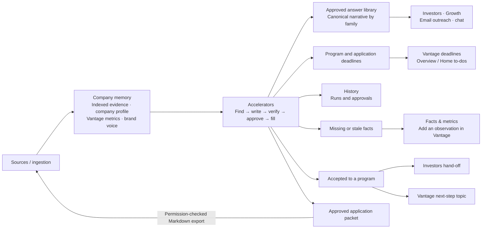

| Direction | Data or intent                                           | Concrete integration point                                                                                                                                                                                                                                                                                                                                                                             | Existing seam and boundary                                                                                                                                                                                                                                                                                                                                                                                                                                                                                                               |
| --------- | -------------------------------------------------------- | ------------------------------------------------------------------------------------------------------------------------------------------------------------------------------------------------------------------------------------------------------------------------------------------------------------------------------------------------------------------------------------------------------ | ---------------------------------------------------------------------------------------------------------------------------------------------------------------------------------------------------------------------------------------------------------------------------------------------------------------------------------------------------------------------------------------------------------------------------------------------------------------------------------------------------------------------------------------- |
| Consumes  | Permissioned Sources and indexed evidence                | `retrieveCompanySnippets({ companyId, query, policy, scope })`; obtain `scope` from the initiating actor's `documentScope()` and carry it through draft, rewrite and verification                                                                                                                                                                                                                      | Retrieval is already behind the Proposals ports (`pipelines/src/proposals/ports.ts:79-88`). The access seam is `requireWorkspaceContext()` and its lazy document scope (`apps/web/src/lib/require-workspace-context.ts:43-56,148`). The existing draft path's omitted scope is a P0 defect, not a behaviour to preserve.                                                                                                                                                                                                                 |
| Consumes  | Company facts and confirmation                           | `companyProfileApi.get()` → `GET /api/company/profile`; `companyProfileApi.patchFact()` → `PATCH /api/company/profile/facts`; Accelerators reads the composed view through `GET /api/accelerators/facts`                                                                                                                                                                                               | The shared client already exposes get, rebuild, fact edit and source selection (`apps/web/src/lib/company-profile/api.ts:43-56`). Existing profile editing requires `settings.manage` (`apps/web/src/app/api/company/profile/facts/route.ts:1-19`); the proposed explicit confirmation operation requires `proposals.approve`, as specified in flow 9. Today's manual edit is not founder approval.                                                                                                                                      |
| Consumes  | Defined, dated metric observations                       | `vantageApi.metrics()` → `GET /api/vantage/metrics`; read metric definition, value, period and source, rather than copying the latest number into another table                                                                                                                                                                                                                                        | Existing definitions and observations are returned together (`apps/web/src/app/employer/tools/vantage/api.ts:205-218`). An observation has no founder-approved boolean; a retained Vantage topic is not metric approval (`pipelines/src/vantage/schema.ts:145-172`; `pipelines/src/vantage/signals.ts:341-353`).                                                                                                                                                                                                                         |
| Consumes  | Company voice                                            | `extractBrandVoice({ companyId, toneOverride })` followed by `buildVoiceDirective(voice)` in the draft/rewrite context                                                                                                                                                                                                                                                                                 | This capability is already exported by `packages/tools/src/brand-voice/index.ts:73-102`. Voice controls style, not truth or eligibility. It cannot introduce a fact missing from company evidence.                                                                                                                                                                                                                                                                                                                                       |
| Supplies  | Approved narrative for Investors, Growth, email and chat | New vertical export `latestApprovedAnswers(companyId, family)` from `@launchstack/pipelines/proposals`; `GET /api/accelerators/answers?family=` for the tool. Investors' `onDraftInChat` can include approved one-liner, traction and team answers. Growth's compose BFF can use the same export before `POST /api/brand/posts`. Email and chat can retrieve the exported, citable packet from Sources | Investor introductions are drafts passed to chat, not sent emails (`apps/web/src/app/employer/documents/_workspace/investors/InvestorsPane.tsx:248-261`; `apps/web/src/app/employer/documents/_workspace/StudioPanes.tsx:840-847`). Growth compose already uses `POST /api/brand/posts` (`apps/web/src/app/employer/tools/growth/brand/api.ts:107-128`). Call the vertical from an app BFF or another composition; do not import it into a brick. Each consumer must apply its actor's current access scope before exposing answer text. |
| Supplies  | Deadlines and next actions                               | Extend the company-scoped feed behind `GET /api/vantage/deadlines` with cycle-backed accelerator deadlines. Overview and workspace Home to-dos link to `/employer/documents?feature=accelerators&at=/applications/<id>` or `/programs/<slug>`                                                                                                                                                          | Vantage already exposes deadlines (`apps/web/src/app/employer/tools/vantage/api.ts:261-265`). Derive accelerator entries from the company's selected program cycles/applications rather than creating duplicate manually maintained Vantage dates. Keep the original `deadline_at`, `deadline_tz`, source quote and last-confirmed time; a day-only display is not the source of truth.                                                                                                                                                  |
| Supplies  | Workspace History                                        | Add loader kind `accelerators` in `apps/web/src/server/history/loaders.ts`. Read accelerator runs and approval requests, and generate workspace-tab links through `toolTabHref("accelerators", path)`                                                                                                                                                                                                  | Shared History contracts are in `apps/web/src/lib/workspace-history.ts:19-58`. The existing Proposals loader joins company-scoped runs to application titles (`apps/web/src/server/history/loaders.ts:404-440`). A failed run remains inspectable; closing a run sheet does not cancel work.                                                                                                                                                                                                                                             |
| Supplies  | Missing facts and stale-metric work                      | `GET /api/accelerators/facts` includes gaps tied to an application, field and claim. “Add observation in Vantage” opens Vantage; `vantageApi.addObservation({ metricId, value, periodStart, periodEnd, source, note })` posts to `/api/vantage/metrics/observations`                                                                                                                                   | The existing observation input and client are defined at `apps/web/src/app/employer/tools/vantage/api.ts:92-99,215-216`. “Ask in chat” uses the context-prefill link described below. A gap is a task, not a model-generated replacement fact.                                                                                                                                                                                                                                                                                           |
| Supplies  | Accepted-program hand-off                                | `/employer/documents?feature=investors` opens Investors. The founder can pass approved answers to `InvestorsPane`'s `onDraftInChat`. For a chosen Vantage agenda, `vantageApi.addTopic(agendaId, input)` posts a private next-step topic to `/api/vantage/agendas/<agendaId>/topics`                                                                                                                   | Investors already opens as a workspace pane, and the intro callback is an existing seam (`apps/web/src/app/employer/documents/_workspace/StudioPanes.tsx:840-847`). Vantage topic creation accepts a title, decision question, proposed next step and `shared` (`apps/web/src/app/employer/tools/vantage/api.ts:101-113,231-232`). Acceptance does not automatically send outreach or share a private topic.                                                                                                                             |
| Supplies  | Answer-context chat                                      | “Ask about this answer” links to `/employer/documents?ask=<encoded-context>`; include the application, question, current answer and accessible source links, within the workspace's 4,000-character composer limit                                                                                                                                                                                     | Proposals already constructs this link (`apps/web/src/app/employer/tools/proposals/_screens/ApplicationScreen.tsx:92-98`). Workspace seeds the composer; it does not auto-send (`apps/web/src/app/employer/documents/_workspace/WorkspaceShell.tsx:1565`).                                                                                                                                                                                                                                                                               |
| Supplies  | Citable approved packets                                 | Reuse `proposalsApi.exportApplication(id)` → `POST /api/proposals/applications/<id>/export`. For `kind='accelerator'`, publish Markdown in Sources folder **Applications**, with evidence and approved packet identity                                                                                                                                                                                 | Existing export calls `uploadFile` and `processDocumentUpload` (`apps/web/src/server/proposals/service.ts:499-522`; `apps/web/src/app/employer/tools/proposals/api.ts:337-342`). The new folder/kind branch must obey the export visibility rule in §3.10. Approval is not permission to broaden an artifact's audience. No PDF, DOCX or diagram export is introduced.                                                                                                                                                                   |

### 3.2 The sub-app: screens and navigation

**Mounting.** Register tool ID `accelerators`, label **Accelerators**, in `apps/web/src/app/employer/documents/_workspace/types.ts`. Add its pane ID in `studioPaneIds.ts` and a dynamic `AcceleratorsTool` case in `StudioPanes.tsx`. The UI lives in `apps/web/src/app/employer/tools/accelerators/`: `AcceleratorsTool.tsx`, `_lib/screens.ts`, `_lib/context.tsx`, `_screens/*`, `_components/*` and `api.ts`. This follows the existing registry/pane contract, rather than adding another shell (`apps/web/src/components/tool-app/README.md:24-45`).

`AcceleratorsTool` mounts `ToolNavProvider` with `toolId="accelerators"` and roots `programs`, `applications`, `answers`, `approvals`, `facts`. Its `ToolFrame` has three groups:

- **Find:** Overview and Programs. Program detail keeps Programs active.
- **Apply:** Applications, Answers and Approvals. The editor and Fill mode keep Applications active. Approval detail keeps Approvals active.
- **Company:** Facts & metrics.

The shareable entry is `/employer/documents?feature=accelerators&at=<tool-relative-path>`. Build links with `toolTabHref`/`ToolLink`; use `useToolRouter` inside the tool. `at=/applications/<id>/fill` opens the same Fill screen whether the user follows a link from History, Vantage or a browser bookmark. The compatibility page `apps/web/src/app/employer/tools/accelerators/[[...slug]]/page.tsx` calls `redirectToToolTab`; add its prefix to `LEGACY_TOOL_ROUTES`. The redirect preserves the tool-relative location. It does not mount a second application. These are the existing navigation and compatibility conventions (`apps/web/src/components/tool-app/README.md:15-22,66-89`).

`/dev/accelerators/[[...slug]]` mounts the same tool over an accelerator simulator. It intercepts the new `/api/accelerators/*` surface and the reused Proposals/company-profile/Vantage reads needed by the screens. It supports the same reset pattern as `/dev/proposals`, and is unavailable in production. The existing simulator demonstrates this mounting boundary (`apps/web/src/app/dev/proposals/[[...slug]]/page.tsx:15-36`; `apps/web/src/app/dev/proposals/ProposalsPreview.tsx:13-70`). The extension panel has its own browser host; it is not another ToolFrame tab.

**Inherited workspace chrome.** Wireframes show the existing workspace, not an accelerator-specific sidebar:

- The left **Sources / History** rail is 280px wide by default, resizable from 220px to 520px, or collapsed to 48px. Below a 768px viewport it becomes a drawer (`apps/web/src/app/employer/documents/_workspace/RailResizeHandle.tsx:20-22`; `apps/web/src/app/employer/documents/_workspace/CollapsedRail.tsx:43-46`; `apps/web/src/app/employer/documents/_workspace/WorkspaceShell.tsx:1976-1984,2608-2616`).
- Each workspace pane retains its open-app tab strip. Accelerators sits beside Sources, chat and other tools, not outside them. Open panes stay mounted (`apps/web/README.md:112-159`).
- Inside the Accelerators tab, the shared tool bar is 44px high. It contains back/forward, the tool title, the Find / Apply / Company screen groups, run status and overflow. Under **520px of pane width**, screen tabs fold into a menu. This breakpoint follows the pane, not the browser viewport (`apps/web/src/components/tool-app/ToolFrame.tsx:220-278`).
- The screen body scrolls independently. Default padding is 32px horizontally, 24px at the top and 48px at the bottom; narrow panes use 16px horizontally and at the top. A full-height editor may use `fill` and supply its own internal padding. Evidence and run sheets cover only the tool pane (`apps/web/src/components/tool-app/ToolFrame.tsx:211-218,283-301`; `apps/web/src/components/tool-app/README.md:74-85`).

Use existing `PageHeader`, `EmptyState`, `FitMeter`, citation components and kit primitives. Use semantic design tokens and container breakpoints. In a narrow editor, move the field outline and evidence region into pane-scoped sheets; do not keep three squeezed columns. Hidden tools keep state, so global shortcuts must check `useToolActive()` (`apps/web/src/components/tool-app/README.md:17,80-86`).

**Screen contract.** Paths below are tool-relative. “Member” means an authenticated, active workspace member with the permitted company/document scope, not a public catalogue visitor. Read responses must not expose restricted quotes or answers to a member who cannot read their sources. Mutations are checked by the server even when their controls are hidden.

| Group and screen               | Path                                          | Purpose                                                                     | Primary actions                                                                                                  | Data / API read                                                                                                                                                                                 | Who can act                                                                                                                                                                                          | Empty state text                                                                                                                                                                                    |
| ------------------------------ | --------------------------------------------- | --------------------------------------------------------------------------- | ---------------------------------------------------------------------------------------------------------------- | ----------------------------------------------------------------------------------------------------------------------------------------------------------------------------------------------- | ---------------------------------------------------------------------------------------------------------------------------------------------------------------------------------------------------- | --------------------------------------------------------------------------------------------------------------------------------------------------------------------------------------------------- |
| Find · Overview                | `/`                                           | Due dates, application pipeline, next actions and company readiness         | Find programs; complete missing facts; resume application; open an approval when permitted                       | `GET /api/accelerators/programs`; `GET /api/proposals/applications?kind=accelerator`; `GET /api/accelerators/facts`; approval counts only from the authorized approvals feed                    | Member reads; `documents.edit` starts matching/applications; `proposals.approve` opens the approval queue                                                                                            | “No accelerator applications yet. Check your company facts, then find programs that fit.”                                                                                                           |
| Find · Programs                | `/programs`                                   | Catalogue with fit, eligibility, terms and next deadline                    | Filter; match to company; inspect a program; refresh a program                                                   | `GET /api/accelerators/programs`; stored company `proposal_opportunities` fit/status joined to global programs/cycles                                                                           | Member reads; `documents.edit` matches or refreshes                                                                                                                                                  | “No programs match these filters. Clear filters to view the catalogue.” If the seed is unavailable: “The program catalogue is not available yet.”                                                   |
| Find · Program detail          | `/programs/:slug`                             | Terms, batches, per-rule eligibility and form preview                       | Choose a batch; open deadline source; start application; refresh                                                 | `GET /api/accelerators/programs/<slug>`; company fact/metric references in the eligibility result; global form origin/hash                                                                      | Member reads; `documents.edit` starts an application or refreshes                                                                                                                                    | “There is no confirmed open batch. Check the program website or choose another program.”                                                                                                            |
| Apply · Applications           | `/applications`                               | Accelerator applications by status and deadline; covered by wireframe 01    | Resume writing; filter pipeline; open Fill mode; record an outcome when permitted                                | `GET /api/proposals/applications?kind=accelerator`                                                                                                                                              | Member reads; `documents.edit` edits; `proposals.approve` records submission and outcome                                                                                                             | “You have not started an accelerator application. Choose a program and a batch to begin.”                                                                                                           |
| Apply · Application editor     | `/applications/:id`                           | Typed fields, current answer, claim verdicts and evidence                   | Draft or reuse; rewrite; verify; review; mark ready; request approval; ask in chat                               | `GET /api/proposals/applications/<id>` with field/approval DTO extensions; `GET /api/proposals/runs?applicationId=<id>`; current run reads; accessible evidence references                      | Member reads; `documents.edit` writes, runs checks and requests approval; `proposals.approve` is required for the separate decision                                                                  | “No fields have been added. Use the program form, paste the questions, or capture the portal form.” A field without an answer says “No answer yet. Draft from company evidence or write an answer.” |
| Apply · Answers                | `/answers`                                    | Approved answer library grouped by question family                          | Filter family; inspect approved version and sources; use in another application                                  | `GET /api/accelerators/answers?family=<family>` over approved, access-checked `proposal_library_items`                                                                                          | Member reads accessible answers; `documents.edit` reuses an answer through an application draft/rewrite                                                                                              | “No approved answers yet. Approve your first application to build the company answer library.”                                                                                                      |
| Apply · Approvals queue        | `/approvals`                                  | Frozen answer sets waiting for an approver; historical decisions by filter  | Open a request; filter pending, approved or changes requested                                                    | `GET /api/accelerators/approvals?status=<status>`                                                                                                                                               | `proposals.approve`; requesters without that permission see their own request status and withdrawal action in the editor                                                                             | “No applications are waiting for approval.”                                                                                                                                                         |
| Apply · Approval review        | `/approvals/:requestId`                       | Review the frozen packet, verification and per-field decisions              | Approve the set; request field changes; withdraw when entitled                                                   | `GET /api/accelerators/approvals?status=` supplies authorized request packets; select `requestId` from that response. The frozen packet is not reconstructed from live answers                  | `proposals.approve` reviews/decides; requester or approver may withdraw through the withdrawal route                                                                                                 | “This approval request is no longer pending. Open the application to see the current answers.” An unknown/inaccessible request reveals no packet                                                    |
| Apply · Fill mode              | `/applications/:id/fill`                      | Portal-order answers, limits, copy state and approval gate                  | Open portal; copy one field; return to writing; confirm submission after doing it in the portal                  | `GET /api/proposals/applications/<id>` with the current approved packet and field order; copied-event state. Copy logging uses `POST /api/accelerators/applications/<id>/sections/<sid>/copied` | Member reads; `documents.edit` copies/logs; `proposals.approve` marks submitted. Unapproved manual copy is an explicit warned exception, not approval                                                | “There is no current approved answer set. Return to the application and request approval.”                                                                                                          |
| Browser · Extension side panel | Current program portal; no tool-relative path | Capture the open form and fill approved answers locally                     | Connect workspace; select application; capture visible form fields; preview mapping; fill; copy unmatched fields | `GET /api/extension/applications?url=<portal-url>`; `GET /api/extension/applications/<id>/answers`; token-authenticated capture/fill endpoints                                                  | App session plus `documents.edit` mints a token; a valid user/company token and current permission/access checks are required for use                                                                | “No approved application matches this portal. Open Accelerators to approve one, or capture this form.”                                                                                              |
| Company · Facts & metrics      | `/facts`                                      | The facts answers use, original as-of dates, freshness and missing evidence | Inspect source; confirm or correct a fact; add a Vantage observation; ask in chat; reverify affected answers     | `GET /api/accelerators/facts`, composed from company profile, Vantage metric definitions/observations and application gaps                                                                      | Member reads; `settings.manage` edits profile facts; `proposals.approve` confirms them. Vantage observation creation retains its existing active-membership guard; no new Vantage role is introduced | “Add company sources and dated metrics before drafting evidence-backed answers.”                                                                                                                    |

The active-membership guard on existing Vantage observation creation is `vantageContext()` (`apps/web/src/app/api/vantage/metrics/observations/route.ts:9-21`; `apps/web/src/app/api/vantage/_http.ts:22-34`). This is not a claim that Vantage observations already have an approval workflow.

**Relationship to Proposals.** Proposals stays installed for grants and remains frozen for grant feature work. It lists/counts only `proposal_applications.kind='grant'`. Accelerators lists/counts only `kind='accelerator'`. Existing applications migrate with the default `kind='grant'`; none is relabelled as an accelerator. Both tools share `pipelines/src/proposals`, the application/section/library/run tables, credits and `/api/proposals/applications/*` CRUD. Accelerator creation, catalogue, verification, approval and facts routes live under `/api/accelerators/*`. Shared application DTOs gain the typed field columns; application-specific accelerator actions must reject a grant ID. Do not fork the executor or copy the Proposals UI into an independently evolving grant-and-accelerator app. Existing Proposals CRUD and run methods are the reuse boundary (`apps/web/src/app/employer/tools/proposals/api.ts:319-396`).

### 3.3 User flows

All wireframes use **Northwind Cold Chain**, from `fixtures/companies/northwind-cold-chain`. Program names and values are illustrative. The copy-based pilot includes flows 1–7, 9 and 10. Flow 8 is the later extension beta, not a dependency for manual portal filling.

**Shared run behaviour.** An asynchronous writing action returns a queued Proposals run. `_lib/context.tsx` tracks it and polls `GET /api/proposals/runs/<runId>` every two seconds only while queued/running. The existing run sheet shows step, error and credits without taking the founder away from the current screen. The current executor defaults to Next.js `after()`; `PROPOSALS_EXECUTOR=worker` sends `proposals/run.requested` to `proposalsRunJob` and is recommended for cloud. These are existing seams, not a new queue (`apps/web/src/app/employer/tools/proposals/_lib/context.tsx:43-100`; `apps/web/src/server/proposals/executor.ts:59-87`; `apps/web/src/server/inngest/functions/proposalsRun.ts`). P0 must fix duplicate/stale execution and the client must stop polling a settled run. A failed check never turns an answer into verified or approved content.

#### Flow 1 — First visit: empty state, facts readiness, Overview

1. The founder opens **Accelerators** from Studio. The workspace mounts `/employer/documents?feature=accelerators&at=/`. The client reads `GET /api/proposals/applications?kind=accelerator`, `GET /api/accelerators/programs` and `GET /api/accelerators/facts`. With no applications, Overview shows the first-use text, **Check company facts** and **Find programs**. It does not populate a fake pipeline.
2. The founder chooses **Check company facts**. Navigation goes to `/facts`. The facts response combines the existing company profile, `vantageApi.metrics()` observations and unresolved application gaps. It distinguishes missing values, evidence-backed values and stale values. A profile's `builtAt` is assembly time, not the date on which revenue was true. There is no existing founder-approved fact/metric bit to infer from a manual override (`pipelines/src/company-metadata/views.ts:62-89`; `pipelines/src/proposals/profile.ts:32-65`).
3. If the workspace has no evidence, **Add knowledge** uses the existing Sources controls. Upload/import enters the normal `source.version.created` → extraction → indexing → company-state projection jobs. No accelerator ingestion path is created (`REPOSITORY.md:90-103`). A company-profile rebuild uses the existing `POST /api/company/profile` route. Until the evidence is usable, gaps remain named and drafting cannot invent replacements.
4. The founder inspects existing facts and metric periods. A permitted user can confirm/correct profile facts or add a dated Vantage observation as in flow 9. Readiness is a checklist of available and current inputs, not a promise that the company is eligible or will be accepted. Browsing the catalogue is allowed before readiness is complete; unknown facts produce **unknown** eligibility verdicts.
5. Returning to `/` shows readiness beside deadlines and next actions. **Find programs** opens `/programs`; matching only starts when the user chooses it. No `programs`, `draft`, `verify` or `review` run is launched by opening Overview. Catalogue seed/refresh jobs are independent of this visit.

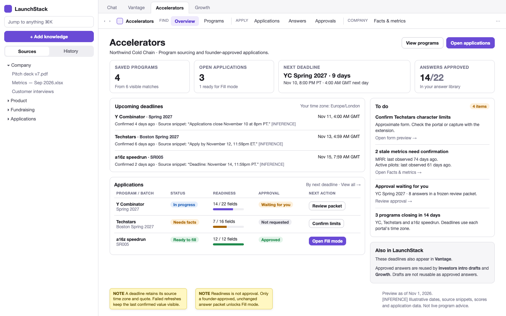
_Regions: workspace Sources/History rail, pane tabs, Accelerators tool bar, readiness summary, deadline queue, application pipeline and next actions._

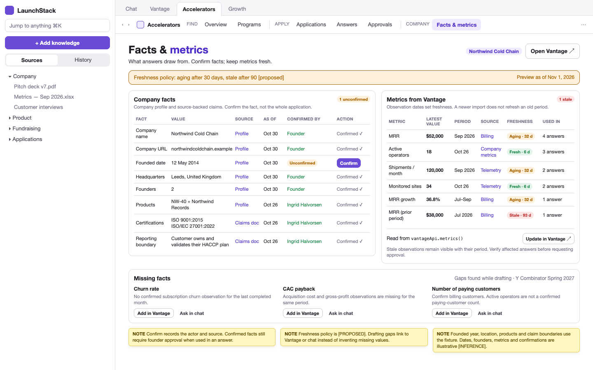
_Regions: company readiness summary, sourced facts, dated Vantage observations, freshness badges and missing-fact actions._

#### Flow 2 — Find and match programs

1. The founder opens `/programs`. `GET /api/accelerators/programs` joins the global catalogue and cycles to this company's stored opportunity fit/status. An unscored program says **Not matched yet**, not zero fit. Stage, location, format, sector, deadline and terms filters operate on the returned catalogue data.
2. **Match to company** calls `POST /api/accelerators/programs/match` with `documents.edit`. It starts run kind **`programs`** through the shared executor. The run loads the current company facts and defined, dated metrics. `testEligibility(rules, facts)` returns pass/fail/unknown with the input fact reference for each rule. A hard fail is hidden by default but available under **Show ineligible**; a missing fact remains unknown rather than being silently treated as pass.
3. After the deterministic eligibility stage, the `fast` model route scores fit using stage, traction, sector, geography, format and terms. It supplies `Fit { score, why, concerns }`, not a new eligibility fact. The run upserts company-scoped `proposal_opportunities` with `source='catalogue'`, `program_id` and `cycle_id`, preserving human pipeline choices. The existing fit batching and status-preserving upsert are the reuse seams (`pipelines/src/proposals/stages.ts:104`; `pipelines/src/proposals/db.ts:201-232`).
4. The founder reads the fit explanation, unknown eligibility facts and next batch deadline. The card links to the source quote and displays timezone and last-confirmed time. Opening a program navigates to `/programs/<slug>` without starting another run.
5. **Refresh now** calls `POST /api/accelerators/programs/<slug>/refresh`. It dispatches `accelerators/program.refresh.requested`, debounced to one program/hour. The worker fetches and quote-checks program data. Separately, `accelerator-catalogue-refresh` runs Mondays at `0 6 * * 1`, with one step per program and concurrency two. A self-host without Inngest uses the rate-limited inline per-program refresh. Fetch/extraction failure leaves the last confirmed catalogue data visible with its error; it does not erase a deadline or disguise an old value as fresh.

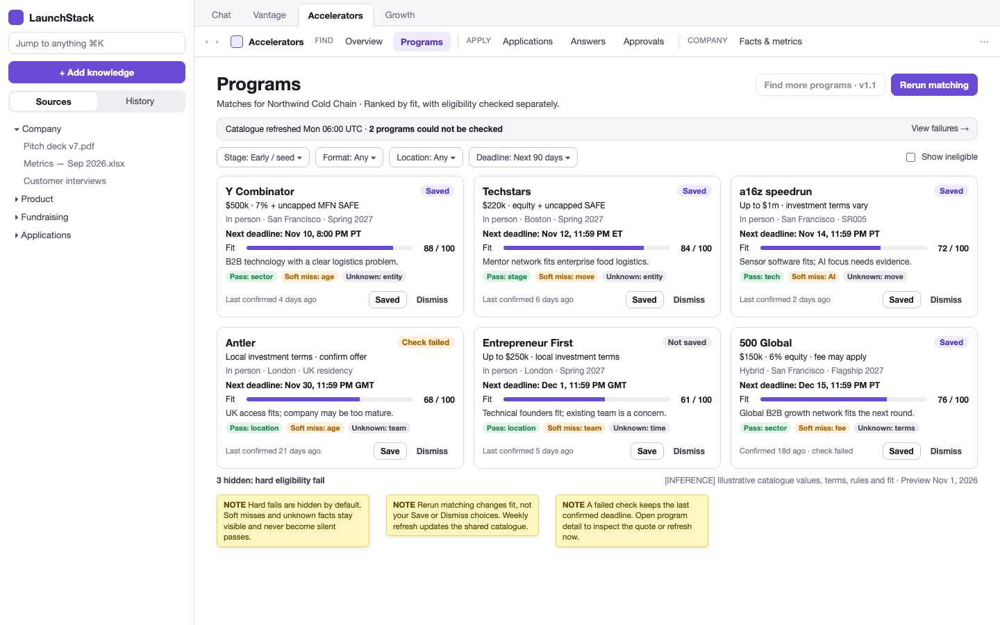
_Regions: shared workspace chrome, program filters, match action/run status, program cards, eligibility badges, fit explanations and sourced next deadlines._

#### Flow 3 — Inspect a program and start an application from a batch

1. At `/programs/<slug>`, `GET /api/accelerators/programs/<slug>` returns terms, source quotes, batches/rolling cycle, eligibility verdicts and form preview. The founder checks the program's actual site, the deadline timezone and the distinction between a hard rule and a fit preference. Browsing creates no run.
2. The founder explicitly chooses a cycle, such as **Y Combinator · Spring 2027**. **Start application** calls `POST /api/accelerators/applications` with `cycleId` and the selected form source. The server resolves the cycle's program, scopes the application to the actor's company, sets `kind='accelerator'`, and records `program_id`, `cycle_id`, `form_origin` and `form_hash`. It snapshots the form into typed `proposal_sections`, preserving portal order. Another company's application is never the template for this request.
3. If the form comes from a curated seed, the confirmation view says **Approximate form. Confirm questions and limits in the portal.** Its fields have `limit_confirmed=false`. An already structured catalogue form needs no model extraction run. The founder lands at `/applications/<id>` with empty fields and the selected batch deadline.
4. For a public static form, pasted questions or an indexed Source, reuse `PATCH /api/proposals/applications/<id>` for the request inputs and `POST /api/proposals/applications/<id>/extract`, which starts **`extract`**. Extraction produces `FormField` values, families, types, required flags, options and separate word/character limits. An empty/login-only page produces an actionable paste/capture fallback, not invented questions. Static `fetchReadable` does not execute JavaScript or use portal cookies (`packages/tools/src/web-research/fetch.ts:226,299`; `pipelines/src/proposals/run.ts:336-346`).
5. A changed form is shown as a field/limit diff before replacing an answer-bearing form. Reconcile stable `field_key` values; do not silently discard written answers or retain approval against an old `form_hash`. The extension can later confirm the open portal's observable fields and limits through flow 8. File and video requirements are checklist items from the beginning, not empty essay prompts.

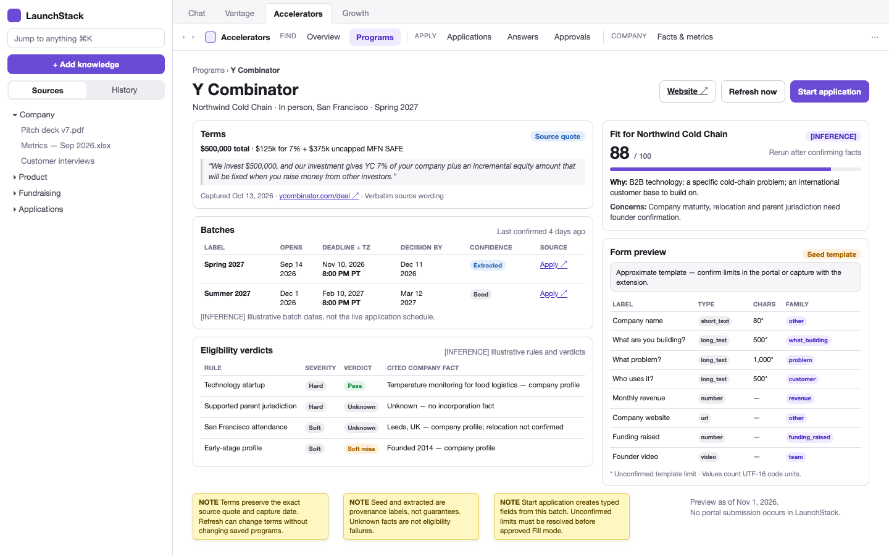
_Regions: program identity and source links, funding/format terms, batch selector and deadline, eligibility evidence, form preview and Start application action._

#### Flow 4 — Write: reuse first, limits, claim check, evidence, rewrite, ready

1. The editor at `/applications/<id>` reads `GET /api/proposals/applications/<id>` and the application's live runs. Its three working regions are the portal-order field outline, the current field and the evidence panel. Each field displays type, family, required state, limit and whether the limit was confirmed.
2. **Draft field** or **Draft empty fields** calls `POST /api/proposals/applications/<id>/draft` with the selected `sectionIds`, starting **`draft`**. For each prose field, the pipeline first looks for an approved, access-permitted, fresh library item in the same question family. A fitting answer is reused without a generation call and records a `reused` section event. An over-limit candidate is offered for tightening; it is not truncated. Only when no suitable reusable answer exists does the pipeline generate from scoped Sources, company-profile facts, Vantage observations and the brand-voice directive.
3. Non-prose fields take a separate path inside answer preparation. URL, email, number, date and option fields use deterministic fact mapping, with unknown values left unresolved. Only supported options can be selected. File/video fields remain manual checklist items; a video talking-points script, if requested, is clearly not a portal upload. The model is not asked to invent an upload or turn a URL into an essay.
4. The editor counts characters as **UTF-16 code units**, matching the field contract. A `char_limit` is hard, with no tolerance and no silent trimming. For an unconfirmed limit, draft/rewrite targets 90% headroom and retains the warning. Word limits remain separate. An answer that passes a word meter can still fail a character limit.
5. Draft/rewrite finishes with claim verification; **Check claims again** calls `POST /api/accelerators/applications/<id>/verify` for a standalone **`verify`** run. `draft_meta.claims` ties sentence/claim hashes to cites, verdicts and check times. Checks distinguish unsupported content, a source that does not entail the claim, a superseded document version and an out-of-date metric. Model failure leaves the affected check unverified. It never receives a green verdict because it has a citation number.
6. Selecting a claim opens its evidence in the right region: source title, quote, page/anchor, version, original as-of date and freshness. A metric also shows its definition and reporting period. “Ask about this answer” prepares `/employer/documents?ask=<encoded-context>` but does not send it. Restricted evidence is checked against the reader's current document scope before the quote or derived answer is shown.
7. **Rewrite** calls `POST /api/proposals/applications/<id>/sections/<sid>/rewrite`, starting **`rewrite`**, with the selected preset/instruction. The same limits, reuse provenance and verification rules apply. A manual answer edit uses `PATCH /api/proposals/applications/<id>/sections/<sid>`; changed claim hashes become unverified and the changed field becomes `edited`. Either kind of text change supersedes a pending/approved packet that contained the old text. The unchanged frozen packet is retained as history, not rewritten in place.
8. **Mark ready** uses the section PATCH with `status='ready'`. This records writer intent, not founder approval. Required-field, attachment, exact-limit and verification blockers remain visible. **Review application** calls `POST /api/proposals/applications/<id>/review`, starting **`review`**, to aggregate checklist/readiness findings. Review is not an approval decision. Only the explicit request/decision flow below authorizes the approved set for normal Fill mode.

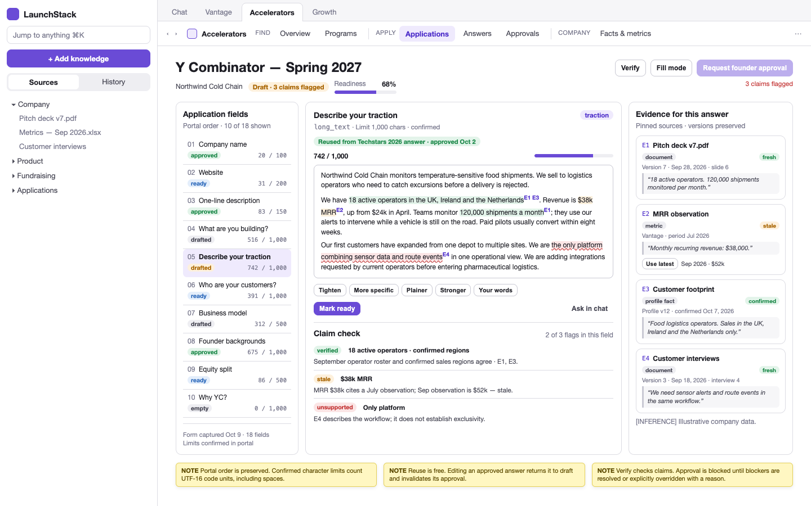
_Regions: portal-order field outline, answer editor and character meter, reuse/verification status, ready/rewrite actions, claim selection and source evidence panel._

#### Flow 5 — Build the answer library and reuse across programs

1. The first successful approval in flow 6 writes the accepted answers to `proposal_library_items` with `family`, `as_of`, `approved_at`, `approved_by` and `source_program_id`, preserving evidence references. Writer-ready status alone does not add an approved answer. Existing manually saved library items remain unapproved candidates until they pass the new workflow; old saves are not retroactively founder-approved.
2. At `/answers`, `GET /api/accelerators/answers?family=traction` returns the accessible approved versions for that family, including source application/program, approval date and original metric/evidence dates. The founder can inspect what was approved and which evidence supports it. Merely reading/filtering the library starts no run.
3. In a second program's editor, **Use company answer** invokes the normal `POST /api/proposals/applications/<id>/draft` **`draft`** path for that field. Family-first matching precedes keyword relevance. A compatible fresh item is copied as-is, its library ID is attached to the draft, and a `reused` event is recorded. Reuse itself has no generation charge; verification still follows the normal verification contract. The new application does not inherit the previous application's approval.
4. If the approved answer exceeds the new program's limit, **Tighten for this field** calls the section rewrite route and starts **`rewrite`**. New text must be verified and approved for the new application. A stale claim or superseded evidence version disqualifies an item from fresh reuse; the UI points to Facts & metrics or offers a new evidence-backed draft rather than presenting the old number as canonical.
5. New approval produces a new approved version. `latestApprovedAnswers(companyId, family)` selects the current eligible version for suite consumers, while old approvals remain inspectable. Editing an answer is done in an application and re-enters approval; the Answers screen does not let a writer edit already approved library text in place. **Export packet** uses `POST /api/proposals/applications/<id>/export` so email/chat can retrieve a citable Sources artifact without gaining an unreviewed private draft.

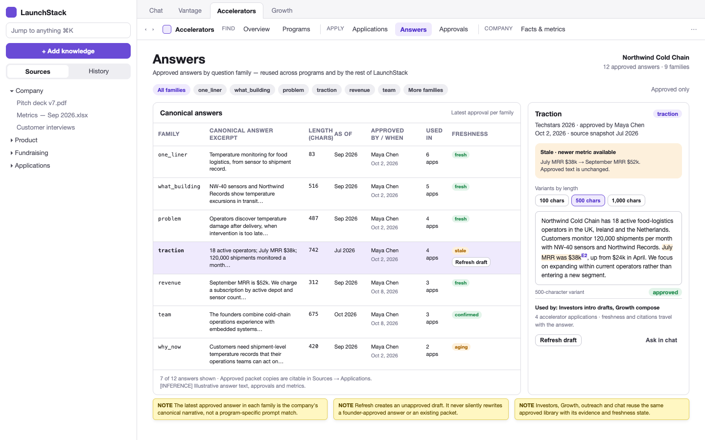
_Regions: family filters, canonical approved answer, approval/program provenance, original as-of/freshness state, evidence links and reuse action._

#### Flow 6 — Founder approval: request, frozen review, changes, approve, supersede

1. The writer finishes `verify` and `review` as in flow 4 and marks the intended fields ready. **Request approval** calls `POST /api/accelerators/applications/<id>/approval-requests` with `documents.edit`. The server validates the field set and current evidence, then writes a `proposal_approval_requests` row containing a frozen `packet`, `packet_hash`, requester and optional assigned approver. The packet includes the exact answers, field identities/order/limits, form hash, evidence and verification snapshot. It records `approval_requested` section events and audit action `proposal.approval_requested`.
2. The editor shows the pending request and a shareable `/approvals/<requestId>` tool link. The request is discoverable in the approver's queue. There is no claim that an email or push notification was delivered: the repository has no notification inbox and its auth sender does not deliver mail (`apps/web/src/server/auth/email.ts:32-39`). A requester can copy the review link using their normal communication channel.
3. A holder of `proposals.approve` opens `/approvals` and reads `GET /api/accelerators/approvals?status=pending`; selecting a request opens `/approvals/<requestId>`. The review renders the **frozen** packet, not today's mutable editor state. Per-field evidence and the current source-access/freshness checks are visible. If the underlying source version or latest metric changed, fresh use is blocked until re-verification and a replacement approval; the old packet is not silently updated.
4. The approver can mark individual fields **Accept** or **Request changes**, with a reason for each changed field. `POST /api/accelerators/approval-requests/<rid>/decision` carries the packet hash and section decisions. The server rechecks `proposals.approve`, company membership, source access and the current packet hash in the decision transaction. Any answer/form/limit change since the request returns **409** and supersedes the request. The reviewer must open a new frozen set; there is no “approve whichever version is current” fallback.
5. A changes decision sets `changes_requested`, records field decisions/events and audit action `proposal.changes_requested`, and sends the writer back to the named fields. Revised text goes through `rewrite` or section PATCH, `verify` and a new approval request. It does not mutate the prior packet. Any permitted override requires the approver's explicit `override_reason`; it cannot relabel a failed claim as source-verified.
6. Accepting every required field sets the request to `approved`, records `approved` events and audit action `proposal.approved`, and writes the approved answer-library versions. Normal per-field copy and extension answers now use that exact approved set, subject to current access/freshness checks. `proposals.approve` is owner-held by default and grantable to custom roles; there is no new built-in `founder` role and the permission is not owner-only.
7. A later answer, field constraint or form edit supersedes the pending/approved request. The editor shows **Approval out of date** and disables normal approved Fill use until a new request is approved. `POST /api/accelerators/approval-requests/<rid>/withdraw` lets the requester or an approver withdraw; it records `proposal.approval_withdrawn`. Reading, deciding and withdrawing a request are transactional CRUD actions, not new model run kinds.

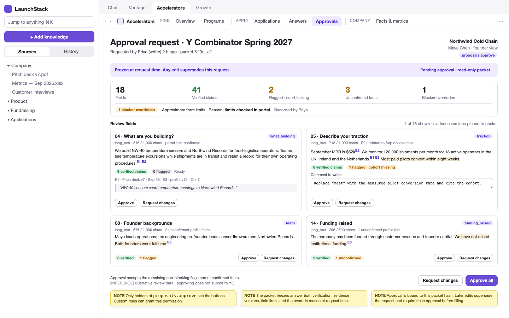
_Regions: request identity and frozen-version banner, field review list, answer/evidence comparison, per-field changes, overall approval controls and decision history._

#### Flow 7 — Fill the portal by copy

1. The writer opens `/applications/<id>/fill`. `GET /api/proposals/applications/<id>` supplies portal-order fields, the current approved packet identity and copy state. The screen shows the selected program/batch, approval date and a prominent **Open portal** link. A stale/superseded packet is not shown as currently approved. This is a synchronous read; no `draft`, `verify` or `review` run starts automatically.
2. **Copy** places only that field's plain answer text on the local clipboard: no Markdown heading, citation marker, source quote or approval footer. The field still shows type, exact count, limit and limit-confirmation state in LaunchStack. A failed clipboard operation leaves the field uncopied and offers manual selection; do not log success before the clipboard promise resolves.
3. After a successful copy, call `POST /api/accelerators/applications/<id>/sections/<sid>/copied` with the copied draft hash. The server requires `documents.edit`, verifies that the hash matches the copied version and appends a `copied` event. **Copied** means only that LaunchStack copied text; it does not claim the portal accepted, saved or submitted it.
4. An unapproved answer is outside normal approved Fill. If the writer explicitly chooses **Copy unapproved**, show a one-click warning naming the lack of current approval, then log the warned copy against its draft hash. That action neither creates approval nor becomes available to the extension. Over-limit and unconfirmed-limit warnings remain visible. File/video requirements remain manual uploads in the portal; LaunchStack does not pretend they were satisfied by copying text.
5. The founder pastes and checks each answer in the actual portal, completes uploads and presses the portal's submit control themselves. Only after that can a `proposals.approve` holder call `PATCH /api/proposals/applications/<id>` with `status='submitted'`. The server stamps `submitted_at` and audits `proposal.submitted`. Copying every field cannot trigger this PATCH. No portal action, copy event or browser close automatically marks the application submitted.

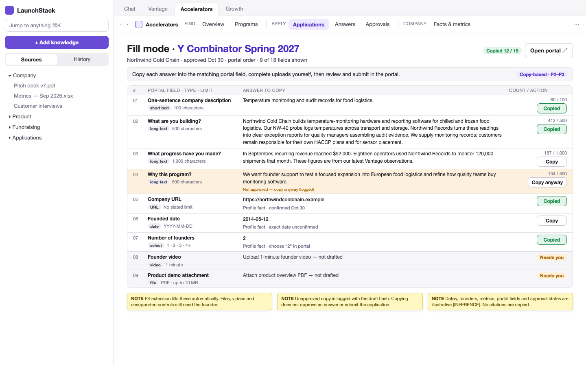
_Regions: program/batch and approval summary, Open portal action, ordered answer cards, character meters, per-field Copy/Copied controls and manual attachment checklist._

#### Flow 8 — Extension capture and fill; never submit

1. The founder connects the Manifest V3 extension to a workspace from the app. `POST /api/extension/token` requires a live app session and `documents.edit`; it mints a short-lived user/company-scoped bearer token. Only its SHA-256 hash is stored in `extension_tokens`. The default TTL is 60 minutes, configurable through `EXTENSION_TOKEN_TTL_MINUTES`. The extension never asks for a program-portal password or transfers portal cookies to LaunchStack. CORS accepts only `EXTENSION_ALLOWED_ORIGINS`.
2. With the portal open, the founder opens the extension side panel. `GET /api/extension/applications?url=<normalized-portal-url>` finds company applications by canonical portal origin/path. Send only the URL needed for matching, not authentication-bearing query values. If more than one application matches, require the founder to choose the program/batch. A matching URL alone cannot authorize access to another company's application.
3. **Capture this form** reads observable labels, field types, order, required flags, `maxlength` and options from the current page. `POST /api/extension/forms` sends the selected application and `FormField[]`. `fieldKey` is a stable field identifier, not a brittle raw selector; `options` stores `{ value, label }` pairs so a displayed option label is not confused with its actual control value. Capture excludes cookies, hidden credentials, existing input values and unrelated page content. Store the captured definition with that company's application; the extension does not publish a private portal capture into the global catalogue. Captured constraints are confirmed only where the DOM exposes them. A multi-step form is not declared complete because the current step was captured.
4. The app compares the captured form hash to `form_hash`. It shows added/changed fields and limits and reconciles stable `field_key` values before replacing an answer-bearing form. A changed packet supersedes approval. The founder returns to the editor for missing answers, **`draft`** / **`rewrite`**, **`verify`** and approval as needed. The capture endpoint itself is not a model run and cannot bless an existing answer set.
5. **Preview fill** calls `GET /api/extension/applications/<id>/answers`. The server returns only the current approved answers after token, membership, permission, evidence-access and freshness checks. Map by `field_key` first; label/family matching is a preview aid, not permission to fill an uncertain control. Unmatched or ambiguous fields remain listed for manual copy. Unapproved text is never returned by this endpoint, even if the app permits a warned manual copy.
6. On the founder's **Fill approved answers** action, the content script writes the previewed values to supported controls and dispatches the appropriate input/change events. It respects current field limits and supported options; it does not silently truncate prose. Plain HTML, Google Forms and Tally are the initial adapter targets **[INFERENCE: exact vendor coverage must be confirmed by the extension spike]**. Unsupported custom widgets or a new page step fall back to copy/capture rather than broad DOM guessing.
7. `POST /api/extension/applications/<id>/filled` records filled/unmatched field results and `filled` section events tied to the approved hashes. It feeds `pdr_extension_fill_fields_total{result="filled|unmatched"}`. An expired/revoked token stops API use and asks the founder to reconnect; a DOM mismatch leaves the control alone. **Disconnect** uses `DELETE /api/extension/token/<tokenId>`, requiring an app session and either token ownership or `members.manage`, and records `extension.token_revoked`. These routes are authenticated CRUD/logging operations; they do not start a writing run or mark an application submitted.
8. The founder reviews the portal. **The extension never clicks Submit, Next, payment, consent or any other consequential portal control.** The founder navigates steps and submits themselves. The submission/status PATCH remains the explicit action in flow 10. The extension is a browser deployable, not a server-side browser; static page fetch, Gotenberg and the document converter are not used to impersonate the logged-in portal session.

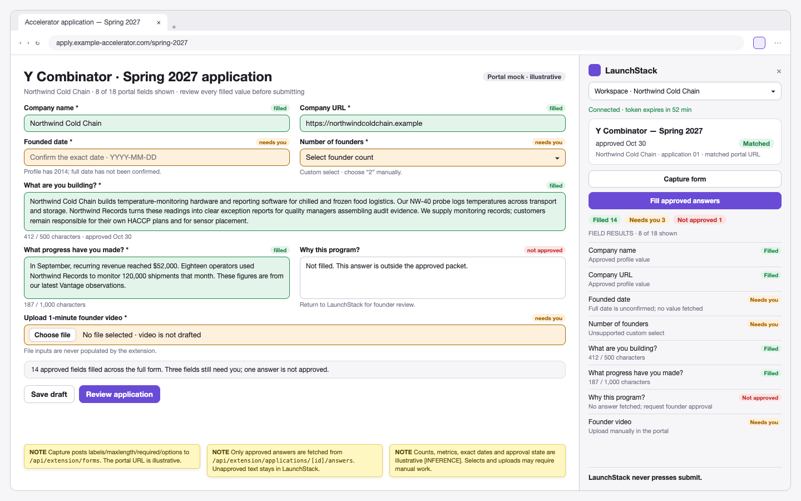
_Regions: the founder's live portal, connected-workspace side panel, application/batch match, capture and approval state, field-mapping preview, Fill action and unmatched-field fallback._

#### Flow 9 — Keep facts fresh: gaps, confirmation and Vantage observations

1. A missing or stale claim in the editor links to `/facts`, optionally selecting its fact/metric row. `GET /api/accelerators/facts` returns profile facts, Vantage definitions/observations and gaps with the originating application/section/claim. Rows show original evidence dates and metric periods separately from last checked and last confirmed times. The proposed product metric policy is aging after 30 days and stale after 90 days; it is an explicit policy choice, not the evidence package's existing default of 30/180 days (`packages/evidence/src/version-freshness/index.ts:8-26,57-72`).
2. For a document-backed fact, **Open source** opens its accessible Source and stable anchor. **Correct fact** uses `companyProfileApi.patchFact()` → `PATCH /api/company/profile/facts` with the existing `{ path, value, label? }` payload under `settings.manage`. A manual correction remains visibly manual. It does not prove that a historical source now contains the new value, nor does it automatically approve an application answer.
3. **Confirm fact** needs an explicit operation rather than rewriting the same value as a fake new source. **[PROPOSED]** Extend the same PATCH route with a separate payload `{ path, confirm: true, expectedValueHash }`, gated by `proposals.approve`, not `settings.manage`. The server compares the canonical current value hash and returns 409 if it changed. Persist `{ confirmed_by, confirmed_at, value_hash, as_of? }` on that fact inside `company_metadata` JSONB; advance the company-context metadata schema from `1.1.0` to `1.2.0`, with no new SQL column/table. Actor/time come from the server. Record audit action `proposal.fact_confirmed` in the same transaction. Preserve the evidence's original version, quote and `sourceDate`; confirmation time is not an observation date. A rebuild that changes the value clears confirmation. A `manual_override` is not confirmation, and an unmatched confirmation hash is not current confirmation. This is attributed founder attestation, not a new metric-approved boolean or automatic answer approval.
4. For a stale or missing metric, **Add observation in Vantage** opens Vantage with the metric selected. The founder supplies value, reporting period, reviewable source and note. `vantageApi.addObservation()` posts to `POST /api/vantage/metrics/observations`; use the existing definition, or create an explicitly defined metric through `POST /api/vantage/metrics` first. Never update MRR by merely changing a timestamp on its old observation. Observation creation is synchronous existing Vantage CRUD, not an accelerator run.
5. **Ask in chat** prepares `/employer/documents?ask=<encoded-gap-context>` with the missing definition/period and accessible source context. It does not send a message, collect an observation or resolve the gap by itself. If evidence must be uploaded, the normal Sources ingestion/projection jobs update company memory; the gap is not closed until that input is usable.
6. Returning to the application, **Check claims again** calls `POST /api/accelerators/applications/<id>/verify`, starting **`verify`**. If the changed fact requires new wording, the writer uses the normal section PATCH or **`rewrite`** route first. New verification cannot mutate the old approval packet. Affected answers must pass a new approval request before normal Fill/extension use. The library retains historical as-of values but excludes stale/superseded answers from fresh canonical reuse.


_Regions: sourced company facts, separate confirmation/as-of dates, Vantage metric definitions and periods, freshness warnings, application-linked gaps and add-observation/chat actions._

#### Flow 10 — After submission: track outcomes and hand off acceptance

1. After submitting in the real portal, a `proposals.approve` holder records **Submitted** through `PATCH /api/proposals/applications/<id>` with `status='submitted'`. The server checks company/application kind and permission, stamps `submitted_at` once and records `proposal.submitted`. `/applications` and `/` read the changed status through the accelerator-filtered applications API. Neither a completed writing run nor a `copied`/`filled` event can make this transition.
2. When the program responds, the same permitted user records **Interview**, then **Accepted** or **Declined**, through the application PATCH. **[PROPOSED]** Add accelerator statuses `interview` and `accepted`; retain grants' existing `awarded` status. The accelerator path is `submitted → interview → accepted|declined`, with a direct `submitted → accepted|declined` allowed for programs without interviews. Preserve withdrawal as a separate outcome. These are founder-recorded outcomes, not inferred from portal DOM, email text or a model verdict. No new `programs`, `draft`, `verify` or `review` run is involved.
3. The outcome is available to instrumentation by joining persisted application status/program/cycle to `proposal_section_events`, approved packet hashes and submission audit time. The success report can segment source-verified founder-accepted answers by eventual application outcome. It must not report a copied field as a submitted application, or a high approval ratio as program acceptance. History continues to show accelerator runs and approvals with links to the application; the application is the authoritative current outcome record.
4. **Plan fundraising in Investors** opens `/employer/documents?feature=investors`. The founder can use the canonical approved one-liner, traction and team answers via `latestApprovedAnswers(companyId, family)` in an `onDraftInChat` intro draft. This is a hand-off, not an automatic investor email or a new claim that the program invested on specific terms.
5. **Add next step to Vantage** reads `GET /api/vantage/agendas`, lets the founder choose an agenda, then uses `vantageApi.addTopic(agendaId, { title, decisionQuestion, proposedNextStep, shared: false })` → `POST /api/vantage/agendas/<agendaId>/topics`. The topic can ask who will own the program, reporting obligations and fundraising plan. If there is no agenda, open Vantage's normal agenda-creation flow instead of silently creating a meeting. The acceptance hand-off is an explicit founder action and respects Vantage's existing access/sharing rules.
6. The founder may export the approved packet using `POST /api/proposals/applications/<id>/export` for citable Sources history. The packet's approval, source versions and original metrics remain historical facts; recording acceptance does not refresh them. Later investor/Growth/email work must use current, access-permitted canonical answers, not blindly reuse a once-successful but now stale application.


_Regions: application status pipeline, deadline/next-action queue, submitted/interview/outcome state and explicit Investors/Vantage hand-off actions from the selected application._

### 3.4 System architecture

Accelerators is a Studio tool, not a separate web shell. Its browser entry is `/employer/documents?feature=accelerators&at=<tool-relative-path>`. `AcceleratorsTool.tsx` mounts inside the existing workspace pane. The old `/employer/tools/accelerators/...` route only redirects to that tab. This follows the current tool contract (`apps/web/src/components/tool-app/README.md:3-22,24-31`).

The component diagram separates a public catalogue from private company work. The browser extension is a separate application. It calls the web BFF over HTTP. It does not run the server-side pipeline or hold model, storage, or Inngest credentials.

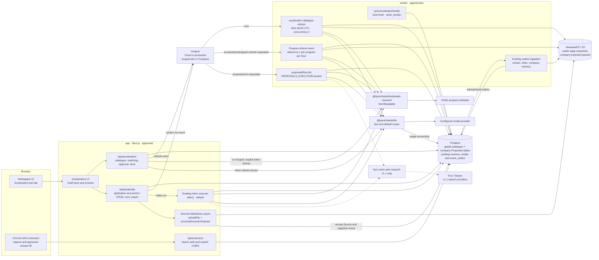

The `app` accepts commands, authorizes reads and mutations, and renders the UI. The worker remains the durable coordinator. Inline Proposals execution is the existing `after()` option, not a new durable web scheduler. Production should select the worker executor. The worker already consumes the ingestion outbox and serves Inngest at `:8020/api/inngest` (`REPOSITORY.md:28-30,90-109`; `docs/deployment.md:65`; `apps/web/src/server/proposals/executor.ts:59-87`).

Catalogue refresh reads public pages only. `fetchReadable` performs SSRF checks, checks each redirect, permits at most three redirects, caps the response at 2 MB and times out after 15 seconds. It strips scripting content and does not run JavaScript. A login wall or client-rendered form is not a reason to add a headless-browser service. The founder uses paste or extension capture instead (`packages/tools/src/web-research/fetch.ts:97,125,226,299`; `pipelines/src/proposals/ports.ts:96-102`).

**Layers and dependency direction**

| Layer                                | Code home                                                                                                                                                                | Responsibility                                                                                                                                                  | Allowed direction and boundary                                                                                                                                                                                               |
| ------------------------------------ | ------------------------------------------------------------------------------------------------------------------------------------------------------------------------ | --------------------------------------------------------------------------------------------------------------------------------------------------------------- | ---------------------------------------------------------------------------------------------------------------------------------------------------------------------------------------------------------------------------- |
| Bricks: evidence and retrieval       | `packages/evidence/src/`; `packages/retrieval/src/`                                                                                                                      | Stable citation anchors, freshness and supersession functions, scoped retrieval, typed evidence metadata.                                                       | Pure evidence functions receive `now` and current-version IDs. Bricks never import a product vertical. The existing anchor-key format remains the format for document citations.                                             |
| Bricks: tools                        | `packages/tools/src/web-research/`; `packages/tools/src/company-context/`; `packages/tools/src/brand-voice/`                                                             | Static public-page fetching, v1.1 non-news provider mode, company-context contracts and brand-voice extraction.                                                 | Tools may import runtime, evidence, store, llm, retrieval and conversion. They must not import pipelines. Environment reads stay in a tool's `config.ts`. No accelerator catalogue or approval workflow is moved into tools. |
| Bricks: model, storage and ingestion | `packages/llm/`; `packages/store/`; `packages/orchestration/`; existing conversion and indexing packages                                                                 | Model transport and usage, database/storage access, transactional source acceptance and outbox processing.                                                      | Existing dependency graph is reused. Engine migrations do not refer to Accelerators product tables.                                                                                                                          |
| Composition: Proposals vertical      | `pipelines/src/proposals/types.ts`, `schema.ts`, `db.ts`, `ports.ts`, `stages.ts`, `run.ts`, `render.ts`; new `accelerators/`, `forms/`, `verify/` folders               | Catalogue/seed/eligibility and matching; typed forms/families/reuse; claims/verification/frozen approval contracts; application runs and approved-answer reads. | Pipelines import bricks. They must not import `~/*`, Next.js, React or Clerk. Product schema stays in the vertical. Read-only use of company-metadata and Vantage is a sibling-vertical dependency, not a brick dependency.  |
| Web application                      | `apps/web/src/app/employer/tools/accelerators/`; `apps/web/src/server/accelerators/`; `/api/accelerators/**`, `/api/proposals/**`, `/api/extension/**` route directories | Workspace UI, BFF DTOs, session/token auth, permission checks, CORS, audit and Sources export integration.                                                      | Routes call the vertical and inject actor/document scope. Server-only auth does not leak into pipelines. Shared UI uses `~/components` and `~/lib`; there are no imports across employer and employee route areas.           |
| Worker application                   | `apps/worker/src/inngest.ts`; new refresh functions in `apps/web/src/server/inngest/functions/`; worker boot hook calling `syncAcceleratorSeed()`                        | Seed sync, catalogue scheduling, event-driven refresh, worker-mode Proposals runs and existing ingestion.                                                       | Register functions in the worker's existing Inngest function array. Reuse the shared engine composition root. Do not create an Inngest endpoint in the web application.                                                      |
| Extension application                | `apps/extension/`                                                                                                                                                        | Manifest V3 service worker, content script and side panel; field capture and user-triggered fill.                                                               | It is its own workspace app, not an `@launchstack/tools` brick. It uses HTTP DTOs and browser-safe contracts. No imports from `~/`, web server modules, database clients or model-provider code.                             |

The lint-enforced boundaries are `eslint.config.js:374-378` (bricks cannot import pipelines), `:591-604` (tools' allowed brick imports), `:621-639` (pipeline framework and `~/*` ban), and `:665-690` (route-area imports). The published compositions tier and the engine configuration direction are documented at `REPOSITORY.md:47,60-87`. The extension boundary is a new application constraint, not a claim that an extension exists today.

### 3.5 Infrastructure and deployment

**Placement**

No new server or Compose service is required. The new deployable is the browser extension. New catalogue and approval data is applied through the existing product migration set.

| Component                                                                   | Runs in                                                                                                                                        | Deployed as                                                                                                        | Storage                                                                                                                                      | Reused/New                                                   | Why there                                                                                                                                                                  |
| --------------------------------------------------------------------------- | ---------------------------------------------------------------------------------------------------------------------------------------------- | ------------------------------------------------------------------------------------------------------------------ | -------------------------------------------------------------------------------------------------------------------------------------------- | ------------------------------------------------------------ | -------------------------------------------------------------------------------------------------------------------------------------------------------------------------- |
| Accelerators UI and BFF routes                                              | `app`, Next.js in `apps/web`                                                                                                                   | GHCR `launchstack-web`                                                                                             | Reads/writes Postgres through the vertical; no separate UI store.                                                                            | Reused runtime; new tool and routes.                         | It needs the workspace host, first-party session, permissions and synchronous company reads.                                                                               |
| Curated seed sync                                                           | Worker boot hook `syncAcceleratorSeed()`                                                                                                       | GHCR `launchstack-web-worker`                                                                                      | Global catalogue tables; idempotent by program `seed_version`.                                                                               | New code; reused runtime.                                    | A release ships a reviewed seed. Boot sync needs neither a user session nor Inngest. It runs even when network refresh is disabled.                                        |
| Weekly catalogue refresh                                                    | Worker Inngest function `accelerator-catalogue-refresh`; cron `0 6 * * 1`, Monday 06:00 UTC; one durable step per program; concurrency 2.      | Worker image; Inngest Cloud in production or `inngest-dev` locally.                                                | Postgres plus S3 key `accelerators/pages/<slug>/<sha256>.txt`.                                                                               | New function; reused scheduler, database and object storage. | Public facts are fetched once for the deployment, not once per company. Each program can fail without discarding the rest of the refresh.                                  |
| On-demand program refresh                                                   | Worker event `accelerators/program.refresh.requested`, debounced to one per program per hour; inline web fallback only when Inngest is absent. | Worker image, or existing web runtime for explicit fallback.                                                       | Same catalogue tables and snapshots.                                                                                                         | New event/function; reused runtimes.                         | A founder can confirm a near deadline without triggering a full catalogue scan.                                                                                            |
| Writing runs: `programs`, `extract`, `draft`, `rewrite`, `verify`, `review` | Existing `startProposalRun`; default inline `after()`; `proposalsRunJob` when `PROPOSALS_EXECUTOR=worker`.                                     | Web or worker image.                                                                                               | Company-scoped `proposal_runs`, applications, sections, library and events.                                                                  | Reused executor and tables; new stages/kinds.                | It preserves the existing run lifecycle and metering. Worker mode is recommended for cloud durability and concurrency control. The grants `funders` run remains unchanged. |
| Model calls                                                                 | `@launchstack/llm` in the selected executor; `fast` for match/cycle extraction/classification/verification, `default` for draft/rewrite.       | Existing provider transport configured by `CHAT_MODELS_CONFIG`; no new container.                                  | Existing usage/credits accounting. Global refresh is platform usage with no company debit.                                                   | Reused.                                                      | Provider choice and usage accounting already belong to the model brick, not to a route or extension.                                                                       |
| Web discovery, v1.1                                                         | `@launchstack/tools/web-research` non-news mode called by the Proposals composition.                                                           | Existing app/worker image.                                                                                         | Company-scoped `proposal_opportunities` with `source = 'web'`.                                                                               | Additive brick change.                                       | Optional discovery extends search without making company-specific hits part of the trusted global catalogue.                                                               |
| PDF/export                                                                  | Existing Sources Markdown export through `uploadFile` and `processDocumentUpload`.                                                             | Existing web image plus worker ingestion.                                                                          | Company Sources metadata in Postgres; Markdown bytes in existing S3 storage.                                                                 | Reused; no new PDF in v1.                                    | The packet becomes a citable company Source. Gotenberg, DOCX and diagram rendering are not added to this feature.                                                          |
| Browser extension                                                           | The user's Chrome; Manifest V3 package `apps/extension`.                                                                                       | Signed ZIP attached to a GitHub release for self-host; unlisted Chrome Web Store listing for cloud **[PROPOSED]**. | Browser-local app-origin/token configuration; no new server store beyond `extension_tokens`. Captured application structure is company data. | New deployable.                                              | Only the founder's browser has the portal session and rendered DOM. The extension never submits the application.                                                           |
| Extension API                                                               | `app`, `/api/extension/*`; explicit public-route middleware exception followed by route-owned auth.                                            | Existing web image.                                                                                                | `extension_tokens` stores SHA-256 hashes, tenant/user binding and TTL.                                                                       | New routes/auth/CORS.                                        | Portal-side calls cannot rely on a LaunchStack session cookie. All data access still resolves a live company membership and permissions.                                   |
| Metrics                                                                     | Existing `prom-client` registry; new Accelerators/extension counters.                                                                          | Existing process; `/api/metrics`.                                                                                  | In-process registry, scraped through the existing metrics endpoint. No analytics database.                                                   | Reused registry; new metrics.                                | Operational evidence belongs with the existing `pdr_` metrics and scrape authentication.                                                                                   |
| Ingestion outbox                                                            | Existing worker coordinator.                                                                                                                   | Existing worker image.                                                                                             | Postgres `event_outbox`, company Sources and object keys.                                                                                    | Reused.                                                      | Approved-packet export takes the one ingestion path. Catalogue snapshots do not become company Sources.                                                                    |
| Postgres                                                                    | Existing `db` service, pgvector/Postgres 16.                                                                                                   | Existing database container or deployment's managed equivalent.                                                    | Engine and product tables in one database; separate migration ledgers.                                                                       | Reused storage; new product tables.                          | No separate catalogue database or tenant store is needed for tens to low hundreds of programs.                                                                             |
| SeaweedFS/S3                                                                | Existing `seaweedfs` or deployment's configured S3-compatible store.                                                                           | Existing object-store service.                                                                                     | Public snapshots and company exports under distinct key prefixes.                                                                            | Reused.                                                      | Large page/packet text is object data. Postgres holds hashes, metadata and references.                                                                                     |
| Migration runner                                                            | Existing one-shot `migrate` service.                                                                                                           | Existing web Dockerfile `migrate` target.                                                                          | Both existing migration ledgers in Postgres.                                                                                                 | Reused.                                                      | Product schema changes are forward-only deployment migrations, not boot-time `drizzle-kit push`.                                                                           |
| Edge/TLS                                                                    | Production `caddy`.                                                                                                                            | Existing Caddy image and `docker/Caddyfile.prod`.                                                                  | Existing configuration/certificates.                                                                                                         | Reused.                                                      | Browser APIs use the normal app origin. Inngest Cloud reaches the worker's public signed `/api/inngest` endpoint.                                                          |

The Compose service locations are `docker-compose.yml:179,198-214,258,417,447,478`. Production image/edge locations are `docker-compose.prod.yml:23-24,45-46,79-81,99`. Sources export is currently Markdown only (`pipelines/src/proposals/render.ts:22-95`; `apps/web/src/server/proposals/service.ts:499-533`). The route-owned-auth requirement follows `apps/web/src/middleware.ts:47-75`.

**Development and production topology**

Development keeps the current Compose stack: `db`, `migrate`, `seaweedfs`, `worker`, `app`, `inngest-dev`, `transcription`, `adeu-docs-editing`, `gotenberg` and `document-converter`. `docling-serve` remains behind the `ocr` profile. `backfill` and `seed` remain on-demand profile services; Accelerators boot sync is not a change that makes either run automatically. `inngest-dev` connects to `http://worker:8020/api/inngest` and exposes its dashboard on `:8288`. These are existing services, not Accelerators additions (`docker-compose.yml:198-239,258-385,417-478`; `REPOSITORY.md:200`).

Accelerators adds code to the existing images and passes the optional configuration below to the existing services. It adds no service, port or volume. Developers build `apps/extension` and load its output unpacked in Chrome. They set the local app origin in the extension options and explicitly allow that unpacked extension ID on the web server. There is no localhost-wide or wildcard CORS fallback.

Production uses the existing GHCR web and worker images behind Caddy, Postgres and SeaweedFS/S3. Register the externally reachable worker `/api/inngest` URL with Inngest Cloud, not the web URL. The endpoint is still protected by the Inngest signing key. The Compose `inngest-dev` service is development-only and stays behind its production profile (`docs/deployment.md:115`; `docker-compose.prod.yml:79-81`).

```mermaid
flowchart TB
  subgraph Dev["Development · existing docker-compose.yml"]
    DevBrowser["Local workspace browser"]
    DevExtension["Chrome · extension loaded unpacked"]
    DevApp["app<br/>Next.js UI and BFF"]
    DevWorker["worker<br/>seed, refresh, runs, ingestion"]
    DevInngest["inngest-dev<br/>dashboard :8288"]
    DevDB[("db · Postgres / pgvector")]
    DevS3[("seaweedfs · S3")]
    DevMigrate["migrate · one-shot<br/>engine + product ledgers"]
    DevConvert["Existing conversion services<br/>transcription, adeu-docs-editing<br/>document-converter, gotenberg<br/>docling-serve: optional ocr profile"]
    DevBrowser --> DevApp
    DevExtension -->|configured app origin| DevApp
    DevApp --> DevDB
    DevApp --> DevS3
    DevApp -->|events| DevInngest
    DevInngest -->|http://worker:8020/api/inngest| DevWorker
    DevWorker --> DevDB
    DevWorker --> DevS3
    DevWorker --> DevConvert
    DevMigrate -.-> DevDB
  end

  subgraph Prod["Production · existing docker-compose.prod.yml"]
    ProdBrowser["Founder workspace and extension"]
    Caddy["Caddy · TLS and routing"]
    ProdApp["GHCR launchstack-web<br/>UI and BFF"]
    ProdWorker["GHCR launchstack-web-worker<br/>seed, refresh, runs, ingestion"]
    Cloud["Inngest Cloud"]
    ProdDB[("Postgres / pgvector")]
    ProdS3[("SeaweedFS / S3")]
    ProdMigrate["Existing migrate target<br/>forward-only migration runner"]
    ProdBrowser -->|HTTPS app origin| Caddy
    Caddy -->|UI and /api/*| ProdApp
    Cloud -->|registered public /api/inngest| Caddy
    Caddy -->|signed /api/inngest| ProdWorker
    ProdApp -->|send events| Cloud
    ProdApp --> ProdDB
    ProdApp --> ProdS3
    ProdWorker --> ProdDB
    ProdWorker --> ProdS3
    ProdMigrate -.-> ProdDB
  end
```

The diagrams show deployment nodes, not a new container-per-box plan. Existing conversion services continue serving company ingestion; none is a browser for accelerator portals.

**Deployment modes and unavailable dependencies**

| Situation                                                    | Behaviour                                                                                                                                                                                                                                                                                                                                                                                                                                                                                                                                                                                                                     |
| ------------------------------------------------------------ | ----------------------------------------------------------------------------------------------------------------------------------------------------------------------------------------------------------------------------------------------------------------------------------------------------------------------------------------------------------------------------------------------------------------------------------------------------------------------------------------------------------------------------------------------------------------------------------------------------------------------------- |
| `DEPLOYMENT_MODE=cloud`                                      | Existing credit checks gate company writing work. Use `PROPOSALS_EXECUTOR=worker` **[PROPOSED]**. Cloud requires `INNGEST_EVENT_KEY`; the deployed worker endpoint and signing key must be registered correctly. Catalogue refresh remains platform work and never consumes a workspace balance.                                                                                                                                                                                                                                                                                                                              |
| `DEPLOYMENT_MODE=self-hosted`                                | This is the existing default. Model usage is recorded but an empty balance does not refuse work. Use the deployment's configured model provider. The public catalogue is local to that installation, not synchronized with a cloud database.                                                                                                                                                                                                                                                                                                                                                                                  |
| Self-hosted with no Inngest                                  | Worker boot still executes `syncAcceleratorSeed()`. Weekly catalogue refresh is off. The UI shows `last_confirmed_at` and `check_error` and offers rate-limited per-program “Refresh now”, executed inline if network refresh is enabled. Select the default inline Proposals executor; do not acknowledge a worker-bound run that cannot be dispatched. There is no replacement cron service.                                                                                                                                                                                                                                |
| `ACCELERATOR_REFRESH_ENABLED=false` **[PROPOSED semantics]** | Disable network catalogue refresh, including cron, event and manual-inline paths. Keep boot seed sync, catalogue reads and application/library work. Display that refresh is disabled instead of reporting a newly confirmed deadline.                                                                                                                                                                                                                                                                                                                                                                                        |
| Air-gapped self-host                                         | Set refresh off and leave external search unconfigured. Seed browsing, existing company memory, deterministic field mapping, approved-library reuse and copy-based Fill mode still work locally. Draft/verify model stages require a reachable local OpenAI-compatible provider configured through the existing LLM layer. Without one, do not generate or certify an answer; surface the unavailable stage and keep its verification unverified. Load the release extension unpacked/offline and configure the reachable local LaunchStack origin. There is no requirement to contact the Chrome Web Store or Inngest Cloud. |
| Website unavailable or rendered behind login/JavaScript      | Keep the last quote-backed catalogue values. Update `last_checked_at` and sanitized `check_error`; do not advance `last_confirmed_at`. Capture the form in the user's browser or paste it into the application.                                                                                                                                                                                                                                                                                                                                                                                                               |
| Optional v1.1 search key/provider absent                     | Return a visible unavailable/empty discovery result without changing the catalogue. Existing Exa and Serper implementations are news-only, so a general-web mode is an additive provider change, not simply enabling the current grant search.                                                                                                                                                                                                                                                                                                                                                                                |

Existing mode behaviour and Inngest absence are described at `.env.example:15-27,507-518`; the current executor switch is `.env.example:473-478`. Existing search-mode and missing-key behaviour are `packages/tools/src/web-research/config.ts:10-19`, `packages/tools/src/web-research/providers/exa.ts:37-45` and `packages/tools/src/web-research/providers/serper.ts:4`. Air-gapped operation with a local model is a design behaviour, not a claim that this document has exercised a local provider.

**Configuration**

All new variables are optional. Declare them in `apps/web/src/env.ts` and document them in `.env.example`; the worker uses the shared composition configuration. The extension reads no server secret or environment file.

| New variable                  | Default                                       | Process that reads it                                | Meaning                                                                                                                                                                                                                                                     |
| ----------------------------- | --------------------------------------------- | ---------------------------------------------------- | ----------------------------------------------------------------------------------------------------------------------------------------------------------------------------------------------------------------------------------------------------------- |
| `ACCELERATOR_REFRESH_ENABLED` | `true`                                        | Worker refresh functions and web inline-refresh BFF. | Enables network refresh. It does not control the idempotent worker boot seed sync. Disabling all refresh paths is **[PROPOSED]** so an offline operator has one explicit switch.                                                                            |
| `EXTENSION_ALLOWED_ORIGINS`   | Empty string / empty allowlist **[PROPOSED]** | Web extension routes, including preflight.           | Comma-separated exact `chrome-extension://<id>` origins. Empty means deny all cross-origin extension calls. Do not use `*`, a guessed ID or the portal origin. Same-origin session-based token issuance is separate from bearer-only extension data routes. |
| `EXTENSION_TOKEN_TTL_MINUTES` | `60`                                          | Web token-issuance handler.                          | Positive integer TTL. Issue a high-entropy token once; persist only its SHA-256 and `expires_at`. Expiry is checked server-side on every use.                                                                                                               |

Reused configuration is not duplicated: `DEPLOYMENT_MODE` defaults to `self-hosted`; `PROPOSALS_EXECUTOR` defaults to `inline`; `INNGEST_EVENT_KEY`/`INNGEST_SIGNING_KEY` configure dispatch and signed invocation; `EXA_API_KEY`, `SERPER_API_KEY` and `SEARCH_PROVIDER` configure optional v1.1 discovery; `CHAT_MODELS_CONFIG` selects `fast`/`default` routes; the existing database, `S3_*` and `METRICS_SCRAPE_TOKEN` settings remain unchanged. The extension's configurable app origin is a browser option, not a fourth new server env variable. Never put that deployment's provider keys in the extension ZIP.

**CI/CD changes**

1. Add an `extension` job to `.github/workflows/CI.yml`. It installs the frozen workspace lockfile, typechecks `apps/extension`, runs its unit tests, builds the Manifest V3 bundle, and packages a ZIP artifact. **[PROPOSED]** Name the workspace package `@launchstack/extension`, with `typecheck`, `test` and `build` scripts. The ZIP contains the compiled manifest/content script/service worker/side-panel assets, not `.env`, source maps containing private configuration, or a development token. This job does not need to start a browser or a new Compose service.
2. Keep `.github/workflows/docker.yml`, `apps/web/Dockerfile` and `apps/worker/Dockerfile` as the existing two application images. Their normal build context includes the new server/UI code. Do not add an extension image or a Vercel pipeline. Images currently publish to GHCR on pushes and `v*.*.*` tags.
3. Extend `.github/workflows/release.yml` with a `v*` release-artifact path. Preserve its existing Changesets npm publishing. Build the extension from the release commit, sign/attest the ZIP with the release workflow identity, and attach the ZIP, SHA-256 and signature/provenance bundle to the matching GitHub release **[PROPOSED]**. A signed ZIP is a verifiable distribution artifact, not a claim that Chrome validates a raw ZIP on unpacked install. Signing uses CI release identity, not an application token.
4. Publish the cloud build through an unlisted Chrome Web Store listing **[PROPOSED]**. Record the listing/account owner before P4. Set `EXTENSION_ALLOWED_ORIGINS` to the published extension's actual ID. The self-hosted artifact retains a configurable app origin and documented unpacked-install path.
5. Apply new product migrations through the existing `migrate` service and `packages/store/scripts/migrate.mjs`. Keep `schema-drift`, `migrations-apply` and `upgrade-from-release` blocking. The schema-order/parity and DML/destructive gates cover the new definitions and the legacy `approved → ready` update. Do not rewrite shipped migration files or run `drizzle-kit push` in a deployment.

The current CI job set, two GHCR images and npm-only release workflow are recorded in `.github/workflows/CI.yml`, `.github/workflows/docker.yml` and `.github/workflows/release.yml`. Migration/order gates are part of the repository's required checks (`REPOSITORY.md:183-190,195-210`; `pipelines/src/proposals/schema.ts:4-6`). These are planned checks; none is reported as run by this design-writing task.

**Capacity and scaling**

- The initial catalogue is tens to low hundreds of curated programs **[INFERENCE: sizing assumption]**. Refresh performs bounded public-page fetches and one short structured `fast` call per active program per week. For `N` active programs, budget approximately `N` fast calls plus the website/apply-page fetches, not `N × companies`. An unchanged content hash can reuse the existing snapshot **[PROPOSED]**. Refresh usage is recorded as platform usage and is never debited to a workspace.
- Refresh concurrency is 2. Each program is a separate Inngest step. On failure, persist its check error and retain confirmed data. A failed program must not erase other successful updates or make a missing page look like a confirmed closure. The on-demand event is debounced to one refresh per program per hour.
- The existing worker `proposals-run` job permits 1 concurrent run per company and 8 globally, with one retry (`apps/web/src/server/inngest/functions/proposalsRun.ts`; `apps/web/src/server/proposals/executor.ts:59-87`). The inline `after()` path does not inherit these distributed limits. Do not promise an 8-global cap for inline multi-replica execution. P0's queued-to-running compare-and-set prevents a duplicate executor for one run; it is not a cross-run company semaphore.
- The current rate limiter uses an in-memory `Map` and is per process (`apps/web/src/lib/rate-limiter.ts`; `apps/web/src/lib/rate-limit-middleware.ts`). **Risk:** multiple web replicas multiply the effective refresh/token/fill-log request allowance. Inngest debounce still limits refresh execution, but it does not make the HTTP limiter distributed. Resolve a shared-limit design before relying on these limits in a multi-replica deployment; no Redis service is introduced by this design.
- Page snapshots are content-addressed. Keep the last 10 snapshot records per program **[PROPOSED]** and prune after a new successful snapshot is committed. Delete an object only when no surviving snapshot row references its key. At 100 programs, 10 snapshots each and a planning assumption of 2 MB of stored text per snapshot, the envelope is approximately 2 GB **[INFERENCE]**; actual text size and content reuse determine growth. Retention is count-based, not one object per failed fetch.
- Approved-packet exports use existing company Sources retention and storage. Re-export and packet revisions must not leak restricted quotes into a workspace-visible Source; that is a P0 prerequisite, not a storage-capacity trade-off.
- Add `pdr_accelerator_refresh_total{result}`, `pdr_accelerator_cycles_unconfirmed` (open cycles not confirmed for 14 days and within 30 days of deadline), `pdr_accelerator_drafts_total{source="reuse|generated"}` and `pdr_extension_fill_fields_total{result="filled|unmatched"}` to the existing registry. Do not use company, program slug, URL or section ID as an unbounded metric label. Existing registry/scrape locations are `apps/web/src/server/metrics/registry.ts` and `/api/metrics` (`docs/observability.md`).

**Reused versus newly introduced**

| Reused                                                                                                               | Newly introduced                                                                                                                                                    |
| -------------------------------------------------------------------------------------------------------------------- | ------------------------------------------------------------------------------------------------------------------------------------------------------------------- |
| Studio workspace, ToolFrame, UI kit/tokens and first-party session/permissions.                                      | `accelerators` tool tab, its screen registry/simulator, `/api/accelerators` BFF, `proposals.approve` and approval audit actions.                                    |
| Proposals application/section/library/run tables, executor, structured model ports, retrieval and Markdown renderer. | Program/cycle references, typed form fields and character limits, families, reuse-first drafting, claims/verification, frozen approval requests and section events. |
| Worker, Inngest integration, outbox ingestion, Postgres/pgvector and SeaweedFS/S3.                                   | Four global catalogue tables, reviewed seed and boot sync, weekly/per-program refresh functions and snapshot retention.                                             |
| `@launchstack/llm`, provider routing, metering and `prom-client`.                                                    | New stage routes, platform refresh accounting, Accelerators/extension metrics and success-event data.                                                               |
| Existing public-page fetcher and web-research provider framework.                                                    | Optional v1.1 non-news search mode. No server-side browser.                                                                                                         |
| Existing GHCR image workflow, migration runner/gates and npm release flow.                                           | `apps/extension`, extension bearer tokens/CORS, extension CI artifact/signing path and proposed cloud store listing.                                                |

### 3.6 Data model

All new SQL belongs to the product migration set in `apps/web/drizzle`. The engine set and its ledger are unchanged. Catalogue schema belongs in `pipelines/src/proposals/accelerators/schema.ts`; the existing Proposals schema remains in `pipelines/src/proposals/schema.ts`. **[PROPOSED]** Keep the token schema in `apps/web/src/server/db/schema/extension.ts`, beside the application-owned auth/access definitions, because token authentication is not a model stage.

The following tables describe the target schema. New SQL types, nullability, defaults and indexes not already fixed by the shared contract are **[PROPOSED]**. Existing columns are shown so a builder can see what is extended rather than creating a second application system. Logical table names below receive the existing `pdr_ai_v2_` prefix through `pgTable`. Existing Proposals IDs are `varchar(64)` and actor auth-subject IDs are `varchar(256)`, not integer user foreign keys. `company_id` is the engine company's `bigint` (`pipelines/src/proposals/schema.ts:47-75,91-125,136-160,171-192,200-224`).

Global tables have **no `company_id`** and never store company answers, facts, metrics, application state, portal cookies, tokens or captured input values. Company tables always filter by `company_id`; being in the same company does not grant access to a restricted source quote. Catalogue references point from company tables to global tables, never the reverse.

**Global: `accelerator_programs`**

| Column              | Type                    | Notes                                                                                                                                                 |
| ------------------- | ----------------------- | ----------------------------------------------------------------------------------------------------------------------------------------------------- |
| `id`                | `varchar(64)`           | Primary key; stable across seed and page refreshes.                                                                                                   |
| `slug`              | `varchar(128)`          | Required, unique, stable URL/seed identity.                                                                                                           |
| `name`              | `varchar(256)`          | Required public program name.                                                                                                                         |
| `website_url`       | `text`                  | Required canonical public URL; fetched only through the guarded fetcher.                                                                              |
| `apply_url`         | `text`, nullable        | Public application entry URL; never a founder's session URL.                                                                                          |
| `terms`             | `jsonb`, nullable       | `{amount, equityPct, instrument, notes, sourceUrl, quote, capturedAt}`. Unknown terms stay unknown; extracted values require a verbatim source quote. |
| `format`            | `varchar(16)`, nullable | `in_person`, `remote`, `hybrid`; null when not confirmed.                                                                                             |
| `locations`         | `jsonb`                 | `string[]`, required, default `[]`. Public program locations, not company locations.                                                                  |
| `stages`            | `jsonb`                 | `string[]`, required, default `[]`.                                                                                                                   |
| `sectors`           | `jsonb`                 | `string[]`, required, default `[]`.                                                                                                                   |
| `eligibility`       | `jsonb`                 | `EligibilityRule[]`, required, default `[]`. Store the rule, not a company's verdict.                                                                 |
| `cadence`           | `varchar(16)`           | Required `batches` or `rolling`.                                                                                                                      |
| `status`            | `varchar(16)`           | Required `active`, `paused`, `closed`; default `active`. Missing page text does not imply `closed`.                                                   |
| `seed_version`      | `integer`               | Required, default `0`. Boot sync upserts by slug only when the reviewed seed version advances.                                                        |
| `last_checked_at`   | `timestamptz`, nullable | Last attempted page check, including failures.                                                                                                        |
| `last_confirmed_at` | `timestamptz`, nullable | Last accepted, quote-backed public confirmation. Never advanced solely because a job started.                                                         |
| `check_error`       | `text`, nullable        | Sanitized last fetch/extraction failure; no portal/session data. Clear after successful confirmation.                                                 |
| `created_at`        | `timestamptz`           | Required, default current timestamp.                                                                                                                  |
| `updated_at`        | `timestamptz`, nullable | Last accepted catalogue mutation.                                                                                                                     |

Use the unique slug index for boot sync and a status index for active-program scans. Seed/page refresh does not touch a company's saved/dismissed/applied choices.

**Global: `accelerator_cycles`**

| Column            | Type                     | Notes                                                                                                                 |
| ----------------- | ------------------------ | --------------------------------------------------------------------------------------------------------------------- |
| `id`              | `varchar(64)`            | Primary key.                                                                                                          |
| `program_id`      | `varchar(64)`            | Required FK to programs; cascade on intentional program deletion.                                                     |
| `label`           | `varchar(256)`           | Required, for example `Spring 2027`. Unique with `program_id`.                                                        |
| `opens_at`        | `timestamptz`, nullable  | Exact opening instant if confirmed.                                                                                   |
| `deadline_at`     | `timestamptz`, nullable  | Exact closing instant, not a date truncated into the viewer's timezone. May be null for rolling or unknown deadlines. |
| `deadline_tz`     | `varchar(128)`, nullable | Source timezone, preferably an IANA name. Unknown timezone is not silently invented.                                  |
| `rolling`         | `boolean`                | Required, default `false`; explicit rolling status rather than a fake distant deadline.                               |
| `decision_by`     | `date`, nullable         | Confirmed decision date when the source gives a date rather than an instant.                                          |
| `starts_on`       | `date`, nullable         | Confirmed start date.                                                                                                 |
| `source_url`      | `text`                   | Required canonical public source.                                                                                     |
| `source_quote`    | `text`                   | Required supporting excerpt for seed/extracted cycle facts.                                                           |
| `confidence`      | `varchar(16)`            | Required `seed` or `extracted`; describes origin, not a numerical confidence claim.                                   |
| `captured_at`     | `timestamptz`            | Required time these facts were accepted.                                                                              |
| `last_changed_at` | `timestamptz`            | Required; changes only when a persisted cycle fact changes, not on every identical refresh.                           |

Indexes: unique `(program_id, label)` and a deadline index for upcoming-cycle reads. A cycle omitted by a later page is retained. The application UI uses the cycle's timestamp/timezone; the legacy application `deadline` date is not the authoritative accelerator deadline.

**Global: `accelerator_forms`**

| Column         | Type                    | Notes                                                                                             |
| -------------- | ----------------------- | ------------------------------------------------------------------------------------------------- |
| `id`           | `varchar(64)`           | Primary key.                                                                                      |
| `program_id`   | `varchar(64)`           | Required FK to programs; cascade on intentional program deletion.                                 |
| `cycle_id`     | `varchar(64)`, nullable | FK to cycles; null for a program-level template. Validate that the cycle belongs to this program. |
| `origin`       | `varchar(16)`           | Required `seed`, `page`, `capture`.                                                               |
| `fields`       | `jsonb`                 | Required `FormField[]`; ordered in portal order. No current values or answers.                    |
| `content_hash` | `varchar(64)`           | Required SHA-256 of the canonical typed form shape, including limits/options/order.               |
| `approximate`  | `boolean`               | Required; `true` for a seed template until confirmed against the actual portal.                   |
| `captured_at`  | `timestamptz`           | Required time of public schema capture/review.                                                    |

Index `(program_id, cycle_id, captured_at)` for latest-form selection. **[PROPOSED]** A global `capture` form is a reviewed, company-free generic schema. Raw extension capture stays company-local in `proposal_applications.extracted` and its sections. `POST /api/extension/forms` does not upload a logged-in page, applicant-specific text or input values into the global catalogue. This preserves the global/non-tenant boundary even when a public form was initially identified in a browser.

**Global: `accelerator_page_snapshots`**

| Column        | Type          | Notes                                                                                                                                                       |
| ------------- | ------------- | ----------------------------------------------------------------------------------------------------------------------------------------------------------- |
| `id`          | `varchar(64)` | Primary key.                                                                                                                                                |
| `program_id`  | `varchar(64)` | Required FK to programs; cascade on intentional program deletion.                                                                                           |
| `url`         | `text`        | Required canonical public page URL. No credentials or session query parameters.                                                                             |
| `sha256`      | `varchar(64)` | Required lowercase SHA-256 of the stored readable text bytes.                                                                                               |
| `storage_key` | `text`        | Required S3 key `accelerators/pages/<slug>/<sha256>.txt`. Text is not duplicated into Postgres.                                                             |
| `fetched_at`  | `timestamptz` | Required snapshot capture time.                                                                                                                             |
| `status`      | `varchar(16)` | **[PROPOSED]** `ok` or `truncated`, from the bounded readable-page result. A failed fetch is a program `check_error`, not a fabricated successful snapshot. |
| `bytes`       | `integer`     | Required UTF-8 byte length of the stored text.                                                                                                              |

Indexes: unique `(program_id, url, sha256)` and `(program_id, fetched_at)`. The blob can be reused across metadata rows with the same content-addressed key. A hash without a durably stored object must not be committed as a usable snapshot.

**Company-scoped: `proposal_opportunities`**

Existing shape: `pipelines/src/proposals/schema.ts:47-86`. New columns are appended after the existing `updated_at` declaration.

| Column               | Type                    | Notes                                                                                                                                                                    |
| -------------------- | ----------------------- | ------------------------------------------------------------------------------------------------------------------------------------------------------------------------ |
| `id`                 | `varchar(64)`           | Existing PK.                                                                                                                                                             |
| `company_id`         | `bigint`                | Required FK to company, cascade delete.                                                                                                                                  |
| `source`             | `varchar(16)`           | Existing `grants_gov`, `web`, `manual`; add `catalogue`.                                                                                                                 |
| `external_id`        | `varchar(1024)`         | Required; unique with company/source. **[PROPOSED]** Catalogue identity is `catalogue:<program-id>:<cycle-id-or-rolling>` so batch updates address the same company row. |
| `title`              | `varchar(512)`          | Required.                                                                                                                                                                |
| `funder`             | `varchar(256)`          | Required; accelerator program/operator name for catalogue rows.                                                                                                          |
| `url`                | `text`, nullable        | Public program/application link.                                                                                                                                         |
| `summary`            | `text`, nullable        | Existing listing summary.                                                                                                                                                |
| `opens_on`           | `date`, nullable        | Existing listing date; detailed accelerator timing comes from the cycle.                                                                                                 |
| `closes_on`          | `date`, nullable        | Existing listing date.                                                                                                                                                   |
| `status`             | `varchar(16)`           | Required `candidate`, `saved`, `dismissed`, `applied`; default `candidate`. Refresh never resets human state.                                                            |
| `amount_min`         | `bigint`, nullable      | Existing amount representation.                                                                                                                                          |
| `amount_max`         | `bigint`, nullable      | Existing amount representation.                                                                                                                                          |
| `eligibility`        | `text`, nullable        | Existing listing blurb. Structured public rules live on programs; company verdicts live in the matching result.                                                          |
| `categories`         | `jsonb`                 | Required `string[]`, default `[]`.                                                                                                                                       |
| `fit`                | `jsonb`, nullable       | Existing `{score, why[], concerns[]}`. Do not put a company's fit result on a global program row.                                                                        |
| `run_id`             | `varchar(64)`, nullable | Existing creating/matching-run reference.                                                                                                                                |
| `created_by_user_id` | `varchar(256)`          | Required auth-subject ID.                                                                                                                                                |
| `created_at`         | `timestamptz`           | Existing required/default-current timestamp.                                                                                                                             |
| `updated_at`         | `timestamptz`, nullable | Existing mutation timestamp.                                                                                                                                             |
| `program_id`         | `varchar(64)`, nullable | New FK to global programs; null for existing grants/manual opportunities.                                                                                                |
| `cycle_id`           | `varchar(64)`, nullable | New FK to global cycles. Validate the program/cycle pair on write.                                                                                                       |

Keep the existing unique `(company_id, source, external_id)` index and company/status/date indexes. Catalogue disappearance does not delete an application or reset an opportunity. Intentional removal of a catalogue row sets its company-side reference null **[PROPOSED]**; historical copied text remains company-owned.

**Company-scoped: `proposal_applications`**

Existing shape: `pipelines/src/proposals/schema.ts:91-131`. Appended columns do not move the current columns.

| Column                 | Type                     | Notes                                                                                                                                                                                                                                                                                      |
| ---------------------- | ------------------------ | ------------------------------------------------------------------------------------------------------------------------------------------------------------------------------------------------------------------------------------------------------------------------------------------ |
| `id`                   | `varchar(64)`            | Existing PK.                                                                                                                                                                                                                                                                               |
| `company_id`           | `bigint`                 | Required FK to company, cascade delete.                                                                                                                                                                                                                                                    |
| `opportunity_id`       | `varchar(64)`, nullable  | Existing FK, set null on opportunity deletion; validate same company.                                                                                                                                                                                                                      |
| `title`                | `varchar(512)`           | Required.                                                                                                                                                                                                                                                                                  |
| `funder`               | `varchar(256)`, nullable | Existing funder/operator name.                                                                                                                                                                                                                                                             |
| `status`               | `varchar(20)`            | Required, default `draft`. Accelerator states are `draft`, `in_progress`, `in_review`, `ready`, `submitted`, `interview`, `accepted`, `declined`, `withdrawn`. `interview` and `accepted` are **[PROPOSED]** additions. `awarded` remains a grant outcome; it is not an accelerator state. |
| `deadline`             | `date`, nullable         | Existing grant date; accelerator UI reads cycle `deadline_at`/`deadline_tz` rather than treating this as an exact instant.                                                                                                                                                                 |
| `owner_user_id`        | `varchar(256)`, nullable | Existing assigned writer/owner; not proof of approval permission.                                                                                                                                                                                                                          |
| `request_text`         | `text`, nullable         | Existing pasted/fetched instructions; company-scoped.                                                                                                                                                                                                                                      |
| `request_url`          | `text`, nullable         | Existing application/guidelines URL.                                                                                                                                                                                                                                                       |
| `request_document_id`  | `bigint`, nullable       | Existing Source reference; access must be scoped.                                                                                                                                                                                                                                          |
| `extracted`            | `jsonb`, nullable        | Extended typed request/form snapshot; stores company-local capture without adding another capture table.                                                                                                                                                                                   |
| `requirements`         | `jsonb`                  | Required `Requirement[]`, default `[]`.                                                                                                                                                                                                                                                    |
| `review`               | `jsonb`, nullable        | Existing review findings/readiness metadata.                                                                                                                                                                                                                                               |
| `readiness`            | `integer`                | Required, default `0`; a completeness score is not approval.                                                                                                                                                                                                                               |
| `notes`                | `text`, nullable         | Existing company notes.                                                                                                                                                                                                                                                                    |
| `exported_document_id` | `bigint`, nullable       | Existing company Sources packet reference.                                                                                                                                                                                                                                                 |
| `submitted_at`         | `timestamptz`, nullable  | Existing founder-reported submission time, stamped by the authorized status change.                                                                                                                                                                                                        |
| `created_by_user_id`   | `varchar(256)`           | Required auth-subject ID.                                                                                                                                                                                                                                                                  |
| `created_at`           | `timestamptz`            | Existing required/default-current timestamp.                                                                                                                                                                                                                                               |
| `updated_at`           | `timestamptz`, nullable  | Existing mutation timestamp.                                                                                                                                                                                                                                                               |
| `kind`                 | `varchar(16)`            | New, required `grant` or `accelerator`, default `grant`. Existing rows remain grants. Both tools filter by kind.                                                                                                                                                                           |
| `program_id`           | `varchar(64)`, nullable  | New FK to global program, null for grants.                                                                                                                                                                                                                                                 |
| `cycle_id`             | `varchar(64)`, nullable  | New FK to selected global cycle. Validate that it belongs to the program.                                                                                                                                                                                                                  |
| `form_origin`          | `varchar(16)`, nullable  | New **[PROPOSED]** `seed`, `page`, `paste`, `document`, `capture`. Null for older requests that have no origin record.                                                                                                                                                                     |
| `form_hash`            | `varchar(64)`, nullable  | New SHA-256 of the application form shape from which sections were created. A later catalogue form does not silently replace an edited application.                                                                                                                                        |

Keep company/status/deadline indexes; add `(company_id, kind)` for tool separation. A founder sets `submitted`, `interview` or `accepted` through `PATCH /api/proposals/applications/:id` with `proposals.approve`. The extension never infers these states from portal DOM. An `accepted` state can drive the Investors/Vantage hand-off without pretending the portal was submitted automatically.

**Company-scoped: `proposal_sections`**

Existing shape: `pipelines/src/proposals/schema.ts:136-166`. One row is one application field, including non-prose fields.

| Column            | Type                     | Notes                                                                                                                                                                          |
| ----------------- | ------------------------ | ------------------------------------------------------------------------------------------------------------------------------------------------------------------------------ |
| `id`              | `varchar(64)`            | Existing PK.                                                                                                                                                                   |
| `company_id`      | `bigint`                 | Required FK to company, cascade delete.                                                                                                                                        |
| `application_id`  | `varchar(64)`            | Required FK to application, cascade delete; all mutations validate company ownership.                                                                                          |
| `position`        | `integer`                | Required portal order.                                                                                                                                                         |
| `key`             | `varchar(64)`            | Required stable application-local section key.                                                                                                                                 |
| `question`        | `text`                   | Required label/question.                                                                                                                                                       |
| `guidance`        | `text`, nullable         | Existing instructions.                                                                                                                                                         |
| `word_limit`      | `integer`, nullable      | Existing positive word limit. Character limits are not converted into this column.                                                                                             |
| `required`        | `boolean`                | Required, default `true`.                                                                                                                                                      |
| `status`          | `varchar(16)`            | Target `empty`, `drafted`, `edited`, `ready`; default `empty`. Migrate existing `approved` to `ready`. Founder approval lives in the frozen request, not this writable status. |
| `draft`           | `text`, nullable         | Existing answer text. A typed value is mapped/validated for non-prose fields; files/videos remain manual tasks, not generated essays.                                          |
| `draft_meta`      | `jsonb`, nullable        | Existing cites/evidence/gaps/model metadata plus `claims` and `verification`. Claims are not a second SQL table.                                                               |
| `created_at`      | `timestamptz`            | Existing required/default-current timestamp.                                                                                                                                   |
| `updated_at`      | `timestamptz`, nullable  | Existing mutation timestamp.                                                                                                                                                   |
| `field_type`      | `varchar(16)`            | New, required, default `long_text`; full enum below. The default preserves old grant prose sections.                                                                           |
| `char_limit`      | `integer`, nullable      | New positive UTF-16 code-unit limit; hard limit, zero tolerance. Null means unknown/no confirmed character limit.                                                              |
| `options`         | `jsonb`, nullable        | New `Array<{value, label}>` **[PROPOSED]** for select/multi-select; values and labels must remain distinct.                                                                    |
| `family`          | `varchar(32)`            | New, required, default `other`; closed family set below.                                                                                                                       |
| `field_key`       | `varchar(256)`, nullable | New stable captured/form field identifier. Not an assumption that a stored selector works on any portal revision.                                                              |
| `limit_confirmed` | `boolean`                | New, required, default `false`; seed/estimated limits cannot be displayed as portal-confirmed.                                                                                 |

Keep application/position and company indexes. Add a unique application-local field-key constraint only for non-null captured keys **[PROPOSED]**. An edit invalidates the answer hash, matching claim verification and any current frozen approval. `ready` means ready to request review, not safe to autofill.

**Company-scoped: `proposal_library_items`**

Existing shape: `pipelines/src/proposals/schema.ts:171-195`. This is the approved answer library, not a new copy in every tool.

| Column                  | Type                     | Notes                                                                                                                                  |
| ----------------------- | ------------------------ | -------------------------------------------------------------------------------------------------------------------------------------- |
| `id`                    | `varchar(64)`            | Existing PK.                                                                                                                           |
| `company_id`            | `bigint`                 | Required FK to company, cascade delete.                                                                                                |
| `question`              | `text`                   | Existing required original question.                                                                                                   |
| `answer`                | `text`                   | Existing required plain answer.                                                                                                        |
| `tags`                  | `jsonb`                  | Required `string[]`, default `[]`; keyword fallback after family matching.                                                             |
| `evidence`              | `jsonb`                  | Required extended `Evidence[]`, default `[]`; read/reuse remains source-permission-aware.                                              |
| `source_application_id` | `varchar(64)`, nullable  | Existing FK; set null on application deletion. The approved answer can survive its source application until deleted by company policy. |
| `source_section_key`    | `varchar(64)`, nullable  | Existing original field key.                                                                                                           |
| `uses`                  | `integer`                | Required, default `0`; increment actual reuse, not every search hit.                                                                   |
| `created_by_user_id`    | `varchar(256)`           | Existing required creator auth subject.                                                                                                |
| `created_at`            | `timestamptz`            | Existing required/default-current timestamp.                                                                                           |
| `updated_at`            | `timestamptz`, nullable  | Existing mutation timestamp.                                                                                                           |
| `family`                | `varchar(32)`, nullable  | New closed-list family. Legacy items may be classified later; unknown is not evidence of approval.                                     |
| `as_of`                 | `timestamptz`, nullable  | New substantive answer/evidence as-of date. Copying or approval must not reset old metric evidence to today.                           |
| `approved_at`           | `timestamptz`, nullable  | New time of a valid frozen-packet approval. Null on existing manually saved items.                                                     |
| `approved_by`           | `varchar(256)`, nullable | New approving auth subject; permission is resolved at decision time.                                                                   |
| `source_program_id`     | `varchar(64)`, nullable  | New FK to global program; set null if intentionally deleted.                                                                           |

Add `(company_id, family, approved_at)` for latest approved family reads. Only non-null approval metadata plus current source/freshness/limit checks qualifies for zero-model-call approved reuse. Do not backfill approval timestamps for legacy manually saved answers. Approval-to-library writes are in the decision transaction and are idempotent for a request/field **[PROPOSED]**.

**Company-scoped: `proposal_approval_requests`**

New table. `packet` and `packet_hash` are frozen at request creation. Status/decision fields are the lifecycle record; edits never mutate the packet into a different approved artifact.

| Column              | Type                     | Notes                                                                                                                  |
| ------------------- | ------------------------ | ---------------------------------------------------------------------------------------------------------------------- |
| `id`                | `varchar(64)`            | Primary key.                                                                                                           |
| `company_id`        | `bigint`                 | Required FK to company, cascade delete.                                                                                |
| `application_id`    | `varchar(64)`            | Required FK to the same company's application, cascade delete.                                                         |
| `requested_by`      | `varchar(256)`           | Required writer auth subject.                                                                                          |
| `approver`          | `varchar(256)`, nullable | Optional intended approver; not an owner-role shortcut. Actual decisions require `proposals.approve`.                  |
| `status`            | `varchar(32)`            | Required `pending`, `approved`, `changes_requested`, `withdrawn`, `superseded`; default `pending`.                     |
| `packet_hash`       | `varchar(64)`            | Required SHA-256 of canonical frozen application/field/answer/evidence/verification data.                              |
| `packet`            | `jsonb`                  | Required frozen packet. Contains company answers and source references; never stored in a global table.                |
| `override_reason`   | `text`, nullable         | Required when a permitted decision overrides unresolved trust blockers; not an assertion that a claim became verified. |
| `decided_by`        | `varchar(256)`, nullable | **[PROPOSED exact name]** Acting approver/requester for the recorded terminal decision.                                |
| `decided_at`        | `timestamptz`, nullable  | **[PROPOSED exact name]** Server time of decision/withdrawal.                                                          |
| `decision_note`     | `text`, nullable         | **[PROPOSED exact name]** Overall review note.                                                                         |
| `section_decisions` | `jsonb`                  | Required, default `[]`; frozen field hashes with `approved`/`changes_requested` and optional reasons.                  |
| `created_at`        | `timestamptz`            | Required, default current timestamp.                                                                                   |
| `updated_at`        | `timestamptz`, nullable  | Last lifecycle transition.                                                                                             |

Indexes: `(company_id, status, created_at)` for the Approvals list and `(application_id, created_at)` for history. **[PROPOSED]** Permit at most one `pending` request per application with a partial unique index; create/supersede/decide transactionally. Use a same-company parent FK, backed by unique `(company_id, id)` on applications, for new approval/event children. Section events also use `(company_id, application_id, section_id)` referencing a unique `(company_id, application_id, id)` on sections, so a valid section ID cannot be attached to another company's application. Add these supporting indexes in C8. A stale packet/field hash returns 409; it cannot be approved against newly edited text.

**Company-scoped: `proposal_section_events`**

New table created with the C8 approval migration. C10 adds the success-metric report and remaining emission/instrumentation, not a second table-creation migration.

| Column                 | Type                         | Notes                                                                                                                                                                                                                                                 |
| ---------------------- | ---------------------------- | ----------------------------------------------------------------------------------------------------------------------------------------------------------------------------------------------------------------------------------------------------- |
| `id`                   | `varchar(64)`                | Primary key.                                                                                                                                                                                                                                          |
| `company_id`           | `bigint`                     | Required FK to company, cascade delete.                                                                                                                                                                                                               |
| `application_id`       | `varchar(64)`                | Required same-company application reference, cascade delete.                                                                                                                                                                                          |
| `section_id`           | `varchar(64)`                | Required same-application section reference, cascade delete.                                                                                                                                                                                          |
| `event`                | `varchar(32)`                | Required `drafted`, `reused`, `verified`, `edited`, `ready`, `approval_requested`, `approved`, `changes_requested`, `copied`, `filled`.                                                                                                               |
| `draft_hash`           | `varchar(64)`, nullable      | Exact answer hash at this event. It is not a hash of today's possibly edited draft.                                                                                                                                                                   |
| `generated_draft_hash` | `varchar(64)`, nullable      | Original generated answer hash for edit-ratio lineage; null for a purely manual/reused answer without a generated baseline.                                                                                                                           |
| `verification`         | `jsonb`, nullable            | Verification snapshot for this answer hash.                                                                                                                                                                                                           |
| `edit_ratio`           | `double precision`, nullable | UTF-16 Levenshtein distance between immutable `draft_meta.generatedDraft` and the approved text, divided by the greater length. Compute once at approval; normalized to `[0,1]`. Null means no comparable generated baseline, not accepted unchanged. |
| `actor_user_id`        | `varchar(256)`, nullable     | **[PROPOSED exact name]** Auth subject for a human action; null for a system stage.                                                                                                                                                                   |
| `created_at`           | `timestamptz`                | Required, default current timestamp.                                                                                                                                                                                                                  |

Indexes: `(company_id, created_at)` and `(section_id, created_at)`. Append events in the same transaction as the associated persisted mutation. A copy/fill event is user activity, not a submission or portal-success claim. Events are not permission/audit replacements; security actions also use the existing workspace audit table (`apps/web/src/server/db/schema/access.ts:298-325`).

**Company-scoped: `extension_tokens`**

New table. This is not a public review link or the existing per-file HMAC token (`packages/store/src/crypto/file-access-token.ts:34-70`).

| Column         | Type                    | Notes                                                                                                      |
| -------------- | ----------------------- | ---------------------------------------------------------------------------------------------------------- |
| `id`           | `varchar(64)`           | Primary key; safe token-record identity for revocation/audit.                                              |
| `user_id`      | `varchar(256)`          | Required auth subject to re-resolve active membership and permissions on use.                              |
| `company_id`   | `bigint`                | Required FK to company, cascade delete; never use a client-supplied active-company cookie as bearer scope. |
| `sha256`       | `varchar(64)`           | Required unique digest of a high-entropy random bearer token. Never store/log plaintext.                   |
| `expires_at`   | `timestamptz`           | Required issuance time plus `EXTENSION_TOKEN_TTL_MINUTES`, default 60 minutes.                             |
| `last_used_at` | `timestamptz`, nullable | Last successful authenticated use, for account visibility.                                                 |
| `revoked_at`   | `timestamptz`, nullable | Immediate rejection after revocation, independent of TTL.                                                  |
| `created_at`   | `timestamptz`           | Required, default current timestamp.                                                                       |

Indexes: unique `sha256`, `(company_id, user_id)` and `expires_at`. Removal/suspension of membership invalidates access even if the token row has not expired. `extension.token_issued`/`extension.token_revoked` audit records hold record IDs, not bearer material.

**Reused company-scoped run table: `proposal_runs`**

There is no new Accelerators run table. Add `programs` and `verify` to the existing kind contract. The same queue/status/error/credit lifecycle is reused (`pipelines/src/proposals/schema.ts:200-231`; `types.ts:45`; `run.ts:171-178`).

| Column           | Type                    | Notes                                                                                                                                                |
| ---------------- | ----------------------- | ---------------------------------------------------------------------------------------------------------------------------------------------------- |
| `id`             | `varchar(64)`           | Existing PK.                                                                                                                                         |
| `company_id`     | `bigint`                | Required FK, cascade delete.                                                                                                                         |
| `kind`           | `varchar(16)`           | Existing `funders`, `extract`, `draft`, `rewrite`, `review`; add `programs`, `verify`.                                                               |
| `status`         | `varchar(16)`           | Required `queued`, `running`, `completed`, `failed`; default `queued`. P0 adds atomic claiming and stale-running handling, not a parallel run table. |
| `application_id` | `varchar(64)`, nullable | Existing FK, cascade delete; matching runs can have no application.                                                                                  |
| `user_id`        | `varchar(256)`          | Required requesting actor, whose document scope must be resolved for execution.                                                                      |
| `input`          | `jsonb`                 | Required, default `{}`; extended inputs use existing typed run contracts.                                                                            |
| `steps`          | `jsonb`                 | Required `RunStep[]`, default `[]`.                                                                                                                  |
| `summary`        | `jsonb`, nullable       | Existing headline/counts/duration summary.                                                                                                           |
| `error`          | `text`, nullable        | Existing sanitized failure description.                                                                                                              |
| `credits_used`   | `integer`               | Required, default `0`; catalogue refresh does not create a workspace writing charge.                                                                 |
| `created_at`     | `timestamptz`           | Existing required/default-current timestamp.                                                                                                         |
| `started_at`     | `timestamptz`, nullable | Existing claim/start time.                                                                                                                           |
| `completed_at`   | `timestamptz`, nullable | Existing terminal time.                                                                                                                              |
| `updated_at`     | `timestamptz`, nullable | Existing mutation time.                                                                                                                              |

Keep existing company/created, company/status and application indexes. Refresh jobs are global worker functions, not company `proposal_runs` with a fabricated tenant.

**Relationships**

The ER diagram uses logical names; the physical product prefix is omitted for readability. Company-to-catalogue references are optional to preserve legacy grants and company history. New approval/event children enforce the same-company parent relationship; every query still supplies company scope.

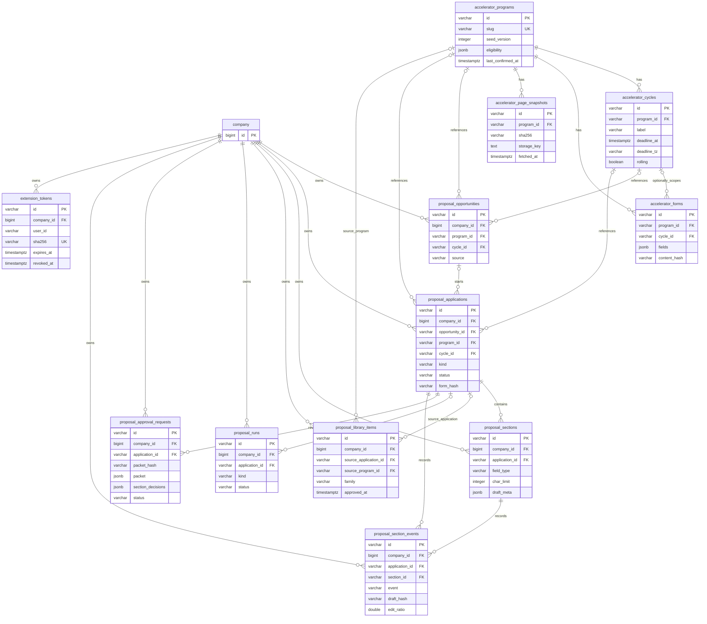

**JSONB contracts**

SQL columns use snake_case; TypeScript/HTTP form contracts use camelCase. These are target wire shapes, not claims about today's schemas. Form-field and claim fields fixed by the shared contract are retained. Exact eligibility-predicate, verification-detail and packet subfields below are **[PROPOSED]** and must be ratified by their lane owners before implementation.

```ts
type FieldType =
  | "long_text"
  | "short_text"
  | "url"
  | "email"
  | "number"
  | "date"
  | "select"
  | "multi_select"
  | "file"
  | "video";

type QuestionFamily =
  | "one_liner"
  | "what_building"
  | "problem"
  | "customer"
  | "traction"
  | "revenue"
  | "growth"
  | "competitors"
  | "differentiation"
  | "market"
  | "business_model"
  | "why_now"
  | "team"
  | "founder_history"
  | "equity_split"
  | "commitment"
  | "funding_raised"
  | "use_of_funds"
  | "location"
  | "prior_programs"
  | "tech"
  | "risks"
  | "impressive"
  | "idea_origin"
  | "other";

interface FormField {
  key: string; // stable application-local key
  question: string;
  guidance: string | null;
  wordLimit: number | null;
  required: boolean;
  fieldType: FieldType;
  charLimit: number | null; // UTF-16 code units, as maxlength uses
  options: Array<{ value: string; label: string }> | null;
  family: QuestionFamily;
  fieldKey: string | null; // capture identifier, not a global selector
  limitConfirmed: boolean;
}
```

A `FormField[]` is ordered. `content_hash`/`form_hash` includes questions, guidance, types, required flags, limits, options, family, keys and order. Source metadata such as capture time is outside the form-shape hash. This prevents an identical recapture from looking like a changed form solely because its timestamp changed.

```ts
interface EligibilityRule {
  id: string;
  text: string; // rule in the program's words
  severity: "hard" | "soft";
  sourceUrl: string;
  quote: string;
  capturedAt: string; // ISO timestamp
  predicate: null | {
    factPath: string; // company profile path or metric key
    op: "eq" | "in" | "gte" | "lte" | "exists";
    value?: string | number | boolean | string[];
  };
}

interface EligibilityVerdict {
  ruleId: string;
  verdict: "pass" | "fail" | "unknown";
  detail: string;
  cites: number[]; // company-local numbered evidence
}
```

A rule without a safe structured predicate yields `unknown`, not a guessed deterministic pass. `EligibilityVerdict[]` belongs to the company matching result, not `accelerator_programs.eligibility`. Hard fail affects matching; the original public rule and source quote remain visible.

```ts
type ClaimVerdict = "supported" | "unsupported" | "stale" | "conflict" | "unverified";

interface Claim {
  id: string;
  text: string;
  textHash: string; // sentence hash for edit invalidation
  cites: number[]; // indexes in this draft's evidence list
  needsEvidence: boolean;
  verdict: ClaimVerdict;
  detail: string | null;
  verifiedAt: string | null;
}

type VerificationRef =
  | { kind: "document"; documentId: number; versionId: number; anchorKey: string }
  | {
      kind: "metric";
      metricId: string;
      observationId: string;
      periodStart: string | null;
      periodEnd: string | null;
    }
  | {
      kind: "profile";
      profilePath: string;
      valueHash: string;
      sourceVersionIds: number[];
    };

interface Verification {
  draftHash: string; // binds checks to exact answer text
  checkedAt: string;
  checks: Array<{
    claimId: string;
    kind: "cited" | "number" | "entailment" | "superseded_source" | "stale_metric" | "conflict";
    severity: "blocker" | "warning" | "note";
    detail: string;
    refs?: VerificationRef[];
  }>;
}

interface DraftMeta {
  cites: number[];
  gaps: string[];
  evidence: Evidence[];
  libraryItemIds: string[];
  modelId?: string;
  promptVersion?: string;
  draftedAt?: string;
  claims: Claim[];
  verification: Verification | null;
  generatedDraft?: string; // immutable first generated prose; same section ACL
}
```

The model cannot promote a deterministic missing-number, stale-version or conflict failure to `supported`. An edited sentence with a changed `textHash` becomes unverified. Verification and approval must compare the persisted draft hash, not reuse a result from the previous text. Legacy `DraftMeta` has no claims/verification; read it as not yet verified until the new stage runs, without fabricating historical claim records. Today's section-level evidence/cite shape is `pipelines/src/proposals/types.ts:76-84,202-211`; its existing integer-cite filtering is `pipelines/src/proposals/evidence.ts:60-65`.

`draft_meta.generatedDraft` retains the immutable first generated prose for the section. Set it in the first successful model-generated section write; preserve it through ordinary edits, clearing, rewrite and redraft of that same section. Do not reconstruct it from a hash or overwrite it to improve the success metric. At approval, compute `edit_ratio = UTF16Levenshtein(generatedDraft, approvedText) / max(generatedDraft.length, approvedText.length)` once, then persist the ratio and `generated_draft_hash` in the event. The baseline has the same company/source-access restrictions as the section and is not returned by the approved-answer extension endpoint. Reuse-only/manual answers without a generated baseline have a null ratio and are reported separately; an empty/incomparable baseline must not become a fake zero.

```ts
interface Evidence {
  n: number;
  documentId: number | null;
  title: string;
  page: number | null;
  quote: string;
  url: string | null;

  kind: "document" | "profile" | "metric" | "manual";
  anchorKey: string | null; // existing CitationAnchor key for a document
  versionId: number | null;
  sourceDate: string | null; // substantive source/metric as-of, not retrieval time
  freshness: "fresh" | "aging" | "stale" | null;
}
```

Document anchors use `@launchstack/evidence` `anchorKey`; do not invent a second document-anchor scheme (`packages/evidence/src/citation-anchors/index.ts:46-54,123-144`). A metric/native profile reference remains typed in the verification/frozen packet rather than pretending an observation ID is a document citation anchor. A profile fact backed by a document can carry that document's anchor/version. A manual fact without a source keeps these null. Null `sourceDate`/`freshness` means unknown, not fresh. Retrieval timestamps and profile `built_at` are not substantive evidence dates (`packages/retrieval/src/tools/citation-builder/citation-builder.ts:94-101`; `pipelines/src/company-metadata/views.ts:62-78,119-122`).

The metric freshness policy is **[PROPOSED]** aging after 30 days and stale after 90 days. Pass it explicitly to the evidence freshness functions; their current default is 30/180 days and must not be silently changed for every caller (`packages/evidence/src/version-freshness/index.ts:8-26,57-72`). Superseded document versions and a newer applicable metric observation can make a claim stale before an age threshold is reached.

```ts
interface ApprovalPacket {
  applicationId: string;
  kind: "grant" | "accelerator";
  programId: string | null;
  cycleId: string | null;
  formHash: string | null;
  frozenAt: string;
  sections: Array<{
    sectionId: string;
    position: number;
    field: FormField;
    answer: string;
    draftHash: string;
    generatedDraftHash: string | null;
    claims: Claim[];
    evidence: Evidence[];
    verification: Verification | null;
  }>;
}

interface SectionDecision {
  sectionId: string;
  draftHash: string;
  decision: "approved" | "changes_requested";
  reason: string | null;
}
```

Canonical packet hashing sorts object keys and preserves section/option order. `packet_hash` is stored outside `packet`; do not include the hash inside its own input. `frozenAt` records request identity but is not a source-freshness timestamp. Each approved field must match its frozen `draftHash` and current typed form constraints before Fill mode or the extension receives it. Partial field decisions never imply an unchecked application-wide approval.

**Company profile confirmation: JSON-only addition**

Extend `MetadataFact` inside `company_metadata.metadata`; do not create a proposal profile table or a new SQL confirmation table. Bump the company-context metadata schema from `1.1.0` to `1.2.0`. The existing fact contract is `packages/tools/src/company-context/schema.ts:69-80`; manual overrides currently mean confidence/priority, not founder verification.

| JSON field     | Type                         | Meaning                                                                                 |
| -------------- | ---------------------------- | --------------------------------------------------------------------------------------- |
| `confirmed_by` | `string`, optional           | Auth subject holding `proposals.approve` who confirmed the exact value.                 |
| `confirmed_at` | ISO timestamp, optional      | Server time of confirmation, not the fact's as-of date.                                 |
| `value_hash`   | `string`, optional           | Canonical current-value hash to which confirmation applies.                             |
| `as_of`        | ISO date/timestamp, optional | Substantive fact/observation date when known; never synthesized from confirmation time. |

```ts
// Added to the existing MetadataFact<T>, not a replacement for its sources/lifecycle.
interface FactConfirmation {
  confirmed_by?: string;
  confirmed_at?: string;
  value_hash?: string;
  as_of?: string;
}
```

Use `PATCH /api/company/profile/facts {path, confirm:true, expectedValueHash}` with `proposals.approve`. Compare `expectedValueHash` with the persisted current value and return 409 on mismatch. Audit `proposal.fact_confirmed` transactionally. A rebuild that changes the value clears confirmation; an unchanged value does not get a new confirmation timestamp from a rebuild. Confirmation does not rewrite source quotes, document versions, observation periods or freshness. No SQL migration is needed for this JSONB addition.

**Migration plan**

Land one product migration at a time. The schema-landing order below is the shared contract, including the outcome-status and C8 section-event addenda. Each owner rebases after the preceding migration so the journal/checksums/column order are deterministic.

| Order | Unit                                                 | SQL/schema changes                                                                                                                                                                                                                                                                                                                                                                               | Existing-data treatment                                                                                                                                                                                                                                                |
| ----- | ---------------------------------------------------- | ------------------------------------------------------------------------------------------------------------------------------------------------------------------------------------------------------------------------------------------------------------------------------------------------------------------------------------------------------------------------------------------------ | ---------------------------------------------------------------------------------------------------------------------------------------------------------------------------------------------------------------------------------------------------------------------- | ------ | --------------------------------------- | ----------------------------------------------------------------------------------------------------------------------------------------------------------------------------------------------------------------------------------------------------- |
| 1     | A1: catalogue tables                                 | Create `accelerator_programs`, `accelerator_cycles`, `accelerator_forms`, `accelerator_page_snapshots` and their indexes/FKs.                                                                                                                                                                                                                                                                    | No tenant backfill. Reviewed program seed is code and syncs at worker boot by `seed_version`, not a bulk company-data migration.                                                                                                                                       |
| 2     | B1: section/application columns                      | Append typed field columns to `proposal_sections`; append `kind`, `program_id`, `cycle_id`, `form_origin`, `form_hash` to applications; append program/cycle references to opportunities and add `catalogue` source. Add `interview`/`accepted` to application status contracts **[PROPOSED]**. Add `programs`/`verify` run-kind literals in the shared run contract without reordering columns. | Existing applications default to `kind='grant'`; existing sections default to `field_type='long_text'`, `family='other'`, `limit_confirmed=false`. Do not invent form hashes or exact limits for historical rows. Enforce status-by-kind in the service/DTO contracts. |
| 3     | B7: answer-library columns                           | Append `family`, `as_of`, `approved_at`, `approved_by`, `source_program_id`; add family/approval read index.                                                                                                                                                                                                                                                                                     | Legacy saved answers remain unapproved. Do not set `approved_at` from `created_at` or a legacy section flag.                                                                                                                                                           |
| 4     | C8: approval requests, section events and status DML | Create `proposal_approval_requests` and `proposal_section_events`, parent-consistency indexes/FKs and approval indexes. Change section status contract to `empty                                                                                                                                                                                                                                 | drafted                                                                                                                                                                                                                                                                | edited | ready`. Apply the legacy status update. | `UPDATE pdr_ai_v2_proposal_sections SET status = 'ready' WHERE status = 'approved';` Existing pseudo-approval becomes writer readiness, not a fabricated founder request/decision. This explicit DML must pass the repository's DML/destructive gate. |
| 5     | C11: extension tokens                                | Create `extension_tokens`, hash/tenant/user/expiry indexes and company cascade.                                                                                                                                                                                                                                                                                                                  | No bearer-token backfill. Tokens are issued through the session-authorized endpoint after deployment.                                                                                                                                                                  |

C10 emits/reads the already-created section-event table for the success-metric report; it does not create that table later. Company-fact confirmation is a versioned JSONB contract update and needs no SQL migration. Claim/Evidence/verification and immutable `generatedDraft` additions are also JSONB contracts; old rows remain readable as unverified and are populated only by real subsequent draft/verify work. Do not invent a historical first generated draft for a legacy edited answer.

Append every new column **after the last existing column** in the Drizzle table declaration and emitted migration. This is required by the `pg_dump` parity gate (`pipelines/src/proposals/schema.ts:4-6`). Do not reshuffle columns while adding logical groups. Update `types.ts`, Zod schemas, service DTOs, database helpers, the shared grant callers, simulator and render/requirement logic in the same cutover. Remove the writable section `approved` literal; there is no alias from old pseudo-approval to founder approval.

Apply through `packages/store/scripts/migrate.mjs`, preserving the separate engine/product ledgers. Keep the product migration history immutable. `schema-drift`, `migrations-apply` and `upgrade-from-release` must cover fresh install and upgrade from a release with legacy approved sections/library items. The DML gate review must name the exact `approved → ready` update; it cannot be hidden in worker seed sync. Schedule the API/status-contract deployment with C8 so older callers do not continue writing the removed section status.

**Retention and deletion**

- All company-owned Proposals rows and extension tokens cascade when the company is deleted. Application deletion cascades its sections, runs, approval requests and section events. The existing library source-application FK is set null; an approved library answer is company narrative rather than merely an application child. An explicit company/library deletion still removes it.
- Global catalogue rows contain public program data only. They never retain company answers, applicant values, approval packets, company matching verdicts, portal screenshots/cookies or extension tokens. Company-specific web discovery and raw extension form capture remain in company tables.
- Catalogue refresh never deletes a cycle merely because a page omits it. Prefer paused/closed program status to physical deletion. If an operator intentionally removes a global program/cycle, preserve company application history and null the optional catalogue references **[PROPOSED]**. Frozen application/approval data remains company-scoped.
- Keep the last 10 page snapshots per program **[PROPOSED]**. Prune metadata after successful replacement; remove only unreferenced object keys. Never prune the only usable snapshot before the new object and its metadata are committed. A failed refresh keeps prior confirmed data and creates no fake replacement object.
- Expired/revoked tokens fail authentication immediately. **[PROPOSED]** Prune obsolete token rows during token maintenance/issuance using the expiry index; the existing workspace audit log retains token-record actions under `audit_retention_days`. Do not retain plaintext tokens in logs, approval packets, metrics or exports.
- Section events, frozen approvals and library evidence are company records. They remain until the owning company/application/library policy deletes them; no new analytics warehouse or permanent cross-company copy is added. Audit retention is the existing workspace setting, nullable for forever (`apps/web/src/server/db/schema/access.ts:47-48,298-325`).
- Exported packets are company Sources in the existing object store and ingestion lifecycle. Company/file deletion must include their object keys through that lifecycle. A SQL cascade alone is not proof that object-store bytes were erased. Global public snapshots are not deleted when one company leaves, and no private packet may be filed under the global snapshot prefix.

### 3.7 Sourcing pipeline

**Code and ownership.** The following additions are **[PROPOSED]**. Lane A owns `pipelines/src/proposals/accelerators/seed.ts`, `refresh.ts`, `eligibility.ts`, `match.ts` and `prompts.ts`. The worker adapter lives in `apps/web/src/server/inngest/functions/acceleratorCatalogueRefresh.ts`; it is registered in `apps/worker/src/inngest.ts`. A new function must be added to that registry, not served by Next.js (`apps/worker/src/inngest.ts:38-62`). The global catalogue is separate from the company's saved program pipeline.

**Seed.** `seed.ts` is a typed, PR-reviewed list of programs, canonical website/apply URLs, quoted terms, eligibility rules, known cycles and approximate form templates. `syncAcceleratorSeed()` runs at worker boot after database migrations. It upserts programs by `slug`, cycles by `(program_id, label)`, and templates by program/cycle and `content_hash`. `seed_version` makes the operation idempotent. A larger version applies the reviewed seed change; a matching version does nothing. Removed seed entries are not deleted from the database. Closing or pausing a program is an explicit reviewed change.

Seed data initializes missing values. A release must not replace a newer extracted deadline or terms with an older seed observation. A deliberate correction includes its source quote and capture date in the PR. Seed templates remain `approximate = true`; their fields have `limit_confirmed = false`. Seed synchronization needs neither a search key nor an LLM. A refresh failure does not make the seed disappear.

**Weekly refresh.** `accelerator-catalogue-refresh` runs at `0 6 * * 1` (Monday, 06:00 UTC). It honors `ACCELERATOR_REFRESH_ENABLED`, which defaults to `true`. There is one independently recorded step per active program and at most two programs in flight. A bad site does not abort the remaining programs. This follows the existing worker cron registration pattern, but there is no scheduled Proposals refresh today (`apps/web/src/server/inngest/functions/brandPublishDue.ts:12`; `apps/worker/src/inngest.ts:38-62`).

For each program:

1. Read the stored program, existing cycles and the last successfully accepted page snapshots. Reserve the attempt and set `last_checked_at`. Use only its curated `website_url` and `apply_url`, deduplicated. This is a small set of known URLs, not a crawler.
2. Call `fetchReadable` separately for each URL. Keep the existing HTTP(S)-only, public-address checks on the first URL and every redirect. Keep its three-redirect, 15-second and 2 MB limits. It strips scripts and does not execute JavaScript (`packages/tools/src/web-research/fetch.ts:97,125,226,299`). An inaccessible, login-walled, truncated or empty page is not evidence that the program has closed. Do not extract a fixed deadline from a truncated response.
3. Compute SHA-256 over the exact UTF-8 readable text. Store those bytes through the existing S3-compatible storage in SeaweedFS at `accelerators/pages/<slug>/<sha256>.txt`. Record `program_id`, `url`, `sha256`, `storage_key`, `fetched_at`, `status` and `bytes` in `accelerator_page_snapshots`. This is a public-page snapshot, not a company Source; do not invoke document ingestion. SeaweedFS is the existing object store (`docker-compose.yml:258`; `.env.example:541-546`).
4. Compare each URL's hash with its last **successfully processed** snapshot. If every hash is unchanged, skip the model call and the diff. Recheck that retained quotations occur in the same text before advancing confirmation timestamps. A failed extraction must not poison the unchanged-hash cache. **[PROPOSED]** `accelerator_page_snapshots.status` distinguishes accepted snapshots from fetch/extract failures so this comparison does not mistake the latest attempted fetch for an accepted refresh.
5. If at least one page changed, make **one** structured `fast` call for this program, with the available pages identified by URL. Limit the extraction input to 60,000 characters, following existing request extraction (`pipelines/src/proposals/stages.ts:205-224`). Its schema asks for cycles and terms, not new company facts. Every returned property carries `{ value, quote, sourceUrl }`. **Every value must carry a verbatim quote found in the fetched text, otherwise that value is dropped.** Check exact text membership, the supplied page identity, and the value's stated units/date context before constructing a database row. A confidence score is not a substitute for a quote. No deadline, timezone, rolling flag, amount, equity percentage or instrument is accepted from model memory.
6. Parse only supported dates and terms. Persist cycle provenance in `source_url` and `source_quote`, and term provenance in `terms.sourceUrl`, `terms.quote` and `terms.capturedAt`. The controlling cycle quotation must support the accepted deadline and its timezone. Null or dropped properties do not erase a previously stored value. A result with no usable quotation-backed values is an extraction failure, not an empty catalogue.
7. Diff accepted values against the stored rows. Insert new cycle labels; update changed deadlines/terms and `last_changed_at`; update `captured_at` when a cycle's source still confirms it. Use the unique `(program_id, label)` key. **Never delete a cycle**, including one that disappears from the page. Historical applications retain their cycle reference. Do not infer `closed`, a new cycle label, or a date extension from absence alone.
8. Commit the accepted diff and confirmation metadata together. Clear `check_error` after a complete successful check. Advance program `last_confirmed_at` only for a check that actually confirms catalogue data, not merely a successful HTTP response. A partial extraction retains the old unsupported fields and sets a diagnostic `check_error`; cycles not attested again retain their previous `captured_at`. The per-cycle unconfirmed gauge uses that cycle confirmation time, so one newly confirmed cycle cannot make an older retained deadline look current.
9. On fetch, storage, schema, quote-validation or model failure, retain all last-known catalogue values, record a bounded `check_error`, and emit a failed/partial refresh result. UI reads expose the error, source quote, source URL and last-confirmed time. Record model usage as **platform usage**, never a debit to a company that happened to request refresh. Finish the program step and continue the batch.

**[PROPOSED]** Refresh logs include program slug, source URL host/path, snapshot hash, step, elapsed time, accepted/dropped value counts and changed-cycle count. They do not include model input or company data. `pdr_accelerator_refresh_total{result}` distinguishes `updated`, `unchanged`, `partial`, `failed` and `debounced`; `pdr_accelerator_cycles_unconfirmed` counts open cycles not confirmed in 14 days whose fixed deadline is within 30 days. Rolling cycles have no fabricated deadline and are not counted as deadline-near cycles.

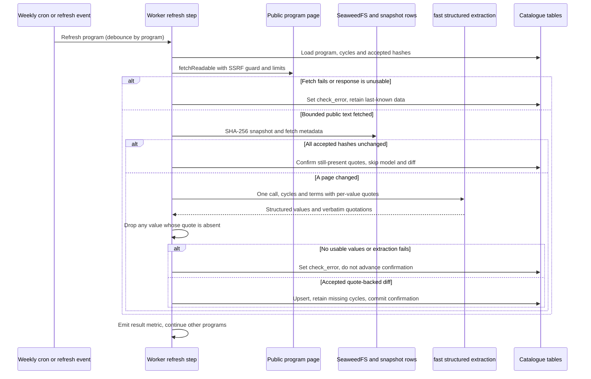

**On-demand refresh.** `POST /api/accelerators/programs/[slug]/refresh` requires `documents.edit` and emits `accelerators/program.refresh.requested`. Debounce to one attempt per program per hour, shared across companies. **[PROPOSED]** The worker event debounce is backed by a database compare-and-set on `last_checked_at` for the inline self-hosted path; two app replicas cannot both reserve the same hourly refresh. A repeated request reports that a refresh is already requested or was checked recently, rather than performing a second fetch. It invokes the same extraction/diff code as the cron.

Self-hosted deployments without Inngest still synchronize the seed at worker boot. Weekly refresh is off. The same rate-limited Refresh now action runs inline and visibly reports its result; it must not claim an event was queued when no executor can consume it. The UI always shows last-confirmed information. No general search key is required for catalogue refresh.

**Company matching (`programs` run).** `POST /api/accelerators/programs/match` starts the new `programs` run through the existing Proposals executor. It requires `documents.edit`. The executor remains inline `after()` by default and uses `proposalsRunJob` when `PROPOSALS_EXECUTOR=worker` (`apps/web/src/server/proposals/executor.ts:59-87`; `apps/web/src/server/inngest/functions/proposalsRun.ts`). The cloud recommendation is worker mode. Proposed credits are 2,000 for this run; a global refresh is not this company run.

1. Fix a single `now` for the run. Load active programs with open or upcoming cycles, including explicitly rolling cycles. Exclude known expired fixed cycles from the default candidate set. Load the permission-filtered company profile and relevant dated metric observations under the requesting actor's `DocumentScope`.
2. Run pure `testEligibility(rules, facts)`. Each rule returns `pass`, `fail` or `unknown`, its `hard` or `soft` severity, the tested fact key/value, and the actual fact/metric provenance. Missing, contradictory or unusable facts yield `unknown`; a model cannot turn that into `pass`. A hard `fail` is hidden by default but remains visible under Show ineligible. Hard `unknown` asks for confirmation. Soft failures are concerns, not silent exclusions.
3. Score fit for the remaining candidates using the existing `FIT_SYSTEM` **batch pattern**, not its grant prompt or Distribution's scoring weights. Use a new accelerator prompt covering stage, traction, sector, geography, attendance format and investment terms. Keep `FitBatchSchema`, batches of 20, the `fast` route and temperature 0.2. These are existing seams (`pipelines/src/proposals/stages.ts:104`; `pipelines/src/proposals/prompts.ts:11-13`). The output remains `Fit { score, why, concerns }`. Fit cannot override a hard eligibility result or assert an uncited company fact.
4. Upsert company rows into `proposal_opportunities`, setting `source = 'catalogue'`, `program_id` and `cycle_id`. **[PROPOSED]** Use `external_id = 'accelerator-cycle:<cycleId>'` so a changed deadline does not create another company opportunity. Preserve `saved`, `dismissed` and `applied` status, following the current conflict-update rule (`pipelines/src/proposals/db.ts:201,232`). Refresh must not silently re-save a dismissed program.
5. Return explicit eligibility verdicts with program details. **[PROPOSED]** Recompute these pure verdicts on program reads against the current permitted facts; do not treat a previously stored fit score as a durable eligibility approval. Saved imminent cycles feed Overview to-dos and the Vantage deadlines adapter. A refresh changing the deadline updates those derived dates, not the company's saved/dismissed choice.

**Deadline handling.** `accelerator_cycles.deadline_at` and `opens_at` are `timestamptz`; `deadline_tz` retains the named source timezone. Parse a stated local time with the source's timezone and the date's daylight-saving rules. Display the instant in the founder's selected timezone, with the original timezone and quote available next to it. Do not use the server timezone or the existing date-only application deadline for cutoff decisions. A page giving only a date, or omitting a timezone, does not justify assuming midnight or 23:59. Keep an unresolved fixed instant null and show Needs confirmation until a source or reviewed seed establishes it. For `rolling = true`, show Rolling, not a synthetic annual deadline. Deadline warnings and submitted gating use the cycle instant when it is known.

**Discovery (v1.1).** This is separate from the seed refresh. **[PROPOSED]** Add a non-news search mode to `@launchstack/tools/web-research`: Exa without `category: 'news'`, or Serper `/search`. Existing providers are news-only (`packages/tools/src/web-research/providers/exa.ts:37-45`; `packages/tools/src/web-research/providers/serper.ts:4`), and grant query/filter text is not suitable for accelerators (`packages/tools/src/grant-search/index.ts:80,103`). Preserve the shared retry, URL-deduplication and per-source reporting pattern. A missing `EXA_API_KEY`/`SERPER_API_KEY` disables discovery without disabling the catalogue. Fetch candidate public pages through `fetchReadable`; drop unreadable hits or those without a supported apply URL. Save accepted discoveries only as company-scoped `proposal_opportunities` with `source = 'web'` and an explicit unverified designation. They never write `accelerator_programs`, `accelerator_cycles` or other global catalogue tables. Promotion into the seed requires a separate curator-reviewed PR. Discovery is not a new global crawler.

### 3.8 Writing pipeline

**Form contract.** Lane B owns the new `pipelines/src/proposals/forms/types.ts`, `families.ts`, `field-values.ts` and `reuse.ts` **[PROPOSED]**. The extracted form and section DTO use the same typed `FormField` contract. A form contains ordered fields plus its origin, `content_hash`, `approximate` flag and capture date; these flags are not inferred from a model's confidence.

| `FormField` member                         | Meaning / persistence                                                                                                                                        |
| ------------------------------------------ | ------------------------------------------------------------------------------------------------------------------------------------------------------------ |
| `key`, `fieldKey`, `position`              | Stable section key, portal control key and portal order. Persist as section `key`, `field_key`, `position`. A repeated label must not collapse two controls. |
| `question`, `guidance`, `required`         | Literal field label, field-specific instructions when provided, and the required flag.                                                                       |
| `fieldType`                                | `long_text`, `short_text`, `url`, `email`, `number`, `date`, `select`, `multi_select`, `file` or `video`; persisted as `field_type`.                         |
| `charLimit`, `wordLimit`, `limitConfirmed` | Separate nullable character/word limits; explicit confirmation of the character limit. Persist as `char_limit`, existing `word_limit`, `limit_confirmed`.    |
| `options`                                  | Allowed values and display labels for choice fields; no invented option. Persist in `options` JSONB.                                                         |
| `family`                                   | One closed-list question family; persisted as `family`.                                                                                                      |

Today extraction has only `wordLimit` and folds character limits into words; drafting, rewriting, review, rendering and the editor are word-only (`pipelines/src/proposals/types.ts:152-158`; `pipelines/src/proposals/prompts.ts:15-26`; `pipelines/src/proposals/review.ts:30-32`). Extend the existing schema/sanitizer, section CRUD, prompts, editor meters, review, Fill mode and Markdown renderer together. Do not create a second answer representation just for the extension.

**Where forms come from, in order of confidence:**

1. **Capture** from the founder's current portal tab. The extension reads the rendered control labels, required flags, choices, order and explicit `maxlength`. It captures fields, not the founder's existing responses. This can see a logged-in form without giving LaunchStack portal credentials. Capture applies to a company application; it does not automatically publish a login-page snapshot or form into the global catalogue.
2. **Public page** containing the actual questions. Use `fetchReadable` and structured extraction; only explicit instructions can confirm a limit. It cannot render a JavaScript form (`packages/tools/src/web-research/fetch.ts:226,299`).
3. **Paste** from the founder. Preserve literal questions and supplied limits. A limit is unconfirmed until the founder confirms it against the portal.
4. **Catalogue template.** Mark `approximate = true` and `limit_confirmed = false`. Show Confirm questions and limits in the portal. A named program is not proof that its current batch still uses the template.

`POST /api/accelerators/applications` creates an application from a cycle with `kind = 'accelerator'`, `program_id`, `cycle_id`, `form_origin` and `form_hash`. Field/value edits use the extended `/api/proposals/applications/*` CRUD. A new capture or changed form hash is shown as a form diff; removed/reordered questions must not silently erase drafts or preserve approval for a different question.

**Limit policy.** A `char_limit` is hard, with zero tolerance. Count UTF-16 code units using JavaScript `text.length`, matching native `maxlength`; do not count graphemes or Unicode code points. The same counter runs in the vertical, UI and extension. A 1,000-character limit allows 1,000 code units, not 1,000 visible glyphs. An unconfirmed positive limit drafts to `floor(charLimit * 0.9)` as headroom; exceeding that target is a warning, while exceeding the stated hard limit is a blocker. No text is silently truncated during copy or fill.

Word limits remain soft, with the existing 10% review tolerance. Show both meters when both limits exist; satisfying the word guideline never waives a character blocker. No stated limit means null, not an invented default. `limit_confirmed` becomes true for an explicit DOM `maxlength`, a supported public-form instruction, or a deliberate founder confirmation. Absence of `maxlength` does not establish that a portal accepts unlimited text.

**Question families.** `classifyFamily` returns exactly one of: `one_liner`, `what_building`, `problem`, `customer`, `traction`, `revenue`, `growth`, `competitors`, `differentiation`, `market`, `business_model`, `why_now`, `team`, `founder_history`, `equity_split`, `commitment`, `funding_raised`, `use_of_funds`, `location`, `prior_programs`, `tech`, `risks`, `impressive`, `idea_origin`, `other`. **[PROPOSED]** Known seed keys and high-confidence label patterns resolve deterministically; ambiguous prose labels use one structured `fast` classification, validated against this enum. Unresolved questions use `other` and remain editable. Family is a reuse aid, not evidence that two questions ask the same thing. Guidance, requested period and company/founder perspective still have to agree.

**Non-prose fields.** Do not send URL, email, number, date or choice controls to the essay drafter. `field-values.ts` maps a known field/fact pair deterministically: company website to website URL; an explicitly selected founder's email to email; founded date to date; a matching dated funding observation to a number. Keep the fact's provenance. For a choice, require an exact allowed value or an explicit reviewed label/value mapping; for multi-select, every selected option must be allowed. Ambiguous person, currency, unit or option mappings stay empty and produce a missing-fact item. Do not turn an estimate into an exact number.

`file` and `video` become manual checklist requirements. Neither copy mode nor the extension uploads a file or bypasses a portal's file picker. A separately requested video talking-points draft is labelled Script, not an uploaded answer. Current company profile facts and manual overrides are not founder-approved metric records (`packages/tools/src/company-context/schema.ts:69-80`; `pipelines/src/company-metadata/edit.ts:28-43`). The later packet approval is still required for mapped values.

**Reuse before generation.** For each prose field:

1. Load same-company library candidates by `family`, then rank compatible questions/guidance using the existing keyword-matching seam (`pipelines/src/proposals/library.ts:17`). Only items with `approved_at` and `approved_by` qualify as approved; legacy manually saved answers do not acquire approval by migration.
2. Recheck the candidate's evidence permissions, current source versions, relevant metric observations and `as_of` freshness. An old approval cannot make stale facts fresh. Do not offer stale, conflicting or inaccessible candidates as ready-to-use answers.
3. If an approved, fresh, compatible answer fits the current limits, propose it **as-is**, with its evidence and Reused from program / approved date attribution. No drafting model call is needed and library reuse costs zero drafting credits. Record `reused` with the draft hash. The new section is `drafted`, not automatically approved for this different application.
4. If the best fresh compatible candidate is too long, use a `tighten` rewrite with the current hard limit and the same evidence. Do not tighten away units, dates or qualifications that made its claims true. It must pass the same checks as a new answer; an unsuccessful rewrite leaves a named over-limit finding for the writer.
5. Otherwise generate a new answer. Stale library prose may not smuggle a stale metric into the prompt as an approved fact. Reuse is not a generic cache of any previous text.

**Generation inputs.** The draft stage combines scoped Sources retrieval, permitted company-profile facts and dated Vantage metric observations into **one numbered evidence space**. Current Proposals numbers retrieval evidence but renders the profile as unnumbered label/value text (`pipelines/src/proposals/stages.ts:242-304`; `pipelines/src/proposals/evidence.ts:28-48`; `pipelines/src/proposals/profile.ts:32-65`). Fix that seam instead of adding another citation-number scheme. Each factual profile value and metric supplied to the model receives an evidence number.

Document evidence carries the existing `anchorKey` and actual `versionId`; `sourceDate` is the source's represented date, not retrieval time. Non-document evidence uses `kind = 'profile'`, `'metric'` or `'manual'` and does not fabricate a document `CitationAnchor`. **[PROPOSED]** Verification provenance and the frozen packet keep native metric refs `{ metricId, observationId, periodStart, periodEnd }` and profile refs `{ profilePath, valueHash, sourceVersionIds }`, keyed to the evidence number. `anchorKey`/`versionId` are null when there is no document version. This lets checks find the precise observation without treating a URL or retrieval score as proof. Vantage observations already have values, periods and metric definitions; there is no observation-level founder-approval boolean (`pipelines/src/vantage/schema.ts:145-172`; `pipelines/src/vantage/types.ts:53`).

Reuse `extractBrandVoice` and `buildVoiceDirective` for company tone (`packages/tools/src/brand-voice/index.ts:73-102`). Accelerator rules take precedence over a conflicting voice directive: answer the question directly; first-person plural unless the question asks about an individual; plain sentences; concrete product/customer examples; metrics with units and periods; no invented projection, superlative, customer endorsement or funding commitment. Keep dates and distinctions such as revenue versus GMV. The `default` route handles draft/rewrite; `fast` handles classification and verification. Bump `PROPOSALS_PROMPT_VERSION` and record model/prompt version on the result. The route aliases come from `CHAT_MODELS_CONFIG`; no provider-specific key is embedded in this vertical.

**Claims and edits.** Structured generation returns plain `draft` text plus `claims[] { text, cites, needsEvidence }`. Store the full claim shape in `draft_meta.claims`: `{ id, text, textHash, cites, needsEvidence, verdict, detail, verifiedAt }`. Keep section-level `cites` as a derived union for the existing export, not as a substitute for claim checks. Validate citation numbers against this answer's evidence space, as current `validCites` already does (`pipelines/src/proposals/evidence.ts:60-65`). Unsupported sentences remain visible with findings; they are not silently deleted to improve a score.

For generated prose, retain `draft_meta.generatedDraft` as the immutable **first** generated answer text. Set it on the first successful model-generated write for the section. Preserve it through writer edits, clearing, rewrites and redrafts of that same section, under the same answer/evidence access rules. `proposal_section_events.generated_draft_hash` references that first text; events do not duplicate its plaintext. This JSON field is needed because a hash alone cannot recover the original text for the approval edit ratio. Do not overwrite the baseline to improve the metric, and do not return it through the extension's approved-answer endpoint. Reuse-only and non-prose sections have no generated baseline and a null `edit_ratio`, never a fabricated zero.

Lane C adds `segmentClaims` in `pipelines/src/proposals/verify/claims.ts` **[PROPOSED]**. It deterministically segments sentences/bullets, preserving decimal numbers, common abbreviations and the displayed text. Hash exact claim text after newline normalization; do not normalize away a changed number, unit or qualifier. A repeated identical sentence is distinguished by its occurrence index. After an edit, unchanged text hashes may carry their citation links and verification result only if the referenced evidence/version/native refs are unchanged. Recompute freshness and access even for unchanged text. New or changed claims become `unverified`; the prior model-generated claim list is not trusted to describe edited prose. Clearing an answer clears its claim metadata. A full-answer `draft_hash` binds checks, events and approval to the value actually displayed.

**Verification.** `POST /api/accelerators/applications/[id]/verify` starts `verify` with `documents.edit`. Verification is also the final step of draft/rewrite. It checks every factual claim against its numbered permitted evidence. **[PROPOSED]** Verdicts are `supported`, `unsupported`, `stale`, `conflict` and `unverified`. `draft_meta.verification` stores `draftHash`, `checkedAt`, and `checks[] { claimId, kind, severity, detail, refs? }`. A check result on another hash is not a result on the current answer. The proposed charge is 500 credits per field for a requested verification run.

| Check               | Inputs and rule                                                                                                                                                                                                                                                         | Verdict on failure                                                                            | Review severity / successful meaning                                                                                            |
| ------------------- | ----------------------------------------------------------------------------------------------------------------------------------------------------------------------------------------------------------------------------------------------------------------------- | --------------------------------------------------------------------------------------------- | ------------------------------------------------------------------------------------------------------------------------------- |
| `cited`             | `needsEvidence` claims require at least one existing, readable evidence number. Missing, out-of-range or inaccessible references do not count.                                                                                                                          | `unsupported`; unavailable recheck data yields `unverified`                                   | `blocker`. Valid citation identity alone does not establish entailment.                                                         |
| `number`            | Every number, currency amount, percentage, unit and relevant period must agree with a cited quote or the exact cited metric observation. Normalize formatting, not meaning. v1 does not certify a model-derived calculation without explicit evidence.                  | `unsupported`                                                                                 | `blocker`. A number appearing somewhere in the workspace is insufficient.                                                       |
| `entailment`        | A bounded structured `fast` call sees only the claim and its already-selected evidence. It can downgrade a deterministic candidate; it cannot add sources, invent a quote, override a failed check, or upgrade an `unsupported`/`stale`/`conflict` claim.               | `unsupported` for unsupported meaning; `unverified` on model failure or indeterminate support | `blocker`. A pass leaves the deterministic candidate unchanged; it is not independent verification of reality.                  |
| `superseded_source` | Compare each stored `versionId` with the document's current version, including profile-source versions. Use `isSuperseded`/current-version lookup. A source withdrawn or inaccessible now cannot be re-used.                                                            | `stale`; unavailable source resolution yields `unverified`                                    | `blocker`. A quote from an older source version does not establish the current fact.                                            |
| `stale_metric`      | Resolve native observation ref, metric definition/unit and period. A claim phrased as current must use the latest relevant observation. Check its source/period date against the freshness policy. Explicit historical questions retain their stated historical period. | `stale`; missing dates/definition/provenance yield `unverified`                               | `blocker` when stale/not current; `warning` when aging. Do not confuse profile rebuild time or approval time with metric as-of. |
| `conflict`          | Map typed facts to canonical fact keys and call `detectConflicts` on current-version assertions. Also compare Vantage values for the same metric/unit and overlapping period. Separate historical periods are not contradictions.                                       | `conflict`                                                                                    | `blocker`. The model must not choose a convenient value or average conflicting numbers.                                         |

The evidence helpers are pure and receive `now` and current-version IDs (`packages/evidence/src/fact-conflicts/index.ts:43-75`; `packages/evidence/src/version-supersession/index.ts:29-54`; `packages/evidence/src/version-freshness/index.ts:57-72`). **[PROPOSED]** Accelerator time-sensitive metrics are aging after 30 days and stale after 90 days; product and pilot founders must sign this policy in Week 2. The package's existing default stale threshold is 180 days, so pass an explicit accelerator policy rather than silently changing the shared default (`packages/evidence/src/version-freshness/index.ts:8-26`). Non-factual first-person intent can have `needsEvidence = false`; it is not counted as source-verified factual text.

**Review and readiness.** Merge deterministic verification/form findings before model writing-quality findings. Required empty fields, hard character-limit violations, incomplete required attachments, known hard ineligibility, expired fixed deadlines and unresolved factual verification issues are blockers. Aging metrics, approximate forms, uncertain eligibility and soft word-limit/style issues remain visible warnings. A model cannot lower a deterministic severity. Reuse the current finding shape and deduplication seam (`pipelines/src/proposals/types.ts:227-245`; `pipelines/src/proposals/review.ts:77-168`).

Readiness remains a progress score, not authorization. **[PROPOSED]** Retain the existing 70% required-section / 30% other-checklist weighting, adding `ready` and current `approved` to full section credit (`pipelines/src/proposals/review.ts:41-60`). The approval/fill gate separately checks hashes, required fields, limits and findings; a high score cannot bypass it. A writer can mark a complete, within-limit field `ready` for review while explicitly unresolved evidence issues remain labelled Override required. Hard form constraints are not overridable. Facts/metric gaps feed Facts & metrics, with actions to add an observation in Vantage or ask in chat; the drafter does not invent the missing value.

**Founder approval.** A section follows `empty → drafted → edited → ready → approved`, with a direct `drafted → ready` path for unchanged text. `approved` now means an authorized human accepted a frozen current revision, not a writer pressed a legacy section button. The product migration changes old pseudo-`approved` rows to `ready`.

`POST /api/accelerators/applications/[id]/approval-requests` requires `documents.edit`. It freezes the ordered answer set, `form_hash`, field types/limits/options, exact values/draft hashes, claims, evidence/version/native refs and verification results into `proposal_approval_requests.packet`. **[PROPOSED]** SHA-256 over deterministic canonical serialization produces `packet_hash`; volatile polling/display state is excluded. The pending request stores requester and optional selected approver. A request may expose evidence-risk blockers for a conscious override, but cannot hide them.

`GET /api/accelerators/approvals?status=` and `POST /api/accelerators/approval-requests/[rid]/decision` require `proposals.approve`. The decision body supplies the request's `packet_hash` and per-field decisions/comments. Inside one transaction, compare that hash with the request and the current application/form/answer revision. **Return 409 without changing sections, audit or library if any required hash differs or the request is no longer pending.** Recheck source access and current verification conditions as well; unchanged prose is not a reason to ignore a newly superseded source.

A set approval marks the matching frozen sections approved and records actor/time. Changes requested retains the frozen packet with field-specific feedback in `section_decisions`; the writer edits the identified fields and creates a new request. An authorized approver must provide a non-empty `override_reason` to accept unsupported, stale, conflicting or unverified factual content. Persist the findings and reason; an override does not change the verdict to `supported`. It never overrides missing required values, hard limits, document access, tenant boundaries or a packet-hash conflict.

`POST /api/accelerators/approval-requests/[rid]/withdraw` is limited to requester or authorized approver. Text, question, limit, option, required-flag or form changes supersede pending/approved requests for that revision in the same transaction. Edited approved sections drop to `edited`; regenerated text drops to `drafted`; cleared text drops to `empty`. Keep old packets for history, not as authority for the changed answer. This fixes the current `patchSection` behavior that keeps edited text approved (`apps/web/src/server/proposals/service.ts:591-623`). Source changes never mutate a frozen packet; they make its fresh-use check fail and require re-verification/new approval, including a new explicit override when warranted.

The diagram shows two related state machines. A pending request does not replace a section's `ready` status.

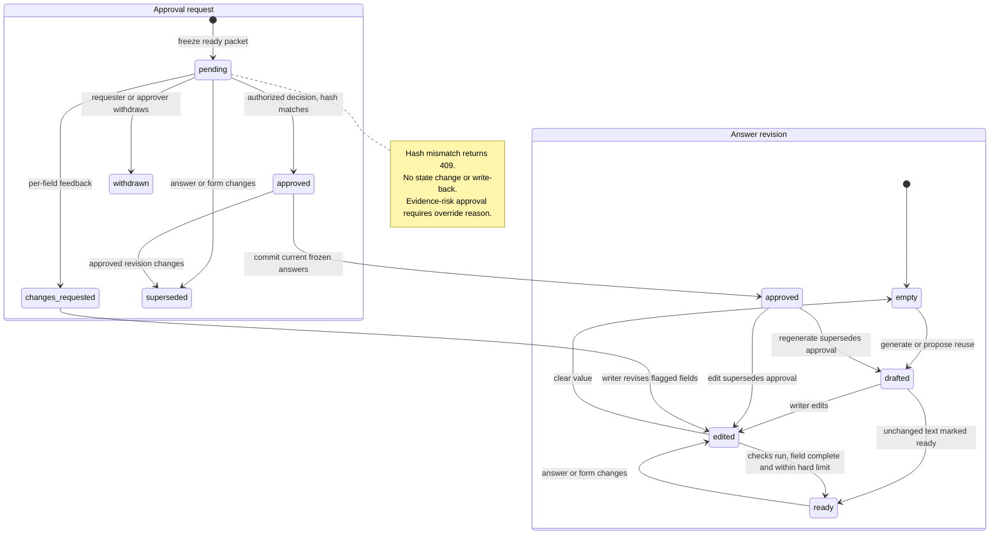

**Fill and submission gates.** Fill mode defaults to the current approved packet, in portal order, with plain-text per-field Copy and the same limit meter. `POST /api/accelerators/applications/[id]/sections/[sid]/copied` records the copied hash and actor. A writer may deliberately copy an unapproved value after a visible Not approved warning; log that exception, and do not mark the value approved. The extension has **no** unapproved override and receives approved answers only. Source-access checks apply to copy as well as evidence display.

`PATCH /api/proposals/applications/[id]` with `status = 'submitted'` requires `proposals.approve`. Check the current form/packet hash, approval of every required answer, hard limits, attachment checklist, known deadline/eligibility blockers and current evidence conditions. An evidence-risk exception must already be recorded in the current approval; an old override does not bless a newly changed source. Stamp `submitted_at` once and audit the action. This records the founder's report that they submitted in the portal; it does not submit or independently prove portal acceptance.

Accelerator application outcome statuses are **[PROPOSED]**: `draft`, `in_progress`, `in_review`, `ready`, `submitted`, `interview`, `accepted`, `declined`, `withdrawn`. Progression includes `submitted → interview → accepted | declined`, with direct accepted/declined outcomes when there is no interview. External outcomes are manually recorded, never inferred by an LLM. Outcome updates use the same application CRUD and authorized workflow. Grants retain their existing `awarded` outcome and their frozen Proposals UI.

**Library write-back and suite export.** On approval, write an immutable approved answer revision to `proposal_library_items`, with `family`, `as_of`, `approved_at`, `approved_by`, `source_program_id`, evidence and original application/section references. Do this with the approval transaction; a rejected 409 cannot write a library item. `as_of` reflects the answer's time-sensitive facts, not the approval click, so approval does not refresh old metrics. Retrying an already-decided request cannot duplicate write-back. Reuse-only proposals still need approval for the new application.

Export `latestApprovedAnswers(companyId, family)` from `@launchstack/pipelines/proposals`. It returns approved narrative text with approval date, as-of and provenance for Investors intro drafts, Growth compose, email outreach and chat. A company ID is not authorization: each server consumer authenticates the actor and filters candidate answers/evidence through that actor's current `DocumentScope` before using text in a model prompt or returning it. Older approved text cannot silently replace a more recent current approval. Stale/inaccessible answers are withheld from fresh reuse and surfaced as gaps, not promoted as canonical current facts. Approved packet export to the Sources Applications folder uses the existing Proposals export path and the restriction in §3.10, making permitted packets citable without adding a PDF pipeline.

**Success evidence.** Section events retain `generated_draft_hash`, the current `draft_hash`, verification, actor and time. **[PROPOSED]** `edit_ratio` is UTF-16-code-unit Levenshtein distance between immutable `draft_meta.generatedDraft` and approved text divided by `max(generatedDraft.length, approvedText.length, 1)`, in `[0, 1]`. Calculate it once at approval, not while typing; later edits, clearing, model rewrites and redrafts do not erase the first-generation baseline. Generated answers approved with `edit_ratio ≤ X` and supported factual claims feed the brief's success signal. Reuse-only and non-prose answers have null ratios and are reported separately; approvals overriding stale/unsupported/conflicting/unverified claims are not counted as source-verified successes. Increment `pdr_accelerator_drafts_total{source='reuse|generated'}` when a prose proposal is persisted.

### 3.9 Browser extension

**Package and runtime.** `apps/extension` is a new Manifest V3 TypeScript workspace package, not a server browser. **[PROPOSED]** Its files are `manifest.json`, `src/service-worker.ts`, `src/content/index.ts`, `src/side-panel.tsx`, `src/options.tsx` and `src/adapters/{html,google-forms,tally,typeform,airtable}.ts`. The service worker owns tokens and API requests. Content scripts read/write the currently authorized portal's controls. The side panel shows company, matched application, capture preview, approved answer count, Fill action, results and manual-copy fallback. No portal password or cookie is sent to LaunchStack.

**Connect and revoke.**

1. The user opens the Accelerators tab, then selects **Connect extension**. The authenticated app calls `POST /api/extension/token`, requiring an active session and `documents.edit`. The server binds the token to the user and selected company, records only SHA-256 of a cryptographically random bearer secret, and returns the secret once with opaque token ID and expiry.
2. **[INFERENCE]** The app hands the short-lived token directly to the installed extension through `chrome.runtime` external messaging from the configured app origin. `externally_connectable.matches` permits that origin; the service worker also checks `sender.url`'s exact origin, extension ID and an outstanding connection nonce. Do not put the secret in a URL, DOM attribute, page-storage item or clipboard. Chrome exposes the external-messaging mechanism, but this LaunchStack flow still needs a spike ([Chrome external messaging manifest](https://developer.chrome.com/docs/extensions/reference/manifest/externally-connectable)).
3. The service worker stores the secret in `chrome.storage.session`, at its trusted-context-only access level. Store only non-secret app-origin preferences in local storage; never use `storage.sync` for tokens. Session storage is cleared on extension reload/update/browser restart and is not exposed to content scripts by default ([Chrome storage reference](https://developer.chrome.com/docs/extensions/reference/api/storage)).
4. Other `/api/extension/*` requests use `Authorization: Bearer <token>`, without a workspace session-cookie fallback. `EXTENSION_TOKEN_TTL_MINUTES` defaults to 60. Expiry/revocation returns 401 and the panel asks the user to reconnect; there is no durable refresh token.
5. The authenticated app revokes through **`DELETE /api/extension/token/[tokenId]`**, as required by the contract addendum. Only the token's owner or a current `members.manage` holder in its company may revoke it. Set `revoked_at`, audit `extension.token_revoked` and clear local session storage when the extension is connected. A disconnected browser cannot prevent server revocation. The bearer token itself does not authorize issuing or administratively revoking tokens.

`EXTENSION_ALLOWED_ORIGINS` is an exact allowlist of `chrome-extension://<id>` origins. Empty/unset means deny extension cross-origin calls. Bearer endpoints answer preflight for allowed origins only; see §3.10. CORS is not the authorization check.

**Capture.** On an explicit Capture form action:

1. Check that the authorized active tab is the selected portal URL. Inject only into that tab. Do not scan browser tabs or read pages in the background.
2. Collect visible form controls and rendered order. Prefer associated `label[for]`, wrapping labels and `aria-labelledby`; then use `aria-label`. A placeholder-only label is marked uncertain. Read `maxlength`, `required`/`aria-required`, the control type, and select/radio/checkbox option labels and values. Skip password, hidden, authentication and payment controls. Do not collect filled values, cookies, arbitrary page text or surrounding documents.
3. Produce `FormField[]`. Prefer a stable portal `id`/`name` for `fieldKey`; otherwise use a structural label/order key and show uncertain mappings. Preserve repeated labels as separate ordered fields. Group radio/checkbox controls into select/multi-select fields. Record explicit `maxlength` as a confirmed character limit; a missing attribute produces null, not Unlimited. Known-family labels can be classified locally; server extraction/classification resolves ambiguous ones.
4. The service worker calls `GET /api/extension/applications?url=<normalizedPortalUrl>`. Match only applications in the token's company by their request URL or canonical program apply URL. Strip fragments, tracking/query secrets and credentials before sending. If the URL identifies several applications, ask the user to select one; never choose the first silently. If there is none, direct the user to create/open an application in Accelerators.
5. Show the field preview and selected application, then send `POST /api/extension/forms` with `applicationId`, normalized portal URL and the field array. The server validates token scope and application ownership, stores the captured form definition and `form_hash` with the company application, and applies the existing form-diff/approval-supersession rules. It does not save a login-page snapshot or write the global program catalogue.

**Fill.** On an explicit Fill approved answers action:

1. Obtain `GET /api/extension/applications/[id]/answers`. The server returns only current approved answers, their field keys/labels/families/types/limits, `form_hash`, `packet_hash` and draft hashes. It rechecks company membership, document scope, frozen revision and fresh-use conditions. An outdated packet returns 409 instead of old text. The extension cannot request draft answers or waive the gate.
2. Re-read the visible field structure of this same authorized tab. Match `field_key` first. Fall back to a unique high-confidence label match, then compatible family/type, never merely the field's numerical position. **[PROPOSED]** A fallback must be unique; duplicate labels, multiple same-family controls, changed required options or a different live hard limit are unmatched until the user recaptures or copies manually. An already-populated control with different text is not silently overwritten.
3. Recheck UTF-16 length against the live control's `maxlength` and the approved field limit. Never truncate. For standard controls, use the native value setter and dispatch bubbling `input` and `change` events so the portal's application state sees the change. Select only a captured allowed option; do not invent an option or set a file input. Adapter-specific setters must read back the accepted value before marking a field filled.
4. Show filled and unmatched fields with specific reasons: ambiguous label, unsupported widget, changed form, hard limit or portal rejected value. Leave unmatched controls untouched and offer plain-text manual copy. If the active tab/URL changed, stop before writing any values.
5. Send `POST /api/extension/applications/[id]/filled` with packet/form hashes, section IDs and field results, not portal values or page contents. The server appends `filled` events for the approved hashes and increments `pdr_extension_fill_fields_total{result='filled|unmatched'}`. A logged fill is not a logged submission.

**The extension never clicks submit.** It also never dispatches a submit event, presses Enter to submit, navigates a Next/Continue flow automatically, uploads an attachment or accepts portal terms. The founder reviews the populated portal and submits there. A stale or unsupported DOM adapter must fail to unmatched/manual copy, not attempt a speculative write.

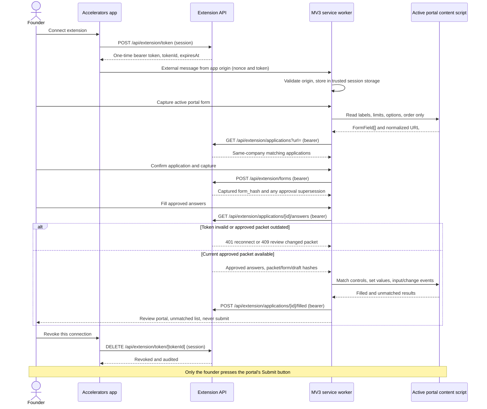

**Adapters.** Plain HTML, Google Forms and Tally are the first supported adapter targets. **[INFERENCE]** Their concrete DOM contracts must be confirmed in the extension spike; no production browser/form reader exists today (`apps/web/package.json:29,168`; `packages/tools/src/web-research/fetch.ts:299`). Typeform and Airtable are best-effort because one-question-at-a-time flows and custom widgets may not expose the full form. The user navigates steps; only currently visible fields are captured/filled. Closed shadow roots, inaccessible frames and unknown widgets remain manual. Adapter selection is by known host/structure, not scripts supplied by a program page.

**Permissions and privacy.** Request `activeTab`, `sidePanel` and `storage`. **[PROPOSED]** Also request `scripting`, which MV3 needs to inject a content script on the user-authorized tab; `activeTab` alone does not authorize `chrome.scripting` ([Chrome scripting reference](https://developer.chrome.com/docs/extensions/reference/api/scripting)). Request specific host permissions only on demand when a portal frame or configured app origin requires them. Do not grant ambient access to all sites. Denial keeps manual copy available. The extension reads only the active portal tab on a user action, sends field labels/choices/constraints rather than page content, and never sends existing responses. Clear sensitive response state when disconnecting or switching company. Fill logs contain IDs/hashes/results, not answer text or portal personal data.

**Distribution.** Cloud uses an unlisted Chrome Web Store listing. Self-host uses the release zip with published checksum/signature on GitHub and a configurable app origin. **[PROPOSED]** The self-host install configuration must set the API origin and matching `externally_connectable` manifest entry before loading the package; changing only a runtime URL cannot grant a new web page the external-messaging permission. The worker checks the exact configured sender origin even when a manifest match pattern is broader. Configuring an origin does not grant permission to unrelated portal hosts. Document the unpacked installation/update path and API compatibility in the release artifact; there is no browser-artifact publication workflow today (`.github/workflows/release.yml`). No extension store account or listing owner is assumed; that is the Week 4 open question.

### 3.10 Security, access and operations

**DocumentScope is a P0 prerequisite, not a later hardening item.** The current draft orchestrator omits scope (`pipelines/src/proposals/run.ts:399-405`). Every actor-initiated run resolves the active workspace actor, obtains `ctx.documentScope()`, and threads it through profile loading, retrieval, library reuse, verification and review. A worker re-resolves the stored requesting user/company and current permissions before executing; it cannot default to company-wide retrieval because a session cookie is absent. Missing/suspended membership or an unresolved scope fails closed. The global refresh has no company documents and is limited to public page data; it must not impersonate an owner to obtain a tenant scope.

Use the existing scope-aware retrieval and post-gate, not a role-string approximation (`apps/web/src/lib/require-workspace-context.ts:43-56,148`; `packages/retrieval/src/search-types.ts:140-148`; `apps/web/src/server/rag/gate.ts:52`). Filter profile facts as well as snippets: an unnumbered profile block must not reintroduce a fact derived from a forbidden source. Do not bulk-load private Vantage evidence to compensate for thin retrieval. Permission checks also apply to stored answers, approval packets, the Answers library, copied text and extension responses. If a reader cannot access the evidence that produced an answer, hide the affected derived answer, not just its source chip. Recheck at read/export/fill time because permissions may have changed since drafting.

**Export restriction.** The current export publishes Markdown into a workspace-visible Proposals folder (`apps/web/src/server/proposals/service.ts:499-533`; `pipelines/src/proposals/render.ts:22-95`). **[PROPOSED]** Accelerator approved packets use Sources folder Applications, with no new PDF/DOCX route. Before publishing, require access to every included source and ensure the destination's effective audience is no broader than any source audience. A workspace-visible destination cannot receive quotes **or derived prose** from a restricted source. Return 403 before upload/ingestion if that condition is not established; do not silently redact a packet and call it complete. Restricted export requires an already configured destination with adequate ACLs; the route must not widen source or destination permissions to succeed. The same restriction applies to legacy grant export in the P0 fix. Final portal copy/fill is a deliberate authorized disclosure by the founder, not an automatic publication to the workspace.

**Approval authorization.** Add `proposals.approve` to the permission catalogue and custom-role editor. Owner holds it by default; it is grantable through custom roles and is **not** in `OWNER_ONLY_PERMISSIONS`. Other built-in defaults require the stated TL decision; do not invent a `founder` role or equate application ownership with approval authority. The repo's built-in roles are owner/admin/member/viewer/guest (`apps/web/src/lib/authz/permissions.ts:66`), and unknown roles already resolve to no permissions (`apps/web/src/lib/authz/resolve.ts:55-59`). Approval/decision/submitted gates check `ctx.can('proposals.approve')`, not `isOwner`. Requesting approval needs `documents.edit`; withdrawal needs requester identity or the approval permission.

Extend the closed `AUDIT_ACTIONS` union and write the event in the same database transaction as the decision (`apps/web/src/lib/authz/audit-actions.ts:7-47`; `apps/web/src/lib/authz/audit.ts:44`). Exact additions are:

- `proposal.approval_requested`
- `proposal.approved`
- `proposal.changes_requested`
- `proposal.approval_withdrawn`
- `proposal.submitted`
- `proposal.fact_confirmed`
- `extension.token_issued`
- `extension.token_revoked`

Record company, actor, target IDs, packet/draft hash, decision and override reason, without copying answers/quotes or bearer secrets into audit detail. `proposal_section_events` separately records `drafted`, `reused`, `verified`, `edited`, `ready`, `approval_requested`, `approved`, `changes_requested`, `copied` and `filled`, plus `draft_hash`, `generated_draft_hash`, verification, `edit_ratio`, actor and time.

**Fact confirmation [PROPOSED].** Extend the existing profile fact-edit flow with a confirmation branch requiring `proposals.approve`, distinct from ordinary `settings.manage` edits. Compare the expected fact value/source hash and return 409 if the represented fact or sources changed. Persist `confirmed_by`, `confirmed_at`, `value_hash` and `as_of` on its confirmation record, and audit `proposal.fact_confirmed` in the same transaction. Preserve the original provenance and source date; confirming today does not make an old observation current. A later changed fact/source invalidates that confirmation rather than silently carrying it to the new value. This is not an observation-level metric approval column or permission to skip claim checks. The additive company-metadata schema is version 1.2.0; the published tools contract gets a minor changeset for the confirmation fields.

Do not claim an approval email was sent: the current auth email sender only returns `delivered: false` and there is no in-app notification sender (`apps/web/src/server/auth/email.ts:32-39`). The Approvals screen is the v1 inbox.

**Extension token and route authentication.** Product table `extension_tokens` stores user, company, `sha256`, `expires_at`, `last_used_at` and `revoked_at`; plaintext tokens are never persisted or logged. **[PROPOSED]** Mint at least 256 random bits, hash the decoded opaque secret consistently, and return it once. TTL comes from `EXTENSION_TOKEN_TTL_MINUTES` (default 60). Every bearer lookup checks expiry/revocation, current active membership, and current `documents.edit`; a token does not preserve permissions after they are removed. Update `last_used_at` on successful use. Scope every application/form/answer/fill query to the token's company; a valid token for company A cannot read an ID from company B.

Add `/api/extension/*` to `isPublicApiRoute`, because the middleware otherwise insists on a session cookie before a bearer request reaches a route (`apps/web/src/middleware.ts:47-75`). Public here means middleware bypass, **not anonymous access**. All route handlers explicitly authenticate:

| Extension route                                | Route-level authorization                                                                |
| ---------------------------------------------- | ---------------------------------------------------------------------------------------- |
| `POST /api/extension/token`                    | Session, active company membership, `documents.edit`; issue only for that actor/company. |
| `DELETE /api/extension/token/[tokenId]`        | Session; token owner or `members.manage` in its company; contract addendum revoke route. |
| `POST /api/extension/forms`                    | Valid bearer; company-scoped capture and form diff; no catalogue administration.         |
| `GET /api/extension/applications?url=`         | Valid bearer; same-company portal-URL candidates only.                                   |
| `GET /api/extension/applications/[id]/answers` | Valid bearer; approved/current answers only, with current scope/fresh-use gate.          |
| `POST /api/extension/applications/[id]/filled` | Valid bearer; approved packet/field hashes bound to the same company application.        |

Issuance/revocation retain the app's same-origin session/CSRF requirements; a bearer alone cannot perform these session operations. Preflight `OPTIONS` returns no company data and is allowed only for configured extension origins. Emit exact `Access-Control-Allow-Origin`, `Vary: Origin`, allowed `GET, POST, OPTIONS` methods for bearer operations, and `Authorization, Content-Type` headers. Do not use a wildcard or enable cookie credentials for the bearer cross-origin API. Session-origin issuance and DELETE revocation remain distinct from extension-origin requests. Existing web routes have no CORS layer, so this middleware is new (`apps/web/src/middleware.ts:47-75`). Denied origins and failed tokens expose no packet data.

**Rate limits.** **[PROPOSED]** Reuse `createRateLimiter`/`withRateLimit`: token issue 10/hour/user, revoke 20/hour/user, bearer reads 60/minute/token, captures 10/minute/token, fill logs 60/minute/token. Matching is limited per company; manual refresh also has the durable one/program/hour debounce in §3.7. Return 429 with retry information before fetch/model work. The existing limiter is an in-memory Map, so these HTTP limits are per process, reset on restart and are not a distributed quota (`apps/web/src/lib/rate-limiter.ts`; `apps/web/src/lib/rate-limit-middleware.ts`). Document that caveat for multi-replica cloud deployments and enforce the production perimeter quota there. The database refresh reservation, token expiry/revoke and packet gates remain authoritative across replicas; process-local rate limiting cannot replace them.

**Public fetch and prompt injection.** Reuse `fetchReadable` for every refresh/discovery/public-form fetch. Reject userinfo, private/loopback/link-local/reserved destinations and recheck redirects; keep time/body bounds and no JavaScript. Its DNS validation and subsequent fetch resolution still have a time-of-check/time-of-use caveat (`packages/tools/src/web-research/fetch.ts:125,299`; `apps/web/src/server/security/url-guard.ts:10-14`). Do not add a raw-fetch or server-headless-browser escape hatch for a blocked URL. The cloud outbound network policy must block internal ranges as a second boundary **[PROPOSED]**.

Fetched page text is **untrusted data**, never instructions. Delimit it by page identity in the extraction input; the fixed extractor has no tools, arbitrary URL fetch action, credentials or company evidence. Instructions on a program page cannot trigger another model tool call, change the schema, disable quote checking or write company tables. Exact quote membership is a provenance guard, not proof that a website's claim is true; use the curated canonical source and show its URL/last-confirmed time. A page can still contain a misleading date, which is why founders can inspect the quote and confirm the portal.

**PII and retention.** SeaweedFS catalogue snapshots hold public program pages only. Never snapshot a login-walled portal, its cookies, submitted responses, applicant profile or captured browser page content. Company answer text and evidence remain company-scoped product data. The extension sends labels/options/constraints and logs hashes/results, not existing portal values. Apply the workspace's existing audit-retention policy; do not invent a separate permanent applicant-data archive. **[PROPOSED]** Public snapshots are content-addressed and pruned only after their referenced cycle provenance is no longer needed; keep snapshots supporting retained historical cycles. An operator must not mistake storage deduplication for consent to publish a private form.

**Metrics and alerts.** Register the contract metrics with the existing `prom-client` registry and `pdr_` prefix (`apps/web/src/server/metrics/registry.ts`; `docs/observability.md`):

| Metric / operational evidence                   | Use and proposed alert                                                                                                                                                                                                               |
| ----------------------------------------------- | ------------------------------------------------------------------------------------------------------------------------------------------------------------------------------------------------------------------------------------ | ---------------------------------------------------------------------------------------------------------------------------------------------------------------------------- |
| `pdr_accelerator_refresh_total{result}`         | **[PROPOSED]** Alert when enabled scheduled refresh has no successful result for eight days, or a weekly batch has more than 10% failed program checks. Correlate errors with slug/hash in logs, not high-cardinality metric labels. |
| `pdr_accelerator_cycles_unconfirmed`            | Alert when nonzero; prioritize fixed deadlines within 30 days whose quote has not been confirmed in 14 days. Exclude deployments with scheduling intentionally off from scheduler-health alerts, not from UI freshness warnings.     |
| `pdr_accelerator_drafts_total{source='reuse     | generated'}`                                                                                                                                                                                                                         | Report reuse share and model work. It does not measure founder approval or factual correctness.                                                                              |
| `pdr_extension_fill_fields_total{result='filled | unmatched'}`                                                                                                                                                                                                                         | **[PROPOSED]** Alert on a sustained adapter-wide unmatched increase; inspect adapter/version and normalized host in logs. Keep program/application IDs out of metric labels. |
| Section events and approval audit               | Compute source-verified approval share/edit ratio against X; distinguish changes requested, overrides, copied unapproved values and generated versus reused answers.                                                                 |
| Structured auth/run logs                        | **[PROPOSED]** Alert on repeated token failures, packet-hash 409 spikes or runs that exceed the P0 stale-running threshold. Log step/result/actor IDs, never bearer secrets, raw model inputs or answers.                            |

The metrics scrape retains its existing bearer protection. Alert thresholds above are proposals, not observed baselines. Track snapshot bytes, extraction drops, model usage and elapsed time in structured refresh logs; a successful HTTP fetch with zero supported values is still a failed catalogue check.

**Runbook entries [PROPOSED].**

| Incident             | Operator actions / user-facing behavior                                                                                                                                                                                                                                                                                                                                                                                                                                                                                                                                                                                          |
| -------------------- | -------------------------------------------------------------------------------------------------------------------------------------------------------------------------------------------------------------------------------------------------------------------------------------------------------------------------------------------------------------------------------------------------------------------------------------------------------------------------------------------------------------------------------------------------------------------------------------------------------------------------------- |
| Refresh failing      | Inspect `check_error`, source URL, snapshot hash and worker step; distinguish network/SSRF, empty/login/JS page, truncation, storage and model errors. Confirm refresh is enabled and the worker function is registered. Keep the last known values and visible last-confirmed warning. Use the rate-limited per-program refresh after the cause is fixed; for a changed site, update the curated URL in a PR. Disable scheduled refresh with `ACCELERATOR_REFRESH_ENABLED=false` during a bad extraction rollout. Never clear confirmation warnings merely to stop an alert. Self-host without Inngest uses Refresh now inline. |
| Deadline disputed    | Inspect the stored quote/raw public snapshot, source timezone and actual portal cutoff. Treat the date as unconfirmed while disputed; do not extend it by guessing. Ask the curator to correct the source/seed or run quote-checked refresh. Preserve the old cycle and diff for applications already tied to it. Confirm timezone conversion and refresh Overview/Vantage derived deadlines only after the supported correction. The founder checks the portal before relying on the date.                                                                                                                                      |
| Extension token leak | From an authenticated session, use `DELETE /api/extension/token/[tokenId]` as token owner or `members.manage`; verify `revoked_at` and the audit event. Revoke other affected tokens if the user's session/device is compromised. Clear extension session storage, review last-use/fill/capture audit IDs, and reconnect only after the cause is removed. Do not paste the leaked secret into an issue or logs. TTL limits exposure but is not a substitute for immediate revoke. Membership suspension or permission removal also makes outstanding tokens unusable.                                                            |

## 4 Impacts

**Graph changes**

No Neo4j or knowledge-graph changes. Ingestion, indexing and retrieval algorithms are not changed. The relational changes below are product migrations in `apps/web/drizzle`, not engine migrations. Existing Proposals tables use the product prefix `pdr_ai_v2_`; this list uses their logical names. New columns are declared last, following `pipelines/src/proposals/schema.ts:4-6`. The existing application, section, library and run tables remain the shared backend (`pipelines/src/proposals/schema.ts:91-231`).

[PROPOSED] Add these global tables. They have no `company_id` and contain public program information, not company answers or portal credentials.

- `accelerator_programs`: unique `slug`; `name`, `website_url`, `apply_url`; `terms` jsonb `{amount, equityPct, instrument, notes, sourceUrl, quote, capturedAt}`; `format` (`in_person|remote|hybrid`); `locations[]`, `stages[]`, `sectors[]`; `eligibility` jsonb `EligibilityRule[]` with `severity: hard|soft`; `cadence` (`batches|rolling`); `status` (`active|paused|closed`); `seed_version`, `last_checked_at`, `last_confirmed_at`, `check_error`.
- `accelerator_cycles`: `program_id`, `label`, `opens_at`, `deadline_at` as `timestamptz`, `deadline_tz`, `rolling`, `decision_by`, `starts_on`, `source_url`, `source_quote`, `confidence` (`seed|extracted`), `captured_at`, `last_changed_at`. Unique on `(program_id, label)`. Store a timezone, not just a display date. A disappeared cycle is retained rather than deleted.
- `accelerator_forms`: `program_id`, optional `cycle_id`, `origin` (`seed|page|capture`), `fields` jsonb `FormField[]`, `content_hash`, `approximate`, `captured_at`. A captured form definition contains field structure, not the founder's entered values.
- `accelerator_page_snapshots`: `program_id`, `url`, `sha256`, `storage_key`, `fetched_at`, `status`, `bytes`. Page text is stored through existing object storage at `accelerators/pages/<slug>/<sha256>.txt`.

[PROPOSED] Extend the company-scoped Proposals model.

- `proposal_opportunities`: append `program_id`, `cycle_id`; add source value `catalogue`. Keep the existing unique company/source/external-id key and preserve saved/dismissed/applied status during refresh (`pipelines/src/proposals/schema.ts:47-86`; `pipelines/src/proposals/db.ts:201-232`).
- `proposal_applications`: append `kind` (`grant|accelerator`, default `grant`), `program_id`, `cycle_id`, `form_origin`, `form_hash`. Existing rows become grants. Accelerator statuses are `draft|in_progress|in_review|ready|submitted|interview|accepted|declined|withdrawn`; add `interview` and `accepted`. Keep `awarded` for grants. A founder records outcomes through the permission-gated application PATCH; the portal and extension never infer them.
- `proposal_sections`: append `field_type` (`long_text|short_text|url|email|number|date|select|multi_select|file|video`), `char_limit`, `options`, `family`, `field_key`, `limit_confirmed`. Add section status `ready`. Migrate existing section `approved` values to `ready`: they have no frozen approval packet or recorded approver and cannot be grandfathered into founder approval. Migrate the readiness/checklist consumers with the status change (`pipelines/src/proposals/review.ts:41-73`).
- `proposal_library_items`: append `family`, `as_of`, `approved_at`, `approved_by`, `source_program_id`. Existing items without recorded approval are not eligible for automatic approved-answer reuse.
- `proposal_approval_requests`: new company/application-scoped records with `requested_by`, optional `approver`, status `pending|approved|changes_requested|withdrawn|superseded`, `packet_hash`, frozen `packet` jsonb, `override_reason`, decision fields and `section_decisions`.
- `proposal_section_events`: new company/application/section-scoped records. Event vocabulary is `drafted|reused|verified|edited|ready|approval_requested|approved|changes_requested|copied|filled`. Persist `draft_hash`, `generated_draft_hash`, `verification`, `edit_ratio`, actor and `created_at`.
- `extension_tokens`: new records scoped to user and company, with `sha256`, `expires_at`, `last_used_at`, `revoked_at`. Store only a hash of the bearer token. Default TTL is 60 minutes, configurable through `EXTENSION_TOKEN_TTL_MINUTES`.
- Extend JSON contracts: `draft_meta.claims[]` holds `{id,text,textHash,cites,needsEvidence,verdict,detail,verifiedAt}`; add `draft_meta.verification`. [PROPOSED] Retain `draft_meta.generatedDraft`, the immutable FIRST generated prose, under the section's current access checks, as the edit-ratio baseline. Preserve it through edits, rewrites and redrafts. Events persist `generated_draft_hash` from that first draft, not its text. Extend `Evidence` with `kind`, `anchorKey`, `versionId`, `sourceDate`, `freshness`. These preserve the source's version and as-of date rather than using profile build time as evidence freshness.
- [PROPOSED] Fact confirmation is JSON-only: `MetadataFact` adds `confirmed_by`, `confirmed_at`, `value_hash` and optional `as_of` under metadata schema version `1.2.0`. There is no SQL migration for these fields. Confirmation records a person's confirmation of that exact value; it does not replace source dates, approve a metric observation or approve an answer. Value-changing edits/rebuilds clear confirmation; a stale `expectedValueHash` returns 409.

The `family` value uses the shared closed question-family list, not free-form model labels. Section `ready`, packet `approved`, application `accepted` and evidence `supported` mean different things. Neither a copied/filled field nor a manual profile override means approval or submission. The shipped profile has no founder-approved fact bit (`packages/tools/src/company-context/schema.ts:69-80`; `pipelines/src/company-metadata/edit.ts:28-43`). The proposed confirmation metadata is an explicit value confirmation, not a substitute for sourced claim verification.

**Provider interfaces touched**

| Interface                                                                        | Change                                                                                                                                                                                                                                                                                                                                                                                                                                                                                                                                                         | OSS side                                                                                                                                                                                                                                   |
| -------------------------------------------------------------------------------- | -------------------------------------------------------------------------------------------------------------------------------------------------------------------------------------------------------------------------------------------------------------------------------------------------------------------------------------------------------------------------------------------------------------------------------------------------------------------------------------------------------------------------------------------------------------- | ------------------------------------------------------------------------------------------------------------------------------------------------------------------------------------------------------------------------------------------ |
| LLM: `resolveChatModel` / `invokeStructured`, via `ProposalPorts`                | No provider signature change. Add stage consumers for matching, cycle extraction, family classification and verification on route `fast`; drafting and rewriting use `default`. Model selection still comes from `CHAT_MODELS_CONFIG`. The new stages live in the Proposals composition, not in a second model client.                                                                                                                                                                                                                                         | Published `@launchstack/llm` unchanged; published `@launchstack/pipelines` gets new stages. Existing fit calls already use `fast` (`pipelines/src/proposals/stages.ts:104`).                                                               |
| Retrieval: `RagSearchMetadata`, `retrieveCompanySnippets`                        | Additive typed `versionId?` on public search metadata. Preserve it when building evidence anchors. Pass the caller's `DocumentScope` through all person-initiated draft/rewrite/verify paths; do not change ranking or indexing. Internal metadata already carries the version, but the public type does not (`packages/retrieval/src/search-types.ts:38-43`; `packages/retrieval/src/types.ts:70-84`).                                                                                                                                                        | Published `@launchstack/retrieval`, minor changeset. Product authorization stays in `apps/web`; the brick receives scope paths/ids, not roles or grants (`packages/retrieval/src/search-types.ts:140-148`).                                |
| Web research: `fetchReadable`, `executeSearch`                                   | Reuse static, SSRF-guarded fetch unchanged. In v1.1, add an explicit non-news search mode: Exa without `category: "news"`, or Serper `/search`. Leave existing news callers on their current behavior (`packages/tools/src/web-research/providers/exa.ts:37-45`; `packages/tools/src/web-research/providers/serper.ts:4`).                                                                                                                                                                                                                                     | Additive published `@launchstack/tools/web-research` change, minor changeset. Catalogue policy remains in `pipelines/src/proposals/accelerators/`.                                                                                         |
| Company context: `getCompanyIdentity`, `MetadataFact`, company profile read path | Reuse identity/profile facts and preserve source version/date in evidence adaptation. [PROPOSED] `MetadataFact` adds `confirmed_by`, `confirmed_at`, `value_hash`, optional `as_of`; metadata schema becomes `1.2.0`. Existing `manual_override` remains distinct from confirmation. Confirmation checks the value hash, retains original source dates and is cleared when the value changes (`packages/tools/src/company-context/index.ts:57-88`; `packages/tools/src/company-context/schema.ts:53-80`; `pipelines/src/company-metadata/views.ts:7-9,62-78`). | Additive published `@launchstack/tools/company-context/schema` change, tools minor changeset. Profile adaptation remains in published `@launchstack/pipelines`; confirmation auth/audit are private app code. JSON-only, no SQL migration. |
| Evidence: `anchorKey`, `computeFreshness`, `isSuperseded`                        | No interface change. Accelerators supplies the first production callers of `isSuperseded`; pass `now` and source-version metadata explicitly. Use existing stable anchors, not a second citation-id format (`packages/evidence/src/version-supersession/index.ts:11-54`; `packages/evidence/src/citation-anchors/index.ts:123-144`).                                                                                                                                                                                                                           | Published `@launchstack/evidence` unchanged. It stays pure and does not acquire DB access.                                                                                                                                                 |
| Storage                                                                          | No storage provider interface change. Store public page snapshots through existing SeaweedFS/S3 storage and persist their content-addressed keys. Reuse the Markdown-to-Sources upload path for approved packets; no PDF service or new bucket service in v1 (`docker-compose.yml:258`; `apps/web/src/server/proposals/service.ts:499-522`).                                                                                                                                                                                                                   | Existing storage brick/runtime unchanged. Snapshot policy and Sources-export ACL enforcement are product/composition work.                                                                                                                 |
| Authz / audit                                                                    | Add `proposals.approve`, extension bearer-token validation, CORS and token revocation. Extend `AUDIT_ACTIONS`; write decision and audit records in the same transaction. Reuse active membership and document-scope resolution (`apps/web/src/lib/require-workspace-context.ts:148,203-205,258-267`; `apps/web/src/lib/authz/audit.ts:44`).                                                                                                                                                                                                                    | Private `apps/web`. No role or tenant concept is added to a published brick.                                                                                                                                                               |
| Vantage metrics                                                                  | [PROPOSED] Add read-only `latestMetricObservations` export with metric definition, value, period and source. Read through the Vantage vertical, not by importing a route-area frontend or copying its tables. There is no approved boolean on observations (`pipelines/src/vantage/schema.ts:145-172`; `pipelines/src/vantage/types.ts:53`).                                                                                                                                                                                                                   | Inside published `@launchstack/pipelines`; a read-only sibling-vertical dependency. Bricks still cannot import pipelines (`eslint.config.js:374-378,621-639`).                                                                             |

**Public surface**

[PROPOSED] Routes are thin BFF handlers under `apps/web/src/app/api/accelerators/**` and `apps/web/src/app/api/extension/**`. Existing application/section CRUD remains under `/api/proposals/applications/*`. “Member” below means an authenticated active member of the selected workspace, not an anonymous global-catalogue reader. Every tenant object lookup also checks `company_id`; evidence reads reapply document scope. Unknown roles and pending/suspended memberships fail closed (`apps/web/src/lib/authz/resolve.ts:55-59`; `apps/web/src/lib/require-workspace-context.ts:203-205`).

| Route                                                                                           | Permission / authentication                                         | Contract                                                                                                                                                                                                                                                   |
| ----------------------------------------------------------------------------------------------- | ------------------------------------------------------------------- | ---------------------------------------------------------------------------------------------------------------------------------------------------------------------------------------------------------------------------------------------------------- |
| `GET /api/accelerators/programs`                                                                | Member                                                              | Global catalogue joined with this company's fit and pipeline status.                                                                                                                                                                                       |
| `GET /api/accelerators/programs/[slug]`                                                         | Member                                                              | Program, cycles, source quotes, eligibility verdicts and available form definitions.                                                                                                                                                                       |
| `POST /api/accelerators/programs/match`                                                         | `documents.edit`                                                    | Start a company-scoped `programs` run; return the queued run.                                                                                                                                                                                              |
| `POST /api/accelerators/programs/[slug]/refresh`                                                | `documents.edit`; rate-limited                                      | Request the refresh event, at most once/program/hour. Self-host without Inngest uses the same refresh helper inline.                                                                                                                                       |
| `POST /api/accelerators/applications`                                                           | `documents.edit`                                                    | Create an accelerator application from a cycle/form, with `kind=accelerator` and the captured `form_hash`.                                                                                                                                                 |
| `GET /api/accelerators/answers?family=`                                                         | Member                                                              | Read the approved answer library by family; do not expose restricted evidence merely because an answer is in the library.                                                                                                                                  |
| `POST /api/accelerators/applications/[id]/verify`                                               | `documents.edit`                                                    | Start a `verify` run for the selected fields/current drafts.                                                                                                                                                                                               |
| `POST /api/accelerators/applications/[id]/approval-requests`                                    | `documents.edit`                                                    | Freeze the ready fields, evidence references and verification into an approval packet.                                                                                                                                                                     |
| `GET /api/accelerators/approvals?status=`                                                       | `proposals.approve`                                                 | Read the approver's workspace queue and frozen packets.                                                                                                                                                                                                    |
| `POST /api/accelerators/approval-requests/[rid]/decision`                                       | `proposals.approve`                                                 | Approve or request changes per field. A current-packet hash mismatch returns 409, not a best-effort decision.                                                                                                                                              |
| `POST /api/accelerators/approval-requests/[rid]/withdraw`                                       | Requester or approver, with active membership                       | Withdraw a pending request; audit the withdrawal.                                                                                                                                                                                                          |
| `POST /api/accelerators/applications/[id]/sections/[sid]/copied`                                | `documents.edit`                                                    | Record copy telemetry for the actual draft hash. A warned unapproved copy is not recorded as approval.                                                                                                                                                     |
| `GET /api/accelerators/facts`                                                                   | Member                                                              | Scoped profile facts, metric definitions/observations and missing/stale fact gaps.                                                                                                                                                                         |
| `PATCH /api/company/profile/facts` with `{path, confirm:true, expectedValueHash}`               | `proposals.approve`                                                 | [PROPOSED] Confirm the unchanged fact value and audit `proposal.fact_confirmed`; a value-hash conflict returns 409. Existing correction payloads retain their existing `settings.manage` gate. Confirmation does not turn a source date into today's date. |
| `/api/proposals/applications/*` — existing application/section CRUD and actions                 | Member for reads; `documents.edit` for mutations; status gate below | Extend DTOs with `kind`, form metadata and typed-field columns. Proposals lists `kind=grant`; Accelerators lists `kind=accelerator`. Markdown/export paths must not bypass the P0 evidence restrictions.                                                   |
| `PATCH /api/proposals/applications/[id]/sections/[sid]`                                         | `documents.edit`                                                    | Edit text/type/limits; invalidate affected verification and supersede the old approval rather than preserving it.                                                                                                                                          |
| `PATCH /api/proposals/applications/[id]` with `status=submitted`, or accelerator outcome status | `proposals.approve`                                                 | The founder records `submitted`, `interview`, `accepted`, `declined` or `withdrawn`. Outcomes are explicit founder input; `awarded` remains a grant outcome. Ordinary title/notes edits retain `documents.edit`.                                           |
| `POST /api/extension/token`                                                                     | Session auth and `documents.edit`                                   | Issue a short-lived user/company-scoped token. This route does not accept an existing bearer token as authority to mint another.                                                                                                                           |
| `DELETE /api/extension/token/[tokenId]`                                                         | Session auth; token owner or `members.manage`                       | Revoke the specified token in the current company; audit `extension.token_revoked`.                                                                                                                                                                        |
| `POST /api/extension/forms`                                                                     | Extension bearer token                                              | Capture field structure from the user's open portal; attach it to a company application. Do not upload portal credentials or existing field values.                                                                                                        |
| `GET /api/extension/applications?url=`                                                          | Extension bearer token                                              | Match applications by portal URL within the token's company; no cross-company URL search.                                                                                                                                                                  |
| `GET /api/extension/applications/[id]/answers`                                                  | Extension bearer token                                              | Return only current approved answers that the token's user may access. Recheck packet integrity, membership and token expiry/revocation.                                                                                                                   |
| `POST /api/extension/applications/[id]/filled`                                                  | Extension bearer token                                              | Record per-field filled/unmatched results against the served answer hashes. It does not mark the application submitted.                                                                                                                                    |

`proposals.approve` is held by owner by default and is grantable to custom roles. It is not an owner-only permission and no new `founder` role is created. Extend the closed audit vocabulary with `proposal.approval_requested`, `proposal.approved`, `proposal.changes_requested`, `proposal.approval_withdrawn`, `proposal.submitted`, `proposal.fact_confirmed`, `extension.token_issued`, `extension.token_revoked` (`apps/web/src/lib/authz/audit-actions.ts:7-47`).

Add `/api/extension/*` to `isPublicApiRoute` solely to avoid requiring a session cookie on bearer routes. Each handler performs its own authentication; token issue/revoke remain session-authenticated. Handle `OPTIONS` preflight for allowlisted `chrome-extension://<id>` origins. `EXTENSION_ALLOWED_ORIGINS` is an explicit allowlist, never `*`; CORS is not a substitute for token validation. The current middleware has no extension exception or CORS implementation (`apps/web/src/middleware.ts:47-75`).

Package changes:

- Extend `@launchstack/pipelines/proposals` with `testEligibility`, `classifyFamily`, `segmentClaims`, `verifyClaims`, `latestApprovedAnswers(companyId, family)`, the accelerator seed, and shared Program/Cycle/FormField/claim types. Approved answers are reusable by Investors intro drafts, Growth, email outreach and chat without introducing a second answer store.
- [PROPOSED] Export `latestMetricObservations` from the existing Vantage surface inside `@launchstack/pipelines`. It is read-only. There is no Vantage schema migration for Accelerators.
- Add `programs` and `verify` to `RUN_KINDS`, `stepsFor`, the executor switch and `PROPOSAL_CREDITS`. Keep `funders`, `extract`, `draft`, `rewrite`, `review`; the grant path is frozen, not deleted (`pipelines/src/proposals/types.ts:45`; `pipelines/src/proposals/ports.ts:35-41`).
- Changesets: `@launchstack/pipelines` minor; `@launchstack/tools` minor for metadata schema `1.2.0` fact-confirmation fields and, in v1.1, the additive non-news mode; `@launchstack/retrieval` minor for typed `RagSearchMetadata.versionId`. Evidence, LLM and storage APIs are unchanged. No new CLI command or SDK facade.
- `apps/extension` is a new private pnpm workspace package, not published to npm. Cloud distribution is an unlisted Chrome Web Store listing; self-host distribution is a signed zip on a GitHub release with configurable app origin. This needs a browser-artifact release path: the current release workflow publishes only packages and pipelines (`.github/workflows/release.yml`).

**External services, and how they fail**

| Service                                | Use                                                         | Behavior when down, blocked or rate-limited                                                                                                                                                                                                                                                                                                                                                                                                                                                                 |
| -------------------------------------- | ----------------------------------------------------------- | ----------------------------------------------------------------------------------------------------------------------------------------------------------------------------------------------------------------------------------------------------------------------------------------------------------------------------------------------------------------------------------------------------------------------------------------------------------------------------------------------------------- |
| Program websites                       | Weekly/on-demand refresh; public form intake                | Keep the last quote-backed cycles/terms. Set `check_error`; do not advance `last_confirmed_at` for a failed, truncated or non-quotable result. Show the source link and last-confirmed age. A missing page does not delete a cycle. Respect existing 15 s / 2 MB / redirect caps and SSRF guards (`packages/tools/src/web-research/fetch.ts:125,299`). Login/JS-only pages do not produce invented questions; offer approximate seed or paste instead.                                                      |
| Accelerator portals                    | Founder submission; extension capture/fill                  | If the portal is down, LaunchStack can prepare/copy answers but cannot complete submission. Save the application and show the portal error. Login, CAPTCHA or an unknown DOM stays in the founder's browser; no server credential collection. Unmatched/ambiguous fields fall back to manual copy. The extension never clicks submit.                                                                                                                                                                       |
| Chrome Web Store                       | Cloud extension installation/update                         | Review delay, rejection or store outage delays extension distribution, not the copy-based pilot. Existing installs continue while compatible. Keep Fill mode available. Do not silently direct cloud users to an unsigned substitute; the signed self-host zip is the separate supported distribution channel. Listing ownership remains an open decision.                                                                                                                                                  |
| Model provider                         | Matching, cycle extraction, draft, rewrite, verify/review   | Fail the named step after existing bounded provider handling. Retain completed partial work but never mark it approved or fabricate a verification result. Fresh eligible library reuse can proceed without a model. Claims awaiting model verification remain `unverified`; approval needs the permitted explicit override, not a success-shaped fallback. Model configuration stays in `CHAT_MODELS_CONFIG`.                                                                                              |
| Search providers: Exa / Serper         | Optional v1.1 discovery, not seed refresh                   | Missing keys return empty results under the current contract; provider errors/rate limits are reported as discovery failures after existing bounded attempts (`packages/tools/src/web-research/index.ts:117,207`; `packages/tools/src/web-research/config.ts:10-19`). Keep the global catalogue usable. Discovered unverified company opportunities do not overwrite curated global rows.                                                                                                                   |
| Inngest Cloud                          | Production refresh cron/events and worker-mode writing runs | Seed sync still runs at worker boot; catalogue dates age visibly rather than appearing refreshed. Failed dispatch must be reported, not disguised as a completed run. Restore the service or explicitly retry using inline execution where supported; there is no silent worker-to-inline failover. Running jobs follow the 15-minute stale rule below. Self-host without Inngest has no weekly refresh and uses rate-limited inline Refresh now (`.env.example:507-518`; `docker-compose.prod.yml:79-81`). |
| SeaweedFS / configured S3 object store | Immutable page snapshots and Markdown-to-Sources export     | Snapshot write failure is a refresh error; keep the prior confirmed data and do not claim an auditable new snapshot exists. Export failure leaves the application and approval intact and returns an explicit error without an exported Source link. Approved per-field copy remains available. Retry through the existing storage path once service is restored (`docker-compose.yml:258`; `apps/web/src/server/proposals/service.ts:499-522`).                                                            |

**Background jobs**

[PROPOSED] Register new refresh functions in `apps/worker/src/inngest.ts`, with function code under `apps/web/src/server/inngest/functions/` and catalogue logic under `pipelines/src/proposals/accelerators/`. The worker is the durable coordinator; web handlers accept commands/read state (`REPOSITORY.md:28-30`; `apps/worker/src/inngest.ts:38-62`). Duration estimates below are [INFERENCE], not measured results.

| Work                                                          | Trigger / executor                                                                                                                       | Expected duration [INFERENCE]                                                                           | If it never finishes                                                                                                                                                                                                                                                                                                            |
| ------------------------------------------------------------- | ---------------------------------------------------------------------------------------------------------------------------------------- | ------------------------------------------------------------------------------------------------------- | ------------------------------------------------------------------------------------------------------------------------------------------------------------------------------------------------------------------------------------------------------------------------------------------------------------------------------- |
| Curated seed sync: `syncAcceleratorSeed()`                    | Worker boot; idempotent by slug and `seed_version`                                                                                       | Seconds for tens of programs                                                                            | Preserve the last committed seed version and surface boot/sync failure. A later worker boot repeats the same idempotent upsert. Do not label an incomplete sync as a new seed version.                                                                                                                                          |
| `accelerator-catalogue-refresh`                               | Inngest cron `0 6 * * 1` (Monday 06:00 UTC); one step/program, concurrency 2; disabled with `ACCELERATOR_REFRESH_ENABLED=false`          | 10–60 s/program; 5–20 min for a starter catalogue                                                       | [PROPOSED] Bound a program step to 2 min and the batch to 1 h. Timeout sets `check_error` without advancing confirmation. Other program steps keep their results. The next scheduled/manual refresh retries from existing rows, not a destructive rebuild. Catalogue-age reporting still works when no refresh completes.       |
| Program refresh                                               | Event `accelerators/program.refresh.requested`; debounce once/program/hour; same helper inline when self-host has no Inngest             | 10–60 s/program                                                                                         | Preserve last confirmed rows, return/show an explicit error, and allow a later rate-limited retry. The event is not a promise that the page was confirmed.                                                                                                                                                                      |
| `programs`, `extract`, `draft`, `rewrite`, `verify`, `review` | Existing proposals executor: inline `after()` by default; `proposals/run.requested` → `proposalsRunJob` when `PROPOSALS_EXECUTOR=worker` | Match 10–45 s; extract/rewrite/review 15–60 s; draft 1–5 min for 5–10 prose fields; verify 5–30 s/field | P0 atomically claims the queued run. A run still `running` 15 min after `started_at` is marked/read as `failed`, with a stale-run reason and explicit retry. Keep partial fields unapproved. A late completion cannot revive a failed run. Restore dispatch for stranded queued work; do not claim an undispatched job started. |

[PROPOSED] `ACCELERATOR_REFRESH_ENABLED` is optional and defaults to `true`; lack of Inngest still disables the weekly scheduler on self-host. `PROPOSALS_EXECUTOR=worker` is recommended for cloud. Reuse `INNGEST_EVENT_KEY` / `INNGEST_SIGNING_KEY` for the transport, `DEPLOYMENT_MODE` for credit behavior and `EXA_API_KEY` / `SERPER_API_KEY` for optional discovery. The extension uses the optional `EXTENSION_ALLOWED_ORIGINS` allowlist and `EXTENSION_TOKEN_TTL_MINUTES` (default 60); an unset allowlist must not become wildcard access.

Use compare-and-set for `queued → running`: only the executor whose update matches a queued row may execute and debit. Guard terminal transitions so duplicate delivery or late completion cannot turn a terminal run into a second success. The existing worker has concurrency 1/company and 8 global with retries 1 (`apps/web/src/server/inngest/functions/proposalsRun.ts`). CAS and stale-run handling fix the current non-atomic start and dead-inline-run behavior (`pipelines/src/proposals/run.ts:171-178,790-816`). Poll at the existing two-second interval only while queued/running, then stop; the current client does not actually stop on settled status (`apps/web/src/app/employer/tools/proposals/_lib/context.tsx:50-55,77-84`).

The weekly deadline audit is a report over current cycles, quotes and confirmation ages, not a second source of dates. Approval requests wait for a human; there is no background auto-approval, portal submission, email delivery claim or attachment upload.

Credits follow existing `proposal_writing` metering. [PROPOSED] `programs`: 2,000/run; standalone `verify`: 500/field; library reuse: 0. Existing costs remain `extract`: 1,000, `draft`: 1,500/generated section, `rewrite`: 1,000, `review`: 2,000 (`pipelines/src/proposals/ports.ts:11-18,35-41`). Do not charge a reused field as generated text. Cloud checks balance before accepting metered work and returns 402 when insufficient; self-host records usage without refusing work (`apps/web/src/server/proposals/executor.ts:59-87`; `.env.example:15-27`). Existing debit is post-success; a failed run can retain partial drafts and is not a successful billable run. Global refresh model usage is platform usage: there is no company to debit, so it never charges an arbitrary workspace.

## 5 Alternatives considered (Optional)

[PROPOSED] These choices record the implementation approach for review. They do not reopen the brief or silently extend the accelerator-only scope.

| OPTION                                                  | WHY IT WAS REJECTED                                                                                                                                                                                                                                                                                                                                                                            | WHAT WOULD CHANGE OUR MIND                                                                                                                                                                                  |
| ------------------------------------------------------- | ---------------------------------------------------------------------------------------------------------------------------------------------------------------------------------------------------------------------------------------------------------------------------------------------------------------------------------------------------------------------------------------------- | ----------------------------------------------------------------------------------------------------------------------------------------------------------------------------------------------------------- |
| A new standalone accelerator vertical                   | Duplicates application/section CRUD, runs, credits, answer library and export. Typed fields, catalogue references and approval packets fit the existing Proposals vertical. A new Studio tool tab does not require a second backend (`pipelines/src/proposals/schema.ts:91-231`).                                                                                                              | Accelerator requirements that cannot be represented without distorting the shared model, backed by pilot examples rather than a preference for another folder.                                              |
| Extend Proposals tool screens instead of a new tool tab | Would mix frozen grant discovery/writing with cycle-based accelerator matching, approvals and Fill mode. Keep the backend shared but give the accelerator journey its own Find/Apply/Company navigation. Studio already supports separate tools as workspace tabs (`apps/web/src/components/tool-app/README.md:3-9,24-38`).                                                                    | Product explicitly restores grant development and pilot founders want one combined workflow with shared navigation.                                                                                         |
| A company-scoped catalogue only                         | Re-fetches the same public sites for every workspace and lets deadlines drift per company. Opportunities remain company-scoped, but public programs/cycles/forms need one confirmation history. Existing opportunities have a company-scoped unique key (`pipelines/src/proposals/schema.ts:47-86`).                                                                                           | Self-host operators reject global product tables, or programme data becomes tenant-specific rather than public.                                                                                             |
| Point `grant-search` or website crawl at accelerators   | Grant query templates/listing filters and news-only providers are the wrong discovery surface. Crawl stores same-domain pages as company Sources, not public programme cycles, and does not execute JavaScript (`packages/tools/src/grant-search/index.ts:80-106`; `packages/tools/src/web-research/providers/exa.ts:37-45`; `apps/web/src/server/inngest/functions/crawlWebsite.ts:185,331`). | Those components acquire a general, typed programme interface and a catalogue storage contract without weakening their existing callers.                                                                    |
| A headless browser service to read/fill portals         | Adds a deployed browser, founder-session handling and arbitrary-URL attack surface. Current fetchers are static; Gotenberg deliberately disables JavaScript. The founder's local extension can read the logged-in DOM without transferring credentials (`packages/tools/src/web-research/fetch.ts:226,299`; `docker-compose.yml:344-350`; `apps/web/package.json:168`).                        | A programme vendor supplies an official form API with scoped authorization, or an approved browser threat model and operational owner justify the added service. Final submit still stays with the founder. |
| Templates as the source of truth for forms              | A seed template cannot prove the current portal's exact questions, options or limits. Preserve it as `approximate`; prefer captured/public form structure and explicit limit confirmation. Today's schema has word limits only (`pipelines/src/proposals/types.ts:152-174`).                                                                                                                   | Programmes publish versioned, machine-readable forms covering the current cycle and exact counting semantics.                                                                                               |
| Keep investing in grants                                | Splits the pilot across different sourcing, eligibility and document workflows. This design freezes, rather than removes, the grant path and tests the brief's provenance/review value on repeated accelerator answers. It does not claim Grantable has a production integration; the brief says no public production API path is established.                                                 | Scope is explicitly reopened and pilot founders prioritize non-dilutive funding over accelerator batches.                                                                                                   |
| Build on third-party autofill extensions                | Would put approved-packet handling, private company answers, field mapping and fill telemetry behind an unevaluated dependency. [INFERENCE] an off-the-shelf integration does not enforce LaunchStack's permission, packet-hash and no-submit gates. No provider meeting that contract has been verified for this design.                                                                      | A maintained provider offers an audited integration that enforces those gates, does not retain answers/credentials, and supports the required portal adapters under acceptable terms.                       |
| Do nothing                                              | Founders continue finding deadlines, rebuilding evidence and copying repeated answers by hand. That does not test whether current permissioned evidence and repeatable founder review beat a one-off model draft.                                                                                                                                                                              | The pilot fails the brief's acceptance signal against the manual/model-plus-documents baseline, or founders do not apply often enough for reuse to matter.                                                  |

## 6 Failure modes

The four rows below are standing LaunchStack failure modes — every design answers them, even if the answer is "not applicable, because". Add feature-specific rows underneath.

[PROPOSED] Detection and fallback behavior below is an implementation requirement, not an observed operational result.

| WHAT BREAKS                                                                                                                 | BLAST RADIUS                                                                                            | HOW WE DETECT IT                                                                                                                                                                                                                            | FALLBACK                                                                                                                                                                                                                                                                                                                                                                                                                                               |
| --------------------------------------------------------------------------------------------------------------------------- | ------------------------------------------------------------------------------------------------------- | ------------------------------------------------------------------------------------------------------------------------------------------------------------------------------------------------------------------------------------------- | ------------------------------------------------------------------------------------------------------------------------------------------------------------------------------------------------------------------------------------------------------------------------------------------------------------------------------------------------------------------------------------------------------------------------------------------------------ |
| Venue network blocks outbound calls → _no outbound internet (air-gapped self-host)_                                         | Live catalogue refresh, discovery, URL intake and remotely hosted models cannot run.                    | Fetch/provider errors, `check_error`, aging confirmation dates and disabled-refresh state.                                                                                                                                                  | Serve the curated seed with unconfirmed dates. Allow paste and local evidence. Use a configured local model if present; otherwise manual writing and eligible approved-answer reuse. Never claim online confirmation occurred.                                                                                                                                                                                                                         |
| Event page or rules change format mid-event → _a program changes its site, deadline or questions mid-cycle_                 | A batch date, eligibility rule, equity term or form definition becomes wrong.                           | Snapshot diff, quote-check failure, changed `last_changed_at`, changed captured `form_hash`; saved-page regression fixtures.                                                                                                                | Keep prior quote-backed data with source/age warning. Retain missing cycles. Reconfirm on the portal; remap/review changed fields and obtain a new approval when the approved form/answers changed.                                                                                                                                                                                                                                                    |
| Repo is private, enormous, or barely committed → _portal behind login / JS-only form / thin company evidence_               | Static form intake returns no useful questions; drafts lack factual support.                            | Too few/no extracted fields, unsupported/unverified claims and named missing-fact gaps. Static fetching does not run JS (`packages/tools/src/web-research/fetch.ts:226,299`).                                                               | Approximate seed → paste → extension capture from the user's own logged-in browser. Name evidence gaps and request facts in Sources/Vantage; do not turn an empty retrieve result into invented traction.                                                                                                                                                                                                                                              |
| Upload fails, or the video lands private → _the portal truncates/rejects an answer, or the extension fills the wrong field_ | A cut-off/wrong answer or missing attachment reaches the portal.                                        | UTF-16 character blocker, unconfirmed-limit banner, ambiguous field mapping, read-back after fill and the portal's own validation.                                                                                                          | Draft to 90% of an unconfirmed limit; read real `maxlength` on capture. Leave uncertain fields unmatched for manual copy. File/video remain founder checklist actions; review the portal before pressing submit.                                                                                                                                                                                                                                       |
| Wrong deadline or timezone                                                                                                  | The founder misses the batch or works to the wrong cutoff.                                              | Show the original quote, source timezone, local display and last-confirmed time; weekly near-deadline audit; fixed/moved/DST/rolling-page fixtures.                                                                                         | Require source/portal confirmation for questionable dates. Keep the prior date visibly unconfirmed rather than silently inventing a timezone or replacing a missing date.                                                                                                                                                                                                                                                                              |
| A reused answer contains a stale metric                                                                                     | Old revenue, users or growth is sent under the founder's name.                                          | Compare the cited observation/period with latest metric observations; check source version and freshness before reuse, approval and Fill mode.                                                                                              | Withhold stale reuse, surface the exact outdated claim and offer a fresh draft or observation in Vantage. Approval without fresh support requires an explicit permitted override; the override does not make evidence verified.                                                                                                                                                                                                                        |
| The model marks an unsupported claim supported                                                                              | An invented or misleading claim gets a misleading verified mark.                                        | Deterministic citation/number/source-version checks; seeded unsupported-claim evals; founder inspection of cited quotes. Retrieval relevance is not entailment (`packages/retrieval/src/tools/citation-builder/citation-builder.ts:43-50`). | The model may only downgrade a deterministically eligible claim. Missing/invalid evidence stays unsupported. Block ordinary approval and show the quote; any permitted override is attributed and excluded from the source-verified success numerator. Residual semantic mistakes still need human review.                                                                                                                                             |
| An edit races an approval decision                                                                                          | Approval appears attached to text the founder did not see.                                              | Recompute the current packet hash in the decision transaction; parallel edit/decision tests; audit packet hash and draft hashes.                                                                                                            | Return 409 and supersede the request. Ask for review of a new frozen packet. A stale hash is not overrideable.                                                                                                                                                                                                                                                                                                                                         |
| A source is updated after approval                                                                                          | The answer text is unchanged but its citation/metric is no longer current.                              | Re-resolve source versions and latest metric observations when verifying, approving and opening/fetching approved answers; detect superseded anchors and stale periods.                                                                     | Mark affected verification stale, withhold fresh-library reuse and require reverification/new approval or the permitted explicit override before normal Fill use. Keep the old packet as history; do not silently repaint it as verified.                                                                                                                                                                                                              |
| Inngest is down, or refresh never runs                                                                                      | Catalogue dates age and worker-mode writing waits/fails.                                                | Last-confirmed age, refresh errors, worker/dispatch failures, queued backlog and the near-deadline unconfirmed-cycle gauge.                                                                                                                 | Serve the seed/last confirmed data. Use rate-limited inline Refresh now on self-host without Inngest. Restore dispatch or explicitly retry writing with the configured executor; fail running jobs after 15 minutes rather than leaving a permanent spinner.                                                                                                                                                                                           |
| An extension token leaks                                                                                                    | Someone can request company approved answers within the token's remaining authority.                    | Token issuance/revocation audit, expiry, `last_used_at`, company mismatch and membership checks. This cannot guarantee detection before misuse.                                                                                             | Revoke the exact token; short TTL and SHA-256-only persistence limit exposure. Never log the bearer secret or include it in URLs. Recheck current membership/permissions on every bearer request. CORS alone cannot contain a stolen token.                                                                                                                                                                                                            |
| A portal DOM change breaks an adapter                                                                                       | Capture misses a limit/options, or fill maps an answer incorrectly.                                     | Saved jsdom fixtures, adapter match confidence/ambiguity checks, read-back comparison and filled/unmatched counts.                                                                                                                          | Stop filling uncertain fields, list them for manual copy and leave existing input untouched. Never click submit. Do not declare a custom widget supported until its fixture and local dry run pass.                                                                                                                                                                                                                                                    |
| Restricted evidence leaks through export                                                                                    | Private quotes or facts become a workspace-visible Source, answer-library result or extension response. | ACL tests with writer/approver/viewer scopes; inspect exported Markdown and subsequent retrieval as a user lacking the source grant. The current export uploads under `Proposals` (`apps/web/src/server/proposals/service.ts:499-533`).     | P0 blocks the unsafe export path. Return 403 if the caller cannot read every included source or the destination audience is broader than any source ACL. Do not publish restricted quotes, derived prose or a redacted restricted packet into the default workspace-visible Applications folder. A restricted export needs a pre-existing permitted destination ACL. Approval is not a permission grant; library/fill reads reapply current scope too. |
| The seed maintainer is absent                                                                                               | New cycles, changed terms and extraction failures remain unreviewed.                                    | Unassigned audit exceptions, `check_error`, near-deadline cycles not confirmed for 14 days and growing confirmation age.                                                                                                                    | Product names a primary and backup maintainer before seed merge. The backup reviews the weekly report and updates the typed seed through a PR. Mark unresolved rows unconfirmed; never reset freshness just to clear the report.                                                                                                                                                                                                                       |
| Duplicate executor delivery or an inline process crash                                                                      | Duplicate writes/credits, partial drafts, or a run permanently shown as running.                        | CAS affected-row result; duplicate-delivery tests; stale `started_at`; terminal-state polling tests.                                                                                                                                        | Only the queued-row claimant executes. Preserve partial fields as unapproved, mark stale running rows failed after 15 minutes, stop polling and allow an explicit new run. Late completion cannot restore success.                                                                                                                                                                                                                                     |

**The worst thing this can do to a team**

A founder misses a batch deadline because LaunchStack showed the wrong date. It can also send a stale or invented metric under the founder's name with a "verified" mark. The deadline audit and seeded-stale/unsupported-claim checks below must catch these before a founder relies on the packet. Founder approval and manual final submission reduce risk; they do not make a wrong date or false verified mark harmless.

## 7 Verification

[PROPOSED] This is the implementation acceptance plan, not a record of executed checks. No builds, tests, formatters, renderers or live portal actions were run while writing this design.

**Automated**

Extend existing pipelines, route, simulator and UI test conventions rather than maintaining a separate fake backend. Current tests pin section-level cites, limits, readiness and simulator mutation, but do not prove claim entailment, freshness, roles or acceptance rate (`pipelines/src/proposals/stages.test.ts:298-342`; `pipelines/src/proposals/review.test.ts:72-109`; `apps/web/__tests__/proposals/simulator.test.ts`).

| Lane / test home                                                                                                                        | Concrete cases                                                                                                                                                                                                                                                                                                                                                                                                                                                                                                                                                                                                                                                                                                                                                                                                                                                                                                                                                                                                                                                                                                                                        |
| --------------------------------------------------------------------------------------------------------------------------------------- | ----------------------------------------------------------------------------------------------------------------------------------------------------------------------------------------------------------------------------------------------------------------------------------------------------------------------------------------------------------------------------------------------------------------------------------------------------------------------------------------------------------------------------------------------------------------------------------------------------------------------------------------------------------------------------------------------------------------------------------------------------------------------------------------------------------------------------------------------------------------------------------------------------------------------------------------------------------------------------------------------------------------------------------------------------------------------------------------------------------------------------------------------------- |
| A — pipelines unit tests under `pipelines/src/proposals/accelerators/`                                                                  | Seed sync is idempotent by slug/version. Refresh preserves company saved/dismissed/applied status. Cycle extraction rejects a date/term without a verbatim quote. Fixed/moved/missing deadlines, timezone conversion (20:00 America/Los_Angeles to UTC and UTC+7), DST boundaries and rolling cycles are distinct cases. No timezone/date is invented when absent. A disappeared cycle is retained. A failed/truncated fetch or snapshot write cannot advance `last_confirmed_at`. Snapshot hashes deduplicate identical content. `testEligibility` covers hard fail, soft fail, pass and unknown/missing facts; a hard fail is excluded unless explicitly showing ineligible programmes, a soft fail is a concern and a model fit score cannot override a hard verdict.                                                                                                                                                                                                                                                                                                                                                                              |
| B — pipelines unit tests under `pipelines/src/proposals/forms/`                                                                         | Form serialization and hashing are deterministic; typed fields and options survive extraction/DB/DTO/editor/Fill mode. UTF-16 counting matches HTML `maxlength`: an emoji counts as two code units, combining sequences retain their units, newline boundaries and exact-limit/one-over cases are pinned. Character limits have zero tolerance; word-limit behavior stays separate. Unconfirmed limits target 90% headroom. Non-prose mapping does not call the essay model; select/multi-select only use listed options; file/video become manual checklist items. Family classification uses a labelled question set. Reuse is family-first, approved, fresh and within limit; stale/superseded/unapproved items are withheld; an over-limit candidate needs an explicit tighten rewrite. Reuse costs 0.                                                                                                                                                                                                                                                                                                                                            |
| C — pipelines unit tests under `pipelines/src/proposals/verify/`, existing `review.test.ts` / `stages.test.ts`, and a new `run.test.ts` | `segmentClaims` handles multiple factual statements and stable text hashes. After an edit, unchanged claims carry verification only when text and source identity/version still match; changed claims become unverified. Missing/invalid cites and numbers absent from the cited evidence deterministically downgrade. A valid-looking citation cannot support an unrelated number/unit/period. The model cannot upgrade a deterministic failure. Superseded documents and non-latest/aged metrics become stale. Test the proposed 30-day aging / 90-day stale metric policy with an injected clock, without changing the evidence brick's default 30/180-day policy (`packages/evidence/src/version-freshness/index.ts:8-26`). CAS permits one executor; stale running work fails at 15 min; duplicate/late completion does not debit twice or revive failure. Draft/rewrite pass document scope.                                                                                                                                                                                                                                                    |
| C — route permission/transaction tests under `apps/web/__tests__/accelerators/`                                                         | Active member reads; viewer cannot mutate; ordinary member cannot approve; owner and a custom role granted `proposals.approve` can approve; unknown/suspended/pending membership fails closed. Check all routes in §4, including requester-or-approver withdrawal, tenant/section ownership, fact confirmation and `submitted\|interview\|accepted` outcome gates. Confirmation uses `expectedValueHash`, returns 409 on change, preserves source dates, writes schema `1.2.0` snake_case fields and is cleared on value change. Approval/edit races return packet-hash 409; approval cannot be replayed against a changed form, text, source reference or decision packet. Editing supersedes approval and removes normal fill eligibility. Unsupported/unverified/stale claims refuse approval without a permitted recorded override. Hash mismatch, ACL and over-limit/type errors are not waived by a prose override. Decision plus audit commit atomically. Restricted-source drafting, library reads and extension responses do not bypass ACLs; export returns 403 for a broader destination, including derived prose and attempted redaction. |
| A+B+C — simulator contract under the Accelerators tool and `apps/web/__tests__/accelerators/`                                           | `/dev/accelerators` uses the production DTOs and implements every new BFF action. Contract assertions cover queued run → terminal mutation, error/status shapes (402, 403, 409), kind-separated application lists, typed fields/limits, per-field copy, frozen approval review, changes requested, withdrawal, post-approval edits, Facts gaps and explicit outcome recording. Reset restores deterministic Northwind data. Settled runs stop polling. Studio tests cover the new tab, tool-relative screens and legacy redirect, not a standalone sidebar. Existing simulator pattern is in `apps/web/src/app/dev/proposals/ProposalsPreview.tsx:13-70`.                                                                                                                                                                                                                                                                                                                                                                                                                                                                                             |
| B — extension unit tests in `apps/extension`, with jsdom portal fixtures                                                                | Saved plain HTML, Google Forms and Tally form DOMs cover labels, required flags, `maxlength`, options, repeated labels, hidden/disabled/read-only fields, ambiguous matches, dynamic rerender and vendor markup changes. Capture sends structure only, never entered answers/passwords/cookies. Fill matches `field_key` first, leaves uncertain fields unmatched, uses native setters/events and checks read-back after truncation. Test all text/number/date/select mappings and manual file/video handling. Assert no submit-button click or form submission. Failure to read a custom widget is explicit, not a fake successful fill.                                                                                                                                                                                                                                                                                                                                                                                                                                                                                                             |
| C — extension API auth/CORS tests in `apps/web/__tests__/accelerators/`                                                                 | Session-only mint/revoke; token owner or `members.manage` can revoke within the same company. Token hashing, default/configured TTL, expiry, revocation, wrong company, changed membership and missing `documents.edit` fail closed. Bearer routes work without the app cookie and still validate authority. Allowed-origin preflight succeeds; missing/unlisted origins and wildcard configurations do not expose data; a spoofed allowed Origin without a valid token still fails. Only current approved answers are returned; forged client verification/fill hashes do not become server approval. Never serialize or log bearer secrets.                                                                                                                                                                                                                                                                                                                                                                                                                                                                                                         |

**End-to-end dry run**

Run these checks during implementation on the `make up` stack, not on a diagram or simulator alone. Use `db`, `migrate`, `seaweedfs`, `worker`, `app` and `inngest-dev`, with a real configured model (`CHAT_MODELS_CONFIG`). The compose stack already provides those services (`docker-compose.yml:179,198-214,258,417,447,478`). Save the run ids, snapshot hashes, approval packet hashes and observed failures as the dry-run evidence.

1. Seed `fixtures/companies/northwind-cold-chain` as **Northwind Cold Chain**. Give the writer `documents.edit` and a separate founder `proposals.approve`. Include current and old metric observations, two versions of a cited document, and a restricted Source that a viewer cannot read. Confirm one unchanged profile value through the permission-gated Facts action; a changed `expectedValueHash` must return 409, and successful confirmation must preserve the original source date. Do not call a manual profile override source-verified just because a person entered it.
2. Refresh against five live public programme sites. [PROPOSED] Use Y Combinator, Techstars, a16z speedrun, Antler and Entrepreneur First, using the canonical URLs from the reviewed seed. Record each page's URL, fetch time, SHA-256, literal quote, extracted deadline/timezone or explicit absence, and last-confirmed state. Compare every extracted value with the actual site. A login/JS wall is an observed failure/approximate fallback, not evidence of successful form extraction. Verify the cron and one on-demand refresh separately.
3. Run `programs` for `northwind-cold-chain`. Inspect hard/soft/unknown eligibility and source facts, save/dismiss programmes, rerun matching and confirm those choices survive. Check deadline to-dos and the Vantage deadlines feed against stored cycles.
4. Create one application from an approximate seed template and one from a live public, team-owned Google Form or Tally form. Record the real form URL and displayed questions/limits. The copy-based pilot may use paste for a JS-only form; the extension beta must capture its actual rendered structure. Do not assert that static URL fetching executed JS. Check origin/hash, required flags, options, typed fields and the approximate/unconfirmed-limit banner.
5. Follow draft → verify → founder approval → Fill mode. Exercise a fresh approved library reuse with zero generation charge and a generated field with visible claim sources. Inject a stale metric and unsupported number; see the blocked approval and named gap. Update the evidence, verify again, request review, and approve the exact frozen packet. Change a draft while a request is open and confirm 409; edit after approval and confirm it no longer uses that approval.
6. In Fill mode, compare copied plain text with the approved answer, its UTF-16 count and the target field's limit. Record copied telemetry for the actual hash. File/video tasks stay manual. Do not submit the live form as part of the dry run.
7. Serve a portal fixture locally and exercise the actual extension capture + fill with a configured app origin and allowlisted extension origin. Use plain HTML plus saved Google Forms/Tally markup for deterministic mapping checks. The browser may capture the local fixture; the server must not weaken its public-URL SSRF guard to fetch it. Inspect inputs after fill, dispatched events, truncation handling, unmatched fields and fill logs. Assert no submit click. Repeat with an expired/revoked token and an unapproved/changed packet.
8. Export an all-readable approved Markdown packet to the Sources folder **Applications**, then retrieve it as an allowed reader and as the restricted-source viewer. Attempt a restricted-source packet export to the default workspace-visible destination and confirm 403, with no document created. Repeat against a pre-existing restricted destination whose audience is no broader than every included source ACL; permitted readers can retrieve it and the viewer cannot. Neither redacting quotes nor approving prose may bypass that rule. Check the History `accelerators` entry, approved answer-library reuse and suite links. Explicitly set an application outcome through the founder PATCH in test data and confirm it reaches the report; never derive submission/acceptance from a copied or filled event.

**The check that catches the worst failure in §6**

- Weekly deadline audit: list every open cycle's programme/label, extracted deadline, source timezone, original quote/link, `last_confirmed_at`, `last_changed_at` and fetch error. Flag any open cycle not confirmed for more than 14 days when within 30 days of its deadline. Missing/ambiguous dates are separate exceptions, not assumed rolling admissions. The named seed maintainer or backup compares flagged rows with the live portal and records the correction/confirmation. If refresh does not run, the report still queries current stored ages; a successful cron invocation is not proof of an accurate deadline.
- CI saved-page fixtures: fixed deadline, moved deadline, removed date, rolling wording, missing timezone, DST boundary and changed page layout. Assert only quote-backed values apply, absent cycles remain, and failed extraction cannot reset the confirmation clock. A fixture with an attractive but nonexistent model date must leave the previous date unconfirmed.
- Seeded-stale-metric/unsupported-claim eval: seed a current observation, an older/conflicting observation, a superseded document and a plausible invented number in the Northwind packet. The expected answer identifies the exact stale/unsupported claim and source; a citation number alone is not a pass. Run the deterministic suite in CI and the configured-model eval before the pilot. Approval is refused without the permitted explicit override reason and approving actor. An override never produces a verified mark or counts as source-verified acceptance. A packet-hash 409 cannot be bypassed with an override.

**Instrumentation**

[PROPOSED] Use `proposal_section_events` as the acceptance dataset, not the current mutable section status. Emit the event with the server's draft hash, original generated/reused candidate hash, verification snapshot, edit ratio, actor and timestamp when the corresponding state change commits. Approval uses the frozen packet; browser copy/fill reports must reference the served/current draft hash. Log no answer text, source quote, portal credential or bearer secret in operational logs. Audit decision/withdrawal/submission/fact-confirmation/token actions through `workspace_audit_events` in the same transaction (`apps/web/src/lib/authz/audit.ts:44`; `apps/web/src/server/db/schema/access.ts:298-325`).

Success metric: **share of source-verified generated answers the founder approves with `edit_ratio ≤ X`**. [PROPOSED] Measure generated prose answers; reuse-only, non-prose and purely manual answers are reported separately. The unit is a generated candidate keyed by company/application/section/`generated_draft_hash`; repeated requests for that candidate do not multiply the denominator. The denominator is generated prose candidates sent for review during the reporting cohort whose required factual claims were supported/fresh in the request-time verification snapshot. The numerator is those candidates approved on the matching packet with supported/fresh approval-time verification and `edit_ratio ≤ X`. A later stale/unsupported/conflict override cannot add to the numerator; if a formerly verified candidate was overridden, it remains in the denominator. Count pending, changes-requested and withdrawn candidates as not accepted at report cutoff and show those counts separately. Keep generation-to-review and verification-gap counts as a companion funnel, so drafts that never became reviewable are not hidden. X and the pilot cohort/date are TL decisions before pilot reporting; this document does not invent a threshold.

[PROPOSED] Compute each section's `edit_ratio` once when the approval decision lands: `UTF-16 Levenshtein distance(draft_meta.generatedDraft, approved_text) / max(draft_meta.generatedDraft.length, approved_text.length, 1)`, in `[0,1]`. `generatedDraft` is the immutable FIRST generated prose, preserved through edits, rewrites, redrafts and reverification; never reset it to a later model draft or the founder's final text. Events keep `generated_draft_hash` and the computed ratio, not original draft text. Reuse-only/non-prose fields have a null ratio, not a fake zero, and are excluded from generated-answer acceptance. Report reuse-only approval/reuse rates separately by question family.

| Signal                                                        | Source / definition                                                                                                                                                                                              | Use                                                                                                                                                                                                                            |
| ------------------------------------------------------------- | ---------------------------------------------------------------------------------------------------------------------------------------------------------------------------------------------------------------- | ------------------------------------------------------------------------------------------------------------------------------------------------------------------------------------------------------------------------------ |
| Draft/reuse/review/approval/copy/fill funnel                  | `proposal_section_events`: `drafted`, `reused`, `verified`, `edited`, `ready`, `approval_requested`, `approved`, `changes_requested`, `copied`, `filled`; hashes connect the candidate to the approved revision. | Weekly source-verified acceptance report, edit-ratio distribution and reuse rate by family. `ready`, `copied` and `filled` are not substitutes for founder approval.                                                           |
| `pdr_accelerator_refresh_total{result}`                       | One completed refresh outcome/program, including failure rather than only successful fetches.                                                                                                                    | Detect catalogue refresh failure and separate scheduling health from quote-backed confirmation.                                                                                                                                |
| `pdr_accelerator_cycles_unconfirmed`                          | Gauge of open cycles not confirmed in 14 days while within 30 days of deadline.                                                                                                                                  | Maintainer deadline-audit queue and the missed-deadline risk signal.                                                                                                                                                           |
| `pdr_accelerator_drafts_total{source="reuse\|generated"}`     | Increment with committed candidate events, not retries or UI renders.                                                                                                                                            | Cost/reuse mix and whether repeated applications benefit from the answer library.                                                                                                                                              |
| `pdr_extension_fill_fields_total{result="filled\|unmatched"}` | Per-field extension result, tied to application and served hashes in the event data.                                                                                                                             | Adapter coverage/regressions. A filled field is not evidence of portal submission or programme acceptance.                                                                                                                     |
| Catalogue health                                              | Count `check_error` rows, median/max days since confirmation, missing timezone/deadline exceptions and unreviewed audit rows.                                                                                    | Identify maintenance debt that counters alone cannot show; flag disabled/no-Inngest refresh explicitly.                                                                                                                        |
| Founder-reported programme outcomes                           | Join application `kind=accelerator`, programme/cycle and current `status` (`submitted\|interview\|accepted\|declined\|withdrawn`) to approved packet/event history at the report cutoff.                         | Feed the accepted/declined outcome dataset and programme hand-off analysis. Outcomes come from permission-gated founder PATCH, never portal DOM or fill telemetry. Keep this separate from the brief's answer-approval metric. |

Expose the four new metrics through the existing `prom-client` registry (`apps/web/src/server/metrics/registry.ts`) and `/api/metrics`, protected by `METRICS_SCRAPE_TOKEN`. Keep metric labels to the specified low-cardinality result/source labels; company/program/application identifiers belong in scoped DB/event reporting, not Prometheus labels (`docs/observability.md`; `apps/web/src/server/metrics/authz.ts`). The weekly report combines the approval metric, unresolved evidence gaps, catalogue health and founder-reported outcomes. This feeds the brief's source-verified acceptance signal; readiness scores and application counts do not prove that signal.

## 8 Team Assignment (After Approval)

Three people keep three long-lived lanes, matching the eight numbered components, P0–P4 build order and Person A/B/C columns in Obsidian › Projects › Launchstack › _Accelerator applications scope_.

The ownership, schedule and release gates below are **[PROPOSED]** until approval. The build order is **P0 prerequisite fixes → P1 Sourcing and P2 Form filling in parallel → P3 Trust → P4 Extension**. Catalogue and field-model foundations can be developed alongside P0 in Week 1. The private-evidence workflow does not cut over before the P0 fixes land. The copy-based pilot includes P0–P3; the extension is a separate beta gate.

### Lanes

| Lane                     | Owner    | Components (drawing boxes)                                                                     | Owns (code paths)                                                                                                                                                                                                                                                                                                                                                                                                                             | Phases in order                                                                                                                                                                                                          | Adjacent next work                                                                                                                                      |
| ------------------------ | -------- | ---------------------------------------------------------------------------------------------- | --------------------------------------------------------------------------------------------------------------------------------------------------------------------------------------------------------------------------------------------------------------------------------------------------------------------------------------------------------------------------------------------------------------------------------------------- | ------------------------------------------------------------------------------------------------------------------------------------------------------------------------------------------------------------------------ | ------------------------------------------------------------------------------------------------------------------------------------------------------- |
| **A · Sourcing**         | Person A | **1 Program catalogue; 2 Program matching**                                                    | `pipelines/src/proposals/accelerators/`; global catalogue tables and their product migrations; catalogue functions under `apps/web/src/server/inngest/functions/`; seed boot hook and catalogue registration in `apps/worker/src/`; catalogue/matching BFF blocks in `apps/web/src/server/accelerators/`; Programs, Program detail and Overview screens in `apps/web/src/app/employer/tools/accelerators/_screens/`                           | P1 catalogue schema → seed → quote-checked cycle extraction → refresh → eligibility/fit matching → Programs/Overview → deadline audit and catalogue hardening                                                            | Optional v1.1 non-news discovery; accepted-program hand-off to Investors; Accelerators History loader                                                   |
| **B · Forms & answers**  | Person B | **3 Application form; 4 Draft answers, library reuse first; 7 Fill mode; 8 Browser extension** | `pipelines/src/proposals/forms/`; section-field and library-column blocks in `pipelines/src/proposals/schema.ts`; application creation/field/copy BFF blocks in `apps/web/src/server/accelerators/`; Applications list/editor, Answers and Fill screens in `apps/web/src/app/employer/tools/accelerators/_screens/`; `apps/extension/`                                                                                                        | P2 typed fields → UTF-16 limits → question families → copy-based Fill → application from cycle → non-prose mapping → family-first reuse → Answers; P4 DOM spike → extension capture and fill                             | The same `field_key`, type, options, limits and approved answer values move from Fill mode into the extension; no second form model                     |
| **C · Trust & platform** | Person C | **5 Claim check; 6 Founder approval**, plus the P0 prerequisite fixes                          | `pipelines/src/proposals/verify/`; shared run orchestration in `pipelines/src/proposals/run.ts`; scoped edits/export in `apps/web/src/server/proposals/service.ts`; approval, section-event and token tables; `apps/web/src/lib/authz/permissions.ts` and audit integration; verification/approval BFF blocks in `apps/web/src/server/accelerators/`; Approvals screens; `apps/web/src/app/api/extension/**` and `apps/web/src/middleware.ts` | P0 scope/run/edit/export fixes → claims contract → claim-emitting drafts → verification and metric reads → P3 frozen approval packets and fill/submit gates → lifecycle events/evaluation; P4 token/CORS/revoke boundary | Evidence freshness and seeded-error evaluation remain with the same owner; extension APIs reuse the approval boundary instead of inventing a weaker one |

### Why the lanes fit

- **A keeps catalogue continuity.** The same owner maintains the seed, source pages, extracted cycles, company matches and deadline displays. A changed deadline can be traced from its quote through the refresh job to Overview and Vantage. The new job follows the existing worker registry pattern (`apps/worker/src/inngest.ts:38-62`), rather than introducing another coordinator.
- **B keeps field continuity.** Limits, question families, non-prose values, reuse and browser matching all depend on one field contract. The current extraction shape has `wordLimit`, but no typed fields or character limits (`pipelines/src/proposals/types.ts:152-158`). B extends that seam once and carries it through the editor, Fill mode and extension. The extension consumes approved values; it does not redraft them.
- **C keeps trust continuity.** The existing scope omission is in the draft orchestrator (`pipelines/src/proposals/run.ts:399-405`). Approval remaining set after an edit is in the section mutation service (`apps/web/src/server/proposals/service.ts:591-623`). C fixes those paths first, then adds claim checks, revision-bound approvals, safe export and extension authorization to the same boundary.
- **Facts & metrics has one integration owner.** A owns the shared screen PR and gap presentation. C supplies the scoped evidence, freshness and confirmation behavior and reviews the PR. This does not move form or approval ownership to A.

### Shared files and contracts

| Shared file or contract                                                                                                                                       | Contract owner                                                                                | Readers                                                                              | Invariant / integration rule                                                                                                                                                                 |
| ------------------------------------------------------------------------------------------------------------------------------------------------------------- | --------------------------------------------------------------------------------------------- | ------------------------------------------------------------------------------------ | -------------------------------------------------------------------------------------------------------------------------------------------------------------------------------------------- |
| `FormField`, extracted field DTOs and section-field columns                                                                                                   | B                                                                                             | A for catalogue templates; C for claims and approval packets                         | One field type/options/limit contract. Seed forms remain approximate; captured fields and confirmed limits are distinguishable.                                                              |
| Program/Cycle types and catalogue references                                                                                                                  | A                                                                                             | B for application creation; C for deadline and eligibility evidence                  | A cycle carries its deadline timezone and source quote. A template is not presented as a captured portal form.                                                                               |
| `draft_meta.claims`, evidence extensions and verification result                                                                                              | C                                                                                             | B for draft/reuse writes and editor rendering                                        | Claim identity and verdict are tied to text hashes and source versions. Changing text cannot retain an old verdict as current.                                                               |
| Run kinds, steps and credit contract                                                                                                                          | C                                                                                             | A for the `programs` handler; B for draft/rewrite callers; all simulator/API clients | C integrates `programs` and `verify` into the existing executor. Run ownership and scope rules apply in both inline and worker execution.                                                    |
| Frozen approval packet, packet hash and approved-answer response                                                                                              | C                                                                                             | B for Fill mode and extension; A for readiness summaries                             | Clients cannot build an approved packet by joining mutable drafts. A stale, withdrawn or superseded packet cannot authorize copy/fill or the submitted status.                               |
| `proposal_section_events` and the event-write helper                                                                                                          | C                                                                                             | B for copied/filled telemetry; C for approval and success reporting                  | The Week 3 approval migration creates the table and helper before copied telemetry merges. Week 4 completes the remaining lifecycle writes, metric report and evaluation.                    |
| `pipelines/src/proposals/types.ts`                                                                                                                            | A owns Program/Cycle blocks; B owns field/family blocks; C owns claims and run-kind blocks    | A, B, C                                                                              | Each owner changes its marked block. A cross-block contract change needs the affected readers' review.                                                                                       |
| `pipelines/src/proposals/schema.ts`, catalogue schema and `apps/web/drizzle/`                                                                                 | The owner of the affected table; the current migration author owns the merge                  | A, B, C                                                                              | One product migration at a time. New columns on shipped tables are declared last, following the existing schema rule (`pipelines/src/proposals/schema.ts:4-6`).                              |
| `pipelines/src/proposals/run.ts`                                                                                                                              | C is integration owner; A supplies matching handlers; B supplies form/draft/reuse behavior    | A, B, C                                                                              | No lane adds a competing executor, bypasses scope or changes another lane's run switch block without review.                                                                                 |
| Accelerators simulator (`/dev/accelerators`; `apps/web/src/app/dev/accelerators/**`) and `apps/web/src/app/employer/tools/accelerators/api.ts`                | A owns catalogue blocks; B owns field/library blocks; C owns run/verification/approval blocks | All screen owners                                                                    | Simulator and production use the same DTOs, permission errors and state transitions. Simulator-only approval shortcuts are not an acceptable contract.                                       |
| Tool host and screen registration: `AcceleratorsTool.tsx`, `_lib/screens.ts`, `_lib/context.tsx`; workspace `types.ts`, `StudioPanes.tsx`, `studioPaneIds.ts` | A integrates the host; each lane owns its screen entries                                      | B and C; shared Studio consumers                                                     | Accelerators is a workspace tool tab, not a second shell. Each new screen and legacy redirect uses the agreed tool-relative path (`apps/web/src/components/tool-app/README.md:24-31,66-88`). |
| `/api/extension/*` bearer/CORS boundary and capture/fill DTOs                                                                                                 | C owns authorization, token lifecycle and CORS; B owns field capture/fill payloads            | B extension client; C routes                                                         | Session issuance, scoped bearer access and origin checks are separate from form matching. The extension only receives current approved answers.                                              |

Shared-file rules:

1. **Monday contracts session: 30 minutes.** Meet on Oct 19, Oct 26, Nov 2, Nov 9, Nov 16 and Nov 23. The first session settles FormField, Program/Cycle, claims and run kinds before callers are written. It also records the approval-packet and event-write contracts needed by the later Fill work. Later sessions resolve actual contract changes and the migration queue.
2. **Own marked blocks.** Mark each lane's additions in `types.ts`, `schema.ts`, `run.ts`, simulator and `api.ts`. Do not reorder or reformat another lane's block. A contract owner reviews any change to its block, even when another lane authors the PR.
3. **Serialize product migrations.** The catalogue schema migration lands first; the form-model migration rebases onto it before merging. Every later library, approval/event or token migration rebases onto the current product ledger. No two PRs independently update the migration journal and merge in parallel.
4. **Land the event dependency before copy telemetry.** C's Week 3 approval migration includes `proposal_section_events` and its writer. B's copied telemetry depends on that merge. C's Week 4 event work is the remaining lifecycle coverage, report and seeded-error evaluation, not a delayed creation of the copied-event storage.
5. **Change every caller with the contract.** A field, run, approval or extension DTO change updates its BFF route, client and simulator in the same PR or through an explicitly ordered dependency. No temporary permission bypass or compatibility alias is used to unblock a lane.

### Week-by-week plan

Each row is one PR, with its implementation, tests and affected contract/simulator/documentation changes. The shared screen has one integration owner. The dry run is a release-evidence PR. “Done when” describes the evidence required during implementation, not checks exercised while writing this design.

### Week 1 (Oct 19–23, 2026)

| #   | Owner    | Unit (one PR)                                                                                                                                             | Depends on                                                                        | Done when                                                                                                                                                                                                            |
| --- | -------- | --------------------------------------------------------------------------------------------------------------------------------------------------------- | --------------------------------------------------------------------------------- | -------------------------------------------------------------------------------------------------------------------------------------------------------------------------------------------------------------------- |
| C1  | Person C | **Scope fix:** carry the actor's document scope through draft input and every retrieval call, inline and worker                                           | Monday scope/run contract                                                         | A restricted document is not retrieved or quoted for a writer outside its scope; both executors enforce the same rule.                                                                                               |
| C2  | Person C | **Run CAS + stale running:** atomically claim `queued → running`; expose abandoned `running` runs as failed                                               | Monday run contract                                                               | Two executors cannot both claim one run; a stale run is visible as failed and can be retried without another duplicate execution.                                                                                    |
| C3  | Person C | **Edits drop approval + export restriction:** changing approved text invalidates its approval; Sources export cannot widen quote visibility               | Scope fix; section-mutation/export contract                                       | Editing drops the old approval and recomputes readiness. A restricted quote is never copied into a workspace-visible export. Production and simulator transitions agree.                                             |
| C4  | Person C | **Claims contract + `segmentClaims`:** claim schema, stable IDs, text hashes and carry-over; no model calls in the pure segmentation work                 | Monday claims contract                                                            | Edited claims lose current verification; untouched claims can retain their matching verdict. Claim/citation IDs cannot refer to evidence absent from the draft.                                                      |
| A1  | Person A | **Catalogue schema:** `accelerator_programs`, `accelerator_cycles`, `accelerator_forms`, `accelerator_page_snapshots`, DB functions and product migration | Monday Program/Cycle and FormField contracts; global/self-host catalogue decision | The migration defines the global catalogue and required references. Program upsert is unique by `slug`; cycle upsert is unique by program/label; existing grant applications still load.                             |
| A2  | Person A | **Seed:** reviewed starter programs, terms and approximate forms; `syncAcceleratorSeed()` upsert by `seed_version`                                        | Catalogue schema; product-approved starter list and seed maintainer               | Worker boot seeds a fresh database without Inngest. A second sync changes nothing; a newer seed version updates its reviewed data without duplicating programs.                                                      |
| A3  | Person A | **Cycle extractor (quote-checked):** public-page fetch, structured cycle/terms extraction and source quotes                                               | Catalogue schema; seed URLs; source/quote contract                                | Fixed-date, moved-date, rolling and no-date fixtures only apply quote-backed changes. Deadline timezone is retained; a disappeared cycle is kept rather than deleted.                                                |
| A4  | Person A | **Refresh job:** worker cron `accelerator-catalogue-refresh` (`0 6 * * 1`) and `accelerators/program.refresh.requested`; snapshots and error state        | Seed; quote-checked extractor; worker registry; self-host refresh decision        | One step per program runs at concurrency 2. A failed site sets `check_error` without failing the batch or erasing last-confirmed data. Boot seed and the callable inline refresh path remain usable without Inngest. |
| B1  | Person B | **Form model:** `FormField`, section-field columns and migration; old extracted shapes remain readable                                                    | Monday FormField contract; catalogue migration merged first                       | Typed fields, limits, options, family and `field_key` persist end to end. Old grants load without becoming accelerator applications; the migration converts old section `approved` statuses to `ready`.              |
| B2  | Person B | **Char limits end to end (UTF-16):** draft/rewrite prompts, counters, review blockers and 90% drafting headroom                                           | Form model                                                                        | Unicode/emoji cases match DOM `maxlength` counting. A field over its character limit is a blocker, not the old 10% word-limit tolerance.                                                                             |
| B3  | Person B | **Question families:** the closed family list and `classifyFamily` during extraction                                                                      | Form model; Monday family contract                                                | A labelled question set from at least three real forms exercises classification. Unknown questions use the declared `other` family rather than creating new family names.                                            |
| B4  | Person B | **Fill mode (stretch):** portal-order fields, character meters and per-field Copy                                                                         | Form model; character limits; frozen approved-packet response contract            | Typed fixtures can be copied field by field in `/dev/accelerators`. Unapproved data is not exposed as approved; production availability remains gated by the later approval/fill work.                               |

**Friday goal:** The four prerequisite bugs are fixed, the catalogue refreshes itself, and applications have typed fields with character limits. The stretch Fill screen does not block this goal or substitute for the P3 approval gate.

### Week 2 (Oct 26–30, 2026)

| #   | Owner                   | Unit (one PR)                                                                                                           | Depends on                                                                                          | Done when                                                                                                                                                                                                                                  |
| --- | ----------------------- | ----------------------------------------------------------------------------------------------------------------------- | --------------------------------------------------------------------------------------------------- | ------------------------------------------------------------------------------------------------------------------------------------------------------------------------------------------------------------------------------------------ |
| A5  | Person A                | **`programs` run (eligibility + fit):** company-scoped matches against catalogue cycles                                 | Catalogue refresh; safe scoped executor; Program/Cycle and metric-read contracts                    | Hard/soft rules return pass/fail/unknown with fact or metric references. Hard failures are hidden by default. Fit persists with reasons/concerns; refresh preserves saved/dismissed/applied company status.                                |
| A6  | Person A                | **Programs routes + simulator:** `/api/accelerators/programs*`, `/dev/accelerators` and the registered Studio tool host | Catalogue schema; matching run; shared API/run contracts                                            | Catalogue reads, match and rate-limited refresh work through the agreed permissions. The real tool mounts in a workspace tab; the simulator implements the same DTO/error contract.                                                        |
| A7  | Person A                | **Programs + Program detail screens:** `/programs` and `/programs/:slug`                                                | Programs routes/simulator; matching; application-from-cycle route                                   | The list shows fit, eligibility and next deadline. Detail shows sourced terms, batches, last confirmation and an approximate-form label where required. Start application opens the selected cycle's application.                          |
| B5  | Person B                | **Application from cycle:** `POST /api/accelerators/applications`, typed sections, Applications list/editor wiring      | Program/Cycle contract; catalogue forms; form model                                                 | A company-scoped `kind=accelerator` application records program, cycle, form origin/hash and ordered fields. The new tool lists accelerators; Proposals continues to list only grants.                                                     |
| B6  | Person B                | **Non-prose mapping:** typed company values and explicit manual actions for file/video fields                           | Form model; application from cycle; company-fact read contract                                      | URLs, email, numbers, dates and choices do not become essays. A value without adequate evidence is left for the founder. File/video requirements remain visible manual actions, not fabricated uploads.                                    |
| B7  | Person B                | **Family-first reuse + library columns:** `family`, `as_of`, `approved_at`, `approved_by`, `source_program_id`          | Question families; character limits; claims and approval/library contracts; ordered migration queue | Reuse only selects approved, in-scope, sufficiently fresh answers that fit the field. Existing unapproved library entries are not grandfathered into approval. Reuse incurs no model debit; unusable candidates return to scoped drafting. |
| C5  | Person C, with Person B | **Draft emits claims (with B):** claim-aware draft/rewrite outputs and stored metadata                                  | Claims contract/segmentation; scope fix; typed draft and limit behavior                             | Generated answers record claim IDs, text hashes and valid evidence references. The editor can identify each claim's evidence; unsupported prose is not made verified by a section-level cite.                                              |
| C6  | Person C                | **Verify stage:** `verify` run, claim/evidence checks and stored verification results                                   | Claim-emitting drafts; safe executor; scoped evidence and metric-read contracts                     | Seeded unsupported, superseded and stale evidence produces visible findings. Results retain checked time and evidence identity, and cannot remain current after the answer text changes.                                                   |
| C7  | Person C                | **Vantage metric read:** definitions, observations, periods and source evidence for drafts/checks                       | Scope/evidence contract; metric freshness decision                                                  | Numeric claims carry the metric definition, observation period and reviewable source. No approval flag is inferred from a Vantage topic being kept, and profile assembly time is not used as the metric's as-of date.                      |

**Friday goal:** A founder can find a fitting program, start the correct cycle, draft or reuse typed answers and inspect claim-level verification with metric dates. Founder approval is not yet replaced by an informal “ready” status.

### Week 3 (Nov 2–6, 2026)

| #   | Owner    | Unit (one PR)                                                                                                                                  | Depends on                                                                                   | Done when                                                                                                                                                                                                                                                                                                                   |
| --- | -------- | ---------------------------------------------------------------------------------------------------------------------------------------------- | -------------------------------------------------------------------------------------------- | --------------------------------------------------------------------------------------------------------------------------------------------------------------------------------------------------------------------------------------------------------------------------------------------------------------------------- |
| A8  | Person A | **Overview + deadline to-dos + Vantage deadlines feed:** `/` and `/api/vantage/deadlines` integration                                          | Programs/matching screens; cycle deadline contract; application list                         | Saved-program/application deadlines appear consistently in Overview and Vantage. Timezone and moved-deadline cases update the to-do ordering without creating duplicate tasks.                                                                                                                                              |
| A9  | Person A | **Deadline audit + catalogue metrics:** quote/confirmation audit and refresh health counters                                                   | Refresh job; cycle source quotes; Overview deadline projection                               | Open cycles unconfirmed for more than 14 days within 30 days of their deadline are flagged. `pdr_accelerator_refresh_total{result}` and `pdr_accelerator_cycles_unconfirmed` expose failures and stale confirmations without treating old data as newly confirmed.                                                          |
| B8  | Person B | **Fill mode polish + copied telemetry:** current packet, portal order, limits and `/api/accelerators/applications/[id]/sections/[sid]/copied`  | Fill screen; approval/fill gate; section-events table and writer from the approval migration | Only current approved values can be copied. A successful copy records its section and approved draft hash; a failed clipboard operation is not recorded as copied. Meters and limits remain consistent with the editor.                                                                                                     |
| B9  | Person B | **Answers screen + `latestApprovedAnswers` export:** `/answers` and canonical narrative by question family                                     | Family-first library reuse; approval publication contract                                    | The library shows approved answers, evidence and as-of dates by family. `latestApprovedAnswers(companyId, family)` is exported from `@launchstack/pipelines/proposals` for suite consumers, without returning pending or superseded drafts.                                                                                 |
| C8  | Person C | **`proposals.approve` + approval requests + audit:** permission, frozen packets, decision/withdraw routes and ordered approval/event migration | Verification; settled default-approver decision; claims/packet contract; migration queue     | Owner-default **[PROPOSED]**, grantable custom-role approval works without making the permission owner-only. Unauthorized users receive 403; changed packet hashes cannot be approved. Decisions and audit are transactional. `proposal_section_events` and its shared writer are available before copied telemetry merges. |
| C9  | Person C | **Approvals screen + fill gate + submit gate:** `/approvals`, `/approvals/:requestId`, request/decision actions in the editor                  | Approval-request routes; frozen packets; permission contract                                 | Review shows the frozen answers, claims and evidence. Requested changes, withdrawal, supersession or an edit removes current fill authorization. Only `proposals.approve` can approve or mark submitted; the founder still presses Submit in the external portal.                                                           |

**Friday goal:** The full current-answer approval boundary works: request review → founder/authorized approver decision → approved-packet Fill. Pending or changed answers cannot pass the fill or submitted-status gate.

### Week 4 (Nov 9–13, 2026)

| #       | Owner                             | Unit (one PR)                                                          | Depends on                                                                                              | Done when                                                                                                                                                                                                                                                                                                                                                                                                               |
| ------- | --------------------------------- | ---------------------------------------------------------------------- | ------------------------------------------------------------------------------------------------------- | ----------------------------------------------------------------------------------------------------------------------------------------------------------------------------------------------------------------------------------------------------------------------------------------------------------------------------------------------------------------------------------------------------------------------- |
| A10     | Person A                          | **v1.1 discovery (non-news search, optional) + catalogue hardening**   | Product discovery decision; refresh/audit evidence; sourcing routes                                     | Catalogue hardening is complete. If discovery is selected, an additive non-news search mode creates only company-scoped, unverified web opportunities; it does not write discovered data into the global catalogue. The curated catalogue remains sufficient for the pilot.                                                                                                                                             |
| B10     | Person B                          | **Extension spike (vendor DOM: plain HTML, Google Forms, Tally)**      | Form/approved-answer contracts; extension go/no-go decision; working copy-based Fill                    | Controlled forms establish how labels, order, types, limits and options map to `FormField`, and how each supported surface reacts to input/change events. The spike records unsupported cases and the beta support boundary; it does not claim automatic submission or file/video upload.                                                                                                                               |
| C10     | Person C                          | **Section events + success-metric report + seeded-error eval**         | Week 3 event storage/writer; draft/verification/approval/copy transitions; signed-off success threshold | Remaining lifecycle events retain actor and draft/generated-draft hashes. The report can reproduce source-verified answer acceptance and edit ratios from event data. The seeded stale/unsupported/error evaluation catches unsafe approval or disclosure; reused answers remain distinguishable from generated drafts.                                                                                                 |
| Shared  | Person A + Person C; A integrates | **Facts & metrics screen:** `/facts` and `GET /api/accelerators/facts` | Company-profile reads; Vantage metric adapter; verification gaps; confirmation/audit contract           | Facts and metrics show source, as-of date, freshness and missing evidence. Confirmation is explicit and audited. Gaps offer Add observation in Vantage and Ask in chat; no profile/manual override is silently treated as founder approval of a metric.                                                                                                                                                                 |
| Dry run | All: Person A, Person B, Person C | **End-to-end dry run → copy-based pilot**                              | P0–P3 flow; catalogue hardening; Facts & metrics; event report                                          | Refresh five live seed program pages. Run the Northwind Cold Chain fixture, then the consenting pilot company's scoped evidence, through program selection, a seed template and pasted exact public-form questions, draft/reuse, verify, frozen approval, copy and safe Sources export. Record deadline/limit checks and the seeded restricted-document/stale-metric cases. No tool or extension presses portal Submit. |

**Friday goal:** Ship the **copy-based P0–P3 pilot on 2026-11-13 [PROPOSED]**, after the dry run passes and the success signal is measurable. The optional discovery feature and extension spike do not replace any trust exit criterion or block an otherwise complete copy-only pilot.

### Weeks 5–6 (Nov 16–27, 2026)

| #   | Owner    | Unit (one PR)                                                                                                                          | Depends on                                                                                                       | Done when                                                                                                                                                                                                                                                                                                                                                                                                                 |
| --- | -------- | -------------------------------------------------------------------------------------------------------------------------------------- | ---------------------------------------------------------------------------------------------------------------- | ------------------------------------------------------------------------------------------------------------------------------------------------------------------------------------------------------------------------------------------------------------------------------------------------------------------------------------------------------------------------------------------------------------------------- |
| B11 | Person B | **`apps/extension` capture + fill:** Manifest V3 package, portal capture, application match, approved-answer preview and explicit Fill | Extension go/no-go; vendor DOM spike; field/packet contracts; token/CORS APIs; listing owner                     | Capture stores the observed field keys/types/options/limits rather than treating a seed as exact. Preview and explicit Fill use current approved values and record filled/unmatched fields. Plain HTML, Google Forms and Tally support matches the spike's declared boundary. There is no Submit action. Cloud unlisted-store distribution and the self-hosted signed release ZIP with configurable app origin are ready. |
| C11 | Person C | **`/api/extension` token auth, CORS, revoke:** session-issued token, scoped bearer routes and token lifecycle                          | Permission/approved-answer gates; extension payload contract; ordered token migration; allowed extension origins | Session issuance requires `documents.edit`; stored tokens are SHA-256 hashes with the configured TTL (default 60 minutes). Expired/revoked or wrong-company access fails closed. `EXTENSION_ALLOWED_ORIGINS` controls CORS/preflight; middleware registration does not bypass route auth. Approved-answer reads recheck the packet; issue/revoke actions are audited.                                                     |
| A11 | Person A | **Suite hooks (Investors hand-off, History loader)**                                                                                   | Approved-answer export; accepted-application state; Studio navigation/history contracts                          | An accepted application links to Investors and its Vantage topic without sending outreach. A company-scoped `accelerators` History loader shows runs/approvals and opens the correct tool-relative screen. Suite narrative consumers use approved answers rather than mutable drafts; grant History remains separate.                                                                                                     |

**Friday goal:** **Nov 20:** capture and session-issued token flows work together on controlled forms. **Nov 27:** ship the **extension beta on 2026-11-27 [PROPOSED]**, with approved-only capture/fill integration, revocation, distribution artifacts and suite hooks complete.

### Six-week lane timeline

The Week 5 and Week 6 bars split implementation and integration of the same PR units above; they do not add new units.

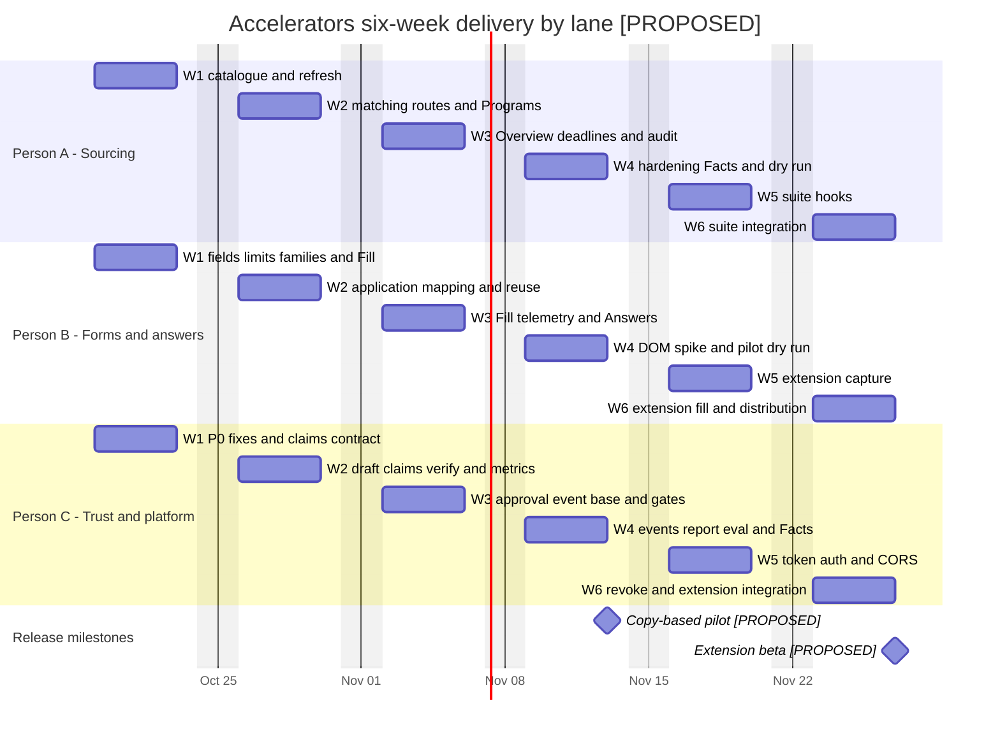

### Milestones

| milestone                           | date                      | contents                                                                                                                            | exit criteria                                                                                                                                                                                                                                                                                                     |
| ----------------------------------- | ------------------------- | ----------------------------------------------------------------------------------------------------------------------------------- | ----------------------------------------------------------------------------------------------------------------------------------------------------------------------------------------------------------------------------------------------------------------------------------------------------------------- |
| Prerequisites and typed foundations | 2026-10-23 **[PROPOSED]** | Four P0 bug fixes; catalogue seed/extractor/refresh; typed fields, UTF-16 limits and families                                       | Scope, duplicate-run, edit-invalidation and restricted-export regression evidence is present. Refresh failures retain old data. Old grants still load and do not become accelerators.                                                                                                                             |
| Trust path integrated               | 2026-11-06 **[PROPOSED]** | Claim verification, frozen approval requests, Approvals screen, approved-only Fill and copy-event base                              | Authorized custom-role approval works; unauthorized decisions fail. An edit/withdrawal/supersession invalidates the packet. Pending or changed answers cannot be copied as approved or marked submitted.                                                                                                          |
| Copy-based pilot                    | 2026-11-13 **[PROPOSED]** | P0–P3, Programs/Overview, application editor, Answers, Approvals, Fill, Facts & metrics, event report and safe Sources export       | The §7 dry run and seeded-error checks pass on the actual deployment path. Program deadlines/limits are checked against sources. A consenting founder completes review and copy without evidence leakage; the success threshold and measurement rule are agreed. Extension availability is not an exit criterion. |
| Extension beta                      | 2026-11-27 **[PROPOSED]** | P4 capture/fill, token auth/CORS/revoke, supported-portal boundary, cloud/self-host artifacts, Investors hand-off and History hooks | Supported controlled portals capture exact fields and fill current approved values after an explicit click. Unmatched fields stay untouched. Expired/revoked/wrong-company tokens fail closed. The extension never submits. Distribution and suite navigation work for their declared deployment modes.           |

### Risks to the schedule

| Risk                                                  | Blocking unit / consequence                                                                                                                              | Owner and response                                                                                                                                                                                                                                                                                                 |
| ----------------------------------------------------- | -------------------------------------------------------------------------------------------------------------------------------------------------------- | ------------------------------------------------------------------------------------------------------------------------------------------------------------------------------------------------------------------------------------------------------------------------------------------------------------------ |
| Starter program list or seed maintainer is not agreed | Blocks **A2**. Unreviewed terms, deadlines or fabricated seed entries are not a substitute.                                                              | Product supplies the starter list and maintainer at the Oct 19 contracts session, before the seed PR merges. A can proceed on schema/extractor fixtures, but cannot claim a pilot-ready catalogue without the reviewed seed.                                                                                       |
| Default approver decision is late                     | Blocks **C8** and therefore the Week 3 trust gate. Owner-default is proposed, not silently decided by implementation.                                    | TLs decide by Oct 30. C keeps `proposals.approve` grantable through custom roles and does not temporarily let every document editor approve. An unresolved approval policy holds the trust/pilot exit gate.                                                                                                        |
| Extension go/no-go is late                            | Blocks **B11** and the Nov 27 beta commitment; it does not make the Nov 13 copy-based pilot incomplete.                                                  | TLs decide by Nov 6. B records the Week 4 DOM support boundary. The account/listing owner is settled by Nov 13. A no-go requires an explicit revised release decision, not an extension stub labelled as shipped.                                                                                                  |
| Migration ordering slips                              | Blocks field, library, approval/event or token callers while the schema is unavailable; parallel journals can invalidate the release migration sequence. | Each Monday session names the next migration author. Catalogue lands first, then the rebased form model; the approval/event base lands before copy-event writes. Later migrations follow the same single-file merge queue. C integrates the release dependencies; no lane merges a caller against a missing table. |

## 9 Open questions

| QUESTION                                                                                                                                                                                       | WHO DECIDES                      | BY WHEN                                                                                    |
| ---------------------------------------------------------------------------------------------------------------------------------------------------------------------------------------------- | -------------------------------- | ------------------------------------------------------------------------------------------ |
| Acknowledge the brief's scope change: accelerators only; existing grants frozen in Proposals; diagrams out of v1.                                                                              | Brief author (Timothy Lin) + TLs | Before Week 1 starts (**Oct 19**).                                                         |
| What is the starter program list, and who maintains the reviewed seed? The wireframe program names are not seed sign-off.                                                                      | Product                          | Before the seed PR merges; target the Week 1 contracts session (**Oct 19**).               |
| Who holds `proposals.approve` by default? **[PROPOSED]** Owner by default, grantable through custom roles, not owner-only.                                                                     | TLs                              | By the end of Week 2 (**Oct 30**), before approval work starts in Week 3.                  |
| Is the first release a copy-only pilot, with a later extension beta, or must the extension be in the first release?                                                                            | TLs                              | By the end of Week 3 (**Nov 6**), before the Week 4 spike and the extension commitment.    |
| Are global catalogue tables acceptable in self-hosted deployments?                                                                                                                             | TLs                              | Week 1 contracts session (**Oct 19**), before the catalogue schema merges.                 |
| Who owns the Chrome Web Store account and unlisted listing?                                                                                                                                    | TLs                              | By the end of Week 4 (**Nov 13**), before beta distribution work.                          |
| Confirm the pilot/beta ship dates and success threshold X, including the acceptance/edit-ratio rule used to count source-verified founder-approved answers.                                    | TLs                              | By the end of Week 1 (**Oct 23**), before the report and pilot exit criteria are fixed.    |
| Approve the metric freshness policy: **[PROPOSED]** aging at 30 days, stale at 90 days for accelerator metrics.                                                                                | Product + pilot founders         | By the end of Week 2 (**Oct 30**), before the approval/fill gate is enabled.               |
| Is non-news program discovery in v1 or v1.1? The proposed pilot uses the curated catalogue; discovery is optional.                                                                             | Product                          | By the end of Week 3 (**Nov 6**), before Week 4 discovery/hardening work.                  |
| Is Inngest required for catalogue refresh in self-host? **[PROPOSED]** Without it, seed sync still runs at worker boot, weekly refresh is off, and rate-limited on-demand refresh runs inline. | TLs                              | Week 1 contracts session (**Oct 19**), before the refresh job and fallback contract merge. |

### Week 1 findings — Person C (Oct 19)

A real-model Northwind Cold Chain **Proposals draft-stage** run produced three sections. Manual review found **18 supported, 0 unsupported and 0 stale company/product factual sentences**: an observed unsupported rate of **0/18 = 0%**. Two accurate statements about missing inputs are audited but excluded from that denominator. [C4 report and Claim contract, PR #513](https://github.com/Deodat-Lawson/LaunchStack/pull/513) preserve the exact drafts, numbered quotes, fixture hashes, model/prompt identity, timestamps and sentence-level labels. The contract is ready for Person B's review.

**Boundary:** the unchanged `draftSection` and real configured model received all seven fixture-document sections through injected retrieval. This did not measure ingestion, indexing, search relevance, access control, persisted profile extraction, run execution or credit charging. One company and three outputs do not establish a population rate or determine success threshold X.

**Findings:** section-level citations do not bind each sentence to its supporting source; some team/product facts came from the supplied profile rather than numbered document quotes. Two outputs also included inline bracket citations contrary to the current prompt. The document's May 12 review date alone does not establish expiry: no freshness threshold was adopted, and “supported” means supported by the supplied inputs, not independently recertified in October.

**Week 2 input [PROPOSED]:** settle claim-to-document/profile provenance and freshness semantics, retain separate proof of indexed/scoped retrieval, and evaluate known unsupported numbers and explicitly superseded or dated metrics before relying on verification for approval/fill. TLs and product still decide X and the freshness policy. Issue #510, not the older Week 1 table above, governs this week's lane scope.

---

LaunchStack / Technical Design
