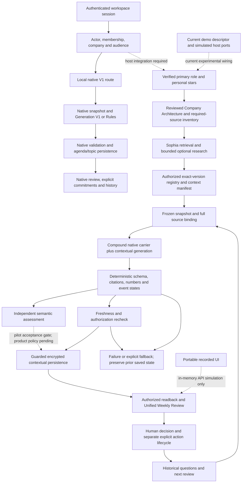

# Vantage — E2E Testing and Full Integration Plan

**Status:** proposal for review; execution not authorized by this document.
**Evidence inspected:** 2026-11-05; local working trees and GitHub read-only.
**Owners proposed:** TL (integration, contracts, persistence and acceptance), Joseph (identity, personal context and UI), Sophia (retrieval, research and semantic evaluation).

This task produced a plan only. No code was changed, tests executed, Vantage Generation/Judge providers invoked, databases accessed or migrated, environments started, branches merged, commits pushed, or deployments made. Historical test results below are evidence from retained reports, not fresh executions. The plan file is the only intended workspace addition.

## 1. Executive summary and readiness

Vantage has substantial reusable components, but no inspected implementation establishes the entire authenticated, role-aware, decision-ready lifecycle. The principal gaps are host composition, trusted context authority, report ownership, and real persistence/authorization acceptance. Model quality also remains an independent blocker: the financial regression failed even though both source definitions reached Generation.

The next stage should use four scenario families, with a shared frozen dataset and two modes:

1. **Mode A:** real application components, isolated PostgreSQL and authenticated HTTP/browser operations, with the model transport replaced by recorded or deliberately invalid responses. Verify deterministic invariants and lifecycle behavior. Any remaining simulated adapter is explicitly recorded.
2. **Mode B:** the same scenarios and frozen assembly, replacing only the model transports with approved Generation and a different-family Judge. Five Generation calls and five Judge calls are proposed, shared ceiling **10 requests**, no live repairs/retries. Start with Finance and stop if its acceptance fails. E2E-04 fault injections remain deterministic.

This is a bounded integration pilot, not the 14-case Candidate-D/V2 comparison. Five outputs cannot establish a 95% reliability rate, statistical superiority, p95 quality, or production readiness.

**Smallest actionable first milestone:** one isolated, authenticated Finance report round trip with zero external calls: real source authorization → required/dynamic context → registry/frozen snapshot → replay transport → deterministic validation → encrypted save → real reload → human review with no implicit commitment. Include the captured bad Finance output as a negative semantic control. A passing corrected replay proves plumbing only. Missing Company Architecture review or required-source authority must be repaired first; do not bypass those gates to obtain a demonstration.

### Readiness assessment

| Milestone | Current evidence | Assessment |
|---|---|---|
| Offline integrated | Component composition, captured-response replay, 761 reported passing tests; 54 PostgreSQL tests skipped in Phase A repair | Partial. Strong offline components; not one verified authenticated host |
| Real-model validated | Historical Pilot: 14 dispatch attempts, 13 responses and one timeout; acceptance failed | Not achieved; offline fixes have no confirming live run |
| Authenticated product E2E validated | Joseph reports authenticated personal-context DB/browser acceptance; contextual UI acceptance uses intercepted writes; portable demo is local simulation | Not achieved for the whole pipeline |
| Production ready | No verified canonical host, multi-user report ownership, migration reconciliation, independent Judge calibration or full DB/browser acceptance | Not achieved |

“Documented blocker” is an honest result, not a PASS. Final milestone sign-off requires its blocking gates to pass.

## 2. Actual source inventory and integration ownership

### Local and remote state

| Source | Inspected head / state | Intended use |
|---|---|---|
| Main checkout `C:\Users\junku\orca\LaunchStack` | `feat/weekly-agenda-contract-v1` at `a9d3e64240551a648c36ba04bce6078e0408168e`; 11 tracked modifications plus untracked fixtures/docs/scripts | Preserve. Historical Candidate-D archive and production review are here; do not implement over dirty files |
| `9499` | `integration/vantage-joseph-sophia-eval-20261102` at `b809e8248e4c65eb2e6e8c4aa05b52003e352aa9`; three tracked files modified and substantial untracked Phase A/V2 work | Primary source for integrated offline pipeline and repaired V2/validation logic; freeze the actual dirty file set, not HEAD alone |
| `1c46` | Detached `284a5dc9ed6c5f65e2f9e0620107f7e0d33d1656`; two tracked changes and untracked V2/storage/fixture work | Source for additive web storage/DTO compatibility and Phase 1 evidence |
| `514f` | `feat/vantage-decision-preparation-20261101` at `284a5dc9`; 16 tracked changes and four untracked polish/test/runbook files | Preserve as UI source; compare with portable branch before transfer |
| `f74c` | Clean `demo/vantage-portable-windows-20261102` at `e660b5908a6fe582ce0786dd58693099cf94ef9d` | Committed copy of polished UI plus standalone simulation. Reuse selected UI files, not simulated transport |
| Other registered worktrees | `LaunchStack-frontend-review` detached `5596beff`; `main-2` at `6134214f` | Inventory only; no evidence that either is a newer Vantage integration source |
| Remote `main` | **`c14773d06dd2c8ef2b28c2d9a6cbdb106ec0faa3`, November 3** | Local `origin/main` is stale at October 5 `6134214f`. Reconcile against this real remote baseline before product integration |
| Remote earlier integration | `integration/vantage-e2e-demo` at `0432b4b440456ee50f1e715bb13d6ae4d72b2ce7`, October 19 | Reuse authenticated Rules acceptance/probe patterns after isolating their hardcoded runtime |
| Remote earlier demos | `demo/vantage-integrated-mvp` at `7bf2f201`; `feat/vantage-joseph-integration` at `301dcfc9`; `Junkun/vantage-week2-rebuild` at `364a3c8b` | Older foundations; not newer replacements for `9499` |

GitHub branch listings and PR metadata were read without fetching or changing local refs. Joseph [PR #561](https://github.com/Deodat-Lawson/LaunchStack/pull/561) is open at `3afeb35dbefc817dfc9a7ea887c94424a047d061`; Sophia [PR #582](https://github.com/Deodat-Lawson/LaunchStack/pull/582) is open at `2b0ce19fcf34f33d87d97276ad6c247c58abb4dd`. Both target `Junkun/vantage-week2-rebuild`, not current `main`. Sophia #582 includes earlier #557 retrieval work; do not apply that twice. No newer relevant Vantage PR was found in the inspected search.

Remote `main` still has the older `server/vantage/service.ts` → `prepareAgenda` path. Its inspected Vantage directories do not contain the local branch's `service-v1.ts`, `context-v0`, or validation modules. The native frozen V1 path described below is therefore a **local integration branch path**, not proof that those features are deployed on `main`. See [current main service](https://github.com/Deodat-Lawson/LaunchStack/blob/c14773d06dd2c8ef2b28c2d9a6cbdb106ec0faa3/apps/web/src/server/vantage/service.ts).

### Critical overlap: Phase 1 versus Phase A

`9499` already contains V2. Its `generation-v2-schema.ts` and eight matching fixture files are byte-identical to `1c46`. Its runner, validator and tests have additional repairs:

- Runner prompt version is `vantage-agenda/contract-v2.1-schema.1`, versus `vantage-agenda/contract-v2.0-decision` in `1c46`.
- Added native/contextual citation namespace guidance, full-context instructions, schema-derived bounds and staged diagnostics.
- Added narrow, provenance-checked source-date attribution and captured-failure regressions.

Use the repaired `9499` pipeline files as the starting point and reconcile the `1c46` web storage/DTO changes onto them. Replacing `9499` wholesale with Phase 1 would lose repairs. The historical Phase 1 test pass does not validate that combined result.

Candidate-D is separate: its actual recorded policy is `vantage-quality/aligned-contract-v0.2`, JSON-object transport and aligned paired schema, with captured prompts in original-checkout `test-output/vantage-quality-2026-10-29/run-002/slot-42` and `slot-43`. It is not selected by a product caller. Historical D/confirmation delivery and scores must remain attached to that exact experiment.

## 3. Current architecture and intended canonical path



Solid arrows in the contextual chain describe available component composition, not a claim that every production adapter is connected. The important missing joins are the authenticated product host, reviewed company-context authority, complete required-source semantics, personal report persistence, and calibrated semantic assessment.

### Component implementation/status matrix

Path prefixes below are relative to `9499` unless specified. Detailed evidence links are in §13. “Blocks” means blocks genuine acceptance of the relevant full path, not necessarily isolated component tests.

| Stage / owner | Implementation and contract | Current integration/adapters/evidence | Missing dependency; blocks? |
|---|---|---|---|
| 1. Auth, actor, company — TL/Joseph | `apps/web/src/app/api/vantage/_http.ts`, `server/vantage/access.ts`; server `WorkspaceContext` → actor/company/permissions | Native APIs derive identity server-side; contextual demo additionally binds descriptor company/actor. Pilot synthetic host does not establish actual ACL integration | Replace pilot allowlist with reviewed product entitlement/permission; test two users and two companies. **Yes** |
| 2. Role recognition/primary role — Joseph | `pipelines/src/vantage/role-context-v0/*`, web `joseph-personal-context`; membership/personal revision → role IDs, mapping version and primary preference | DB-backed PR #561 implementation exists; experimental `joseph-personal-host.ts` still has process-memory state. Current controlled directory is founder/product/engineering/growth-sales; archived fixture roles are more specific | Wire DB provider and authoritative primary resolver; version exact role mappings/responsibilities; freshness invalidates a stale role revision. Roles must never confer ACL. **Yes** |
| 3. Stars and required context — Joseph/TL | Joseph provider plus `context-v0` ports; selected exact source refs → required sources or blocking state | Required stars fail on missing/revoked/unprocessed/over-budget content. Report is larger than the personal snapshot | Full workspace-mandatory inventory is not retained in current Generation envelope (`otherMandatory: not-retained`). Add server-owned membership, not inferred labels. **Yes** |
| 4. Company Architecture — TL | Web `server/vantage/company-architecture.ts`, pipeline `context-v0/company-architecture.ts` and `proposals/context-v0.ts`; structured profile/version/review state | Real projection exists, but returns `unreviewed`; Joseph provider requires `reviewed` or `unknowns-marked` | Authenticated review/unknown-marking write, permission and audit contract. Do not mark reviewed in a test adapter and call it product integration. **Yes** |
| 5. Retrieval/research — Sophia | `dynamic-retrieval/*`, `rag-search.ts`; scoped role/context request → versioned candidates and provenance | Bounded retrieval/research and authorized RAG adapter exist. Host must supply authorization and binding adapters; no production RAG bridge caller found. Research tools are injected | Register real source/catalog/RAG adapters; trace query embedding and tool costs. Keep public research disabled for initial pilot. **Yes for full retrieval E2E** |
| 6. Registry/manifest — TL/Sophia | `context-v0/registry.ts`, assembler/validation; exact refs/content/ACL metadata → admitted manifest | Real deterministic logic used in synthetic scenarios; registry rejects scope/version/content mismatch | Independently read trusted current state rather than trusting retrieved metadata or model-provided inventory. **Yes** |
| 7. Frozen snapshot — TL | Pipeline `context-v0/adapters.ts` and `evidence-snapshot.ts`, web `server/vantage/experiments/sophia-composition-v0.ts`; admitted manifest + native input → frozen generation envelope | Existing source/ACL/cutoff binding and guarded commit checks; live pilot used synthetic transaction/current-state ports | Real adapters and atomic recheck/commit, authoritative primary role and required-source snapshot. **Yes** |
| 8. Generation — TL | Native `generation-port.ts` defaults to `generateWeeklyAgendaV1`; Sophia compound runner; repaired V2 opt-in runner in `9499` | Native product route does not call V2. Demo calls Sophia V0, not V2. Candidate-D is an archived experiment; V2 has real failed Pilot evidence | Explicit experimental host selection with frozen prompt/transport/model identity; preserve native schema, 2,400 compound output cap and bounded attempt contract. **Yes for decision-ready E2E** |
| 9. Deterministic validation — TL | `validate-generation-v1`, Sophia compound checks, `validate-generation-v2.ts`, `event-state-grounding-v1.ts` | Real checks and captured-response regressions. Native ≤1 topic/contextual ≤3, no contextual owner/due/help/enhancements; exact citations and numeric/date checks | Compose all checks through real host before persistence; lexical number support is not semantic entailment. **Ready as component; integration still required** |
| 10. Semantic validation — Sophia | `validation/{contracts,judge,judge-evidence,...}.ts`, `evaluation-integration/*`; scenario sources/expectations/output → integrity, six rubric dimensions and verdict | Independent invocation supported. Historical Judge used same `gpt-6-luna` family; invalid quotes/IDs correctly remain rejected after repair | Different-family transport/config, input/output ID binding, omission calibration and V2 supplemental rubric. **Yes for model acceptance** |
| 11. Encrypted storage/readback — TL | `demo-service.ts`, `demo-v2-fields.ts` in `1c46`, `demo-contract.ts`, `demo-api.ts`; validated report → sealed JSONB sidecar → DTO | Actual encryption and metadata CAS; read rechecks sources/access. Phase 1 tests mock persistence. Envelope history cap 8 and payload cap 750,000 bytes | Transfer optional V2 fields, real PostgreSQL transaction tests, personal report ownership, retention/version policy. **Yes** |
| 12. Human review — Joseph/TL | Unified `ContextDemoScreen`, drawer; contextual `expectedVersion` review mutation vs native decide route | Contextual decisions are recorded separately from generated recommendations. Native decide may carry an explicit validated commitment. Portable interactions are memory-only | Real mutation/browser/restart evidence; cannot infer persistence from intercepted writes. **Yes** |
| 13. Commitments/history/next review — TL/Joseph | `repository-v1.ts`, `pending-questions.ts`, history appendices; human decisions and outcomes → historical context | Separate APIs/CAS and authoritative human state exist; generation does not automatically create work | End-to-end next-week case; ownership/visibility alignment across native carrier and personal report. **Yes** |
| 14. Failure/fallback — TL | V1 Rules fallback; V2 outcome classifier; `withFreshState`/guarded commit | V2 can reuse an already validated same-envelope fallback without another call. Contextual demo rejects unsuccessful non-replay generation and retains saved state | Define explicit UI/status distinctions; never reuse a stale/unauthorized prior report as fallback. Exercise failure after Generation but before save. **Yes** |

### Native V1 versus contextual reports

Native V1 is a frozen wire contract with native agenda/topic/commitment storage. The contextual report is an additive experimental sidecar attached to a native agenda carrier. It has its own topic evidence, review state and optional V2 fields. These are different validation and lifecycle contracts.

Current contextual storage chain:

`compound output schema → normalize → ExperimentalReportV0 → DemoReport construction → JSON serialization/encryptSecret → model_metadata[vantageContextDemoV1] compare-and-swap → decrypt/openPayload → freshness/access validation → API DTO/demo-contract → frontend/demo-api → replay fixtures`.

The contextual envelope is **not** in `vantage_contract_state.payload`. Additive V2 JSON fields do not themselves require a migration. Moving to per-user contextual report ownership or replacing the sidecar with durable report/review tables is a separate schema decision and future migration task. Keep legacy absent fields valid; malformed present V2 fields must fail rather than disappear silently. Frozen native V1 remains unchanged.

## 4. Dependencies and integration gaps

### Required before deterministic full-host acceptance

1. **Freeze/reconcile source ownership.** A SHA of `b809e824` excludes the important uncommitted repairs. Produce a file/hash manifest and reviewed patch inventory for `9499`, `1c46`, and `514f`; keep originals untouched.
2. **Resolve Company Architecture review.** Add a real permissioned transition to reviewed/unknowns-marked with revision and reviewer audit. Current projection/provider mismatch prevents genuine generation.
3. **Bind primary role and required-source membership.** Add a host-owned immutable context extension or equivalent trusted side-channel to the frozen envelope. Include principal/company, membership and primary-selection revisions, required-lane membership, source versions/content hashes, and ACL digest. Do not infer mandatory status from citation use, source age, titles or public/private labels.
   Joseph's current `role-context-v0/role-map.json` accepts founder/product/engineering/growth-sales, not the archived owner-manager, Partnerships Lead or Security Engineer labels. Unknown role IDs are rejected by `saveRoles`. Joseph/TL must approve a versioned directory extension or an explicit mapping that preserves the specific verified responsibilities and primary perspective. The V2 frame supports security/owner labels but has no Partnerships frame; generic persona is valid, but missing responsibility context is not. Do not silently map both sides to generic engineering/growth roles and claim the original paired-role experiment passed. Freeze this mapping as part of the new test condition.
4. **Replace simulated host ports.** Authentication, document catalog, exact-version text, authorizer, current-state reader, transaction/persistence and personal-context provider must point at isolated real infrastructure.
5. **Select one experimental generation factory explicitly.** Repaired V2 is the proposed pilot arm because it exercises the repaired financial case and decision fields. Keep it off by default. Test the native carrier independently and preserve Candidate-D unchanged for a later comparison.
6. **Define ownership.** Native agendas are unique by `(companyId, weekStart)`; personal contextual reviews cannot safely overwrite each other in the same carrier slot. Decide personal reports keyed by `(companyId, ownerUserId, weekStart)` and version as the default proposal. The native company agenda can remain a compatibility object; its existence must not grant access to another person's report.
7. **Prove privacy on reads and writes.** The local native schema has private evidence and creator IDs, while inspected generation/read paths are company-scoped. Audit all evidence/snapshot/overview/source-open/history/report paths for actor visibility. An actor-private source must not appear in another actor's native carrier, diagnostics or Judge pack.
8. **Isolate test infrastructure correctly.** Existing helpers hardcode database names/ports/projects, and DB tests often accept only 55437 or 55438. Parameterize and retain strict ownership checks for a new namespace. Do not merely point a new variable at an existing demo DB or weaken safeguards globally.

### Required before Mode B

- A new metered run spec for these E2E IDs and ten-call ceiling. The old ledger hardcodes Phase A/B cases and budgets; do not repurpose the exhausted Pilot ledger or label new cases as old ones.
- Independent Judge model/provider transport. Current live transport is OpenAI-compatible; a Claude configuration alone does not prove an Anthropic protocol adapter works. Test its request/response/usage/error capture offline.
- Actual model IDs, endpoint class, reasoning settings, tokenizer, rates and prompt sizes pinned. Public pricing is a planning reference, not Azure invoice proof.
- New finite-scenario completeness proof, if used, must be generated from the trusted isolated catalog. Otherwise status stays `excerpted`. Complete inventory does not prove semantic correctness.
- Required generation and Judge inputs fit their existing byte limits without dropping critical context. Count the full native+contextual output; Phase 1's `o200k_base` 548/641/552-token goldens and 1,459-token three-topic stress are proxy projections, not provider-tokenizer proof or measured p95.

### Required before product release, not reasons to expand the first pilot

Resolve current-main migration ancestry; scoped concurrency in place of seven-table global write locks; audited report retention/key rotation; request idempotency; rate/cost limits; async generation/cancellation if request-time limits require it; CI with mandatory DB coverage; safe evidence-link schemes; operational telemetry and rollback. Define scheduling separately—manual E2E success does not establish unattended weekly runs.

The November 2 production review is useful evidence, not an instruction to implement its every proposal blindly. In particular, Joseph already has DB-backed context work, V2 exists uncommitted, and the portable branch contains the UI. Reuse these instead of rebuilding them.

## 5. Shared scenario and acceptance protocol

### Freeze and isolation

Create a new worktree and proposed integration branch only after implementation approval. Suggested run namespace: `vantage-e2e-<UTC>-<short-id>`. Reserve a fresh loopback app port (proposed 3186) and PostgreSQL port (proposed 55446) after checking availability. Use unique DB/container/volume/runtime/output names, independent secrets and `.next`/cache locations. Never use 3104, 3111, existing demo databases/runtime directories, or clean shared caches. Existing helpers require scoped adaptation before those example ports work.

Use real synthetic users created through the supported isolated auth setup: owner/admin, ordinary member, second same-company member with different private documents, and outsider in a second company. Server session and membership resolution are authoritative. Never accept a request's company/user/role field as authority.

**Historical-clock setup is required.** These scenarios have October/November cutoffs; ordinary ingestion and profile review today would create post-cutoff versions and correctly fail freshness checks. Materialize synthetic document/profile/index timestamps under an isolated Vantage domain-clock/fixture setup, with profile review and source versions at or before each scenario cutoff. If a service currently reads wall time directly, add a test-only injected domain clock before acceptance; do not remove date checks or backdate real records. Keep real authentication/session-expiry time separate, and record actual execution time alongside the synthetic business clock. The same domain clock and materialized timestamp manifest must be used in Mode A and Mode B. This setup does not establish live connector-ingestion correctness.

Every case freeze records:

- Case/variant, implementation commit plus dirty-source manifest, prompt/schema/normalizer/rubric hashes, transport and model configuration hashes.
- Actual database IDs and exact versions, source text hashes, ingestion/chunk/index versions, source and observed timestamps, permissions/audience and ACL digest.
- Logical fixture ID → actual registered source-ref crosswalk. Historical `doc:D03@v1` or `doc:joseph-semantic/...@synthetic-v1` are not automatically valid DB refs.
- Verified primary role and membership/personal-context revisions; company-profile version/review state; mandatory sources/stars and access results.
- Explicit half-open report period, `asOf`, timezone and clock. An older authorized mandatory source can be included; a new/future source must not cross the cutoff.
- Raw retrieval candidates/ranks/filter reasons, admitted source set, registry/manifest and frozen envelope hashes; no Gold/expected findings in Generation input.
- Exact transport prompts and outputs, validation stages, model usage/outcomes, saved report/version, redacted HTTP trace and database assertions.

Existing historical fixtures/captures remain byte-identical. Database materializations and prospective next-week additions get new versioned manifests, not edits to the old experiment.

### Verdicts and deterministic versus semantic gates

Record a vector per case: `retrieval`, `authorization`, `snapshot`, `generation-delivery`, `deterministic-validation`, `semantic-assessment`, `persistence`, `human-review`, `next-week`.

- **PASS:** every required deterministic invariant passes and every required semantic expectation is independently assessed and satisfied.
- **FAIL:** an observed invariant violation, critical omission, fabricated fact/citation, state promotion, unauthorized exposure, incorrect persistence, or wrong human-action side effect.
- **NEEDS REVIEW:** no confirmed deterministic violation, but a missing/invalid Judge result, ambiguous material meaning, unavailable independent assessment, or unexecuted/mocked required seam. Missing infrastructure is also recorded as a blocker. This cannot become PASS through averaging.

Mode A can pass its deterministic gates while semantic quality remains unassessed. Invalid Judge evidence yields unassessed semantics; it does not make the generated answer correct or incorrect by itself. Preserve valid and invalid scores, raw outputs and failed attempts separately.

For this small pilot, require human inspection of **all five** delivered reports and Judge evidence. Keep Sophia's existing rubric version and raw scores; add versioned supplemental checks for decision quality, brief quality, recommendation precision and warranted vigilance. Do not silently reinterpret historical 0–100 or /20 scores.

Semantic gate per successful report: all critical expectations satisfied, no critical unsupported claim or state promotion, every recommendation evidence-linked and challengeable, and human Decision Quality at least 4/5. These are case acceptance criteria, not proof of the V2 Phase 2 aggregate thresholds.

## 6. Four E2E scenario specifications

### E2E-01 — Normal weekly review, human decision and next week

Use C05's order/supply case for concrete operational decisions and uncertainty, then a separately authored next-week continuation. This adds lifecycle coverage beyond schema tests.

| Field | Specification |
|---|---|
| Initial actor/state | Authenticated owner-manager in isolated company E2E-01; no report for the target week; second member and outsider exist for denial checks. Verified primary owner-manager/solo-operator mapping, persisted stars |
| Source versions | Reuse unchanged `1c46/fixtures/vantage-generation-v2/C05.input.json` sources. **D03@v1 = 200-cup order with paid deposit; D01@v1 = delivery estimated for November 9; obs D06@v1 = older stock estimate around 125 cups on October 30.** Materialize exact registry refs and crosswalk before freeze |
| Company/required state | Reviewed or unknowns-marked profile through actual authorized API; order and supplier documents explicitly required; older inventory starred. Include finite authorized inventory and relevant distractors from fixture |
| Cutoff | Week start 2026-10-26; `[2026-10-26T04:00:00Z, 2026-11-02T05:00:00Z)`; `asOf=2026-11-02T14:00:00Z`, America/New_York. Retain the archived fixture period exactly where it differs and flag mismatch before running |
| Retrieval | Include all three critical sources despite old inventory date; preserve estimate/current-stock uncertainty and separate source identities. Required-source omission blocks assembly |
| Generation | Recommend current usable-stock evidence and conditional response before the order; no asserted shortage, full payment, confirmed backup availability or automatic assignment. Meaningful decision rule and specific change-condition |
| Deterministic checks | Full compound schema/runtime bounds; exact refs and versions; numeric/date/arithmetic support; event-state; actor/cutoff/source/role binding; no contextual owner/due/help or enhancements; output cap 2,400 |
| Sophia/human checks | Evidence coverage of order, delay and old inventory; warranted vigilance; no date metadata promoted to confirmed delivery; recommendations remain advice |
| Persist/review/reload | Save encrypted report, decrypt/read through API, open exact sources, record a human decision with expectedVersion and authenticated actor. Repeat/reload/restart confirms the same decision/version/history. Commitment count and pending-question state are unchanged by this decision alone |
| Explicit lifecycle continuation | In a separate user operation, create one authorized native commitment, verify idempotency, then record an outcome through the real API. Independently keep one historical question open; do not infer its resolution from silence |
| Next week | Proposed new fixture: current inventory check and operator-reported fulfillment, linked to original order, with actual new refs/versions. Freeze week `[2026-11-02T05:00:00Z, 2026-11-09T05:00:00Z)`, `asOf=2026-11-09T14:00:00Z`. Prior human choice remains historical; report must not re-raise fulfilled work as unfinished, claim independent verification, or silently close the still-open question |
| Evidence | Two frozen envelopes; DB before/after report, decision, commitment and pending-question assertions; encrypted round-trip; process restart readback; HTTP/browser trace with no intercepted mutations; two Generation/Judge assessments in Mode B |

**PASS:** both weekly checkpoints satisfy their deterministic and semantic gates; explicit human lifecycle survives restart with zero unintended actions. **FAIL:** any automatic commitment, lost review, invented stock result, failed source binding or incorrect carry-forward. **NEEDS REVIEW:** only replay semantics or missing genuine host/restart seam. Debug in order: actor/role → required sources → frozen pack → raw output → normalized report → transaction → DTO → UI → next-week history.

The continuation document bodies and expected notes must be written and reviewed before any execution. They are proposed fixtures, not existing source facts.

### E2E-02 — Paired authoritative primary roles

| Field | Specification |
|---|---|
| Original fixtures | Original-checkout `test-output/vantage-quality-2026-10-29/run-002/inputs/C02.json` and `C03.json`. Ten source records are identical, all version `v1`. C02 SHA256 `e93ea3713868107dc1ff99a0a82b0b1f3ea9815058bd11123b2042648ff44cb3`; C03 `923004a3e16ff9b558f2193c20491ba04256eccc54ab543b355942317f693df3` |
| Actor/control | Same authenticated actor, company, ACL, source texts, stars, company profile and cutoff; two isolated runs differing only in authoritative primary role and its legitimate revision. Archive both runs rather than overwriting one. This is a new controlled materialization: original C02/C03 actor/company labels differ |
| Roles | Both memberships/responsibilities verified. Variant A primary Partnerships Lead; B primary Security Engineer, through the prospectively approved versioned mapping described in §4. Current Joseph role IDs alone cannot represent these exact preferences. Trusted role resolver receives session-derived principal/company and revision. Client/source text cannot change primary role |
| Company/required state | Same reviewed company profile; same required set including sponsor draft, security checklist and prior meeting record; same available cross-role dependencies |
| Cutoff | `[2026-10-26T04:00:00Z, 2026-11-02T05:00:00Z)`, `asOf=2026-11-02T14:00:00Z` |
| Key source meaning | D01: planned November 4 pitch, unfinished impact/budget slides, draft/no accepted invite. D08: November 5 shared-admin review due, no completed review/final signoff. D06 prior meeting connects unfinished pitch work and access review. Preserve all other source versions/distractors |
| Retrieval | Required context remains present. Current retrieval scores the union of role IDs, so holding both verified roles fixed and changing only primary may legitimately produce identical rankings. Pass authoritative role context and primary metadata through the host boundary, log both, and require cross-role dependencies to remain eligible. Do not require different retrieval ranking to manufacture a PASS; primary-sensitive ranking would be a separate design change |
| Generation | A prioritizes pitch preparation/completion path and invitation confirmation. B prioritizes shared-admin access review. Either may mention a material cross-role dependency with its reason. Do not force a second topic solely to make rankings differ |
| Deterministic checks | All common checks, same source/ACL hashes, only approved role/revision/run differences; correct role reaches both retrieval and generation; stale role revision rejects commit; roles confer no new access |
| Sophia/human checks | Correct top priority for each role, meaningful decision path, no “scheduled pitch”/“review completed” promotion, no trivia recommendation slot. Judge sees role-specific expected behavior but not the arm's hoped-for score |
| Persistence/UI | Separate immutable run/version records; role preference survives reload; report displays correct context provenance; no cross-user report replacement. User review remains bound to its report, even after primary role changes |
| Evidence | Source-set equivalence proof, authoritative role adapter trace, request/manifest/prompt role bindings, ranked retrieval, two raw outputs/Judge results, two report versions and real reload |

**PASS:** both role variants meet semantic priorities and all invariants. Different wording alone is not evidence of role awareness. **FAIL:** spoofed role accepted, critical dependency filtered without justification, wrong priority or cross-actor state leakage. **NEEDS REVIEW:** valid but ambiguous prioritization or unavailable role/host binding. Debug the resolved primary role and retrieval inputs before changing the prompt.

C03 is absent from the V2 fixture directory; import its unchanged archived input into the new experiment namespace. Never fabricate it from C02's expected answer.

### E2E-03 — Financial definitions and omitted evidence regression

| Field | Specification |
|---|---|
| Source fixture | `9499/fixtures/vantage-pipeline-edge-cases/semantic-cases.json`, case `conflicting-metrics`, version `joseph-semantic-edge-cases-v1` |
| Historical frozen identities | Company `synthetic-joseph-evaluation`, actor `synthetic-joseph-actor`; `doc:joseph-semantic/conflicting-metrics/finance@synthetic-v1` and `/sales@synthetic-v1`; original captured envelope under Pilot `freeze/conflicting-metrics/generation-context-gold-free.json` |
| Real-host materialization | New authenticated founder/CEO in isolated workspace, exact source text copied with content hashes and new actual DB ref crosswalk. No copied synthetic principal is treated as authenticated identity |
| Definitions | Finance: provisional USD 12,000, retaining original refund/qualification language. Sales: USD 18,000 including unsigned opportunities. Use the exact fixture text; neither is a interchangeable “true revenue” measurement |
| Company/required state | Reviewed profile; both documents in the authorized finite inventory. Use the same required/optional classification as the frozen scenario, documented prospectively; making both required is a separate sensitivity condition, not a silent repair |
| Cutoff | Original `asOf=2026-10-19T12:00:00.000Z`. Historical freeze has `[2026-10-12T00:00:00.000Z, 2026-10-19T00:00:00.000Z)`, timezone America/New_York, kind week-to-date. Preserve that historical envelope unchanged for replay. For the new authenticated completed-week materialization, freeze canonical New York bounds `[2026-10-12T04:00:00Z, 2026-10-19T04:00:00Z)` and the same asOf after verifying the period function. This is an explicitly different host condition, not a byte-identical live rerun. Mode A and B use this same new freeze |
| Retrieval/assembly | Both exact source bodies reach candidates, admitted registry, snapshot and actual wire input. Duplicate native intake of Finance is labelled the same source, never independent corroboration. Record required/retrieved/cited/uncited sets separately |
| Generation | Preserve both amounts and definitions, provisional status and unsigned opportunities; explain comparability uncertainty. Ask/recommend reconciliation of inclusion criteria, period and status using each ledger/owner as evidence permits. Never claim only one revenue source, sum to USD 30,000, or treat USD 6,000 difference as an established loss |
| Deterministic checks | Exact citations and numeric provenance; any explicit computed difference needs verified arithmetic/derivation and must not erase definition mismatch. Full runtime/size checks. Structural validity alone cannot pass this case |
| Sophia/human checks | Critical omission of either financial definition must fail coverage; unsupported exclusivity must fail grounding. Judge evidence must use actual source/output IDs and verbatim quotes. Expectation IDs are not source IDs. Unknown or invalid Judge evidence leaves semantics unassessed |
| Persist/UI | Only contract-valid, fresh, authorized report can be saved. Experimental output's semantic status stays attached; a failed candidate cannot replace the last accepted report. Drawer shows both sources, uncertainty and reconciliation next step; human decision remains separate |
| Evidence | Full stage-by-stage source trace, provider wire/raw response, deterministic diagnostics, source-use report, Judge packet/response/evidence-validation, human checklist, persisted report and browser source opens |

**Mode A negative controls:** first replay the historical structurally valid but incomplete Finance output unchanged against its **original historical envelope and registry**. It must remain recognizable as incomplete by the evaluation gate. For the real-host materialization, create a separate derived negative fixture using the reviewed exact-ref crosswalk: change only source/identity bindings required by the new namespace, retain the same semantic wording/omission, and preserve the original bytes and derived diff. Old synthetic refs submitted unchanged to the new DB registry must fail exact-citation validation; that is a different negative test, not an omission assessment. A hand-authored complete fixture with actual registered refs exercises storage/UI mechanics, not model quality. Calibrate omission detection with removed-Sales and fabricated-exclusivity variants offline; do not feed those gold labels to Generation.

The historical UTC-midnight window and New York timezone are an additional host-compatibility checkpoint found during inspection. TL must record the original-versus-canonical period difference and ensure no source enters/leaves the test corpus unnoticed. If the product period contract cannot produce the proposed completed-week window, stop preflight and resolve the contract; do not weaken its validation or rewrite the old Pilot artifacts.

**Mode B first gate:** one Generation then one independently configured Judge, with human review. If Generation is invalid, do not spend the Judge call. Stop the live pilot on failed/uncertain critical coverage or invalid Judge evidence; unused slots are not permission to repair/retry. **PASS** requires both definitions, uncertainty and reconciliation. **FAIL** includes the historical omission even when all refs parse. **NEEDS REVIEW** includes missing Judge evidence; it cannot unlock later calls.

### E2E-04 — Guardrails, race conditions, failure and recovery

Use a saved, accepted E2E-01 report as the starting point, plus a different actor and company. Each boundary subtest starts from a fresh copy of the same isolated database checkpoint. Mutating several boundaries at once would let the first failure hide the others, so keep the following subtests separate inside one scenario family.

All use the E2E-01 role/profile/source set/cutoff unless the row explicitly changes that one property. Faults are injected at the relevant adapter boundary; no real provider requests are needed.

| Subtest | Controlled mutation and stage | Required observable outcome |
|---|---|---|
| 04a required source | Remove a required source; separately revoke its read access before assembly | Required-context failure; zero Generation dispatches, no fabricated replacement, no write. Restore through authorized setup and prove recovery in a new run |
| 04b scope/audience | Attempt foreign company override, foreign document ref, same-company other-user private source and other-user report read | Reject or filter before evidence/prompt construction; direct source/report APIs deny; no identifiers/content leaked through native carrier, error body, logs or Judge pack |
| 04c freshness/cutoff | New source version after freeze; future sourceDate; excerpt/hash mismatch; role/ACL revision changes | Reject invalid admission or fail guarded commit. Older authorized required source is a positive control; age alone is not invalidity |
| 04d post-generation revocation | Revoke source or membership between returned output and transaction recheck | No save and no overwrite; stale output cannot become fallback. Existing stored bytes remain, but readback withholds content if permission is now revoked |
| 04e structured failures | Replay malformed JSON, unversioned/invented citation, excessive field length, >3 contextual topics, foreign recommendation ref, ungrounded number/bad derivation and event-state promotion | Real validators reject. No text trimming, alias invention or partial report display. Provider repair policy exercised through a synthetic transport with at most the existing two attempts |
| 04f Judge failures | Replay fabricated quote, expectation-as-source ID, wrong version, unavailable Judge, and omission-positive negative control | Exact evidence guards reject invalid judgments; semantic assessment stays unassessed or fails appropriately, never defaults to a passing score |
| 04g bounded recovery/fallback | Synthetic first attempt invalid, second valid; both invalid; timeout; matching and mismatching cached V1.5 fallback envelopes | One outcome per run: first-pass/after-repair/fallback/failed. No third call. Fallback requires exact frozen-context/source-set equality and revalidation; otherwise retain prior saved report. Rules is separately labelled native fallback |
| 04h persistence/concurrency | Competing reviews with same expectedVersion, competing generations, transaction failure after validation, duplicate explicit commitment request | Exactly one winning CAS update; losing stale mutation gets 409 or defined conflict, no lost review/partial save/duplicate commitment; report/actor binding survives restart |
| 04i read compatibility | Legacy report without V2 fields, malformed present fields, unavailable decryption key, capped-history boundary | Legacy validates/renders with sentence fallback and hidden V2-only sections; malformed/decryption failure fails safely. History-cap failure preserves all prior reports and reviews |
| 04j permissions restored | Restore access/version through an authorized new snapshot, then use a valid replay response | New independently validated run can succeed. Never resurrect old stale output by suppressing the original failure |

Before/after DB checks must compare authoritative row versions, model metadata, report history, review entries, commitments and pending-question versions. Ciphertext may change under fresh encryption; compare persisted raw metadata for no-write cases and decrypted canonical payload for successful round trips.

**PASS:** every boundary rejects at the intended checkpoint, recovery succeeds where allowed, prior state is preserved and zero unauthorized disclosure occurs. **FAIL:** bypass, unintended write, excessive attempt, false semantic pass or unsafe reuse. **NEEDS REVIEW:** database/ACL/current-state/transaction is still a mock or required suite was skipped. Required evidence includes stage-tagged failures, dispatch count, DB assertion report, redacted HTTP trace and real browser behavior.

## 7. Phase A repairs: reuse and remaining work

The retained Pilot has 14 provider dispatch attempts, 13 responses, one timeout, 46,464 reported input tokens and 16,325 output tokens; cached input 27,327 is a subset, not additional usage. Timeout usage and dollar billing are unknown. The same `gpt-6-luna-2026-09-22` response model was used for Generation and Judge. No family independence or authenticated DB/browser E2E was established.

The offline report preserves 107 original artifacts and replays all 14 attempts without network requests. It reports 761 passing tests and 54 skipped PostgreSQL tests. Preserve those historical verdicts and artifacts exactly.

| Finding | Already repaired offline | Still required |
|---|---|---|
| Finance omitted Sales although both reached Generation | Full-context guidance, source-use/citation diagnostics and review-only exclusivity signals | Real-model retest; trusted required-source semantics; Judge omission and human checks |
| Malformed/oversized output and invalid refs | Native/context namespace guidance, schema limit reminders, bounded diagnostic errors/tests | Confirm actual model obeys unchanged compound cap/schema. Keep historical bad outputs rejected |
| Judge fabricated quote or used expectation ID | Input-bound source/output ID sets and strict verbatim quote checks | Different-family adapter and calibration; no quote/ID repair that invents evidence |
| Attributed source date wrongly rejected | Narrow validator support tied to exact frozen content/version, ACL/access and cutoff | Port repaired validator, preserve negative tests; metadata must not prove publication, approval or execution |
| Completeness hardcoded excerpted | Trusted finite-synthetic inventory proof, fail-closed reasons; legacy remains excerpted | Real host inventory authority. Complete inventory is not complete understanding or proof of source truth |

Run the existing replay once after integration into a **new output directory**, compare hashes/verdicts, and add only regressions for newly fixed joins. Do not replay unchanged suites repeatedly merely to increase test totals. The previous ten-call retest proposal was not an authorization; this document's ten-call proposal uses a different five-output set and a different-family Judge.

## 8. Step-by-step execution and ownership

All steps below are future work requiring implementation authorization; model calls also require a separate budget approval.

| Step | Work and exit evidence | Lead / support | Planning effort |
|---|---|---|---|
| 0. Review plan/decisions | Approve scope, personal-report ownership, company reviewer permission and proposed arm; no calls yet | TL, product owner, Joseph, Sophia | 0.5 day |
| 1. Source integration inventory | New isolated workspace; immutable source/diff manifests; remote-main ancestry and migration conflict inventory; preserve source worktrees/demos | TL | 0.5–1 day |
| 2. Minimum host joins | Real personal-context provider, profile review, primary resolver, required-source inventory, registry/current-state and guarded persistence wiring | TL + Joseph; Sophia reviews retrieval boundary | 2–4 days |
| 3. Independent evaluation harness | New E2E run spec/ledger, exact Judge IDs, negative controls, finite inventory proof, offline protocol tests | Sophia + TL | 1–2 days; parallel with step 2 |
| 4. First milestone | Authenticated offline Finance round trip with real PostgreSQL/reload/human review; captured failure retained; no external calls | TL + Joseph + Sophia | 1–2 days |
| 5. Four Mode A families | Freeze all cases/continuation, execute all deterministic boundaries, real browser mutations and PostgreSQL suites; classify gaps | TL coordinates; Joseph UI/auth; Sophia retrieval/evaluation | 1–2 days |
| 6. Mode B approval packet | Exact frozen inputs/wires/token counts, provider/Judge IDs, endpoint/rates, zero hidden calls, 10-request/$2 ceiling proposal and stop rules | TL; Sophia validates Judge | 0.5 day |
| 7. Bounded live pilot | Finance first; remaining four outputs only after Finance gate. Five human reviews; preserve every attempt | TL runs; Sophia evaluates; Joseph verifies UI | 0.5–1 day |
| 8. Targeted repairs/reruns | Root-cause issues, smallest generalizable fixes, affected deterministic regressions; new approval for any paid reruns | Component owner; TL integration | 1–3 days initially; depends on findings |
| 9. Canonical product integration | Reconcile current main, auth/ownership/storage/real adapters/unified UI/native compatibility; queues/limits as required | TL, Joseph, Sophia | 3–6 days; scope-dependent |
| 10. Final acceptance | Mandatory DB suites, full integrated browser, regression and stable-demo smoke, distinct milestone sign-offs | TL accountable; all owners | 1–2 days |

These are estimates of focused engineering effort, not promises that dependencies or model semantics will pass. With parallel work, expect roughly two to three working weeks for an initial integration/assessment cycle; migration/auth divergence or repeated semantic failures can extend it. Do not wait for unrelated audits or modify their workspaces.

## 9. Commands and required artifacts

Commands here are **planned**, not executed in this planning task. Run them only from the new integration workspace after reviewing package scripts and isolating process environment. Never invoke old live runners with inherited authorization.

### Existing reusable commands

```powershell
# Offline component regression; outbound provider transport denied and keys absent.
pnpm.cmd --filter @launchstack/pipelines test src/vantage --exclude 'test-output/**'
pnpm.cmd --filter @launchstack/pipelines typecheck
pnpm.cmd --filter @launchstack/web typecheck
pnpm.cmd --filter @launchstack/pipelines test:retrieval
pnpm.cmd --filter @launchstack/pipelines test:validation
pnpm.cmd --filter @launchstack/pipelines test:integration

# After copying/reconciling Phase 1 sizing script; provider mapping remains a gate.
pnpm.cmd exec tsx pipelines/scripts/vantage-v2-token-projection.ts

# Read-only historical input, new replay output. Substitute frozen absolute paths.
node --import tsx pipelines/scripts/vantage-phase-a-offline-audit.mjs `
  --pilot-root '<preserved-original-pilot-root>' `
  --output-dir '<new-run-root>/phase-a-replay'
```

Use the broad regression once, then focused commands for changed areas. The named subset commands above are useful for debugging, not an instruction to duplicate all passing work.

### PostgreSQL and browser acceptance

Existing tests include:

- `pipelines/src/vantage/repository-v1.integration.test.ts`.
- `apps/web/__tests__/api/vantage/contract-v1.integration.test.ts`.
- Web server `vantage-auth-v1`, `vantage-company-architecture`, `vantage-joseph-personal`, `vantage-sophia-composition`, and `vantage-context-demo` integration suites.
- `apps/web/__tests__/server/vantage-generation-v2-storage.test.ts` from `1c46` is valuable encryption/DTO coverage but currently uses mocked persistence; extend with real DB coverage rather than relabel it.
- Earlier remote `integration/vantage-e2e-demo` has `apps/web/e2e/vantage-contract-v1.spec.ts` and `scripts/dev/vantage-integration-probes.mjs` for authenticated Rules/ACL checks.

After adapting ownership-safe test configuration, planned invocations include:

```powershell
# Environment points ONLY to the new owned DB; no existing demo URL.
pnpm.cmd --filter @launchstack/pipelines test src/vantage/repository-v1.integration.test.ts
pnpm.cmd --filter @launchstack/web exec jest --runInBand --runTestsByPath `
  __tests__/api/vantage/contract-v1.integration.test.ts `
  __tests__/server/vantage-auth-v1.integration.test.ts `
  __tests__/server/vantage-company-architecture.integration.test.ts `
  __tests__/server/vantage-joseph-personal.integration.test.ts `
  __tests__/server/vantage-sophia-composition.integration.test.ts `
  __tests__/server/vantage-context-demo.integration.test.ts
```

**Not yet implemented:** a four-scenario real-host runner, isolated Playwright config and mandatory-DB skip checker. Proposed interfaces are `vantage-e2e-plan.mjs freeze|run-mode-a|status`, `vantage-e2e-model.mjs preflight|run-case`, and `playwright.vantage-e2e.config.ts`. Their names are design placeholders, not runnable existing commands. Specify exact commands in the execution approval packet once implemented and verified offline.

Existing `vantage-tl-test.mjs` hardcodes project/container/volume and port 55434; several later DB suites hardcode 55437/55438. Do not run `test:tl`, migrations, seed helpers or Docker teardown unmodified against shared resources. New harness must check unique labels, DB identity, allowed loopback port and schema journal, then fail if any required integration test skips. Use local test concurrency 1 where necessary; never stop another agent's processes.

### Artifact layout

```text
test-output/vantage-e2e/<run-id>/
  authorization-and-run-spec.json       # explicit limits, models, owners, condition
  source-manifest.json                 # commits, dirty-file hashes, migrations
  environment-manifest.json            # sanitized adapters, DB/index/clock config
  fixtures/<case>/<variant>/           # source crosswalk, expectations, ACL, hashes
  stages/<case>/<variant>/             # retrieval, registry, manifest, frozen input
  requests/                            # exact sanitized wire, raw response, receipts
  provider-ledger.json                 # reserve-before-dispatch; all failures count
  validation/                          # deterministic, Judge integrity, semantic, human
  persistence/                         # DB assertions, decrypted canonical hashes
  browser/                             # trace, screenshots, HAR without credentials
  replay/                              # offline reconstruction from immutable capture
  issues.json                          # failure-to-fix-to-regression links
  results.json                         # per-stage PASS/FAIL/NEEDS REVIEW + blockers
  acceptance.md
```

Keep Gold/expectations in evaluator-only files. Generation artifacts must demonstrate their absence. Never store auth cookies, credentials or encryption keys in published artifacts. Preserve original Pilot/quality ledgers and scores, with new assessments stored under a new rubric/run identifier.

## 10. Provider-call and cost proposal

### Proposed single-arm initial pilot

Use repaired V2 from `9499`, explicitly experimental and off in production. This tests the actual Phase A repairs without silently switching to Candidate-D. Candidate-D remains a preserved reference/replay arm; an arm comparison needs separate approval.

| Family | Generation | Judge | Explanation |
|---|---:|---:|---|
| E2E-03 Finance, first | 1 | 1 | Gate before any other live case |
| E2E-01 lifecycle | 2 | 2 | Current week and frozen next-week continuation |
| E2E-02 paired roles | 2 | 2 | Same evidence, two authoritative primary roles |
| E2E-04 fault/recovery | 0 | 0 | Captured/injected transport failures and real infrastructure |
| **Total hard ceiling** | **5** | **5** | **10 total provider dispatches** |

Live SDK retries = 0; one Generation request and one Judge request per planned output. **No repair reserve, verification calls, connection-probe completions or paid fallback requests.** Deterministic Mode A exercises the existing two-attempt repair contract. Configure the experiment's lower call allowance without changing shared production retry constants. If the runner cannot enforce one live attempt, it is not ready to run this proposal.

Every dispatched request consumes a slot even on timeout/HTTP failure/invalid JSON. Reserve in a persistent shared ledger before dispatch. On crash, unresolved slots remain consumed. Stop on the first Finance failure or invalid assessment; later failures also stop further spending pending review. A failed primary output is never counted as delivered V2 because an older report or native Rules result exists.

### Models and transport

- **Generation proposed:** the previously used Azure deployment `gpt-6-luna`, response identity historically `gpt-6-luna-2026-09-22`; JSON-object/reasoning-none settings, unchanged 2,400 output-token cap. Confirm actual deployment mapping before approval; record returned model identity. Drift requires a new labelled condition.
- **Judge proposed:** independently configured Anthropic `claude-sonnet-5-5`, exact accepted model ID/version frozen before approval, no tools, one request, existing 4,096 output-token cap. Account availability and adapter wiring are unverified. This is a proposed new provider configuration, not a claim that it is already installed or approved. Official model identifiers are documented in [Claude's model overview](https://platform.claude.com/docs/en/models/overview).
- If an available different-family model is chosen instead, freeze and cost that exact selection before authorization. Do not silently reuse Luna as “independent.” A human can adjudicate, but this would be a separately labelled protocol.
- No external research in this pilot. No unmetered query-embedding/reranker requests. If the real RAG path needs them, either use a frozen, disclosed query-embedding/index fixture for this bounded test and mark that adapter unvalidated, or submit an additional exact embedding-call/token budget. The ten-call plan alone does **not** establish live end-to-end embedding/ingestion correctness.

This is a confirmed implementation issue, not a hypothetical cost: `server/engine.ts:195` registers the app RAG port; `server/rag/port.ts:31` constructs default embeddings; vector retrieval and notes retrieval can each call `embedQuery`, and the embedding transport has its own retry loop. Optional ensemble reranking can add requests. Sophia's retrieval-lane counters are not provider-request counters. The existing app port does not expose a cache-only embedding injection. To retain actual DB/vector search in Mode A and the ten-call Mode B, first implement a host seam that injects frozen query vectors into **every** embedding-consuming leg, verifies query/index/model/dimension equality, fails on a cache miss and disables network reranking/fallback. Mark the embedding adapter as recorded, not production validated. Until that seam exists, recorded retrieval is only component-mode evidence and cannot satisfy the full real-retrieval gate. Live embedding/ingestion acceptance remains a separately budgeted follow-up before production readiness.

### Token and dollar estimate

Projected planning envelope, to replace with measured frozen-prompt counts at preflight:

| Stage | Requests | Expected input/request | Input ceiling/request | Output ceiling/request |
|---|---:|---:|---:|---:|
| Generation, whole compound response | 5 | 6,000 tokens | 12,000 tokens | 2,400 tokens |
| Judge, including source/output evidence | 5 | 8,000 tokens | 16,000 tokens | 4,096 tokens |
| Total | 10 | 70,000 input | 140,000 input | 32,480 output |

These token estimates are assumptions, not measurements. Retain existing stricter prompt-byte limits (V2/Sophia preflight 23,500 bytes and transport 24,000 bytes); the token ceiling does not authorize a byte-limit increase. If full critical evidence cannot fit, stop and repair assembly/contract offline; do not truncate silently. Confirm provider tokenizers; Phase 1's proxy is insufficient for an exact budget.

For an illustrative uncached list-price estimate, OpenAI currently lists Luna at **$0.10/M input and $0.50/M output** ([official model pricing](https://developers.openai.com/api/docs/models/gpt-6-luna)); Anthropic lists Sonnet 5.5 at **$2/M input and $10/M output** ([official pricing](https://platform.claude.com/docs/en/about-claude/pricing)). Prices were read on 2026-11-05. OpenAI direct pricing is **not verified Azure deployment billing**, and cloud/geography terms can differ.

At those reference rates, with no cache discount:

- Expected-input estimate, conservatively using every output cap: `30k×$0.10/M + 12k×$0.50/M + 40k×$2/M + 20,480×$10/M = $0.2938`.
- Input/output ceiling estimate: `60k×$0.10/M + 12k×$0.50/M + 80k×$2/M + 20,480×$10/M = $0.3768`.
- **Proposed shared spending ceiling: $2.00**, together with the stricter ten-request ceiling. This is a proposed limit, not approved spending or a bill quote. Before execution, substitute verified deployment/provider rates, include any regional or billable-reasoning charges, and reserve each request's maximum cost. Unknown billing/tokenization prevents budget sign-off. No embedding/research, cloud infrastructure, taxes or human labor are included.

Historical usage is reported separately; a missing billed amount remains unknown rather than zero. Record provider receipts and calculated estimates with their basis. Never infer actual invoice cost from these projections.

No automatic escalation to the old Phase B/Phase 2 experiment is allowed. The earlier 14-case × two-arm × three-run comparison, repairs and pairwise judging is explicitly outside this proposal.

## 11. Failure triage and regression strategy

Inspect the earliest broken invariant before proposing changes:

| Failure class | Evidence checkpoint | Generalizable repair direction | Required rerun |
|---|---|---|---|
| Retrieval | Authorized corpus vs candidates, query/ranking and filter reasons | Registration, permissions, deduplication, required-source priority, bounded recall | Affected retrieval cases + E2E-02/03; all ACL boundaries if authorization changes |
| Assembly | Candidate → registry → manifest → frozen wire | Exact source/version/hash binding, truncation accounting, required-role semantics | All four Mode A families; live affected cases only with new approval |
| Generation | Full wire contains source but raw response omits/distorts it | Clear shared task/contract, output budget or generic decision rule; no answer-specific hints | Finance plus analogous omission/definition cases; preserve untouched negatives |
| Deterministic validator | Raw vs parsed output, stage/error code | Narrow general rule with positive/negative examples; never trim output into success | Captured replay + validator suite + E2E-04 |
| Judge | Judge packet, namespaces, raw evidence quotes, missed expectations | Input binding, rubric calibration, failure-as-unassessed | All negative controls; every affected prior assessment under a new rubric label |
| Persistence | Guarded state read, transaction/CAS, ciphertext and DTO | Atomicity, ownership, recheck, compatibility | DB concurrency/rollback + E2E-01/04; no live model needed for storage-only changes |
| UI/review | API truth vs rendered state/mutation/reload | Correct report identity, version handling, source display and human intent | Real browser review/reload/denial tests; no model rerun for display-only changes |
| Product contract | Competing plausible ownership/approval/lifecycle semantics | Explicit product decision and versioned contract | Cases affected by the decision plus compatibility regression |

Use a local issue record before creating any external issue:

```text
id / priority / owner / status
case + variant + run + exact code/config/fixture hashes
stage / deterministic-or-semantic / observed vs expected behavior
source refs + raw evidence paths + failed invariant
root-cause hypothesis + evidence that would falsify it
implementation bug vs product-contract gap
proposed general fix + impacted interfaces
regression test + original negative control
rerun scope + paid-call approval reference if needed
resolution evidence + remaining limitations
```

Priority order: unauthorized disclosure or wrong write → corrupted/lost human state → source/role/cutoff drift → critical semantic omission/unsupported claim → delivery/invalid Judge evidence → lower-value prioritization/UI issues. Do not improve the aggregate score by removing failed cases, revising Gold after seeing output, counting fallback as V2, or relabelling missing evidence as irrelevant.

## 12. Canonical integration and final acceptance

### Integration order

1. **TL freezes source inventory and ancestry.** Start an isolated integration branch from a deliberately selected base after comparing current remote `main` with Week 2 and `b809e824`. Prefer a reviewable series rebased/cherry-picked onto the approved current-main base; do not merge whole demo branches. Review migration journals and auth/schema changes before any DB setup. Current planning does not authorize those future mutations.
2. **Joseph context/auth foundation.** Reuse #561's persisted roles/stars and provider. Align real workspace identity, primary role revision, private audience and source-open rules. TL owns company-profile review and report ownership contract; Joseph owns UI/API interactions.
3. **Sophia retrieval and registry integration.** Reuse #582, recognizing included #557 ancestry. Register authorized RAG/current-state bindings. Keep optional research disabled until separately metered and accepted. Required sources take priority and cannot be sacrificed to optional ranking.
4. **TL transfers Phase A repair and V2 compatibility.** Reconcile `9499` repaired pipeline with `1c46` web sidecar/DTO code. Preserve V1 schema, native carrier checks, contextual limits, event-state and exact citation rules. Freeze a new combined implementation identity and reproduce captured replay.
5. **TL composes one product host.** A product contextual service accepts server-derived context, resolves trusted providers, freezes one snapshot, invokes the selected gated generation factory, validates, rechecks current state, persists, and returns one typed report DTO. Demo/replay ports remain explicit alternatives, never hidden production defaults.
6. **Persistence and lifecycle alignment.** Choose durable per-person report ownership and immutable generation/review history. For initial isolated acceptance, existing encryption/CAS can be exercised within known caps; wider rollout requires retention/ownership decisions. Preserve historical envelopes and native V1 reads. No silent schema repurposing or report migration.
7. **Joseph unifies presentation.** Bring verified UI file changes from `514f`/`e660b590`, adapted to product DTO and real APIs. Provide native/Rules rendering through an explicit adapter, with appropriate provenance. Keep portable fetch simulation, static fixtures and launch scripts out of the product path. Preserve old summary sentence fallback when V2 fields are absent.
8. **Sophia adds assessment observability.** Store deterministic integrity, semantic status, reviewer identity, evidence and rubric versions separately from generated advice. During the pilot semantic acceptance gates progression and promotion to accepted report. Production asynchronous Judge behavior must be decided after calibration; a slow/unavailable Judge cannot silently count as PASS, and it never authorizes sources or actions.
9. **TL adds operational controls and CI.** Per-actor/company permissions, scoped locks, budgets/idempotency/rate limits, correlation IDs, safe failure states, queue/cancellation as needed. Required PostgreSQL suites and relevant pipeline tests must run in CI rather than skip because only `TEST_DATABASE_URL` is supplied.

### Generation activation decision

Keep native V1 and explicit Rules fallback available. Do not label Sophia V0 or repaired V2 as “Candidate-D.” Candidate-D requires its exact archived prompt/schema/transport to be ported and independently verified before use as a production arm.

The ten-call E2E pilot can establish limited V2 integration/semantic feasibility. It does **not** approve replacing the default generator or completing V2 Phase 3 UI activation. The larger V2 comparison still requires its separate case freeze, independent review, budget and original quality/delivery gates. Until then V2 remains an explicit experimental selection.

### Explicit fallback policy

- Invalid or stale new output never replaces a saved accepted report.
- A previously saved report may remain visible only while the viewer still has access and readback freshness policy permits it; otherwise show an unavailable/stale state without disclosing revoked content.
- Same-envelope validated V1.5 fallback is allowed only when all context/source/actor/role bindings match and validation passes. It makes no additional call and is labelled fallback, never V2 success.
- Native Rules generation is a separate fallback contract and presentation. It cannot masquerade as a contextual report or inherit personal claims it did not validate.
- No prior usable report means an explicit failed/unavailable state with a retry option subject to budget and new authorization; no fabricated “empty successful week.”
- Human decisions, commitments and pending-question outcomes remain authoritative across generation failures and regeneration. New AI suggestions cannot overwrite them.

### Final acceptance checklist by milestone

| Milestone | Required evidence to declare it achieved |
|---|---|
| **1. Offline integrated** | Canonical isolated host; real authentication and DB adapters for required seams; all Mode A boundaries; no provider traffic; legacy/V2 round trip; recorded mock adapters explicitly excluded. If real auth/DB is still missing, call it component integration only |
| **2. Real-model validated** | Five planned outputs satisfy independent/human semantic gates and delivery checks; exact ledger ≤10; complete provenance; Finance regression passes; all needed retrieval adapters disclosed. No reliability/quality generalization beyond this small sample |
| **3. Authenticated product E2E validated** | Same code/config behind normal signed-in host; all four families including next-week and actual browser mutations; two-user/two-company privacy; real PostgreSQL tests with zero required skips; no test descriptor or simulated auth/catalog/transaction bypass |
| **4. Production ready** | Prior milestones plus reviewed main/migration integration, access/ownership/retention/key policy, scoped concurrency/load, operational budgets/telemetry/recovery, supported real retrieval/ingestion adapters, release/rollback review and independent activation approval |

Final acceptance must show:

- Zero unauthorized source/report exposure, including errors, native carrier, historical reads and evaluator packets.
- Zero invented source IDs or ungrounded critical claims; numeric lexical validation is not the semantic proof.
- Correct authoritative role throughout retrieval/generation and no privilege changes from roles.
- Frozen source-version/cutoff consistency at assembly, dispatch, commit and read.
- Saved report, human review and explicit commitments survive reload/restart; no unintended action from recommendations or contextual decisions.
- All E2E-04 failures preserve prior state safely; exact outcomes and CAS conflicts recorded.
- Relevant PostgreSQL tests execute; no silent skip or wrong database.
- Browser checks use the actual integrated host, no interception of review/context writes.
- Relevant pipeline/web/auth/retrieval suites, typechecks and scoped lint pass on the final source manifest; broader checks only as warranted by changes.
- Stable demos remain operational under their own runtime/port/config. Use non-destructive smoke checks after approval; do not reseed, regenerate, upgrade or clean them.
- Every blocker has owner, evidence and required resolution. Unresolved blocking items prevent the affected milestone from being signed off.

### Risks, owners and decisions

| Priority | Risk / decision | Accountable owner | Acceptance gate |
|---|---|---|---|
| P0 | Cross-user private evidence/report exposure; company-week report collision | TL + Joseph | Same-company different-user and foreign-company negative tests |
| P0 | Profile always unreviewed; missing required-source authority | TL, Joseph for review UI | Real reviewed/unknown-marked revision and server inventory; no bypass |
| P0 | Lost decisions or unauthorized work creation | TL + Joseph | Real CAS, rollback, restart and explicit-action tests |
| P0 | Financial omission remains unfixed semantically | TL Generation, Sophia evaluator | Finance first live gate plus human review |
| P1 | Split dirty work and newer remote main | TL | File-level source manifest and migration/ancestry review |
| P1 | Uncalibrated/same-family Judge, invalid evidence | Sophia | Different-family transport, exact evidence guard, negative controls |
| P1 | Hidden embedding/research/SDK spend | TL + Sophia | Deny-by-default transports and shared reserve-before-dispatch ledger |
| P1 | Compound truncation or prompt-byte overflow | TL | Whole-compound/provider-token measurement; unchanged caps |
| P1 | Skipped DB tests and fixed-port helpers | TL | Isolated owned DB and fail-on-required-skip acceptance |
| P1 | Table-wide locks, envelope history cap and synchronous request timing | TL | Scoped concurrency/retention/operational design before broad release |
| P2 | UI simulation mistaken for product acceptance | Joseph | Actual signed-in host and unintercepted writes/restart |

## 13. Evidence index

These are inspected sources, not newly executed tests. Local working-tree line references can move; the future freeze must include hashes.

| ID | Source and relevant evidence |
|---|---|
| E01 | [Phase A offline repair](C:/Users/junku/.codex/worktrees/9499/LaunchStack/docs/runbooks/vantage-phase-a-offline-repair-2026-11-02.md): preservation 9–14; repair findings 22 onward; 761/54 and replay 90–120; file list 125–143; remaining limits/proposal 145 onward |
| E02 | [Live Pilot](C:/Users/junku/.codex/worktrees/9499/LaunchStack/docs/runbooks/vantage-live-e2e-pilot-2026-11-02.md): failed acceptance 3–5; model/host boundaries 15–38; financial finding 75–88; usage/verification and no-auth/DB/browser 145–180 |
| E03 | [Joseph/Sophia offline integration](C:/Users/junku/.codex/worktrees/9499/LaunchStack/docs/runbooks/vantage-joseph-sophia-evaluation-2026-11-02.md), plus [PR #561](https://github.com/Deodat-Lawson/LaunchStack/pull/561) and [PR #582](https://github.com/Deodat-Lawson/LaunchStack/pull/582) |
| E04 | [V2 Phase 1 design/storage trace](C:/Users/junku/.codex/worktrees/1c46/LaunchStack/docs/design/vantage-generation-v2-phase1.md): trace 3–13; disabled runner/role/transport limits 15–25; corrected examples 27–35; synthetic verification/token limitations 37 onward |
| E05 | [Repaired V2 runner](C:/Users/junku/.codex/worktrees/9499/LaunchStack/pipelines/src/vantage/experiments/decision-generation-v2.ts), [validator](C:/Users/junku/.codex/worktrees/9499/LaunchStack/pipelines/src/vantage/validate-generation-v2.ts), [source-use diagnostics](C:/Users/junku/.codex/worktrees/9499/LaunchStack/pipelines/src/vantage/experiments/source-usage-v0.ts) |
| E06 | [Contextual storage service](C:/Users/junku/.codex/worktrees/514f/LaunchStack/apps/web/src/server/vantage/demo-service.ts): open/seal 159–201; auth 230–257; read freshness 488–519; failed generation 585–615; history/CAS 684–733; review/version/CAS 931–972 |
| E07 | [Native repository](C:/Users/junku/.codex/worktrees/9499/LaunchStack/pipelines/src/vantage/repository-v1.ts): table lock 107–112; pending review 852–891; generation recheck 911 onward; explicit decision/commitment 1077–1161; [schema](C:/Users/junku/.codex/worktrees/9499/LaunchStack/pipelines/src/vantage/schema.ts): company/week uniqueness 200 |
| E08 | [Company Architecture projection](C:/Users/junku/.codex/worktrees/9499/LaunchStack/pipelines/src/vantage/context-v0/company-architecture.ts): unreviewed projection 546/585; [database adapter](C:/Users/junku/.codex/worktrees/9499/LaunchStack/apps/web/src/server/vantage/company-architecture.ts): authorization/freshness 402–500; [Joseph provider](C:/Users/junku/.codex/worktrees/9499/LaunchStack/pipelines/src/vantage/role-context-v0/provider.ts): review-state gate 324–335 |
| E09 | [Polish acceptance](C:/Users/junku/.codex/worktrees/514f/LaunchStack/docs/runbooks/vantage-weekly-review-polish-2026-11-01.md): 125 Jest/30 browser checks with intercepted writes and simulated staleness; [portable runbook](C:/Users/junku/.codex/worktrees/f74c/LaunchStack/docs/runbooks/vantage-portable-windows-2026-11-02.md): 125 UI + 8 transport tests, seven browser groups, recorded simulation |
| E10 | [Production review](C:/Users/junku/orca/LaunchStack/docs/reviews/vantage-production-review-2026-11-02.md): useful risk inventory; reconcile with later/parallel work rather than treating every historical finding as current proof |
| E11 | [Candidate-D configuration](C:/Users/junku/orca/LaunchStack/test-output/vantage-quality-2026-10-29/run-002/configuration-authorization-100.json), [C02 input](C:/Users/junku/orca/LaunchStack/test-output/vantage-quality-2026-10-29/run-002/inputs/C02.json), [C03 input](C:/Users/junku/orca/LaunchStack/test-output/vantage-quality-2026-10-29/run-002/inputs/C03.json) |
| E12 | [Earlier authenticated integration harness commit](https://github.com/Deodat-Lawson/LaunchStack/commit/0432b4b440456ee50f1e715bb13d6ae4d72b2ce7); [current main](https://github.com/Deodat-Lawson/LaunchStack/commit/c14773d06dd2c8ef2b28c2d9a6cbdb106ec0faa3); [portable branch](https://github.com/Deodat-Lawson/LaunchStack/tree/demo/vantage-portable-windows-20261102) |

## 14. Prioritized implementation checklist and immediate next action

1. [ ] **Approve implementation scope for the first milestone only:** isolated authenticated offline Finance round trip; no paid calls or production activation.
2. [ ] Freeze actual dirty source manifests and preserve the original Pilot, Candidate-D and stable demo artifacts.
3. [ ] Reconcile `9499` repaired V2 with `1c46` web compatibility; identify current-main migration/auth conflicts before database setup.
4. [ ] Decide personal report ownership and company-profile reviewer authority; wire real primary role and required-source inventory.
5. [ ] Prepare isolated owned PostgreSQL/auth/source infrastructure and enforce zero external dispatches; retain strict database guards.
6. [ ] Complete the first Finance replay round trip and real human-review/reload checks; retain the historical omission as a failing semantic control.
7. [ ] Freeze the other three scenario families, including next-week continuation and C02/C03 paired primary roles.
8. [ ] Execute all Mode A gates, PostgreSQL suites and real browser writes; fix integration defects with targeted regressions.
9. [ ] Prepare the exact ten-call independent-Judge approval packet with measured tokens, verified rates and all remaining adapter limitations.
10. [ ] After separate approval, run Finance first; proceed only on its PASS, stop within the shared request/dollar limits, and inspect all five reports.
11. [ ] Triage failures by earliest stage; preserve historical grades; obtain new approval for any paid rerun.
12. [ ] Complete canonical host/UI/persistence integration and final acceptance, signing off offline, real-model, authenticated product and production readiness separately.

**Recommended immediate next action:** authorize steps 1–6 as the smallest zero-provider implementation milestone. Its completion should produce one genuine authenticated persisted report/review lifecycle plus reproducible negative evidence—not another simulated demo and not a large model experiment.
