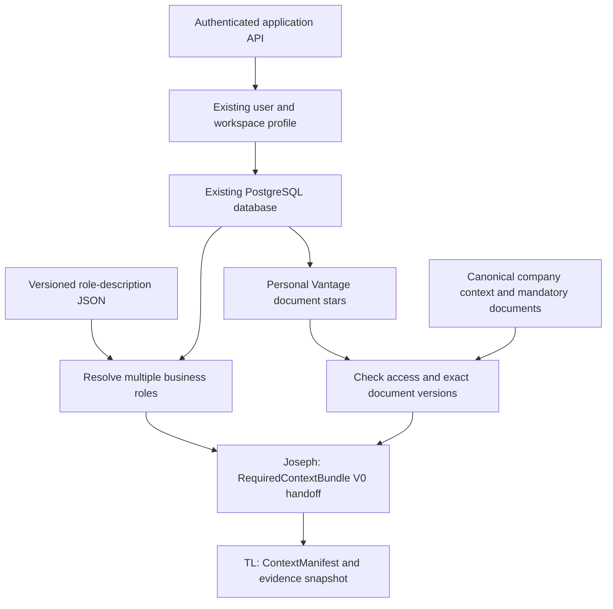

# Joseph — Week 2 roles and personal context handoff

Date: 2026-10-26. Owner: Joseph. Status: independent implementation and synthetic
acceptance; **production persistence/routes require TL review and integration**.

Base: `Deodat-Lawson/LaunchStack`, `Junkun/vantage-week2-rebuild`, exact commit
`364a3c8bd3b1c5bb2ee45cf66c1ea608b3c44618`.
Branch: `feat/joseph-vantage-context-v0`.
Shared contracts: `@launchstack/pipelines/vantage/context-v0`, `v0-proposed` /
`v0-assembly-1`. Role map: `joseph-roles-2026-10-26-v0`.
Personal state DTO: `joseph-personal-context-v0`.

## Assignment and delivery boundary

The supplied Week 2 Plan, section C and interface handoffs, assigns Joseph the
schema audit, multi-business-role identity/map, Vantage-personal stars, new UI,
required-context provider and fixture tests. It explicitly says **“no migration
before TL review”**. The Technical Design assigns existing v1 fixes, source/ACL
adapters, generation integration and final acceptance to TL. This change adds no
v1 wire fields, production API routes, migrations, live providers, or deployment.
It does not alter PR #511, main, or the shared TL branch.

Implemented: deterministic role mapping, confirmation/correction, optional primary
perspective, scoped revision-safe star/unstar store port, source revalidation,
required-source diagnostics, reusable UI, a persistent browser-only synthetic
preview, and tests against the actual TL validator/assembler. The fixture store
and localStorage are **not** production PostgreSQL persistence. Durable production
storage is the outstanding Joseph follow-through after TL signs off on the
concrete schema/API proposal below; final cross-branch wiring and acceptance are TL-owned.

## Whiteboard flow alignment

The user supplied a whiteboard photo (`IMG_9193.JPG`) as a design reference.
The readable Joseph-related labels are API call, user profile, DB, `role.json`
with role descriptions, “Add col / use existing,” and “User starred documents.”
The lower destination appears to say “Snapshot”; the existing V0 contract makes
that boundary precise. The chart is architectural context, not evidence of TL
schema approval or an instruction to implement other team members' work.



This is the chart interpreted through the stated ownership boundaries in the
Week 2 Plan; the company-context and permission checks come from that plan and
shared V0 types. “API call” is treated as the application's authenticated API,
not an instruction to add a separate AI call for role recognition. “Add sheet”
is interpreted as a relational association for personal stars in the existing
PostgreSQL database, not a spreadsheet or second database.

| Diagram step                    | Implementation / remaining work                                                                                                  |
| ------------------------------- | -------------------------------------------------------------------------------------------------------------------------------- |
| API → user profile              | Existing profile fields audited; authenticated V0 API bindings remain proposed.                                                  |
| Add column / use existing → DB  | Reuse canonical membership/profile/document records; additive role fields and personal-star relation await TL schema review.     |
| `role.json`: role → description | Implemented as `role-map.json`, extended for multiple roles, aliases, responsibilities, priorities and explicit fallback.        |
| User starred documents          | Implemented store interface, star/unstar logic, UI and scoped fixtures; real PostgreSQL persistence remains pending.             |
| Snapshot handoff                | Required-context provider implemented and tested against TL's manifest assembler. TL owns final snapshot/generation integration. |

The chart reinforces the existing proposal; it does not remove the outstanding
production storage/API work. The preview still uses synthetic data and browser
storage. No unrelated annotations in the photo are treated as new requirements.

## Repository audit and reuse decision

| Existing surface                                                                                                                    | Finding                                                                                           | Reuse / decision                                                                                                                                                                                                   |
| ----------------------------------------------------------------------------------------------------------------------------------- | ------------------------------------------------------------------------------------------------- | ------------------------------------------------------------------------------------------------------------------------------------------------------------------------------------------------------------------ |
| `apps/web/src/server/db/schema/identity.ts`, `users`                                                                                | `title`, `bio`, display name; legacy role/status explicitly deprecated                            | Read title only as unconfirmed business-role hints. Never infer permissions.                                                                                                                                       |
| Same file, `userCompanyMemberships`                                                                                                 | Unique user/company membership, active status, authorization `role`, nullable `profileTitle`      | Prefer workspace `profileTitle`, falling back to global `users.title`. Keep authorization role untouched. No existing structured multi-business-role field.                                                        |
| `apps/web/src/server/profile/store.ts`; `/api/profile` and `/api/profile/workspace`                                                 | Existing self-profile and workspace override reads/writes                                         | Reuse caller resolution and profile ownership patterns; do not serialize business-role arrays into a display title or bio.                                                                                         |
| `packages/store/src/db/schema/base.ts`, `company`                                                                                   | Canonical company identity                                                                        | Company ID is the workspace boundary for this slice. Server resolves the active company.                                                                                                                           |
| Same file, `document`, `documentVersions`                                                                                           | Company-scoped canonical document ID, current version pointer, version ID/number and timestamps   | Store canonical IDs, read exact immutable versions. An ID/URL/title alone is not permission proof. Do not duplicate documents.                                                                                     |
| `apps/web/src/server/workspace/document-access.ts`; `~/lib/authz/scope`                                                             | Document/folder/grant authorization, scoped document reads                                        | TL production source adapter must use the same ACL machinery before content and before returned listings.                                                                                                          |
| `/api/documents/[id]/versions/[versionId]/content`                                                                                  | Authorized version-specific content path exists                                                   | Reuse version/content resolution through a server adapter; avoid capped recent listings and public URL requirements.                                                                                               |
| `packages/tools/src/company-context/schema.ts`, `companyMetadata`, `companyProfileSources`; `apps/web/src/server/company-profile/*` | Existing company profile, facts/provenance, per-document source versions, permission-filtered DTO | Reuse this canonical profile. TL must define reviewed/unknowns-marked Architecture projection, exact version/fingerprint and mandatory source catalog. Do not create another master profile or auto-draft it here. |
| `mindmap.ts` / `artifacts.ts` `starred`; workspace session `pinned` / `sourceIds`                                                   | Stars belong to other content types; pins belong to a session                                     | None satisfies canonical-document + user + company + Vantage uniqueness. Reusing these would change unrelated modules.                                                                                             |

The provider consumes trusted adapters rather than importing web routes into a
pipeline. Existing profile/title, membership, document IDs and versions remain
canonical. All fixture contents are synthetic; no business DB was queried.

## Role proposal and behavior

`pipelines/src/vantage/role-context-v0/role-map.json` defines Founder, Product,
Engineering and Growth/Sales with stable IDs, exact aliases, descriptions,
responsibilities and agenda priorities. It is an interim ontology, not an ACL.

Exact title aliases separated by `+`, comma, semicolon or “and” provide unconfirmed
suggestions. Unknown tokens produce explicit fallback; no substring guessing,
model call, or Owner/Admin/Member inference. A user can save zero or multiple
controlled roles and clear or set one primary role. Manual correction takes
precedence over title suggestions. Empty confirmed selection remains intentionally
empty. Multi-role order is primary first, then stable directory order; merged
priorities preserve that order and remove duplicates. The shared TL manifest sorts
role IDs independently; callers should retain BusinessRoleContext for primary-lens
presentation. Map/profile versions must join TL's current-state freeze.

## Concrete storage / API proposal for TL review

Do not run a migration from this PR. Recommended smallest additive change in the
**existing PostgreSQL**:

1. Nullable `business_context_v0 jsonb` on `user_company_memberships`, with a
   validated object containing controlled `roleIds[]`, optional `primaryRoleId`,
   `confirmedAt`, and the role-map version. Null means use title hints. Existing
   membership uniqueness already provides user/workspace scope.
2. `vantage_context_revision bigint NOT NULL DEFAULT 0` on that membership, used
   by role and star changes. Backfill only the revision default; never infer or
   confirm business roles during migration.
3. Personal-document relation `vantage_document_stars`: `company_id`, `user_id`,
   `module` constrained to `vantage`, `document_id`, last observed version ID,
   `starred_at`, `updated_at`. Unique `(company_id,user_id,module,document_id)`;
   FK to the membership's `(user_id,company_id)` and canonical document identity.
   Enforce document company match in the same transaction. Keep only refs and
   timestamps, never cached excerpts. Membership deletion cascades its personal
   state. Document deletion semantics need TL signoff: proposed tombstone/retained
   selection diagnostics, so deletion never silently removes a required star.

Proposed versioned routes (not registered):

| Route                                           | Contract                                                                                                                                                               |
| ----------------------------------------------- | ---------------------------------------------------------------------------------------------------------------------------------------------------------------------- |
| GET `/api/vantage/context-v0/personal`          | Resolve current session + active membership; return versioned personal state, readable document choices, role context, and coverage. No client actor/company selector. |
| PATCH `/api/vantage/context-v0/roles`           | `{roleIds, primaryRoleId?, expectedRevision}`; explicit confirmation, controlled IDs, optional primary must be selected.                                               |
| PUT `/api/vantage/context-v0/stars/:documentId` | `{starred, expectedRevision}`; adding requires current document access; removing an existing own selection remains possible after revocation.                          |

Normal reads 200, updates 200, malformed 400, unauthenticated 401, denied 403,
missing/cross-company source 404 (no existence leak), stale revision 409, source
adapter unavailable 503. Never return private error text or unauthorized titles.
Store `compareAndSwap` must atomically check membership/access, lock the owning
membership, compare revision, replace scoped stars/roles and increment revision
in one transaction. Concurrent writes fail with 409; stale payloads are not retried
automatically. Recheck source ACL in that transaction for additions. Fixtures test
CAS behavior, **not** real SQL isolation.

The implementing adapter must read current role/star selections without cached
content, and enumerate every active star, with pagination internal to the adapter
if needed. A source budget failure must not turn a partial star list into a complete
result. Local preview persistence is intentionally not reused in production.

## Provider integration

Import `createPersonalContextProviderV0` from
`@launchstack/pipelines/vantage/role-context-v0`. Inject:

- TL `resolveAuthenticatedActor`, checking the active server session/membership.
- `PersonalContextStoreV0` with scoped atomic reads/CAS on the existing database.
- `readProfileTitle` with workspace-title precedence.
- `requiredSources` with canonical company Architecture and mandatory document refs.
- `readSource` and `readDocument` with authoritative ACL and exact version/excerpt
  reads. `readDocument` resolves the source at the report cutoff every time; the
  star's last-known version is only an unavailable-source diagnostic, not a cache.
- A server clock. Abort signals and bounded request timeouts are propagated.

Assign the resulting object to `ContextPipelinePortsV0.roles`. It implements the
unchanged `resolveBusinessRoles` and `resolveRequiredContext` interfaces.
`prepareRequiredContext` additionally exposes source-by-source UI diagnostics.
The UI accepts a `PersonalContextClientV0`; TL supplies the approved HTTP client
when routes/storage are ready. Do not register this fixture client in Vantage v1.

Every company-required source and personal star is checked regardless of age.
Sources carry exact version, ACL/audience, source/check times, offsets, constraints
and coverage. Missing company Architecture is distinct from a missing personal
star. A company record with reviewed unknowns is allowed; an unreviewed record is
not. If a doc is both mandatory and personally starred, include its content once
as company-required and record the star check separately. The personal store
remains authoritative for the entire star set; TL freshness must freeze it even
when content is deduplicated across lanes. A version conflict is rejected by the
shared assembler.

No required source is pruned by recency/top-k or silently truncated. Any missing,
revoked, invalid, inaccessible or over-budget context throws a typed error before
returning a usable bundle. `RequiredContextErrorV0.diagnostics` contains coverage
and safe reasons without excerpts. The existing V0 bundle requires a non-null
company record and cannot represent all failures cleanly; throwing this typed
boundary error avoids inventing a placeholder record or changing the TL contract.
A hanging dependency returns 503. No source contents or role text are sent to a
public service.

TL still owns independent source registry/current-state reads, post-generation
freshness and final same-transaction guarded persistence. The provider's own
checks are not a replacement for that boundary. Unknown ACL digests supplied by a
client are never sufficient: production adapters must read authoritative records.

## Preview and acceptance

```sh
pnpm --filter @launchstack/pipelines exec vitest run src/vantage/role-context-v0 src/vantage/context-v0 src/vantage/proposals/context-v0.test.ts
pnpm --filter @launchstack/web test --runInBand --testPathPatterns=vantage-personal-context
pnpm --filter @launchstack/pipelines typecheck
pnpm --filter @launchstack/web typecheck
SKIP_ENV_VALIDATION=1 pnpm --filter @launchstack/web exec next dev --turbo --hostname 127.0.0.1 --port 3001
```

Open `http://127.0.0.1:3001/dev/vantage-context`. The existing dev-route gate
protects this page in production. No login, real API, AI key or database is used.
The page clearly labels synthetic data. Browser storage contains only synthetic
role/star choices and is namespaced independently of the prior v1 preview.

Try Founder + Engineering, choose Engineering as primary, Save roles, star the
January engineering document, and reload. The exact version remains included.
“Revoke engineering document” hides the document and blocks readiness; remove the
unavailable star to recover. “Missing company context” reports the distinct
mandatory failure. Reset only removes this preview's synthetic choices.

Automated evidence and browser results are recorded in
`docs/runbooks/vantage-joseph-context-v0-acceptance.md`.

## Review decisions / remaining work

TL review is needed for the proposed membership fields/relation/API; controlled
role IDs and priority merge; canonical profile review/version projection; star
retention/deletion; actor-only default; no silent required-source override; and
budget behavior. After approval, implement the PostgreSQL adapter/forward
migration and approved route bindings, then perform actual SQL/auth acceptance
on an isolated synthetic workspace. Final v1 integration and release acceptance
remain TL-owned. No production deployment, main merge, live model or connector
acceptance is claimed by this handoff.
