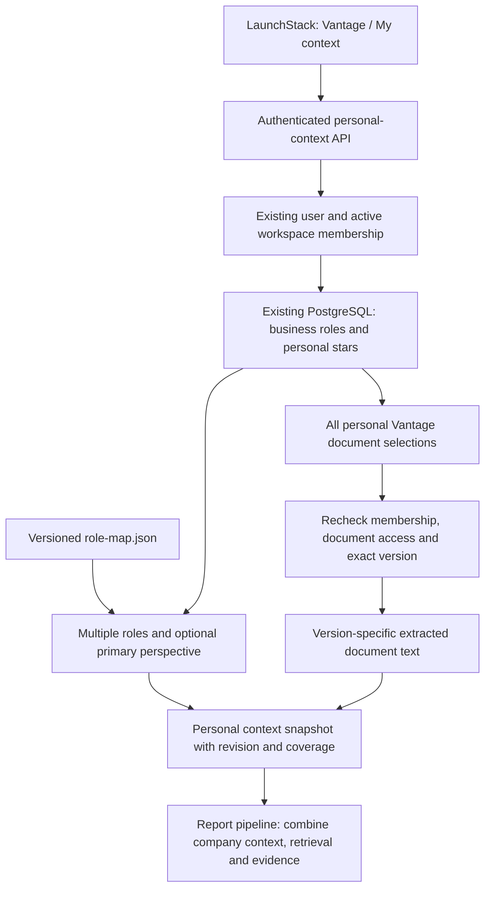

# Joseph — roles, personal stars and context snapshots

Date: 2026-10-26. Base: `Junkun/vantage-week2-rebuild` at
`364a3c8bd3b1c5bb2ee45cf66c1ea608b3c44618`.
Branch: `feat/joseph-vantage-context-v0`. PR: #561.

## Implemented application flow

The initial submission was a provider and synthetic preview. Following Joseph's
explicit request to implement the whiteboard in LaunchStack, this branch now adds
real PostgreSQL persistence, authenticated routes and a normal Vantage screen.
It is no longer necessary to use the development preview to edit personal context.

Open **Documents → Vantage → My context**, or
`/employer/documents?feature=vantage&at=%2Fcontext`.

The readable whiteboard labels are API call, user profile, DB, role.json,
add column / use existing, user starred documents, and apparently snapshot.
"Add sheet" is implemented as a PostgreSQL relation. The other unclear notes are
not treated as requirements. This implements Joseph's personal context flow; it
is not a claim that the complete multi-owner weekly report pipeline is deployed.

## Reuse and storage

- `users.title` and membership `profileTitle` remain canonical profile hints.
  Workspace title wins. Authorization roles are never used as business roles.
- Nullable membership `business_context_v0` stores confirmed role IDs, optional
  primary role, confirmation time and mapping version. Null means use title hints;
  a confirmed empty selection remains empty.
- Membership `vantage_context_revision` is the shared optimistic concurrency
  counter for roles and stars. The transaction locks this membership before any
  write. A stale revision receives 409 without overwriting another save.
- `vantage_document_stars` is explicitly Vantage-only. Its primary key is
  `(company_id, user_id, document_id)`, with a composite membership foreign key
  and membership-deletion cascade. It stores canonical document/version IDs and
  timestamps, never titles or excerpts. Other modules' stars and pins are untouched.
- Document/version IDs are intentionally retained when a source is deleted, so a
  deleted required selection blocks the snapshot until its owner removes it.
  The relation has no document-deletion cascade. Additions and changed selections
  validate document company, access and exact version in the same transaction.
- Existing document/version tables and version-specific `documentSections` provide
  the content. Unversioned chunks are not treated as proof of a particular version.

Migration: `apps/web/drizzle/20261027000000_vantage_personal_context.sql`, registered
in the existing product journal. Apply engine then product using the normal runner.
The original Week 2 Plan required TL review before migration. Joseph subsequently
explicitly requested the complete implementation and local application update;
that does not establish TL approval for the shared or hosted deployment. The PR
includes the concrete migration for maintainer review; never infer production
approval from this document or from a successful local test.

## API and UI

All routes resolve the authenticated user and active workspace server-side through
`requireWorkspacePermission("documents.read")`. Request bodies cannot choose an
actor, workspace, or authorization role. Personal context settings do not open the
separately gated v1 pilot generation/sharing endpoints.

| Route                                           | Behavior                                                                                                         |
| ----------------------------------------------- | ---------------------------------------------------------------------------------------------------------------- |
| GET `/api/vantage/context-v0/personal`          | Saved state, mapped roles, all readable document choices, coverage and optional personal snapshot.               |
| PATCH `/api/vantage/context-v0/roles`           | `{roleIds, primaryRoleId?, expectedRevision}`; controlled roles and explicit confirmation.                       |
| PUT `/api/vantage/context-v0/stars/:documentId` | `{starred, expectedRevision}`; add an authorized exact version or remove an own selection even after revocation. |
| POST `/api/vantage/context-v0/snapshot`         | `{expectedRevision}`; recompute a consistent personal snapshot or return 409 and safe diagnostics.               |

JSON mutations validate type, fields, numeric bounds and same-origin browser
requests. Responses use private/no-store. Expected statuses are 400 invalid input,
401 signed out, 403 unavailable membership/permission, 404 unreadable or absent
source on add, 409 revision/version/coverage conflict, and 503 service unavailable.
Driver errors and SQL parameters are not exposed in responses or logs.

`PersonalContextScreen` uses the real HTTP client. `PersonalContextPanel` supports
multi-role confirmation, primary perspective, document search, star/unstar,
version-specific source links, coverage, a snapshot summary, and safe reload after
conflicts. All edits are personal to the current workspace. They persist in the
database across browser reloads and new connections, not in localStorage.
`/dev/vantage-context` remains an explicitly synthetic developer fixture.

## Role mapping and snapshot semantics

`role-map.json` defines Founder, Product, Engineering and Growth/Sales, their exact
aliases, descriptions, responsibilities and priorities. Unknown titles produce an
explicit fallback. Manual confirmation wins over title hints. Primary perspective
changes priority order; it grants no permissions. Mapping version is
`joseph-roles-2026-10-26-v0`.

`loadPersonalContext` reads a repeatable-read database transaction. Membership,
current authorization-role permissions and document scope are re-evaluated in that
transaction. Each starred document is resolved at the snapshot cutoff regardless
of age. Exact version text is read in stable page/line/chunk order; offsets refer
to that version's ordered extracted-text representation. No RAG top-k is involved.
At most 100 selections and 64,000 total excerpt characters are supported. Missing,
unreadable, unprocessed or over-budget selections produce coverage and **no usable
snapshot**. Nothing is silently truncated into a complete result. Unavailable
source titles and text are not returned. Role corrections and removal remain usable
when a selected source is no longer readable.

The returned `vantage-personal-snapshot-v0` contains a SHA-256 identity, timestamp,
actor/ACL scope, personal revision, mapped roles and source entries. It is an
on-demand personal-input snapshot, not a persisted agenda or the TL's complete
`EvidenceSnapshotV0`. It carries no promise of future access: the consuming report
pipeline must revalidate before using or committing it.

## Shared provider integration

`createPostgresPersonalContextStoreV0` implements the existing shared store port.
`createDatabasePersonalContextProviderV0` binds the existing Joseph role/required
context provider to the authenticated membership, PostgreSQL store, profile title
and exact-version document reader. The caller supplies the canonical company
Architecture/mandatory-source inventory and company source resolver. No fixture or
invented company record is installed as a production fallback.

The shared provider still checks every mandatory document and personal star,
deduplicates exact required/star references, validates version/audience/cutoff,
returns safe diagnostics and fails closed on incomplete context. Shared contracts
remain `v0-proposed` / `v0-assembly-1`; frozen v1 wire fields are unchanged.

## Remaining team integration and publication boundary

The real personal role/star database, API, UI and snapshot flow are implemented.
The TL still owns combining the company Architecture projection, Sophia's retrieval,
independent registry/current-state validation, report generation and guarded final
commit. Those are not replaced by a personal snapshot or claimed complete here.

The code is submitted through PR #561 against the team's designated integration
branch. The connected GitHub account has no push/merge permission on
`Deodat-Lawson/LaunchStack`. Public source review is separate from a hosted app
release. A maintainer must review/merge and use the existing GHCR/Compose release
process for the shared deployment. No Vercel deployment was created.
