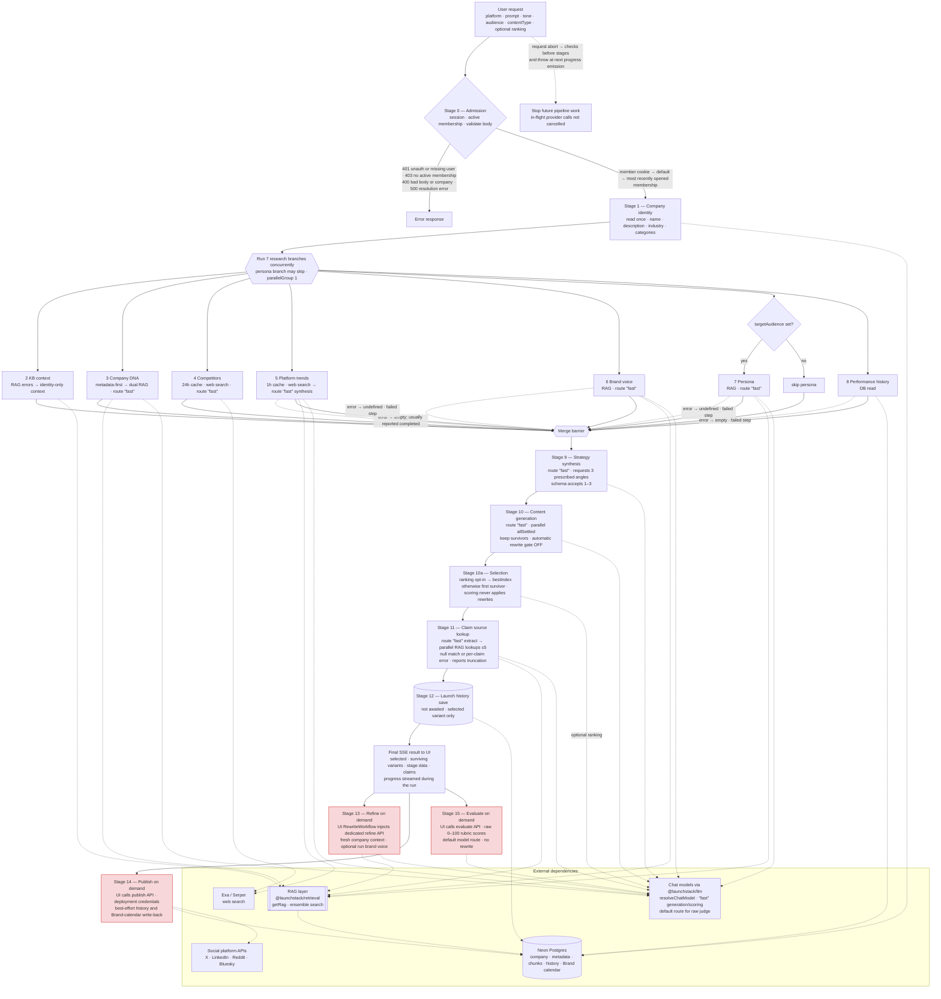

# Marketing Pipeline — Current-State Process Document

> **Deliverable 1.** Evidence-backed map of how the Launchstack marketing (campaign
> planner) pipeline works **today**, in the MAIN checkout (`kien-ship-it/wizzard`,
> monorepo layout), **reviewed 2026-10-12**. Code references describe current
> behavior, not the target design or a live-production verification.
>
> Primary code: `pipelines/src/marketing/*` (`@launchstack/pipelines/marketing`),
> with shared capabilities in `packages/tools/src/`,
> `apps/web/src/app/api/marketing-pipeline/**`,
> `apps/web/src/app/employer/documents/components/marketing-pipeline/**`.
>
> **Model correction originally recorded 2026-08-22** (unification P0):
> pipeline-local LLM calls resolve `resolveChatModel({ route: "fast" })` via
> `pipelines/src/marketing/models.ts:9-14`; extracted capabilities use
> `packages/tools/src/llm.ts:13-21` and their own model policies. The on-demand
> judge uses the default route with temperature 0 (`packages/tools/src/content-scoring/index.ts:31-35`),
> not the generation route. Web research uses Exa/Serper, not Tavily.

---

## 1. Purpose and scope

### 1.1 User problem

The user wants a **publish-ready social post grounded in their own company documents**,
without writing it themselves. The pipeline acts as a small marketing department:
it finds multiple angles, matches brand voice, targets an audience, and traces the
post's factual claims back to source documents.

### 1.2 Platforms

`x`, `linkedin`, `reddit`, `bluesky` (`packages/tools/src/platform-profiles/index.ts:19`,
re-exported by `pipelines/src/marketing/types.ts:113-117`).

### 1.3 Content types

`post`, `thread`, `ad_copy`, `email`, `multi_platform`
(`pipelines/src/marketing/types.ts:138`); non-default types append a format
directive, while `post` uses the base prompt (`generator.ts:159-171`).

### 1.4 Inputs (`pipelines/src/marketing/types.ts:119-155`)

| Field                    | Required | Constraint                                      | Use                        |
| ------------------------ | -------- | ----------------------------------------------- | -------------------------- |
| `platform`               | Yes      | `x` \| `linkedin` \| `reddit` \| `bluesky`      | Platform formatting        |
| `prompt`                 | No       | 1–2000 chars (defaults to a generic prompt)     | Campaign request           |
| `maxResearchResults`     | No       | 1–12                                            | Trend research depth       |
| `platformMeta.subreddit` | No       | ≤100 chars                                      | Reddit generation context; does not change publish destination |
| `platformMeta.hashtags`  | No       | ≤5 strings, each ≤50 chars                       | Hashtag guidance           |
| `toneOverride`           | No       | `formal`\|`conversational`\|`technical`\|`bold` | Brand-voice override       |
| `targetAudience`         | No       | ≤200 chars                                      | Enables persona extraction |
| `contentType`            | No       | enum above                                      | Output format              |
| `enableVariantRanking`   | No       | boolean; off unless explicitly true              | Scores surviving variants and selects the highest score |
| `?debug=true`            | No       | query param                                     | Includes DNA extraction debug/provenance |

The API supplies a generic prompt when omitted (`run.ts:35-49`), but the current
workspace UI requires a nonblank prompt and does **not** send `enableVariantRanking`
(`apps/web/src/app/employer/documents/components/marketing-pipeline/useMarketingPipelineController.ts:416-444`).
`debug` is parsed in `apps/web/src/app/api/marketing-pipeline/route.ts:40-41`
and controls `dnaDebug` in `run.ts:518`.

### 1.5 Outputs (`pipelines/src/marketing/types.ts:173-190`, `run.ts:500-532`)

| Field                     | Type               | Contains                                                                                                  |
| ------------------------- | ------------------ | --------------------------------------------------------------------------------------------------------- |
| `variants`                | `ContentVariant[]` | One surviving post per returned strategy, in strategy order; normally 3, possibly 1–2 (`generator.ts:192-267`) |
| `pipelineStages`          | `PipelineStages`   | DNA, competitors, trends, strategies, optional voice/persona, performance insights, and the base company knowledge context used for generation (`run.ts:520-530`) |
| `claimSources`            | `CheckedClaim[]`   | Up to 5 extracted claims with a nullable `match` (document, excerpt, retrieval `relevance`) and optional lookup `error` (`packages/tools/src/claim-evidence/index.ts:41-60,82-113`) |
| `message` / `image/video`  | top-level          | Copied from the ranked winner when ranking is enabled and succeeds; otherwise the first surviving variant. Media is an `image`/`video` recommendation, not an asset (`run.ts:445-449,500-503`) |

Ranking scores and `bestVariantId` are streamed in generation `step_data`
(`run.ts:415-437`); they are not separate fields in the final result. Claim
truncation is reported in step detail using `totalClaimsFound`, but that total is
not included in the final `claimSources` array (`run.ts:468-486,532`).

---

## 2. End-to-end process map

**Reading the map.** Solid arrows = control flow. Dotted arrows = data/external
dependency. Dashed "error →" arrows = branch fallbacks that let the run continue.
Colored nodes (Refine, Publish, Evaluate) are **UI-wired, optional follow-on actions**,
not stages automatically executed during generation.

The gather barrier precedes strategy, generation/ranking, claim lookup, and the
non-awaited history write (`pipelines/src/marketing/run.ts:114-134,343-495`).
Admission uses `apps/web/src/lib/require-workspace-context.ts:148-215` and
`active-workspace.ts:81-131`; cancellation is forwarded by
`apps/web/src/app/api/marketing-pipeline/route.ts:53-79` to
`packages/tools/src/stage-runner/index.ts:90-118`. The stage callbacks do not
pass that signal into retrieval, generation, or ranking calls (`run.ts:139-144,386-408`),
so already-started parallel calls can still finish.

---

## 3. Stage inventory

Stage timing is **available**, but historical latency baselines and token/cost
measurements are not. The shared runner logs and emits `durationMs` in SSE
completion events (`packages/tools/src/stage-runner/index.ts:95-105`), and the UI
stores it in live step state (`apps/web/src/app/employer/documents/components/marketing-pipeline/useMarketingPipelineController.ts:377-390`).
There is no persisted backend timing series or per-stage token/cost accounting in
this execution path; total run time is logged (`run.ts:497-498`).

| #   | Stage               | Module                                             | Trigger                      | Inputs                                                    | Output                                                                               | Model                      | Data source                                                 | Persistence                       | Failure                                                          | Fallback                                                          | Downstream                   |
| --- | ------------------- | -------------------------------------------------- | ---------------------------- | --------------------------------------------------------- | ------------------------------------------------------------------------------------ | -------------------------- | ----------------------------------------------------------- | --------------------------------- | ---------------------------------------------------------------- | ----------------------------------------------------------------- | ---------------------------- |
| 0   | Request admission   | `apps/web/src/app/api/marketing-pipeline/route.ts:25-41` | User submits request | session, active membership, JSON body | opens SSE stream | — | `users`, memberships, role permissions | none | 401 session/user missing; 403 workspace/membership denied; 400 bad JSON/schema/company; 500 resolution error | member cookie → member default → most recently opened membership (`apps/web/src/lib/active-workspace.ts:93-131`), then active-status check | `runMarketingPipeline` |
| 1   | Company identity    | `packages/tools/src/company-context/index.ts:57-87`, `run.ts:114-120` | after admission | companyId | name, description, industry, employee range, ≤8 categories; reused by KB/DNA | — | `company`, `category` | none | DB errors stop run; identity is outside the stage runner | missing company row → `Unknown Company` and empty identity fields | all gather branches' shared setup |
| 2   | KB context          | `packages/tools/src/company-context/index.ts:111-139` | concurrent gather branch | companyId, prompt, prefetched identity | company facts + KB snippets string | — (retrieval only) | identity + RAG (topK 6, weights 0.4/0.6, ≤400 chars/snippet) | read-only | required stage, but retrieval errors are swallowed by `onError: "empty"` | identity-only context with `No matching KB snippets found` on no results/error | generation; later evaluation context |
| 3   | Company DNA         | `packages/tools/src/company-context/index.ts:156-198,328-401` | concurrent gather branch | companyId, prompt, prefetched identity | `CompanyDNA` + source/model/prompt debug info | route "fast" | metadata first; otherwise 2 concurrent RAG queries (topK 4 each) | none | metadata DB or synthesis error stops run; either RAG-query failure empties both snippet sets | RAG only when metadata is absent; RAG failure/empty → minimal company-name context, then synthesis. Low-confidence/non-active metadata facts are dropped, not a whole-row RAG trigger (`facts.ts:18-25`) | strategy; generation through strategies |
| 4   | Competitor analysis | `competitor.ts:12-20,57-116` | concurrent gather branch | company identity, categories | `CompetitorAnalysis` | route "fast" on cache miss | web search + identity | 24h in-process cache, keyed by normalized company name + sorted categories; not durable | required; synthesis failure stops run | cache hit skips search/LLM; web error/no results → synthesis from identity/minimal context | strategy |
| 5   | Platform trends     | `research.ts:37-74`, `pipelines/src/trend-search/run.ts:38-80`, `synthesizer.ts:86-115` | concurrent gather branch | platform, identity + platform guidelines, prompt | normalized `MarketingResearchResult[]`; current synthesizer supplies at most 5 non-placeholder results | route "fast" synthesis when uncached search has results; prebuilt queries skip LLM planning | Exa/Serper web search | 1h in-process trend cache keyed by normalized prompt + company context (`pipelines/src/trend-search/cache.ts:12-32`) | research helper catches errors, logs and returns `[]`; outer stage is also degradable | `[]`; helper-handled failure is normally reported as completed with 0 topics, not failed; empty-URL placeholders are filtered (`run.ts:52-61,201-245`) | strategy; generation references |
| 6   | Brand voice         | `packages/tools/src/brand-voice/index.ts:81-101`, `run.ts:247-273` | concurrent gather branch, always | companyId, toneOverride | `BrandVoice` or undefined | route "fast" | RAG (topK 6) | none | retrieval/LLM error → degradable failed step | undefined; no default-voice object. Empty successful retrieval still reaches synthesis with a no-samples prompt | strategy, generation, optional refine |
| 7   | Target persona      | `packages/tools/src/persona/index.ts:72-92`, `run.ts:275-307` | only when targetAudience is truthy | companyId, targetAudience | `TargetPersona` or undefined | route "fast" | RAG (topK 6) | none | retrieval/LLM error → degradable failed step | undefined; skipped status when no audience. Empty successful retrieval still reaches synthesis | strategy, generation |
| 8   | Performance history | `performance.ts:15-74`, `run.ts:309-340` | concurrent gather branch, always | companyId, platform | newest ≤10 rows → 1–4 insight strings, or `[]` | — | `marketing_content_history` | read-only | degradable failed step on error | `[]`; successful no-history read reports skipped / `No history yet` | strategy |
| 9   | Strategy synthesis  | `positioning.ts:94-128`, `types.ts:197-208`, `run.ts:347-372` | after gather barrier | DNA, competitors, trends, prompt, optional voice/persona, insights | requests thought-leadership, pain-point, proof-driven; schema permits 1–3 strategies and does not enforce those IDs | route "fast" | gathered in-memory context | none | required; error stops run | none | generation |
| 10  | Content generation  | `generator.ts:178-267`, `run.ts:380-398` | after strategies | one strategy each, company context, research, optional voice/persona/type, platformMeta | 1–3 surviving `ContentVariant`s, in strategy order | route "fast", per-strategy calls concurrent | in-memory + platform profile guidance | none | `Promise.allSettled` retains fulfilled variants; only zero survivors throws `All variant generations failed` | logs failed variants; automatic rewrite quality gate remains OFF (`run.ts:393`) | optional ranking / selection |
| 10a | Ranking / selection | `run.ts:400-452`, `packages/tools/src/content-scoring/index.ts:110-169` | rank only when enableVariantRanking=true and >1 survivor | surviving messages, platform | 1–10 scores/issues + bestIndex in generation step data; primary message and matching strategy | route "fast", concurrent per-variant scoring | quality-editor prompt (5 criteria); no company-context input | none | individual scoring failures → null score; unexpected ranking error logged | highest available score; ties choose earliest tied survivor; all scores failed/ranking absent → first survivor. Ranking ignores suggested rewrites and does not reject low scores | claim lookup, final result, history |
| 11  | Claim source lookup | `packages/tools/src/claim-evidence/index.ts:63-114`, `run.ts:454-486` | after primary selection | companyId, selected message | ≤5 `CheckedClaim`s; total found available to step-detail truncation notice | route "fast" extraction | parallel per-claim RAG (topK 2); first result's doc/excerpt/relevance | none | extraction failure → degradable failed step; per-claim retrieval errors are handled independently | extraction failure → `[]`; no source → match null; lookup failure → match null + error true; missing score → relevance null | SSE result, claim panel |
| 12  | Save to history     | `performance.ts:77-92`, `run.ts:488-495` | after claim lookup | companyId, platform, selected message + its matched strategy angle, contentType | launches 1-row insert | — | `marketing_content_history` | **write**, selected surviving/ranked variant only | logs `console.warn`; does not fail result | fire-and-forget; final SSE result does not await insert | next run's Stage 8; best-effort publish matching |
| 13  | Refine (dedicated)  | `generator.ts:280-320`, `apps/web/src/app/api/marketing-pipeline/refine/route.ts:18-48` | UI Refine sheet / POST | originalMessage, platform, feedback, optional run brand voice; server rebuilds company context using feedback | refined message, mediaType, feedbackApplied in success data | route "fast" | workspace-scoped fresh KB context; caller-supplied voice | none | auth/validation responses; unexpected error → generic 500 via handleRouteError | no generation fallback | **UI wired** through RewriteWorkflow's injected backend (`useMarketingPipelineController.ts:704-724`) |
| 14  | Publish             | `packages/tools/src/social-publish/index.ts:31-51`, `apps/web/src/app/api/marketing-pipeline/publish/route.ts:17-64` | UI Publish / POST | platform, message, optional title; deployment-held credentials | tool returns optional postId/postUrl; route returns `{ success: true, data: { platform, postUrl } }` | — | X/LinkedIn/Reddit/Bluesky APIs | non-awaited history postId/postUrl/publishedAt write-back + published Brand-calendar row (`publish/route.ts:34-59`) | adapter failure → 502; unexpected route error → generic 500; write-back failures warn without failing publish | credential/network errors surfaced; Reddit HTTP-200 body errors checked; X/Bluesky truncate at profile limits | **UI wired** (`useMarketingPipelineController.ts:610-653`); URL-envelope mismatch remains (§7.4) |
| 15  | Evaluate            | `apps/web/src/app/api/marketing-pipeline/evaluate/route.ts:19-105`, `packages/tools/src/content-scoring/index.ts:31-81` | UI Evaluate quality / POST | current edited message, platform, base company context, original prompt, DNA/voice/persona | 10 criterion scores + overall 0–100, rationales, model and rubric version | default route, temperature 0 | passed generation knowledge context preferred; otherwise rebuild from original prompt/message; append DNA/voice/persona + reference posts | no history write; UI feedback only | auth/validation responses; unexpected error → generic 500 | Bluesky/other platform strings use X rubric; Bluesky has no reference examples | **UI wired** (`useMarketingPipelineController.ts:655-695`); scores only, never rewrites |

### Dead / unreachable code (reviewed)

- **Resolved — historical P0 removals (2026-08-22):** `buildMessagingStrategy`,
  `generateCampaignOutput`, `knowledge.ts`, the old platform-search `clients/`,
  and the broken `scripts/dev/test-platform-apis.ts` were recorded as deleted in
  the prior review. The current marketing module exposes `buildMultiStrategy`,
  `generateVariants`, and shared-tool publishing instead (`pipelines/src/marketing/index.ts:2-3,15-16`;
  `competitor.ts:2-3`; `publish.ts:7-12`); the retired implementations are not
  part of the current marketing module inventory.
- **Corrected — `validatePostQuality` is not dead.** The generation rewrite gate
  is disabled (`run.ts:393`, `generator.ts:226-235`), but opt-in ranking calls the
  validator for every surviving variant (`packages/tools/src/content-scoring/index.ts:133-142`).
  Scoring does not apply its proposed rewrite.
- **Resolved — dedicated refine/publish routes are reachable from the UI.**
  The controller calls both (`apps/web/src/app/employer/documents/components/marketing-pipeline/useMarketingPipelineController.ts:624-627,704-724`),
  and the workspace injects the refine backend into `RewriteWorkflow`
  (`MarketingPipelineWorkspace.tsx:1992-2001`). Evaluate is also wired (`useMarketingPipelineController.ts:665-677`).

---

## 4. RACI

`R` = Responsible · `A` = Accountable · `C` = Consulted

| Concern                            | Product/User                     | UI        | API host              | Feature service              | RAG/Knowledge | LLM/Provider        | Publishing client   | Reviewer                       |
| ---------------------------------- | -------------------------------- | --------- | --------------------- | ---------------------------- | ------------- | ------------------- | ------------------- | ------------------------------ |
| Resolve active workspace           | C                                | —         | R/A (member cookie + membership fallbacks, active-status check) | — | — | — | — | — |
| Brand voice detection              | —                                | —         | —                     | A                            | R             | R                   | —                   | —                              |
| Persona targeting                  | R (opts in via `targetAudience`) | C         | —                     | A                            | R             | R                   | —                   | —                              |
| Performance history                | —                                | —         | —                     | R/A                          | —             | —                   | —                   | —                              |
| Strategy variant selection         | R (API ranking opt-in) | Default path does not request ranking | — | R/A (ranked bestIndex or first survivor) | — | R (optional scoring) | — | No mandatory human gate |
| Quality control on shipped content | R (on-demand evaluation/review) | R (Evaluate quality) | R (evaluate endpoint) | R (ranking + raw judge; automatic rewrite gate disabled) | C (evaluation context) | R | — | No mandatory score threshold |
| Claim-to-source mapping            | — | R (source/no-source/error display) | — | A | R | R (extraction only) | — | Retrieval relevance ≠ verification |
| Save to performance history        | — | — | — | R/A (fire-and-forget) | — | — | — | — |
| Refine with real context           | R (requests/accepts rewrite) | R (injected RewriteWorkflow backend) | R (fresh company-context read) | R (refine logic) | R | R | — | User accepts result |
| Publish + engagement write-back    | R (Publish action) | R (wired) | R (best-effort history + calendar writes) | R (publish metadata only; engagement read-back absent) | — | — | R (adapters) | — |

Sources: `pipelines/src/marketing/run.ts:400-495`,
`apps/web/src/app/api/marketing-pipeline/{refine,publish,evaluate}/route.ts`
(§3), and `apps/web/src/app/employer/documents/components/marketing-pipeline/useMarketingPipelineController.ts:610-724`.

---

## 5. Exceptions and edge cases

| #   | Case                                      | Status                   | What happens                                                                                                                                       |
| --- | ----------------------------------------- | ------------------------ | -------------------------------------------------------------------------------------------------------------------------------------------------- |
| 1 | Brand voice extraction fails | Handled | Degradable stage returns undefined and emits failed status (`run.ts:247-273`); generation has no voice directive. The fallback narration says "default voice", but no default object is constructed. |
| 2 | No targetAudience provided | By design | Persona skipped with SSE skipped status (`run.ts:275-285`); API also treats an empty string as no audience. |
| 3 | Persona extraction throws | Handled | Degradable stage returns undefined and emits failed status (`run.ts:275-307`). |
| 4 | No performance history | Handled | `buildPerformanceInsights` returns `[]` and stage reports skipped / `No history yet` (`performance.ts:43-44`, `run.ts:327-339`). |
| 5 | >5 claims found | **Resolved silent truncation; cap remains** | Checks first 5 concurrently; `totalClaimsFound` lets progress detail say "checked 5 of N found" (`packages/tools/src/claim-evidence/index.ts:68,82-89`, `run.ts:468-473`). The final result does not retain the total. |
| 6 | Claim has no source / lookup fails | **Resolved sentinel ambiguity; evidence gap remains** | No result → match null; lookup error → match null + error true; missing relevance → null (`packages/tools/src/claim-evidence/index.ts:93-113`). UI distinguishes no source from lookup failure (`MarketingPipelineWorkspace.tsx:720-745`). A match still does not prove truth. |
| 7 | One generation call fails | **Resolved** | `Promise.allSettled` keeps survivors in strategy order and logs failed variants; only all-failed generation stops the stage (`generator.ts:190-267`). |
| 8 | Low-quality post | Partial; automatic gate still off | Live generation passes enableQualityGate=false (`run.ts:393`). Ranking can score/select but neither rewrites nor rejects low scores (`run.ts:403-449`); on-demand evaluation scores only (`packages/tools/src/content-scoring/index.ts:56-81`). |
| 9 | Save-to-history fails | Gap | Warn only; final result succeeds and the user is not notified (`run.ts:488-495`). |
| 10 | User clicks Refine | **Resolved mismatch** | Workspace injects refineWithCompanyContext into RewriteWorkflow (`MarketingPipelineWorkspace.tsx:1992-2001`); controller sends optional run voice (`useMarketingPipelineController.ts:704-724`); refine route reloads workspace KB (`apps/web/src/app/api/marketing-pipeline/refine/route.ts:33-43`). |
| 11 | Request abort / user cancels | **Resolved boundary cancellation; in-flight limit remains** | UI aborts its fetch (`useMarketingPipelineController.ts:602-608`); route forwards request.signal and throws at the next progress emission (`apps/web/src/app/api/marketing-pipeline/route.ts:53-79`). Runner checks before stages and does not swallow aborted errors (`packages/tools/src/stage-runner/index.ts:90,118`). Provider calls already started are not signal-wired. Stream cancel() alone marks output closed (`route.ts:128-130`). |
| 12 | Active-workspace cookie stale/invalid | **Resolved validation uncertainty** | Positive-bigint parsing + membership check; invalid/stale cookie falls through to member default, then most recently opened membership (`apps/web/src/lib/active-workspace.ts:47-54,89-131`). requireWorkspaceContext rejects missing/inactive membership with 403 (`require-workspace-context.ts:175-204`), rather than blindly accepting users.companyId. |
| 13 | RAG port not registered | Handled by explicit retrieval/stage policies | Shared retrieval catches getRag failures (`packages/retrieval/src/tools/grounded-retrieval/grounded-retrieval.ts:73-79`). KB context degrades to empty snippets; DNA's RAG fallback uses minimal context; voice/persona degrade to undefined; each claim lookup becomes match null + error true (§3). |
| 14 | Sparse / empty company KB | Partial | KB keeps identity-only context; DNA can synthesize from company name only (`packages/tools/src/company-context/index.ts:119-139,355-381`). Prompts forbid invention and instruct industry-level framing/placeholders (`generator.ts:31-37`, `packages/tools/src/company-context/prompts.ts:5-14`), but no hard groundedness admission gate exists. |
| 15 | Chat-provider timeout/error | Partial | DNA/strategy synthesis remain required; generation keeps successful siblings, failing only with no survivors; voice/persona/claim extraction degrade. Runner has no retry/timeout policy. Web search separately retries subqueries up to 3 attempts (`packages/tools/src/web-research/index.ts:30-74`). Route maxDuration=60 is a host setting (`apps/web/src/app/api/marketing-pipeline/route.ts:9-10`), not signal propagation to an in-flight model. |
| 16 | Invalid platform length | Gap in campaign path | Generation provides prompt guidance but no hard length validator. X truncates to 280 and Bluesky to 300 at publish time (`packages/tools/src/social-publish/adapters/x.ts:14-21`, `adapters/bluesky.ts:52-64`; `packages/tools/src/platform-profiles/index.ts:87`, `posts.ts:66-70`). The separate Brand compose/save path validates length (`posts.ts:179-185`); the campaign publish route does not call it. |
| 17 | Publishing failure | Handled and UI-reachable | Publish adapter failure → 502 (`apps/web/src/app/api/marketing-pipeline/publish/route.ts:28-31`), shown by the controller (`useMarketingPipelineController.ts:635-648`). Reddit body-level errors are inspected even on HTTP 200 (`packages/tools/src/social-publish/adapters/reddit.ts:98-115`). |
| 18 | Publish succeeds but history does not match | Partial | Newest row matching company/platform/exact message is updated; no match is silently skipped (`performance.ts:101-130`). Edits, choosing an unsaved variant, or publish-time plain-text conversion can prevent matching. Brand-calendar recording is a separate best-effort insert (`publish/route.ts:49-59`). |
| 19 | All/some variant scores fail | Handled | Per-score failures become null, successful scores still compete, ties choose earliest tied variant, and all-null returns index 0 (`packages/tools/src/content-scoring/index.ts:110-142`). Unexpected ranking exception falls back to first survivor (`run.ts:409-449`). |

---

## 6. Metrics — available vs. missing

| Metric                    | Status                      | Notes                                                                                                                                                                                                                                                                                                        |
| ------------------------- | --------------------------- | ------------------------------------------------------------------------------------------------------------------------------------------------------------------------------------------------------------------------------------------------------------------------------------------------------------ |
| **Quality score** | Available, opt-in | Ranking scores surviving variants 1–10 and streams scores/issues (`run.ts:403-437`). UI also requests raw 0–100, 10-criterion evaluation (`useMarketingPipelineController.ts:655-695`; `packages/tools/src/content-scoring/rubric.ts:18-29,55-86`). Automatic rewrite gate remains disabled; neither path blocks publication. |
| **Groundedness** | Partial | Claim matches expose retrieval/rerank relevance, not truth confidence (`packages/tools/src/claim-evidence/index.ts:41-54,93-113`). On-demand judge also scores groundedness against company context (`packages/tools/src/content-scoring/rubric.ts:33-35`), but that model score is not factual proof. Neither is written to history by this path. |
| **Platform fit** | Available, opt-in; enforcement partial | Ranking includes platform fit (`packages/tools/src/content-scoring/index.ts:154-160`); raw judge includes platform_structure (`rubric.ts:42`). Prompt/profile guidance and publish truncation do not constitute hard campaign-generation validation (§5, case 16). |
| **Latency** | Available per run; aggregation missing | Shared runner logs and streams durationMs for completed/skipped/degraded stages; UI retains live step timing (`packages/tools/src/stage-runner/index.ts:95-105`, `useMarketingPipelineController.ts:377-390`). Required failures rethrow without completion timing events (`stage-runner/index.ts:118-119`); no persisted backend timing series. |
| **Cost / tokens** | Missing in this path | No per-stage token/cost fields in the progress/result contract (`packages/tools/src/contract.ts:35-45`, `pipelines/src/marketing/types.ts:173-190`); stages do not collect usage. |
| **Completion rate** | Aggregation missing | Per-run result/error and stage statuses are streamed (`apps/web/src/app/api/marketing-pipeline/route.ts:85-115`); no cross-run success/failure counter is written by the pipeline. |
| **Refinement rate** | Instrumentation missing; feature wired | Dedicated endpoint is called by the workspace (`useMarketingPipelineController.ts:704-724`), but does not record a refinement counter (`apps/web/src/app/api/marketing-pipeline/refine/route.ts:33-46`). |
| **Publish rate** | Partial | UI calls publish; route launches postId/postUrl/publishedAt history updates and published Brand-calendar inserts (`publish/route.ts:34-59`). Matching is best-effort and no aggregate rate is computed here (`performance.ts:101-130`). |
| **Downstream engagement** | **Read model present; automatic collection missing** | Impressions/engagements/clicks are nullable columns (`pipelines/src/marketing/schema.ts:24-26`). Save omits them and publish updates only publish metadata (`performance.ts:77-92,123-130`); adapters have no engagement read-back. buildPerformanceInsights uses engagement values if present (`performance.ts:46-66`). Current all-NULL DB contents are not established by code review. |

### 6.1 The engagement trap

The schema and `buildPerformanceInsights` provide a **conditional engagement read
model**, not an implemented collection loop. Generated history inserts omit the
three engagement columns (`pipelines/src/marketing/performance.ts:77-92`).
Publishing now has a real UI caller and records platform identifiers/timestamps,
best-effort (`apps/web/src/app/api/marketing-pipeline/publish/route.ts:34-59`),
but neither that write-back nor the adapters fetch impressions/engagements/clicks.

Thus this path has **campaign history and publish metadata, but no automatic
engagement collection**. Rows inserted by this path start with NULL engagement
fields; an assertion that every existing database row is still NULL requires a
live query and is not made here. `buildPerformanceInsights` will use externally
populated data if it exists (`performance.ts:46-66`).

### 6.2 Test coverage

**Resolved — the pipeline is not wholly untested.** Existing source-level coverage
includes:

| Suite | What the source exercises |
| ----- | ------------------------- |
| `pipelines/src/marketing/posts.test.ts:5-22` | Brand post labels, per-platform limits, empty/over-limit body rules |
| `apps/web/__tests__/marketing-pipeline/judge-rubric.test.ts:16-55` | Complete/unique/known judge-criterion validation |
| `apps/web/__tests__/marketing-pipeline/campaign-benchmark.test.ts:28-29,51-118` | Opt-in live LLM-judge benchmark over candidate posts; emits JSON results. Skipped unless RUN_LLM_BENCHMARK is 1/true; returns without scoring when no runnable candidates exist. The checked-in samples are placeholders (`pipelines/src/marketing/benchmark/candidates.sample.json:5-14`). |
| `packages/tools/__tests__/stage-runner.test.ts:19-177` | Progress ordering, skip/fallback/required-error behavior, abort checks and abort propagation |
| `packages/tools/__tests__/variant-ranking.test.ts:8-33` | Highest score, stable ties, partial/all score failures, issues propagation |
| `packages/tools/__tests__/claim-evidence.test.ts:9-49` | Retrieval relevance, null no-source/missing-score states, per-claim lookup errors |
| `packages/tools/__tests__/social-publish.test.ts:36-109` | Missing credentials, X truncation/post ID, Bluesky session reuse, Reddit HTTP-200 body errors |
| `packages/tools/__tests__/{company-context,grounded-retrieval,brand-voice-persona,content-scoring}.test.ts` | Fact-confidence/metadata formatting (`company-context:44-110`), snippet policies/error handling (`grounded-retrieval:18-120`), voice/persona prompt assembly (`brand-voice-persona:9-42`), judge schema/prompt and rewrite threshold (`content-scoring:17-60`) |

These files were **read, not executed** for this review. They are not evidence of
a passing full campaign run. The discovered marketing suites do not cover the
complete route → gather → generation → SSE → UI flow or directly exercise
`generateVariants`' partial-failure orchestration; those remain coverage gaps.

---

## 7. Corrections, answers, and verification notes

This section resolves the draft's open questions and records the source review
of the MAIN checkout on 2026-10-12. It does not claim runtime or live-DB checks.

### 7.1 Open questions from the draft — now answered

- **"Is `targetAudience` actually exposed in the UI?"** → **Yes.** It is a real input field
  (`apps/web/src/app/employer/documents/components/marketing-pipeline/MarketingPipelineWorkspace.tsx:876-881`),
  held in controller state (`useMarketingPipelineController.ts:82`) and sent to
  the API (`:441`). The persona stage is genuinely user-reachable.
- **Strategy model** → superseded (2026-08-22): `MARKETING_MODELS` no longer
  exists in the marketing modules. Strategy synthesis calls
  `invokeMarketingStructured` (`pipelines/src/marketing/positioning.ts:122-125`),
  which resolves the configured route "fast", rather than naming a concrete
  provider/model ID (`models.ts:9-14`). Shared capabilities use their own
  policies through `packages/tools/src/llm.ts:13-21`; the raw judge is a
  separate default-route consumer (`packages/tools/src/content-scoring/index.ts:31-35,56-74`).

### 7.2 Verified accurate (code-checked)

- **Model policies** — generation/strategy/competitor/refine use route "fast"
  through `pipelines/src/marketing/models.ts:9-14`; DNA/voice/persona/claim
  extraction and optional ranking use their shared-tool route "fast" policies.
  Trend research also synthesizes with route "fast" (`pipelines/src/trend-search/synthesizer.ts:92-100`).
  On-demand/raw benchmark evaluation is distinct: default route, temperature 0
  (`packages/tools/src/content-scoring/index.ts:31-35,56-74`).
- **Selection and quality gate** — optional ranking selects bestIndex; without
  it, the first **surviving** variant is used (`run.ts:403-449`). The automatic
  rewrite gate is still disabled (`run.ts:393`), but quality scoring is live
  through ranking and on-demand evaluation. Strategies need not all survive,
  and the selected strategy is matched by variantId (`run.ts:450-452`).
- **Persistence and destination** — saveGeneratedContent is wired after claim
  lookup (`run.ts:488-495`); publish metadata write-back and Brand-calendar
  recording are wired (`apps/web/src/app/api/marketing-pipeline/publish/route.ts:34-59`).
  Reddit still hardcodes `sr: "u_me"` and obtains an app-only client_credentials
  token (`packages/tools/src/social-publish/adapters/reddit.ts:26-34,67-87`).
  There is no campaign-publish subreddit input; submission errors are surfaced.
- **Workspace resolution** — requireWorkspaceContext calls
  resolveActiveCompanyForUser and verifies active membership
  (`apps/web/src/lib/require-workspace-context.ts:167-204`), including the
  most-recently-opened membership fallback (`active-workspace.ts:121-131`).
- The main `apps/web/src/app/api/marketing-pipeline/route.ts:134-140` **is** the
  SSE stream (`text/event-stream`); the reviewed route directory has no separate
  `/stream` route.

### 7.3 Nuances to tighten

- **Claim relevance, not confidence.** Current wire shape is `match: null` for
  no source, `error: true` for lookup failure, and nullable `match.relevance`
  for the retrieval score (`packages/tools/src/claim-evidence/index.ts:41-60,93-113`).
  The UI labels it "relevance" and distinguishes failure from no match
  (`MarketingPipelineWorkspace.tsx:720-745`); there is no numeric default
  standing in for a source match.
- **Debug is an output flag, not raw-error exposure.** `?debug=true` is parsed
  at `apps/web/src/app/api/marketing-pipeline/route.ts:40-41` and includes DNA
  source/model/prompt debug info (`run.ts:518`; `packages/tools/src/company-context/index.ts:172-177,191-196`).
  Stream errors stay generic but can append chat-config/company hints
  (`route.ts:97-115`); disconnect aborts are treated as expected and suppress
  error events/error-level logs (`route.ts:86-95`).
- **Caches are in-process and capability-specific.** Competitors cache for 24h
  by company name/categories (`competitor.ts:12-20,64-68,115`); trend output
  caches for 1h by normalized prompt/context (`pipelines/src/trend-search/cache.ts:12-32`).
  Publishing reuses Bluesky sessions for 55 minutes
  (`packages/tools/src/social-publish/adapters/bluesky.ts:10-30`) and Reddit
  app tokens until reported expiry minus a 60-second buffer
  (`adapters/reddit.ts:9-45`). These are not durable caches; the cache's
  maxEntries setting triggers expiry pruning, not a strict size cap
  (`packages/tools/src/web-research/cache.ts:20-40`).
- **Live-DB engagement snapshot** (draft §6.3: Reddit 28 / X 4 / LinkedIn 4,
  all-NULL engagement) was **not independently re-queried** for this review.
  It remains an unverified historical snapshot, not evidence of today's data.
  Source proves only that these save/publish paths do not collect engagement
  (§6.1), not that every extant row is NULL.

### 7.4 Highest-leverage gaps (for the v2 plan)

1. **Variant selection — resolved as an opt-in capability.** Ranking exists
   (`run.ts:403-449`; `packages/tools/src/content-scoring/index.ts:110-142`).
   Remaining decision: benchmark-backed default-on behavior and UI exposure;
   the workspace currently omits the flag (`useMarketingPipelineController.ts:436-443`).
   Its variant stack still labels/activates the first item as "Best" rather
   than consuming bestVariantId (`:517-524`), so ranked API output is not a
   completed ranking-aware UI flow.
2. **Refine mismatch — resolved.** Dedicated context-aware backend is injected
   into RewriteWorkflow (`MarketingPipelineWorkspace.tsx:1992-2001`), calls the
   refine route with run voice (`useMarketingPipelineController.ts:704-724`),
   and reloads workspace company context (`apps/web/src/app/api/marketing-pipeline/refine/route.ts:33-43`).
3. **Generation fault-tolerance — resolved.** allSettled keeps survivors and
   only total failure aborts (`generator.ts:190-267`). Add direct orchestration
   coverage rather than recommending an already-implemented cutover.
4. **SSE cancellation — resolved at stage/progress boundaries.**
   request.signal is forwarded (`apps/web/src/app/api/marketing-pipeline/route.ts:56,76-79`)
   and checked by the runner (`packages/tools/src/stage-runner/index.ts:90,118`).
   Remaining gap: in-flight retrieval/model/scoring calls do not consume it.
5. **Engagement loop — partially resolved prerequisites, collection still open.**
   UI publishing, native post IDs, history publish metadata, and Brand-calendar
   writes exist (`useMarketingPipelineController.ts:624-627`;
   `apps/web/src/app/api/marketing-pipeline/publish/route.ts:34-59`).
   Implement platform read-back if engagement analytics are promised; neither
   history-save nor publish-write-back writes engagement values
   (`performance.ts:77-92,123-130`).
6. **Tests — resolved "none exist"; end-to-end coverage remains open.** See §6.2
   for real unit suites and the environment-gated benchmark. Add campaign
   orchestration/SSE/UI integration coverage; do not equate existing test source
   with an exercised or passing full run.
7. **Publish result/write-back gaps — open.** The API wraps postUrl under
   success data (`apps/web/src/app/api/marketing-pipeline/publish/route.ts:62`;
   `apps/web/src/server/api/responses.ts:19-20`), but the controller reads
   top-level payload.postUrl (`useMarketingPipelineController.ts:629-637`).
   Align that envelope. Carry a history row ID through the UI instead of relying
   on exact-message matching (`performance.ts:101-130`), which misses edits,
   unsaved variants and possible Markdown-to-plain-text conversion.
8. **Reddit publishing — open.** The adapter has no subreddit target input and
   requests an app-only token (`packages/tools/src/social-publish/types.ts:3-14`;
   `adapters/reddit.ts:26-34,67-87`). Its own code notes that submission needs
   user-context OAuth and now surfaces USER_REQUIRED-style body errors
   (`adapters/reddit.ts:67-71,98-115`). Implement the required auth/destination
   flow rather than assuming environment-key presence makes Reddit publishable.

---

_Originally generated against `marketing-pipeline-v2`; behavior and current
file/line anchors reviewed in MAIN on 2026-10-12. No checks or live-DB queries
were run for this documentation-only review._

### 8 Features Worth Discussing

- **No campaign image/video generation.** `image/video` and variant mediaType
  are enum recommendations, not generated assets (`pipelines/src/marketing/types.ts:166-170,211-216`;
  `generator.ts:237-242`). Neither generation nor publish inputs accept media
  attachments (`types.ts:141-155`; `apps/web/src/app/api/marketing-pipeline/publish/route.ts:11-15`).
- **Design choice: company context as source of truth.** The generation prompt
  explicitly treats it as the single source for product claims, features,
  metrics, and results, and forbids invented specifics (`generator.ts:31-37`).
  User prompts steer campaigns but are not independently verified; richer
  user-supplied evidence/media would require a deliberate input/grounding design.
- **Variant ranking — resolved capability, default still off.** Three prescribed
  strategy angles are requested, 1–3 surviving posts returned, and opt-in ranking
  selects bestIndex (`positioning.ts:103-120`, `generator.ts:246-267`, `run.ts:403-449`).
  Current workspace generation does not request it; users can select other
  variants (`useMarketingPipelineController.ts:436-443`; `MarketingPipelineWorkspace.tsx:2010-2014`).
- **Automatic quality gate still disabled, but scoring guides exist.** Generation
  passes enableQualityGate=false (`run.ts:393`); optional ranking uses a
  5-criterion 1–10 quality prompt (`packages/tools/src/content-scoring/index.ts:145-162`).
  The UI also offers a separate 10-criterion 0–100 evaluation
  (`MarketingPipelineWorkspace.tsx:1701-1720`; `packages/tools/src/content-scoring/rubric.ts:18-49`).
  Neither ranking nor evaluation automatically rewrites or blocks a post.
- **No automatic engagement collection.** History and publish metadata are
  written, but engagement values are not collected by these paths (§6.1).
  Current all-NULL database contents have not been established in this review.
- **Publishing from the product UI — resolved.** The workspace Publish button
  calls the dedicated route (`MarketingPipelineWorkspace.tsx:1739-1758`;
  `useMarketingPipelineController.ts:624-627`). Credentials are deployment-held,
  not selected from a per-user linked-account flow
  (`packages/tools/src/social-publish/config.ts:8-32`): TWITTER_BEARER_TOKEN,
  LINKEDIN_ACCESS_TOKEN (+ LINKEDIN_API_VERSION), Reddit client ID/secret/user
  agent, Bluesky handle/app password. X/Bluesky use those credential accounts;
  LinkedIn resolves their authenticated member and posts PUBLIC to its main feed
  (`adapters/linkedin.ts:56-85`); Reddit hardcodes u_me and still lacks
  user-context submit auth (§7.4). There is no code basis for asserting nobody
  can see the resulting posts.
- **Publish persistence — resolved best-effort, not engagement analytics.**
  Native IDs/URLs and publishedAt are written to a matching history row, and a
  published Brand-calendar row is inserted (`apps/web/src/app/api/marketing-pipeline/publish/route.ts:34-59`;
  `pipelines/src/marketing/posts.ts:211-240`). Remaining exact-message and
  success-envelope gaps are recorded in §7.4.
