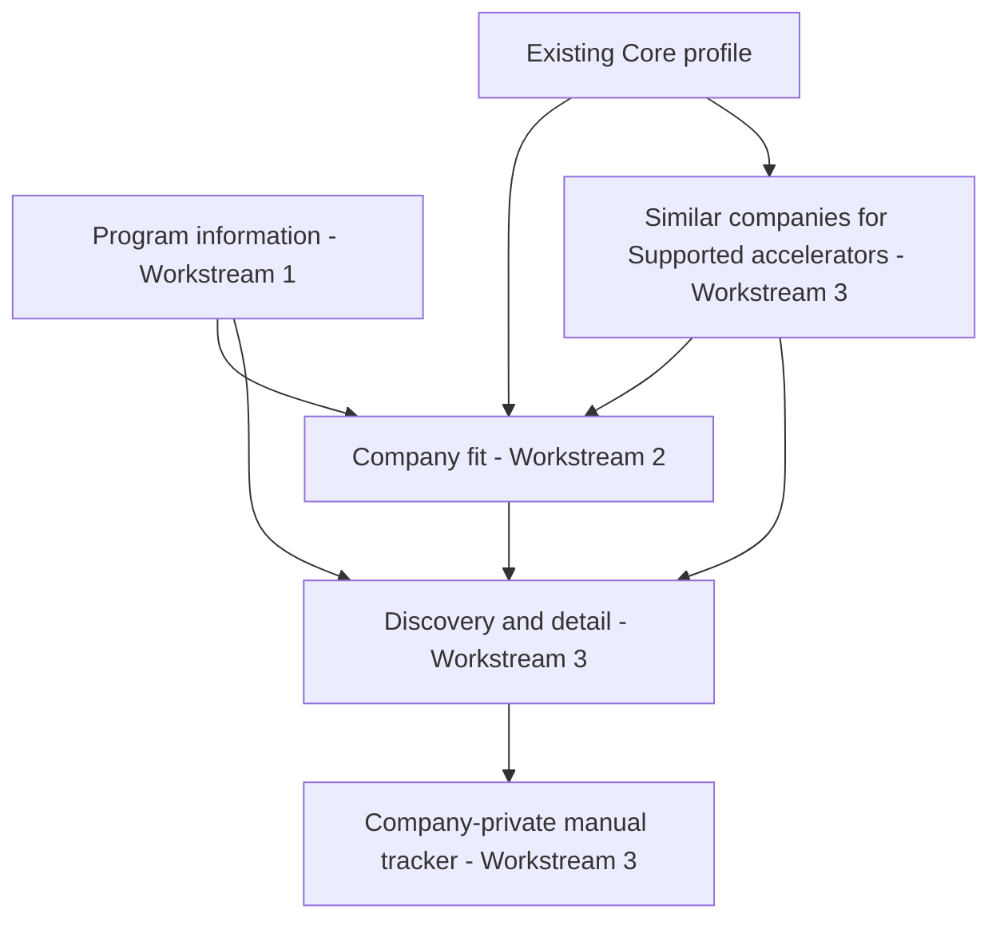

# Accelerator Sourcing and Company Fit - Plan

## Goal Capsule

- **Objective:** A company can find relevant accelerator programs, understand the evidence behind their suitability, compare participation terms, and manage its application shortlist through decisions.
- **Product authority:** Requirements draft based on the requested three directions. Feature ownership is user-directed: Tony finds accelerators and collects each one's program information, Tiffany owns company fit, and Kien owns similar companies for a few supported accelerators, discovery/tracking, and integration. Scoring defaults and freshness targets remain proposals.
- **Open blockers:** None for reviewing this draft. Third-party data availability limits completeness, not whether the product can represent and explain missing information.

---

## Product Contract

### Summary

Extend the existing accelerator finder with richer sourced program profiles, evidence-backed multidimensional company-fit scoring, and company-specific discovery plus a manual application tracker.
The product helps founders decide where to apply; it does not fill or submit applications.

### Current baseline

The existing product has a reviewed public catalogue, sourced descriptions and target-applicant narratives, cycles/deadlines, text and saved-fit filters, and company-private fit results.
The current assessment is one nullable 0–100 score with reasons, concerns, unknowns, and evidence references; it becomes stale when the company profile or program changes.
Structured portfolio records, deal records, tags, dimension scores, and manual tracking are additions, not existing functionality.
The new manual tracker changes the previous no-submission-tracking scope without restoring the removed form-filling workflow.

### Actors and terms

- A1. **Company member:** Uses the existing Core profile to discover programs, inspect fit, and maintain company-private tracking records within their permissions.
- A2. **Catalogue operator:** Collects, checks, and updates public program information and reviews extraction gaps or conflicts.
- A3. **Product owner:** Approves audience, catalogue coverage, scoring defaults, and release acceptance.

A **Program** is the accelerator offering; a **Cycle** is a particular batch or rolling intake.
A **Portfolio company** is a company with sourced evidence of participation or investment; these are distinct relationships.
A **Supported accelerator** is one of a deliberately small set of Programs whose past-batch company data can be accessed; similar-company matching and application responses exist only for these.
A **Fit assessment** compares a company's Core profile with a Program; it is not an admission probability.

### Requirements

**Boundary and trust**

- R1. Application assistance shall remain limited to research, official application/contact links, and manual tracking; the product shall not generate applicant answers, populate forms, submit applications, or send outreach.
- R2. The public Catalogue shall remain separate from company-private profiles, fit assessments, tasks, and tracking records under existing company access rules.
- R3. Material program claims shall carry source links, supporting excerpts, checked dates, and an explicit distinction between reported facts and interpretations.
- R4. Missing, conflicting, stale, inaccessible, and not-applicable information shall remain distinguishable rather than being converted into invented values or negative findings.

**Program collection and enrichment**

- R5. Collection shall discover relevant linked official pages for program details, terms, batches, and application routes, with permitted secondary sources used to fill identified gaps.
- R6. Collection shall support repeatable refresh and operator review while preserving stable Program and Cycle identity across updates.
- R7. Each Program shall support the information groups in the Program information specification below, including explicit unavailable states for information that cannot be verified.
- R8. For each Supported accelerator, collection shall source accepted companies from all accessible previous batches, with what each company does, its batch, sources, and stable identity, distinguishing participation from investment and attaching funding, exits, and returns only to supported claims.
- R9. For Supported accelerators, Program detail shall rank past accepted companies by similarity to the active company's Core profile, explain each match, and link to available application responses as read-only pitch references; other Programs shall state that this feature is not available.
- R10. Program detail shall provide a formatted Deal and Economics section preserving the substantive source-page content rather than forcing every term into a fixed template.
- R11. Application responses shall be collected only for Supported accelerators and only from public or explicitly authorized sources, with accepted-company status verified separately from the availability of the response text.
- R12. Tags shall be generated from program evidence into a controlled taxonomy with stable identifiers, aliases, and support for multiple tags per Program.

**Company-fit evaluation**

- R13. Matching shall reuse the existing Core profile and its evidence rather than require a second company-profile workflow.
- R14. Matching shall evaluate the dimensions in the Scoring specification and expose criterion results, supporting evidence, concerns, and unknowns.
- R15. Explicit eligibility requirements shall produce a separate eligible, ineligible, or unknown result, with inferred preferences excluded from hard eligibility decisions.
- R16. Overall fit shall be calculated from a versioned rubric and weights, with evidence coverage shown separately from suitability.
- R17. Assessments shall be bound to the company-profile, program-data, and scoring-rubric versions so that affected results are identified as out of date.
- R18. Reading, filtering, and tracking shall not silently start paid matching; users shall explicitly initiate matching with its cost visible.

**Discovery and tracking**

- R19. Discovery shall support the facets, combination rules, and sort options in the Discovery specification while preserving the selected company context.
- R20. Program rows shall expose enough sourced facts, current fit state, and tracking state to shortlist a Program without opening every detail page.
- R21. Program detail shall combine program research with an inspectable company-fit assessment and links from conclusions to their underlying evidence.
- R22. Members with edit permission shall be able to maintain priority, application status, and tasks using the Tracking specification without a completed fit assessment.
- R23. Discovery and tracker views shall preserve filters when navigating to detail and back, with clear result counts, reset controls, empty states, and unavailable-data states.
- R24. New user-facing content shall support English and Simplified Chinese and use the existing accessible component kit and design tokens.

### Program information specification

This specification supplies the content required by R7–R12.
Collection is required to attempt these categories; a value is required only where a permitted source supports it.

| Group | Information to support | Interpretation limits |
| --- | --- | --- |
| Identity and operations | Name, operator, official URL, location, public operating status, last checked date | Separate active/paused/closed/unknown from whether applications are open |
| Investment stage and audience | Accepted stages, sectors, technologies, business models, customer types, geography, founder or incorporation constraints | Preserve detailed narrative alongside structured facets |
| Contact and entry route | Public program email, phone number, application URL, email/referral/invitation routes, application steps and interview process | Do not collect private personal contact details or imply a route is open without evidence |
| Batches and timing | Previous and next announced batches, normal annual cadence, start/end dates, deadlines and timezone, rolling intake | Distinguish announced dates from historical patterns; never promote an inferred date into the next deadline |
| Selectivity | Reported acceptance rate, applicant/admit counts, cycle/year, population, source and method | Derive a rate only from compatible counts; unknown is not zero |
| Deal and Economics | Formatted terms, cash amount/currency, equity, instrument, valuation/cap, discounts, fees, conditions, optional components, benefits and source links where published | Cash, credits, perks, fixed equity and contingent dilution must remain distinct |
| Portfolio and outcomes (Supported accelerators only) | Company identity, website, what it does, batch, participation/investment relationship, funding rounds with dates, investors, exits, operating status and reported returns | Funding raised or valuation is not an investment return; actual realized/unrealized returns require their own basis and date |
| Historical application responses (Supported accelerators only) | Original questions and responses where shareable, company, Program, batch/year, source, acceptance evidence, redactions and completeness | Distinguish verified accepted applications from unverified examples and retrospective advice |
| Tags | Sector, technology, business model/customer type, stage and geography facets | Do not merge all meanings into one untyped tag list; no evidence means no asserted tag |

**Deal presentation:** Under R10, preserve headings, lists, tables, caveats, and links in a safe readable rendering, not an executable embed of the original website.
Identify the effective batch/date and alternative packages when terms differ.
Show a short factual summary beside the detailed content when supported.
Do not imply that nominal cash divided by headline equity captures a SAFE or mixed-instrument package.
Where republication is not permitted, link to the full page and display an authorized excerpt rather than copying restricted material.

**Recommended supporting information:** Duration, remote/hybrid/on-site format, relocation requirements, language, time commitment, mentorship, investor access, incorporation restrictions, and eligibility exclusions belong on the Program profile when available.
These explain fit and feasibility; they are not a separate expansion into application assistance.

**Refresh proposal:** Check application-window facts daily for known deadlines within 30 days, weekly for other current intakes, and monthly for general program information.
Use source-specific limits and expose last-successful-check dates when checks fail.
A changed deadline, deal, status, or requirement must not be hidden by a failed refresh or silently replaced with an unsupported value.
The cadence is a proposed operating target, not a claim of existing automation.

### Scoring specification

The following is an initial rubric for R14–R16, proposed for calibration rather than claimed to predict acceptance.

| Dimension | Initial weight | Evidence and criteria |
| --- | ---: | --- |
| Sector and technology | 20% | Stated focus areas against the company's actual product and technical approach |
| Company stage and traction | 15% | Product maturity, funding stage, revenue, users and other published stage expectations |
| Business model and customers | 15% | B2B/B2C, customer segment, commercial model and target markets |
| Portfolio similarity | 15% | Kien's similar-company results: past accepted companies by product, customer, technology and stage at entry (Supported accelerators only) |
| Deal compatibility | 15% | Published capital, equity, instruments and conditions against known company funding needs and constraints |
| Operational feasibility | 10% | Location, incorporation, attendance, relocation, timing and time commitment |
| Program value to the company | 10% | Supported company needs against the program's sector expertise, network and resources |

For each criterion, use anchored ratings: 0 = evidenced incompatibility, 25 = weak alignment, 50 = partial alignment, 75 = strong alignment, 100 = direct alignment.
Unknown evidence produces no rating; it does not produce a zero or a neutral 50.
The model may interpret evidence against the rubric, but arithmetic and the selected weights determine the composite.
Each rated criterion must identify both the relevant company evidence and program evidence.
Unsupported certainty must fail assessment validation rather than be stored as a scored fact.

Calculate the overall score as the weighted mean of rated dimensions and display the share of applicable weight covered by evidence.
The proposed minimum for an overall score is 70% evidence coverage; below it, show available dimension results and “insufficient evidence” instead of an overall number.
A dimension is not applicable only under a documented rubric rule, not because collection failed.
Portfolio similarity is not applicable for Programs outside the Supported accelerator set; its weight is excluded rather than scored as zero.
Within a dimension, unknown required criteria prevent a complete dimension rating.
Unknown deal preferences or scheduling constraints must remain explicit profile gaps, not invented founder preferences.

Eligibility is independent of the weighted score under R15.
A confirmed failed hard requirement makes the Program ineligible regardless of its similarity score.
An unresolved hard requirement remains unknown and is visible beside any available fit score.
Default recommended results exclude confirmed ineligible Programs, with a control to include them; unknown eligibility remains visible with its limitation.

Portfolio comparison must explain the matched attributes and the sourced relationship.
Use the historical company's stage at admission when known, rather than its current success as a proxy for the accelerator's entry criteria.
A famous alumnus, funding event, or similar company does not prove causal program benefit or likely admission.
Within a Supported accelerator, absent portfolio evidence leaves that dimension unknown.

### Discovery specification

Under R19–R23, extend the existing finder rather than create a second catalogue.
The active company determines saved-fit results and private tracker records.
Without a ready Core profile, users can still browse, filter factual data, and track Programs; personalized scoring explains which profile information is missing.

- **Facets:** Sector/technology tags, business model/customer type, investment stage, geography/format, intake/deadline window, known funding/equity terms, operating status, eligibility, fit dimensions/overall score, priority, and tracking status.
- **Combination:** OR among selected values within one facet; AND across facets and text search.
- **Unknowns:** Offer an explicit unknown option where material; numeric thresholds exclude unknown values rather than treating them as zero.
- **Deal filtering:** Apply numeric comparisons only to comparable sourced terms; conditional or non-comparable packages retain their narrative and an unknown/not-comparable filter state.
- **Sorting:** Best current fit by default; also nearest confirmed deadline, program name, and tracked priority.
- **Transparency:** Do not rank missing or stale fit as current fit, nor label a dated intake as currently open without a sourced window/status.

Rows show Program name/logo, relevant tags, location/format, investment stage, next confirmed deadline or rolling/unknown state, deal headline when available, fit with coverage/freshness, and tracker priority/status.
Program detail organizes overview, who it is for, Deal and Economics, portfolio and similar companies, batches/how to apply, historical application examples, contacts/status, and sources.
The company-fit panel remains visible beside the research in wide panes and stacks without clipping in narrow panes.
Tracker controls are available from list/detail and a dedicated tracked-program view.

### Tracking specification

The manual tracker in R22 is company-private and independent of application submission systems.

- **Identity:** One opportunity per company, Program, and selected Cycle; a Program-only shortlist is allowed before a Cycle is known.
- **Continuity:** Selecting a Cycle upgrades the Program-only record without duplication; applying in a later Cycle creates a separate record and preserves prior history.
- **Priority:** Low, medium, or high, independent of fit and application status.
- **Statuses:** Shortlisted, preparing, applied, interviewing, accepted, rejected, and withdrawn.
- **Pending:** A view/filter for applied or interviewing records awaiting a final decision, not a conflicting second submission status.
- **Application data:** Selected Cycle, user-recorded submission date, private notes, and next action; opening the official portal never marks an application submitted.
- **Tasks:** Title, open/completed state, due date, and priority; support preparation work without drafting answers.
- **Dates:** Show official deadline separately from internal task due dates and preserve the deadline the user planned against when official dates change.
- **Changes:** Members manually update or correct states; a new application Cycle must not overwrite the previous Cycle's result.
- **Permissions:** Read-only members cannot mutate records, and company switches never expose another company's notes or decisions.

### Key flows

- F1. **Find and understand.** A member selects their company, filters Programs, opens a result, inspects fit/evidence, compares terms and relevant portfolio companies, and returns to the preserved results. **Covers R13–R21, R23.**
- F2. **Plan and track.** A member shortlists a Program, chooses priority and Cycle, adds preparation tasks, applies externally, and manually records pending/interview/final outcomes. **Covers R1, R2, R22.**
- F3. **Refresh and reassess.** An operator refreshes Program information; affected fit becomes out of date, tracked opportunities remain intact, and a member explicitly requests an updated match. **Covers R3–R6, R17, R18.**

### Three parallel workstreams

Ownership is by deliverable, not by frontend/backend layer.
Each person owns the data handling and acceptance proof for their lane.
The user-directed feature split is Tony for finding accelerators and their program information, Tiffany for company fit, and Kien for similar companies in Supported accelerators, discovery, program detail, manual tracking, and integration.

#### Workstream 1 — Accelerator discovery and program information

**Owner: Tony.**

Own R3–R7, R10, and R12: finding accelerators, collection, source provenance, refresh, program-data structures/import, Deal and Economics content, batches/contact/status, and evidence-backed tags for every Program.
Past accepted companies and application responses are not part of this workstream.
Own the shared public Program/Cycle/evidence/taxonomy contract and its storage changes.

**Deliverables:** An enriched reviewed catalogue, a repeatable collector/refresh path, a data-coverage report, and explicit unavailable/conflicting states.
Provide representative records covering mixed investment instruments, multiple batches, and missing data.

**Handoff:** Publish Program facts and stable identifiers to Workstreams 2 and 3.
Escalate conflicting sources to operator review rather than requiring the matcher or UI to resolve truth.

#### Workstream 2 — Company fit and matching quality

**Owner: Tiffany.**

Own R13–R18: Core-profile mapping, eligibility, dimension criteria, evidence references, deterministic aggregation, coverage, rubric versioning, staleness, and quality evaluation.
The portfolio similarity dimension consumes Kien's similar-company results for Supported accelerators and is not applicable for other Programs.
Own the private assessment contract, matching execution, and any required Core-profile mapping changes.
Publish dimension scores, eligibility, evidence, coverage, and freshness for Kien to present; coordinate any fit-panel contract changes with him.
Do not build a second profile store or take ownership of the Program catalogue.

**Deliverables:** A versioned rubric, company-specific assessments with inspectable evidence, and a reviewed benchmark comparing the richer results with the current generic score.
Record any regression, unresolved evidence gap, and performance/cost tradeoff; do not claim improvement from a few persuasive examples.

**Handoff:** Consume the Program and Similar-company contracts and publish an assessment contract to Workstream 3.
Report missing collection fields to Workstream 1 and profile gaps to the company-profile owner.

#### Workstream 3 — Similar companies, discovery, program detail, and manual tracker

**Owner: Kien, also integration owner.**

Own R8, R9, R11, R19–R24, and the user-facing enforcement of R1–R4: choosing Supported accelerators, sourcing their past accepted companies and application responses, the similar-company matching algorithm, facets/search/sorting, list/detail presentation, evidence inspection, deal presentation, tracker APIs/storage, tasks, tenancy, permissions, localization, and interaction accessibility.
Own the private tracking contract and all accelerator screens/message catalogues.
Render assessment results from Workstream 2; do not recompute fit in the browser.

**Deliverables:** Similar-company matching with application references for the first Supported accelerators, a company-tailored discovery experience, and an end-to-end manual tracker, exercised with current, stale, unknown, ineligible, unsupported, and unavailable-data cases.
Provide desktop/narrow-pane and keyboard evidence for the changed screens.

**Handoff:** Surface missing or contradictory data to Workstream 1 and ambiguous or unsupported fit explanations to Workstream 2.
Changing priority or status must remain independent of paid matching and official application submission.
As integration owner, arbitrate shared-contract changes and coordinate common schema/export, permission, and metering changes with the responsible feature owner.

### Shared contracts and collaboration

The contracts below define information boundaries, not a prescribed API or database design.

| Contract | Single owner | Consumers | Minimum agreement |
| --- | --- | --- | --- |
| Program and Cycle | Workstream 1 | 2 and 3 | Stable IDs, structured facts plus narratives, explicit unknowns, version/freshness and effective Cycle |
| Evidence | Workstream 1 for public sources; 2 for company mapping | 2 and 3 | Resolvable references, source excerpts/dates, fact versus interpretation, no private-company evidence in the public catalogue |
| Taxonomy | Workstream 1 | 2 and 3 | Stable facet/tag IDs, labels/aliases, evidence and handling of unknown classifications |
| Fit assessment | Workstream 2 | 3 | Eligibility, criterion/dimension results, weights, overall score, coverage, evidence and version/freshness |
| Similar companies | Workstream 3 | 2 and 3 | Supported accelerator set, accepted companies with batch/description/sources, application responses with permission and acceptance status, ranked matches with explanations |
| Tracking record | Workstream 3 | 3 | Company scope, stable Program/Cycle references, priority, status, tasks and dates independent of fit |

1. **Contract kickoff:** All three agree IDs, evidence references, unknown states, Cycle semantics, assessment shape, and representative examples before cross-lane integration.
2. **Parallel development:** Workstream 1 finds and enriches accelerators; Workstream 2 builds and evaluates the rubric against agreed examples; Workstream 3 sources the first Supported accelerators and builds similar-company matching, discovery and tracking against the same contracts.
3. **Early integration:** Connect a real enriched Program, a real Core profile, a persisted dimension assessment, and a company-private tracking record before broadening catalogue coverage.
4. **Contract changes:** The contract owner proposes changes with both consumers; the integration owner resolves collisions before shared files are edited.
5. **Release review:** All three demonstrate the acceptance examples together; data gaps remain visible rather than being filled by UI or model inference.

Use separate branches from the current accelerator integration base and PRs back to that base, as in the existing team workflow.
Do not assign multiple people independent edits to a common schema barrel, migration set, or screen.
A daily short check focuses on contract changes, blocked evidence, and integration failures; PRs identify the affected contract and consumer.

### Acceptance examples

| Example | Covers | Expected result |
| --- | --- | --- |
| AE1. Incomplete or inaccessible Program | R4–R7, R21 | Program stays usable with sourced available data and explicit unavailable states; no invented contact, terms or deadline |
| AE2. Repeat import and refreshed terms | R6, R17, R22 | Stable Program/Cycle IDs persist, no duplicate opportunities appear, affected fit is stale, and tracking notes/status survive |
| AE3. Mixed cash/SAFE package | R7, R10 | Full formatted terms preserve conditions and instrument distinctions; the headline does not claim unsupported fixed dilution |
| AE4. Next batch not announced | R4, R7, R19 | Historical annual cadence is visible as historical; no fabricated next deadline or open-now label |
| AE5. Related portfolio company | R8, R9, R14 | The user sees participation/investment evidence and explicit similarity attributes; funding/valuation is not labeled return |
| AE6. Similar accepted company's application | R1, R3, R9, R11 | The most similar accepted companies appear first with their matching attributes; a permitted original response is shown read-only and distinguished from advice, acceptance verification and missing sections; no answer-generation or form workflow appears |
| AE7. High similarity but hard exclusion | R14–R16, R19 | Ineligibility remains explicit and excludes the Program from default recommendations despite a strong similarity dimension |
| AE8. Thin company or Program evidence | R4, R13–R16 | Missing facts remain unknown, coverage falls, and below the specified coverage threshold no overall score is asserted |
| AE9. Profile, data or rubric changes | R17, R18 | Saved results are labeled out of date; browsing and filtering start no paid match |
| AE10. Combined tags and filters | R12, R19, R23 | Within-facet OR and across-facet AND produce the expected set; back navigation preserves filters and unknown terms never satisfy numeric thresholds |
| AE11. Manual application lifecycle | R1, R18, R22 | A member sets high priority, completes a task, applies externally, records applied/pending then rejected, without drafting, sending or paying for matching |
| AE12. Later Cycle and company isolation | R2, R22 | A second Cycle preserves the earlier outcome; another company cannot read or mutate either record |
| AE13. Read-only and narrow-pane use | R2, R21–R24 | Read-only access cannot change state; evidence and tracker controls remain accessible and localized without clipped content |
| AE14. Unsupported accelerator | R4, R9, R14 | Program detail states that similar companies are not available for this accelerator; portfolio similarity is excluded from fit rather than scored as zero |

### Release acceptance and measurement

All acceptance examples must be exercised against the connected product, not only isolated contract examples.
Review the matching benchmark across different sectors, stages, locations, hard exclusions, sparse profiles, absent portfolios, and conflicting sources.
Compare against the existing scorer on the same company–Program pairs using blinded human judgments of ordering and explanation support.
Demonstrate no unsupported hard-eligibility decisions and no unsupported factual claims in the reviewed release sample.
The proposed weights and coverage threshold must be reviewed against that benchmark before rollout; they are not admission statistics.

Report catalogue coverage per information group rather than a single scrape-success count.
Track source age, unresolved conflicts, stale-assessment share, scoring coverage, human-reviewed relevance, and shortlist-to-applied progression where company activity permits measurement.
Do not use a higher volume of extracted text or higher average fit scores as proof of better sourcing or matching.

### Dependencies, assumptions, and scope boundaries

- Existing Core-profile facts may not contain structured funding preferences, technology, incorporation, availability, or desired program benefits; missing inputs must remain visible under R4 and R13 rather than be invented.
- Public information may not contain investment returns, acceptance rates, or accepted application texts; the required capability includes collection and presentation, not guaranteed availability for every Program.
- Respect source access controls, robots rules, applicable terms, licensing, and authorized use; do not bypass login, paywalls, CAPTCHAs, or private applicant portals.
- No application autofill, answer drafting, automated submission, automated email, portal synchronization, or inferred application status is included under R1.
- A hypothetical dilution calculator, commercial data-provider purchase, predictive admission probability, and wider CRM/reminder integrations are not required by this scope.
- Historical application records do not authorize copying private answers into public examples or reactivating retired form APIs.

### Kien's execution sequence

Kien's work runs in two phases; Tony's and Tiffany's branches are not merged during either.

1. **Data discovery.** Identify which accelerators have accessible past-batch company data and accepted application responses, then select the first Supported accelerators. Collection does not start until that selection is made.
2. **Vision demo.** Collect and store real past-company and response data for the selected accelerators, build the similar-company matching, and build the full product UI as a demo. Tony's program information and Tiffany's fit scores are simulated in the UI against this specification, using real public data and clearly labeled as demo output rather than their delivered work.

Tony's and Tiffany's work is integrated later, replacing the simulated parts; that integration is outside these two phases.

### Outstanding decisions

**Resolve before rollout:** Product owner approves the target startup audience and required catalogue coverage; Kien selects the first Supported accelerators based on accessible past-batch data; product owner ratifies or revises the proposed scoring defaults, refresh targets, and benchmark acceptance based on observed quality.
These do not prevent reviewing or planning the requested product scope.

**Deferred to implementation planning:** Collection mechanisms and scheduling infrastructure, exact storage/API design, large-catalogue query strategy, source-specific rendering permissions, deployment sequence, and concrete benchmark fixtures.
No production code or schema changes are authorized by this requirements draft alone.

### Repository grounding

- `docs/design/accelerators/README.md:3-79` — current scope, terminology, explicit matching and previous team roles; this draft proposes the additions above rather than treating historical form-assistance plans as active scope.
- `docs/design/accelerators/README.md:95-137` — shared-file coordination, public/private separation, stable identity, access and retired execution paths.
- `pipelines/src/proposals/accelerators/types.ts:96-192,207-294` — existing sources, narratives, cycles, Program and single-score assessment contracts.
- `apps/web/src/server/accelerators/run.ts:18-104` — current generic company-to-catalogue evaluator.
- `apps/web/src/app/employer/tools/accelerators/_lib/discovery.ts:3-99` — existing search, fit/intake filters and saved-score ranking.

This document is grounded in source inspection, not a claim that the proposed capabilities are implemented or runtime-verified.
