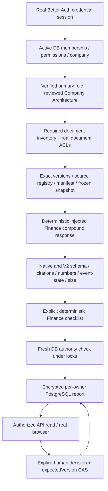

# Vantage ? Milestone 1: Authenticated Finance E2E Integration

Implementation date: 2026-11-05 America/New_York; verification artifacts also carry 2026-11-06 UTC timestamps.

## Result and scope

The actual isolated Next.js application authenticates a synthetic account with Better Auth, resolves its database membership and role, assembles authorized exact-version Finance and Sales documents, validates an injected deterministic compound response, encrypts and saves a private report in PostgreSQL, records an explicit human decision with optimistic concurrency, and reloads it through the authorized API. The real authenticated browser walkthrough also passed; its final report remains saved at version 2.

This is an authenticated local product integration with simulated Generation. It is not a real-model result, an independent semantic Judge result, full production retrieval validation, or a claim that the historical Finance omission has been fixed. No external Generation, Judge, embedding or research request was dispatched. No commit, push, merge, production migration or deployment was performed.

## Isolation and exact source provenance

| Source | Inspected state / use |
|---|---|
| New integration branch | `integration/vantage-finance-m1-20261105` in `C:/Users/junku/.codex/worktrees/99e3/LaunchStack` |
| Integration base | `b809e8248e4c65eb2e6e8c4aa05b52003e352aa9` |
| Original repository | `a9d3e64240551a648c36ba04bce6078e0408168e`; dirty work preserved |
| Remote main at inspection | `c14773d06dd2c8ef2b28c2d9a6cbdb106ec0faa3`; not merged |
| Joseph PR #561 head | `3afeb35dbefc817dfc9a7ea887c94424a047d061`; open at inspection |
| Sophia PR #582 head | `2b0ce19fcf34f33d87d97276ad6c247c58abb4dd`; open at inspection |
| `9499` | Integration base plus dirty repaired Sophia/V2/Judge code and fixtures; selected files copied and hashed, no edits there |
| `1c46` | Selected additive DTO/encrypted-sidecar compatibility files only; repaired `9499` V2 takes precedence |
| `514f` | Polished dirty Weekly Review UI and related tests copied without changing the source worktree |
| Joseph prerequisite commit | `9ba54f4dd44e5d7228bfc163f045c8659208c8af`; selected personal-context schema/store/lib files and focused transactional authz/schema prerequisites |
| Portable demo | Existing `f74c` / `e660b590` retained; not used as the production host |

[Transfer manifest](../../test-output/vantage-finance-m1/source/transfer-manifest.json) records 66 imported source file hashes. [Preservation check](../../test-output/vantage-finance-m1/source/preservation-check.json) confirms those original source files remain byte-identical and records the selected Joseph commit files. Dirty source content is identified by hashes, not represented as a committed revision. Candidate D and frozen native V1 behavior were not activated or modified.

Only the new runtime is used: app `http://localhost:3186`, PostgreSQL `127.0.0.1:55446/vantage_finance_m1_20261105`, Docker container/volume `vantage-finance-m1-20261105-db` / `vantage-finance-m1-20261105-data`. Stable ports 3104/3111 and existing demo databases/runtime directories were not used. All changes remain uncommitted in the new worktree.

## Implemented path



| Boundary | Implementation and evidence | Remaining boundary |
|---|---|---|
| Authentication | Actual Better Auth sign-in route, credential account, session cookie and database session; normal browser sign-in | Local HTTP synthetic accounts; production HTTPS/SSO not assessed |
| Actor/company/permissions | Existing `requireWorkspaceContext`, active membership, custom `finance-reviewer` permissions, transactional Joseph scope readers | Outside company is rejected at the outer enabled-workspace gate; no claim of testing two enabled companies |
| Role | Confirmed DB business context resolves `founder` as primary; request cannot supply authoritative actor/company/role | Role-change UI and paired-role quality remain later work |
| Company Architecture | Existing projection/authorization adapter; actual reviewed projection shown; review binds expected revision and fingerprint | Extraction/profile records are synthetic fixtures, not live extraction |
| Required context | Local DB inventory, two required private documents, actual grants, exact versions/content hashes | Personal stars are empty; their lifecycle is not covered here |
| Retrieval/assembly | Real registry, `runDynamicContextV0`, manifest and evidence snapshot; both financial definitions retained | Finite metadata-based retrieval adapter; no embeddings/vector ingestion/research |
| Native carrier | Two actual private native evidence rows explicitly linked to the exact same document versions | Necessary bridge because frozen V1 returns Rules early without native intake; copies are not independent corroboration |
| Generation | `finance-milestone-v1.ts` injected transport through repaired contextual V2/Sophia normalization | Authored deterministic response; no provider or model Judge |
| Validation | Real compound schema, native validation, exact citations, numeric/event-state checks, topic/size bounds, manual Finance checklist | Checklist is not general semantic entailment or independent validation |
| Persistence | Existing SecretBox encryption, new per-owner contextual table, company/owner binding, real SQL/CAS | Local schema only; no production migration or canonical storage rollout |
| Human review | Shared Weekly Review components and new guarded API; explicit needs-more-evidence choice, version CAS, encrypted audit and reload | No next-week history integration, automatic commitments or regeneration |

Primary implementation files: `apps/web/src/server/vantage/contextual-{host,service,schema}.ts`, `apps/web/src/app/api/vantage/contextual/**`, `apps/web/src/app/employer/vantage/finance/**`, `pipelines/src/vantage/experiments/finance-milestone-v1.ts`, and `scripts/dev/vantage-finance-*`.

The native agendas/topics and frozen V1 contracts retain their existing semantics. The new report table has `(company_id, owner_user_id, week_start)` uniqueness: this avoids treating a company-shared native agenda as a private user report. The existing demo's encrypted metadata sidecar stays on its existing path; imported V2 fields remain additive and optional on legacy reads.

## Frozen Finance inputs and authority proof

The synthetic owner is `vantage-r9129b8d7dd4027f0-owner`, product user `1`, company `1`. The same-company peer is user `2`; outside-company actor is user `3` in company `2`. Exact account metadata is in [sanitized runtime](../../test-output/vantage-finance-m1-20261105/sanitized-runtime.json); credentials and encryption keys remain in ignored `runtime.json` and are not included here.

| Canonical ref | Exact content | SHA-256 |
|---|---|---|
| `doc:1@1` | October revenue is USD 12,000, provisional; refunds not reconciled. | `80313e9906dd08330b9c7b4e98cd640ddf714c3a61164b8fbad7332246d891e7` |
| `doc:2@2` | October revenue is USD 18,000; includes unsigned opportunities. | `7b1c526f040a4ed1c781d1c60ac16b94f043eba530bd343376cc501645f65b77` |

Both document entries retain actor-private audiences. The company projection has its own canonical version and company audience. The complete registry, frozen envelope, ACL digests and source fingerprints are preserved inside the decrypted synthetic saved-report evidence in the HTTP acceptance artifact.

Report week: `2026-10-12`, time zone `America/New_York`; period `2026-10-12T04:00:00Z` to `2026-10-19T04:00:00Z`, exclusive end. Synthetic domain `asOf`: `2026-10-19T12:00:00Z`. Authentication sessions use the real clock; report/review fixture timestamps use this declared synthetic domain clock. The host binds current document heads separately, so advancing a head after the cutoff cannot silently reuse a stale authority stamp.

[Native evidence crosswalk](../../test-output/vantage-finance-m1-20261105/native-evidence-crosswalk.json) records the two real DB bridge rows, document versions, identical body hashes and `independentCorroboration:false`. Only these linked native rows enter this report's native input. The copied base fixture also contains unrelated synthetic metrics/evidence in this new database; [seed baseline](../../test-output/vantage-finance-m1-20261105/seed-baseline.json) makes that explicit. They do not enter the Finance snapshot.

## Executed acceptance

Authoritative final API artifact: [26-request HTTP trace](../../test-output/vantage-finance-m1-20261105/acceptance-http-1793940516711.json). It includes fresh generation `POST 200`, authenticated identities, the actual decrypted saved envelope, authorized source opens, the human decision and saved audit, and before/after DB fingerprints.

Authoritative direct race artifact: [PostgreSQL controls](../../test-output/vantage-finance-m1-20261105/acceptance-db-1793940523410.json). It starts with an existing reviewed version-2 report and proves ciphertext/version preservation. These direct controls disclose their synthetic identity wrapper; they use actual DB membership, permissions, sources and guards. The HTTP/browser flows use real Better Auth instead.

| Check | Observed result |
|---|---|
| Unauthenticated API | 401 |
| Normal owner authentication and fresh generation | Better Auth 200; report POST 200; encrypted row created |
| Finance and Sales retained | Both exact cited definitions present in frozen input and saved report; both source endpoints 200 |
| Another user's private report | Same-company peer 404 |
| Cross-company access | Outside actor 403 at enabled-workspace gate |
| Private/outside unregistered source | 404 |
| Missing mandatory Finance inventory entry | Generation 409, `native_evidence_bridge_missing` |
| Revoked Finance grant | Reload and generation 403, `source_unavailable` |
| Changed exact version or source content | 409, `native_evidence_bridge_invalid` |
| Head advanced after cutoff | 409, `stale_saved_context` |
| Malformed generation | One injected invocation, validation rejected, existing saved row unchanged |
| Tampered normalized report | Commit rejected before persistence |
| Source changed between prepare and commit | Exact `native_evidence_bridge_invalid` rejection |
| Architecture review stale revision / wrong projection | CAS/fingerprint rejection |
| Concurrent review from same version | Exactly one 200 and one 409 |
| Stale subsequent review | 409; saved decision retained |
| Invalid calendar date / report ID | 400 |
| No unintended actions | Native agendas, topics, commitments, contract state and event outbox counts/digests unchanged; all zero in this fixture |

The saved decision is `needs-more-evidence`, with text ?Reconcile the two definitions before deciding.? It is stored separately from the AI recommendation and carries the authenticated owner's audit entry. A read-only independent audit checked the decision, actor, topic, version and timestamp against the final artifacts.

After API/DB acceptance, the exact owned synthetic report was checkpointed and removed with an explicit ID/version/company/owner/week CAS solely to permit a fresh browser generation. This is controlled fixture setup, not application failure recovery. Checkpoints and all failed execution artifacts are retained. The final browser-created report is left saved.

## Verification and token budget

- Pipeline Vantage suite: 768 passed; 54 legacy PostgreSQL tests skipped because their hard-coded target is a different database. This is explicitly not evidence that those 54 tests ran on this host.
- Web/auth/Vantage regression: 46 suites passed, 592 tests passed; 7 suites / 88 tests skipped for their separate database targets.
- Dedicated real PostgreSQL + Better Auth HTTP acceptance: 2/2 Jest entries passed, containing 26 HTTP trace entries and four direct DB control groups.
- Finance replay tests: 7/7 passed, including malformed/omitted output controls and offline transport checks.
- Runtime tests: 3/3 passed, covering clean child environment, blocked external transports, and real loopback sockets.
- Web TypeScript and scoped API/host/replay/UI ESLint passed. Final verification artifacts record the exact commands and exits.

[Full-compound token projection](../../test-output/vantage-finance-m1/token-projection.json): **485 tokens** (native plus experimental), 2,365 UTF-8 bytes, using locally installed `js-tiktoken@1.0.21` `o200k_base` as an explicitly labeled proxy. This is 20.2% of the unchanged 2,400-token cap; 85% warning threshold remains 2,040. Prompt was 21,515 bytes against the unchanged 23,500-byte preflight. No provider tokenizer identity or real-provider usage is asserted. Runtime `providerAttempts:1` denotes one injected simulated call here, not an external request.

Problems found and resolved during execution: synthetic profile reader-version mismatch; offline Next font loading; contextual-only input hitting frozen native Rules early; Next bundling of dynamic tokenizer resolution; missing independent SecretBox runtime initialization; weak test assertions that could have accepted an unrelated rejection. The tokenizer is now an explicit already-cached dependency verified by frozen offline installation. An existing retrieval-gate unit test now uses the repository's standard mocked workspace helper, avoiding unrelated live-auth module loading; real authentication remains exercised separately.

## Zero-provider boundary

The app and acceptance children receive a clean allowlisted environment; provider credentials are not inherited. Generation is injected, no semantic Judge is registered, embeddings/research are absent, mail/connectors/workers are disabled. Node fetch/DNS/TCP/TLS transport is restricted to loopback by a tested preload guard. Fonts use a local Arial fallback.

[Network summary](../../test-output/vantage-finance-m1-20261105/network-summary.json) records denied attempts, including Next's registry check and local IPC attempts. Ten early denied events lack origin metadata and are not retrospectively attributed. Denied attempts were blocked before dispatch; this is a Node transport guard, not an OS firewall certification. Browser acceptance separately records the observed request origins. No claim of zero incidental attempted network activity is made.

## Reproduction

Use the isolated worktree, not the original checkout. Docker Desktop must be running; the launcher resolves its installed per-user Docker CLI. Dependencies were installed with pinned pnpm 10.15.1, offline, frozen lockfile and scripts disabled.

```powershell
Set-Location C:\Users\junku\.codex\worktrees\99e3\LaunchStack
corepack.cmd pnpm install --offline --frozen-lockfile --ignore-scripts --child-concurrency=1 --network-concurrency=1
node scripts/dev/vantage-finance-runtime.mjs --status
# On a newly provisioned fixture only (do not reseed a review you want to preserve):
node scripts/dev/vantage-finance-runtime.mjs --prepare
# In a dedicated terminal; existing host already runs on 3186:
node scripts/dev/vantage-finance-runtime.mjs --serve
```

```powershell
# Dedicated real DB/API suite; the wrapper loads only the isolated runtime environment.
Set-Location C:\Users\junku\.codex\worktrees\99e3\LaunchStack\apps\web
$env:VANTAGE_FINANCE_M1_ACCEPTANCE = 'true'
node node_modules/jest/bin/jest.js --runInBand --runTestsByPath __tests__/server/vantage-finance-contextual.integration.test.ts
Remove-Item Env:VANTAGE_FINANCE_M1_ACCEPTANCE
```

This suite deliberately reviews the dedicated synthetic report and restores temporary source/grant faults. A fresh-generation replay requires the documented explicit owned-report checkpoint/reset command in the harness; it is not automatic. Preserve the current browser result before running mutating acceptance again.

```powershell
Set-Location C:\Users\junku\.codex\worktrees\99e3\LaunchStack
node --test scripts/dev/vantage-finance-runtime.test.mjs
node scripts/dev/vantage-finance-db-check.mjs
corepack.cmd pnpm --filter @launchstack/web typecheck
corepack.cmd pnpm --filter @launchstack/pipelines typecheck
# Offline regression guard for the following package-local test commands:
$env:NODE_OPTIONS = '--require=C:/Users/junku/.codex/worktrees/99e3/LaunchStack/scripts/dev/vantage-finance-network-guard.cjs'
Set-Location pipelines
node node_modules/vitest/vitest.mjs run src/vantage --maxWorkers=1 --no-file-parallelism
Set-Location ../apps/web
node node_modules/jest/bin/jest.js --runInBand --testPathPatterns='vantage|authz|require-workspace-context' --testPathIgnorePatterns='vantage-finance-contextual.integration.test.ts'
```

Browser URL: `http://localhost:3186/employer/vantage/finance`. The browser helper uses the ignored local synthetic credentials and never exports cookies/storage state: `node scripts/dev/vantage-finance-browser.mjs <step>`. Consult its explicit steps before running a mutating step. `--stop` on the runtime launcher stops only the owned DB and preserves its volume; stop the dedicated app terminal separately.

## Remaining integration work and next scenarios

1. **Role-aware prioritization (E2E-02):** identical authorized sources, two verified primary roles, actual resolver and retrieval inputs; cover cross-role dependencies. Joseph owns role/required-context semantics; TL owns authenticated host assertions; Sophia owns retrieval diagnostics. Start deterministically; semantic quality requires separate provider approval.
2. **Complete weekly lifecycle (E2E-01 remainder):** next-week history, carried questions, explicit commitment creation and distinct review/action permissions. TL owns persistence/API/UI; Joseph owns personal context; Sophia verifies freshness across retrieval. M1 currently rejects regeneration of an existing owner/week and deliberately preserves that report.
3. **Failure/recovery (E2E-04):** required-star revocation, two enabled companies, expired memberships, interrupted DB writes, malformed compound/fallback, and recovery without overwriting human state. Extend this dedicated PostgreSQL harness and exercise the remaining legacy database suites on safely provisioned targets.

The original Finance semantic regression still needs a separately approved real Generation plus independent Judge run of the frozen case. No larger batch, Phase 2, or Phase 3 execution is authorized by this milestone.

Production integration still needs a reviewed canonical owner-scoped schema/migration, full ingestion/retrieval adapters, removal of the required native duplicate bridge, broader auth/tenant coverage, next-week history, and independent real-model acceptance. Local table-level locks favor this bounded test's consistency; production concurrency/scalability is not assessed. Saved reports are withheld when current authority/source state changes, while ciphertext is preserved. Native V1 compatibility tests pass offline; legacy PostgreSQL suites remain explicitly outstanding.

## Final browser and verification index

**PASS ? authenticated browser lifecycle.** The normal Better Auth form established the session; the user inspected and confirmed the authorized Company Architecture; the real generation API saved report `af50dbf6-4beb-4030-9472-f6e48dd7e78a` at version 1. Both exact sources opened successfully. An explicit **Needs more evidence** decision advanced the report to version 2. Both the saved-report reload and a full browser reload retained the decision and note. The final report is left in PostgreSQL.

[Browser steps](../../test-output/vantage-finance-m1/browser/steps.log), [request log](../../test-output/vantage-finance-m1/browser/requests.txt), [reloaded snapshot](../../test-output/vantage-finance-m1/browser/06-reloaded.yaml), [desktop screenshot](../../test-output/vantage-finance-m1/browser/08-saved-desktop.png), [mobile screenshot](../../test-output/vantage-finance-m1/browser/07-mobile.png). The 390px viewport had no horizontal overflow. All 385 listed HTTP requests, including assets, targeted localhost:3186; some GETs were aborted and followed by successful responses. No interception was used. A scan of 24 browser evidence files found no exact or URL-encoded matches for the synthetic password or active session token; no HAR, trace or storage state was exported.

[Final database counts](../../test-output/vantage-finance-m1-20261105/final-counts.json) confirm one contextual report at version 2 and zero native agendas/topics/commitments/contract state/program deadlines. The unrelated synthetic evidence/metric baseline is unchanged. The final [runtime verification](../../test-output/vantage-finance-m1-20261105/runtime-verification.json) is read-only. App and owned DB remain running; the isolated browser was closed.

The final HTTP/DB Jest 2/2 result preceded one assertion-only harness addition: explicit validation of every persisted review audit field. That addition was separately checked offline against the preserved HTTP artifact, with **6/6** positive/mutant checks passing and no DB access: [audit assertion evidence](../../test-output/vantage-finance-m1-20261105/acceptance-review-audit-1793940712821.json). This timing distinction is intentional; no mutating suite was rerun over the final browser report.

Consolidated evidence: [verification index](../../test-output/vantage-finance-m1/verification.json), [complete implementation patch](../../test-output/vantage-finance-m1/implementation.patch), [milestone-focused patch](../../test-output/vantage-finance-m1/milestone-only.patch), [file manifest](../../test-output/vantage-finance-m1/implementation-files.json). Full regression logs remain alongside that index. Source artifacts, runtime configuration and report checkpoints are local; ignored secret configuration is excluded from the patches and reviewable manifests.

Smallest next milestone: the deterministic authenticated paired-role case using the same source versions and grants. Keep Generation/Judge execution disabled until separately approved.
