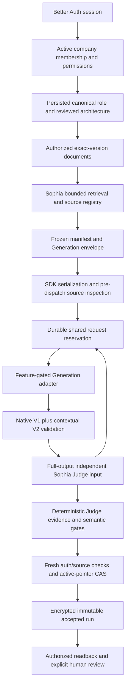

# Vantage M3 — Real-model Grounding E2E Preparation

Date: 2026-11-06. Scope: an isolated, authenticated Finance Pilot path prepared and verified offline. **No live Pilot is authorized or executed by this document.**

## Checkpoint and isolation

| Item | Value |
| --- | --- |
| Base M2 checkpoint | `8ad8c7fa185db7b54d5d406538be9a164e988c27` |
| M3 branch | `integration/vantage-grounding-m3-20261106` |
| M3 checkout | `C:/Users/junku/.codex/worktrees/ff33/LaunchStack` |
| Local application | `http://localhost:3188` |
| Dedicated synthetic PostgreSQL | `127.0.0.1:55448/vantage_grounding_m3_20261106` |
| Database user | `vantage_grounding_m3` |
| Container / volume prefix | `vantage-grounding-m3-20261106` |
| Ignored runtime and evidence directory | `test-output/vantage-grounding-m3-20261106/` |

M2 remains a separate checkpoint in `d6a4`; M1, the stable demos, and the other dirty worktrees are not integration targets for writes. M3 has not been committed, pushed, merged, or deployed. Offline dependency installation reused the frozen lockfile and downloaded zero packages. No production database operation occurred. Local schema provisioning is confined to the owned synthetic database and its identity marker.

## Phase A integration decision

The [file-by-file comparison](vantage-grounding-m3-phase-a-comparison-2026-11-06.md) audited the completed Phase A files in `9499` against M2, with before/after hashes. Applicable repairs are already inherited: full-context guidance, exact namespaces, schema limits, attributed source-date handling, canonical Judge IDs and verbatim quotes, and fail-closed completeness. No older source file was copied over M2.

M3 uses the **default V2 Finance compound profile**, not M2's compact `role-pair-m2` profile. Native V1 contracts, production defaults, and the separate candidate-D experiment remain unchanged. The original 14-dispatch Pilot, failures, scores, and repair artifacts are historical evidence; they were not regraded. This preparation does not establish that the Finance semantic failure is fixed.

## Execution path and implemented boundaries



| Boundary | Implementation | Verification meaning |
| --- | --- | --- |
| Authentication / authorization | Existing Better Auth, workspace context, company membership and document grants; new `/api/vantage/grounding/**` wrapper | Real local sessions, HTTP and PostgreSQL; synthetic users and documents |
| Role / required context | Existing Joseph preference, canonical mapping, Company Architecture and context adapters | Role is server-resolved; request text cannot supply authority |
| Retrieval / assembly | Existing Sophia bounded metadata retrieval, registry and frozen manifest | Real assembly over a closed synthetic catalog; no vector provider, embeddings or research |
| Shared host | Optional policy/persistence hooks in `contextual-host.ts`; M1 defaults retained | M3 does not weaken the legacy fixture policy or silently change production behavior |
| Generation | `live-grounding-m3.ts`, default repaired V2 compound adapter, real shared SDK serialization | Offline fixtures enter at HTTP response boundary; future live adapter is explicit and disabled by default |
| Transport | `live-grounding-m3-transport.ts`, optional public fetch seam in shared LLM factory | Exact endpoint/model/body/source inspection before reservation; one attempt, no SDK retry or redirect following |
| Deterministic validation | Existing native and contextual schemas, normalization, citations, numeric/event-state and size guards | Native carrier is independently normalized; full compound remains within the existing 2,400 output-token configuration |
| Semantic assessment | Sophia `evaluateVantage`, canonical V2 adapter, explicit native-copy mapping | Offline Judge responses test handling only; they are not independent model judgments |
| Persistence | `grounding-repository.ts` and `grounding-policy.ts` | Append accepted encrypted run, then guarded active-pointer CAS; source freshness and paired request receipt checked inside activation transaction |
| Human lifecycle | Existing versioned host review with M3 persistence strategy and authenticated API | Human choice and actor attribution remain separate from generated advice; no native action is created |
| Budget / approval | `evaluation-live/m3-request-budget.ts` | PostgreSQL reservation commits before HTTP; missing, corrupt, stale, exhausted or uncertain state fails closed |

The report DTO labels offline results as replay with a simulated Judge and `modelJudgeUsed:false`. Raw compound, frozen context, provider wire traces, request receipt and assessment are audit data, not public report fields. Saved reports remain private to their owner/company. A failed candidate never replaces the accepted pointer or its human review. Revoked evidence can make an old report unavailable without deleting its encrypted state.

## Frozen Finance scenario

The historical domain clock is explicit and independent of execution time: week `2026-10-12`, America/New_York, window `[2026-10-12T04:00:00Z, 2026-10-19T04:00:00Z)`, cutoff **`2026-10-19T12:00:00Z`**. Source timestamps are `2026-10-16T12:00:00Z`. These are provisional historical observations, not current November financial results.

| Source | Reference / provenance | Exact observation | SHA-256 of text |
| --- | --- | --- | --- |
| Finance | `doc:1@1` | October revenue is USD 12,000, provisional; refunds not reconciled. | `80313e9906dd08330b9c7b4e98cd640ddf714c3a61164b8fbad7332246d891e7` |
| Sales | `doc:2@2` | October revenue is USD 18,000; includes unsigned opportunities. | `7b1c526f040a4ed1c781d1c60ac16b94f043eba530bd343376cc501645f65b77` |
| Neutral company context | Company Architecture backed by `doc:3@4` | Synthetic Finance Grounding builds business software. Finance and Sales maintain monthly reporting records. | Recorded in `grounding-fixture.json` |

The initial company scaffold included the desired reconciliation answer. Before any M3 acceptance, it was replaced by an appended neutral version; old company version 3 and its provenance were preserved. Finance and Sales text and versions were not altered. `company-context-neutralization.json` records that transition and zero accepted M3 runs before it.

The registry contains Finance `doc:1@1`, Sales `doc:2@2`, and a versioned `company:company-metadata/1@...` projection. The company document is provenance for that projection, not a third independent financial observation. The accepted input hash is `eb417d64a0967ead19b864f47c2b989edc639c3b976903765debfcbff5540aaa`; its source-freeze hash is `c748337d3b6e681e471c0f45c01b2fbe0146c1d8481b94b17c61de7f31052f85`. The source-wire proof reconstructs the same Finance/Sales text hashes from both actual SDK requests. All 21 Judge output units use canonical identifiers.

Two native evidence rows copy Finance and Sales only to satisfy the existing native carrier. `native-evidence-crosswalk.json` records the explicit alias-to-document mapping and `independentCorroboration:false`. The Judge receives native output units with that verified mapping; copies do not become additional independent sources. Completeness means complete for this **closed synthetic scenario**, not complete knowledge of the company.

## Live acceptance and failure policy

Every live candidate must meet all existing deterministic contracts and pass the independent Judge with complete context, every critical expectation met, grounding/coverage/temporal scores of 100, and the remaining assessment metrics at least 75. Judge IDs and quotations must refer to actual canonical source/output units. A parse error, invented reference, unsupported quote, missing assessment, timeout, low score, or unresolved completeness fails closed.

The written critical expectations require both source observations, their different definitions and uncertainty, and an evidence-grounded reconciliation decision. They forbid treating either amount as final verified revenue, summing incomparable definitions, claiming there is only one supplied financial source, or inventing human approval, owners, deadlines or completed reconciliation. These expectations go to the Judge; the Generation source data does not contain the expected answer. A human must inspect the exact sources and full output before accepting the live result as semantic evidence.

This smallest Pilot has no regeneration, repair, retry, provider fallback, Judge rerun, embedding, research or retrieval-provider allowance. Structural Generation failure stops after one charged request. A delivered candidate followed by a Judge failure consumes two. In either case the previous accepted report stays active. There is no automatic promotion of a partially valid V2 or replacement with an unassessed fallback.

## Persistent request accounting

One fixed live key, `finance-live-pilot`, covers the whole Pilot. Its hard cap is **2 reservations: Generation 1 + Judge 1**. Retry and repair allowances are zero; embedding, retrieval-provider and research limits are zero. Offline keys are disjoint and cannot mint live permission.

The database transaction locks the budget row, validates plan/counter/ledger consistency and approval, writes the intent, and increments the count before returning permission to dispatch. `synchronous_commit=on` and database `fsync=on` are required. Failure, timeout or process death never refunds a reservation. An unfinished reservation blocks continuation rather than guessing whether a provider received it. Judge reservation must reference the delivered Generation response hash. Report activation independently verifies the paired receipts in its own transaction.

The initial live plan is deliberately incomplete and unapproved. A one-way finalization may bind a pristine zero-request draft while leaving it unapproved; an already bound, approved or used plan cannot be reset through that API. Code, prompt/schema, rubric, builder, model/endpoint, source freeze and input hashes are bound to approval and checked again at execution. Credentials must be supplied only through the two explicitly named environment variables after approval and binding validation; they are absent from persisted configurations and evidence artifacts.

## Verification and artifacts

**Offline preparation passed. Live execution remains No-Go.** The final source inventory contains 2,763 source/configuration/lock files with hash `14255c01d1c4c8fba431c9873f8a0800a494cd085037c22bcaffef654dd03991`. It binds the exact M2 SHA, model definitions, schemas, evaluator and runtime code. Model settings now have an explicit credential-free JSON representation; hydration restores their runtime Map, and all model definitions participate in the configuration hash.

| Executed check | Result | Scope |
| --- | --- | --- |
| Full Vantage pipeline regression | **811 passed, 54 skipped** | 50 files passed; the unconfigured PostgreSQL suite was skipped |
| Web Vantage/authz/workspace regression | **592 passed, 88 skipped** | 46 suites passed; seven database suites skipped; old M1/M2 mutating host acceptance excluded |
| New M3 pipeline/SDK cases | **21 passed** | Included in the pipeline total; real SDK serialization with injected responses |
| Shared SDK single-attempt regression | **5 passed** | No hidden retry; optional fetch seam leaves defaults unchanged |
| Fixed request-plan units | **8 passed** | Included in pipeline total; cap/identity/finalization contract |
| Runtime and approved-endpoint policy | **4 + 4 passed** | Closed transport, all DNS entry points, exact source inventory and synthetic approved-path tests |
| Actual PostgreSQL counter suite | **1 suite passed, eight controls** | 24 competing processes, at most one Generation and one Judge dispatch to a local fixture; crash, timeout, failed, disabled, missing and corrupt state |
| Actual Drizzle/PostgreSQL ledger regression | **1 passed** | Durable receipt and cap with the real driver's JSON codec behavior |
| Dormant live-gate harness | **13 checks passed** | Synthetic approved snapshot, actual authorization predicate, strict model hydration, injected credentials/fetch; no real keys or live approval |
| Authenticated HTTP/PostgreSQL preflight | **25 checks, 11 controls passed** | Actual Better Auth, guarded source assembly, fake provider HTTP, encrypted save, review and reload |
| Full Web and Pipeline TypeScript | **Passed** | Final checks after integration fixes |
| Focused TypeScript ESLint | **Passed** | Changed host/API/LLM/pipeline files; runtime scripts separately checked with Node and tests |

Do not add overlapping test totals together. The skipped database suites were not exercised. Actual M3 PostgreSQL and HTTP checks are listed separately and used only the dedicated M3 database. The independent reviewer reran the focused M3, budget, runtime/policy and SDK tests, checked both TypeScript projects, and inspected the final HTTP, source, counter and encrypted-audit proofs. The PostgreSQL race suite was executed by the runtime implementer and independently inspected, not rerun by the reviewer.

The final accepted report is `5bcbc993-9bb6-4ddd-8407-bd38e623444b`, owned by synthetic actor `vantage-r40f820f70e43f0aa-owner` / database user 1 in company 1. The primary acceptance run saved version 1, recorded the human choice and reloaded version 2. It appended to active pointer version 2 without changing the older report `2d15ac5c-41de-4beb-9fa0-38fb23e29c92` or its version-2 ciphertext. A separate actual HTTP check rejected stale version 1, submitted two concurrent reviews at expected version 2, and obtained exactly one success and one conflict. The current report is **version 3**, with the winning authenticated actor in the encrypted audit. Active pointer version 2, earlier reports, native tables and provider budgets remain unchanged. `review-cas-proof.json` preserves this result. Its original script failed only afterward on a PostgreSQL Result-versus-Array prototype comparison; the failed artifact was retained and the remaining checks were completed read-only, without resetting or repeating the review.

Negative HTTP cases reject unauthenticated and unauthorized owners, stale code bindings, exhausted request budget, source omission, a false only-source claim in the native carrier, invalid Judge IDs, low grounding, Judge timeout, Generation 429/500/redirect/malformed output, same-version source-date drift and real grant revocation. All nine failed-candidate variants preserve every saved report's bytes/version and the active pointer. Metadata drift and grant revocation also preserve reservation counts. The five native agenda/topic/contract/commitment/outbox tables remain empty with identical full-table digests. Source copies are intake evidence, not automatically created work.

The new append-only attempt audit preserves encrypted full wire/context/assessment data independently of accepted reports. Read-only decryption verified 19 attempts, including failed Judge assessments with both SDK requests and responses retained. Attempt status `admitted` means the pipeline gate passed; it does not itself assert successful database activation. Public errors expose no raw provider failure body or credentials.

Integration failures are retained as `preflight-failed-*.json`. They identified actual boundaries: Drizzle's shared JSON codec needed explicit parameterized `JSON.stringify(...)::jsonb` writes and object/string read normalization; runtime JSON needed canonical model-Map serialization; a concurrent source edit correctly invalidated a prepared hash. No guard was weakened to pass these cases. The first M1 compatibility generate/review/encrypted reload passed on the new M3 database. A later architecture re-review made that older M1 snapshot stale as designed; it is historical compatibility evidence, not a currently readable M1 report. The stable M1 environment was never modified.

Primary evidence under `test-output/vantage-grounding-m3-20261106/`:

- `preflight-http-db-1794004827693.json`: complete final HTTP trace, preserved state, source-code hash, token projection and budget snapshots.
- `source-wire-proof.json`, `offline-example-report.json`: actual accepted encrypted payload's source/envelope/transport proof and clearly labeled authored offline output.
- `review-cas-proof.json`, `review-cas-failed.json`: actual stale/concurrent review outcomes and preserved harness-comparison failure provenance.
- `counter-offline-proof.json`, `drizzle-ledger-proof.json`, `attempt-audit-verification.json`: durable accounting and private audit retention.
- `grounding-fixture.json`, `native-evidence-crosswalk.json`, `company-context-neutralization.json`: exact source versions and provenance.
- `verification/pipeline-final.log`, `verification/web-final.log`, their `*-execution.json` files, and `verification/final-runtime-verification.json`: commands, counts and final isolation state.
- `verification/final-source-inventory.json`: all approved-scope source hashes.
- `implementation.diff`, `implementation-files.json`: the uncommitted M3 diff and changed-file hashes; no runtime credentials or databases included.
- `preflight-reproduction.md`, `review-cas-commands.txt`: exact authenticated execution commands and retained-state replay constraints.
- `network-summary.json`: zero external provider dispatches; 97 blocked attempts comprise one Next registry fetch and 96 socket/IPC denials. The latter do not establish remote requests. These are Node transport controls, not an OS firewall claim.

No provider credential file was created or read. The live singleton remains **unapproved, 0/2 reserved**. Offline tests use separate explicit keys and local fake responses; their reservations do not constitute billable provider usage.

## Exact proposed models, tokens and budget

| Setting | Generation | Independent Validation Judge |
| --- | --- | --- |
| Proposed existing local model ID | `google/gemini-3.7-flash` | `gpt-6-luna` |
| Declared model family | Google Gemini | OpenAI GPT-6 |
| Configuration source | `apps/web/config/chat-models.yaml` | `apps/web/config/chat-models.vantage-demo.azure.yaml` |
| Reasoning effort | `none` | `medium` |
| Output-token cap | **2,400** | **4,096** |
| Attempt timeout | 20,000 ms | 20,000 ms |
| Attempts / retries / repairs | 1 / 0 / 0 | 1 / 0 / 0 |
| Accepted offline SDK message JSON | 21,545 bytes / 4,826 token proxy | 17,632 bytes / 4,273 token proxy |
| Accepted offline response content | 2,365 bytes / 485 token proxy | 4,646 bytes / 1,121 token proxy |

Counts use local `js-tiktoken` **o200k_base as a proxy**, including the actual serialized messages and returned compound content. They are not verified provider tokenizer or billing counts. The complete authored Generation compound projects to 20.2% of the unchanged 2,400 cap, below the 85% warning threshold; this is one Finance fixture, not a p95 delivery result or maximum-three-topic study. The existing 23,500 **byte** prompt limit is unchanged. No output/retry cap was silently raised.

These model IDs and families are proposals from local configuration. Actual endpoints, routing, returned model IDs, availability, independent backend families, tokenizer behavior and prices have not been verified. `live-execution.template.json` contains `.invalid` endpoints, proposed identities, null bindings and no credentials; it deliberately fails live validation. A proxy alias must not be assumed to prove independent model families.

The exact proposed smallest Pilot is **one Finance Generation followed, only after structural success, by one independent Judge: two requests maximum**. Generation failure uses one slot; a Judge attempt uses the second. Every transport failure counts. There is no automatic batch expansion or Phase 2/3 experiment.

**Budget proposal:** reserve **USD 0.50**, conditional on separately reviewed actual rates and input estimates fitting that amount. For a transparent planning example only, at assumed rates of USD 5 per million input tokens and USD 25 per million output tokens for both models, the observed fixture-shaped projection costs `(9,099 × 5 + 1,606 × 25) / 1,000,000 = USD 0.085645`. Using both full output caps and the same input projection gives USD 0.207895; a longer generated report also grows the Judge input. These are assumptions, not current price quotes or observed charges. The implemented hard limit is the two-request counter, not a provider-enforced dollar limit. Replace the assumptions with verified rates and record their evidence hash before approval; otherwise remain No-Go.

## Reproduction and the future live command

Run commands from the M3 checkout. Dependencies are pinned and installed offline. Existing retained state must not be reseeded or reset. The runtime has an owned-project/port/database marker check; it does not act on another worktree's services.

```powershell
# Local non-provider checks:
node scripts/dev/vantage-grounding-checks.mjs runtime
node scripts/dev/vantage-grounding-checks.mjs budget-unit
node scripts/dev/vantage-grounding-checks.mjs counter
node scripts/dev/vantage-grounding-checks.mjs types
node --test scripts/dev/vantage-grounding-live-policy.test.mjs

# Read current durable live counter; no mutation or dispatch:
node --import tsx scripts/dev/vantage-grounding-budget.mjs --status

# Current template MUST exit nonzero / No-Go:
node scripts/dev/vantage-grounding-live.mjs --validate --config test-output/vantage-grounding-m3-20261106/live-execution.template.json --max-requests 2
```

The full pipeline and Web command arguments, clean allowlisted environments and exits are recorded in the two final regression execution files. The authenticated preflight uses `apps/web/scripts/vantage-grounding-preflight.ts`, launched with `childEnvironment(readRuntime())`, the closed network preload and the web TypeScript resolver. For a deliberate repeat on retained state, use `--resume` and a new explicitly offline case key; preserve the old reports, budgets and failure artifacts. Do not rerun the initial `--prepare` against accepted state. The local fixture server must be running; no model endpoint is substituted silently.

The exact future one-shot command is:

```powershell
node scripts/dev/vantage-grounding-live.mjs --run-approved-once --config test-output/vantage-grounding-m3-20261106/live-execution.json --approval-manifest test-output/vantage-grounding-m3-20261106/approval-manifest.approved.json --max-requests 2
```

**Do not run it now.** It requires the separately approved, freshly started live host. The preparatory and launch sequence is fully recorded in `proposed-live-commands.md`: build an unapproved proposal with reviewed configuration; finalize only the pristine draft; record the human-approved manifest with a CAS; validate it; stop only the owned offline M3 app; then launch:

```powershell
node scripts/dev/vantage-grounding-live.mjs --serve-approved --config test-output/vantage-grounding-m3-20261106/live-execution.json --approval-manifest test-output/vantage-grounding-m3-20261106/approval-manifest.approved.json --credentials-file test-output/vantage-grounding-m3-20261106/execution.env --max-requests 2
```

Launch alone performs no Generation request. The credential file, to be supplied only after authorization, contains exactly `VANTAGE_M3_GENERATION_API_KEY` and `VANTAGE_M3_JUDGE_API_KEY`. The launcher checks durable approval, current code, actual database/ACL/input and approved report baseline before reading it. The one-shot command then authenticates through Better Auth, verifies the live host and fresh baseline, and makes one local API POST. It never retries a failed status or uncertain response. The guarded provider transport permits only the two reviewed HTTPS chat-completion POST endpoints and charges the durable slot before dispatch.

No live plan finalization, approval import, approved-host launch or live one-shot POST was executed in this task.

## Go / No-Go and remaining limits

| Gate | Current result / required owner |
| --- | --- |
| Exact M2 base and isolated M3 branch; stable environments preserved | GO — TL, verified locally |
| Actual auth/ACL, both Finance sources, compound validation, encrypted persistence/review | GO for the recorded offline scope — TL |
| Counter durability, hard 2-call cap, failure preservation | GO for executed offline/PG checks — TL |
| Current code inventory and final type/lint/regression checks | GO — TL plus independent reviewer |
| Actual model endpoints, deployment IDs, response IDs and distinct families | **NO-GO** until provider operator verifies and documents them |
| Actual prices/token semantics within USD 0.50 proposal | **NO-GO** until TL/operator reviews rates and binds pricing evidence |
| Human approval of exact plan/configuration/source/code/baseline and cap | **NO-GO** — requires separate explicit user approval |
| Live credentials and new approved host | **Not loaded or launched** — operator after approval only |
| Real Generation and Judge semantic acceptance | **Not executed** — Sophia/TL assess the first Pilot and human reviewer inspects both definitions and reconciliation |

The actual live-only draft-finalization SQL path has unit/static coverage but was intentionally not executed on the real unapproved Pilot row. Its execution and result must be checked during the separately authorized preparation; it may not reset an already bound or used plan. The provider identity/rate evidence is trusted operator input, not automatically proven by an alias or hash. Transport guards do not certify arbitrary non-Node processes. Metadata retrieval is real but finite and synthetic; vector retrieval, embeddings, research and production connector quality are outside this Pilot.

M3 has current authenticated HTTP/API acceptance. No new M3 browser or real-provider acceptance was performed; the M1/M2 browser results remain separate historical evidence. The authored offline output and injected Judge prove wiring and rejection behavior, not model reasoning, Judge calibration or a fix for the original Finance omission.

**Smallest next authorized action:** review and complete the concrete credential-free configuration and USD 0.50/two-request proposal, then approve exactly one Finance Generation + one independent Judge. Stop after those results for human review. No broad experiment, production activation, merge, push or deployment follows automatically.


