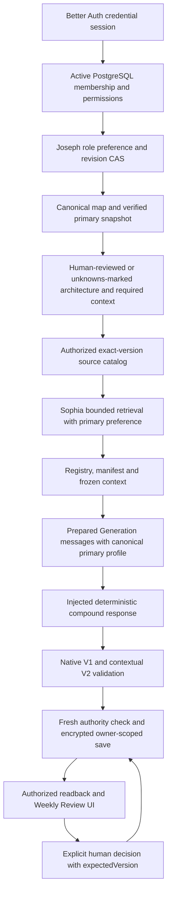

# Vantage — Milestone 2: Role-Aware Product E2E

Date: 2026-11-06. This run extends [the M1 Finance milestone](vantage-finance-m1-2026-11-05.md) and the [integration plan](../design/vantage-e2e-testing-and-full-integration-plan-2026-11-05.md).

## Result and scope

**Milestone 2 passed within the deterministic local scope.** The authenticated local product path resolves a persisted Joseph primary-role preference, runs Sophia's bounded retrieval over the same authorized evidence, freezes the context, passes the resolved primary role into an injected deterministic Generation adapter, validates the compound output, and saves an encrypted private PostgreSQL report. Both role trials retain both consequential issues. Human review uses the existing Weekly Review components and version-checked API.

This establishes deterministic role-sensitive integration. It does **not** establish real LLM role reasoning, independent Judge agreement, production retrieval quality, or a fix for the historical Finance semantic omission. There were zero external Generation, Judge, embedding or research requests. No push, merge, deployment, production migration, stable-demo modification, or historical score alteration occurred.

## Checkpoint and isolation

| Item | Exact state |
| --- | --- |
| M1 checkpoint | `7e3ac98e0aa202e1e936e616d07cb3d1a59ae8fc` — `checkpoint(vantage): preserve authenticated Finance milestone 1` |
| Checkpoint parent | `b809e8248e4c65eb2e6e8c4aa05b52003e352aa9` |
| M1 worktree | `C:/Users/junku/.codex/worktrees/99e3/LaunchStack`; clean after checkpoint |
| M2 branch | `integration/vantage-role-aware-m2-20261106` |
| M2 worktree | `C:/Users/junku/.codex/worktrees/d6a4/LaunchStack`; created from the exact checkpoint |
| Application | `http://localhost:3187/employer/vantage/roles` |
| PostgreSQL | `127.0.0.1:55447/vantage_role_m2_20261106` |
| Owned container / volume | `vantage-role-m2-20261106-db` / `vantage-role-m2-20261106-data` |
| Runtime and evidence | `test-output/vantage-role-m2-20261106/` |

The M1 checkpoint includes 106 verified implementation, fixture, test and documentation files. Runtime files, credentials, keys and databases were excluded. Its prior manifest was checked against the actual working tree. Three whitespace-only fixes were made before committing, followed by the affected runtime checks. The new M2 checkout received a frozen, offline dependency installation: 1,968 packages, zero downloads. Other dirty worktrees and stable ports 3104/3111/3186 remain separate. No remote queries were made during this zero-external-request milestone; M1's earlier remote provenance remains historical.

The original M1 report describes its then-uncommitted state. The checkpoint above was created later under the explicit M2 authorization. M2's local commit is the commit containing this runbook; its exact SHA is recorded in the final handoff and local completion artifact rather than embedded recursively in its own content.

## Implementation and role-to-report trace



| Boundary | Actual implementation | Evidence and limits |
| --- | --- | --- |
| Authentication and company | Better Auth, `requireWorkspaceContext`, real active membership and custom `role-reviewer` permissions | Credential login/session and HTTP requests are real. Accounts and company are synthetic. The role has documents.read/edit and settings.manage; no broad folder permission bypass. |
| Persisted preference | Existing `savePersonalRoles` / `personalContextSession`; M2 `/personal` wrapper | Same actor, same selected responsibilities, only primary changes through the real revision-checked Joseph API. The wrapper restricts the fixed paired scenario. Generation POST accepts only the fixed week. |
| Canonical mapping | `pipelines/src/vantage/role-context-v0/role-map.json` | Appends Partnerships Lead and Security Engineer, version `joseph-roles-2026-11-06-v1`; original four roles/fallback preserved by equality tests. No unrelated role system. Stored mapping version is exposed and stale confirmed mappings block generation. |
| Required context / architecture | Existing Company Architecture projection and personal-context provider | A reviewed or explicitly unknowns-marked projection is mandatory (this run used `unknowns-marked`); stars are empty and the ten benchmark documents are dynamic candidates in both trials. Same original D06 historical source; no native prior agenda is silently introduced. |
| Source authorization | Real document grants, company scope, exact document versions/chunks and current heads | Ten actor-authorized sources; separate same-company private and outside-company canaries remain invisible. Roles do not grant document access. |
| Retrieval | Existing `createDynamicRetrievalProviderV0` with opt-in `primaryRolePreference:true` | Uses verified primary relevance within the authorized candidate set. Existing default ordering is unchanged. Finite metadata adapter; no vector search, embeddings or research. |
| Registry / freeze | `runDynamicContextV0`, `createSourceRegistryV0`, `assembleContextManifestV0`, existing freeze/commit guards | Eleven entries: ten benchmark-derived documents plus canonical Company Architecture. Source versions, content, ACL, dates, offsets and provenance are retained. |
| Generation | `role-pair-milestone-v1.ts`, repaired V2/Sophia compound adapter | The helper consumes resolved role, exact frozen evidence and actual retrieval ranking before constructing the compound. No finished report is swapped after validation. The injected transport makes one simulated invocation. |
| Actual role wire | M2-only `transportProfile:"role-pair-m2"` | Prepared system message contains marked JSON with primary ID, map version, description, responsibilities and priorities. Host independently parses and deep-compares it against the canonical frozen primary before save. Default M1/V2 prompt bytes remain unchanged. |
| Deterministic validation | Real compound schema, normalization, native carrier, citations, numeric/event-state and size checks | Plus an explicitly authored role-pair checklist; no semantic model Judge. Wrong priority, malformed compound, post-validation substitution and role binding failures are rejected. |
| Persistence | Existing SecretBox and guarded PostgreSQL writes in `role-contextual-host.ts` | New local-only `pdr_ai_v2_vantage_role_contextual_runs` stores encrypted report, full frozen envelope, role provenance, ranking, exact prepared messages and review audit. Unique owner/company/week/scenario/context key preserves each revision's report. |
| Review / reload | Shared WeeklyBrief, CompactTopicRow and TopicDetailSheet; new authenticated role page/API | Human choice is distinct from the AI recommendation. Actor attribution and report-version CAS are retained. Existing reports keep their frozen role when the current preference changes. |

Primary changed modules: `apps/web/src/server/vantage/role-contextual-{host,service,policy}.ts`, additive local schema, `personal-context-store.ts`, `apps/web/src/app/api/vantage/role-contextual/**`, `apps/web/src/app/employer/vantage/roles/**`, canonical role directory, opt-in retrieval fields/order, M2-only Generation transport and paired fixture/test helper. Runtime and acceptance tools are under `scripts/dev/vantage-role-*` and `apps/web/scripts/vantage-role-*`.

The native V1 carrier and frozen contracts are unchanged. Native agendas/topics/commitments are not the new report store. Two real private native evidence rows copy D01/D08 solely to satisfy the existing native intake bridge; their crosswalk explicitly marks them as **not independent corroboration**. No production schema migration was added or executed.

## Frozen data and equivalence

Cutoff: **2026-11-02T14:00:00.000Z**. Week `2026-10-26`, America/New_York; period start `2026-10-26T04:00:00.000Z`, exclusive end `2026-11-02T05:00:00.000Z`. November 4/5 are future dates relative to this declared historical cutoff, not the actual November 6 execution date. Authentication and DB operational timestamps use the real clock; report/review domain timestamps use the declared frozen clock. Artifact execution timestamps retain the real time.

The [source archive](../../fixtures/vantage-role-pair-milestone/README.md) contains byte-identical C02/C03 inputs. Scoped Git attributes preserve those two archive files without Windows line-ending conversion; [staged checkout verification](../../test-output/vantage-role-m2-20261106/fixture-checkout-proof.json) confirmed both exported copies retain their exact hashes. Original source SHA-256 values remained unchanged:

- C02: `e93ea3713868107dc1ff99a0a82b0b1f3ea9815058bd11123b2042648ff44cb3`
- C03: `923004a3e16ff9b558f2193c20491ba04256eccc54ab543b355942317f693df3`

The new DB pilot maps logical `v1` source refs to exact local document/version IDs. Original text and logical versions are preserved in [the runtime crosswalk](../../test-output/vantage-role-m2-20261106/role-fixture.json). Day-only dates are explicitly materialized at noon UTC on the same day; this is a declared new database convention, not a claim that the entire historical envelope is byte-identical. Cached public D03 and unreviewed company D04 text are local documents; canonical, explicitly unknowns-marked Company Architecture is a separate control. Nothing is fetched externally.

| Shared condition | Proof |
| --- | --- |
| Actor | `vantage-rb67bc9a2d2440309-owner`, same authenticated actor/company/ACL |
| Selected roles | `{partnerships-lead, security-engineer}` in both trials; resolver orders primary first |
| Source set | Ten exact document versions plus the same canonical company projection; all eleven survive assembly |
| D01 / D08 / D03 runtime refs | `doc:4@4` / `doc:5@5` / `doc:6@6` |
| Stable source-set SHA-256 | `67bfcca3f9e5158184d8c50eba1ba5562c5cdee1edbb7238ac71d834b4e667dd` |
| Source authority | `187335d24e2935992b2969fe5dd3db65e491670fa7b3ca16a1c6c61b06252a03` |
| History SHA-256 | `9ea6f916edacbe44c4e129507b1322abacca5e224bd6a45ffa2f82502f23fbb9` |
| Complete invariant-projection SHA-256 | `738e6841d5852374f845943e1be1fa3df2ab502f14bdf7a75f8457809941d1e5` |

The full equality assertion compares source registry, snapshot entries, source freeze, actor/architecture/star freezes, native input, source authority, source versions/content/ACLs, selected-role set and mapping, historical context and cutoff. Only known per-read `checkedAt` observation fields are excluded from source equality; both raw values and their differences are retained. Source dates are **not** excluded. Primary role, preference revision, primary-first array order, run IDs and derived context fingerprints necessarily differ.

## Partnerships versus Security

| Observation | Partnerships trial A | Security trial B |
| --- | --- | --- |
| Verified primary / revision | `partnerships-lead`, revision 3 | `security-engineer`, revision 4 |
| Retrieval ranks | D01 rank 2; D08 rank 7 | D08 rank 2; D01 rank 6 |
| First decision topic | Check readiness for the proposed pitch | Prepare the shared-admin access review |
| Recommendation | Confirm the invitation and assess remaining impact/budget slides before deciding whether to proceed | Review unresolved access items and confirm required evidence for the scheduled review and final sign-off |
| Change condition | Accepted invitation and credible slide completion plan establish readiness | Current evidence shows review completion and recorded final sign-off |
| Retained second topic | Shared-admin access review | Proposed sponsorship pitch |
| API report | `06210c48-8652-4d55-b5f3-cafb08b8f213`, captured at version 2 | `3a443916-2969-4c45-9bf3-0c639c80f4a0`, captured at version 2 |
| Human choice | Needs more evidence: confirm invitation and unfinished slides | Needs more evidence: confirm completion evidence and final sign-off |

D06 historical material ranks first in both retrieval results; the claim is a reversal in the two consequential candidates' relative ordering, not that the selected decision topic ranks first among every source. Both reports explicitly preserve the proposed/unconfirmed November 4 pitch, unfinished slides and the absence of recorded access-review completion/sign-off. Owner, due assignment and help fields remain null. Source dates are evidence, not new commitments.

## API and PostgreSQL acceptance

The authoritative [HTTP acceptance artifact](../../test-output/vantage-role-m2-20261106/acceptance-http-1793994408466.json) includes 51 combined trace entries, frozen/saved payloads, actual prepared Generation messages, exact role profiles, rankings and human-review audits. SHA-256: `b567c9aaa241ef596bb841ac6ab4cb08b056e2932e8bf739032570017c6296f0`.

Its lineage is explicit. The initial pre-profile-wire run saved a neutral fallback and first A/B pair. A corrected final A3/B4 pair then passed all product operations; the harness stopped only on operational `checkedAt` differences in its equality assertion. A read-only continuation completed the exact same A3/B4 assertions after projecting only those observation timestamps. No report was reset, deleted, overwritten or regenerated to conceal a failure. All failed captures remain alongside the successful artifact. The earlier neutral unknown-profile control is identified as pre-profile-wire; it is not represented as a fresh full-profile-wire run.

The [direct PostgreSQL controls](../../test-output/vantage-role-m2-20261106/acceptance-db-1793994419444.json) passed eight groups. SHA-256: `7f71e7efbbc5db5fcfda49bf3b4ee1556bbabec8a6ea3ee66e1e7d50bbb49901`. These controls declare their synthetic identity wrapper; they exercise actual membership, permissions, source reads, guards, encryption and CAS. HTTP and browser authentication are independently real. The positive control re-reviews the latest A report after the primary switches, advancing it to version 3; that is an intentional review mutation, not corruption of the earlier version-2 capture.

| Negative or integrity check | Observed result |
| --- | --- |
| No session | 401 |
| Request-body role spoofing | 400; saved state unchanged |
| Unknown requested role | 400; unconfirmed unknown profile separately resolves to neutral fallback with both issues |
| Private/outside source canaries before and after primary change | Absent from authorized personal document catalog; exact source reads denied 404 |
| Same-company peer reading either private report | 404 |
| Outside-company actor reading either report | 403 at the isolated workspace gate; not a claim of two enabled tenants |
| Prepare A, persist primary B, then commit A | 409 `stale_context` |
| Stale confirmed map | 409 `stale_role_mapping`; existing report remains readable |
| Source changes after freeze | 409 `scenario_source_binding_invalid` |
| Same source/version with changed source date | 409 `stale_context` |
| Revoke actual document grant | Prepare and saved read denied 403 `source_unavailable`; restored afterward |
| Remove real documents.edit permission | Prepare/review denied 403 `write_forbidden`; restored afterward |
| Malformed compound / wrong priority / substituted DTO / wrong role metadata | Rejected by exact schema or binding/semantic guard; all saved ciphertexts and versions retained |
| Two reviews from one version | Exactly one 200 and one 409 `stale_review` |
| Subsequent stale review | 409 `stale_review`, prior decision retained |
| Automatic actions | Native agendas, topics, contract state, commitments and event outbox remain zero with identical before/after digests |

## Browser acceptance

The actual authenticated browser walkthrough passed for both roles. It used the named isolated session `vantage-role-m2-ui`, saved preferences through the Joseph-backed UI, reused architecture revision 1 (`unknowns-marked`), generated both reports, opened the exact D01/D08 source bodies, explicitly chose Needs more evidence, and reloaded the saved report and browser. No request interception or report substitution was used. The final request list contains 296 HTTP requests, all to localhost:3187, including exactly one authentication POST, two preference PATCHes, two Generation POSTs and two review PATCHes. Sixteen GETs were aborted (14 architecture, two source); successful reads followed and exact-source assertions passed. The console check found zero errors and zero warnings. An in-memory scan of 33 artifact files found no exact or URL-encoded synthetic password/session-token matches; no HAR, trace, cookies or storage state was exported. The named browser was closed afterward. Both confirmation dialogs were initially unselected, with save disabled; no review was written before confirmation.

| Browser result | Partnerships | Security |
| --- | --- | --- |
| Report ID | `1ae8da0e-63c4-40fe-a2e4-d7229b4cab1d` | `4e23408b-8c7c-498a-9790-991540ff9f3f` |
| Frozen role preference revision | 8 | 9 |
| Human review and reload | expectedVersion 1 → saved version 2 | expectedVersion 1 → saved version 2 |
| Decision | Needs more evidence; confirm invitation and unfinished slides | Needs more evidence; review unresolved access items and needed completion/sign-off evidence |

The earlier Partnerships report retains its original perspective and decision when current preference is Security. Five pre-browser reports remain byte-for-byte preserved in their ciphertext and versions; exactly two new reports were added (seven total). The final read-only [database/browser audit](../../test-output/vantage-role-m2-20261106/final-browser-audit.json) verifies authenticated AES-256-GCM decryption, exact canonical role wire, effective-prompt and frozen-envelope SHA-256 values, one correctly attributed owner/topic/version-2 review on each new report, unchanged source authority/ACLs/history and zero native actions/outbox entries.

Browser artifacts live in the separate [browser output directory](../../test-output/vantage-role-m2/browser/): [paired readback](../../test-output/vantage-role-m2/browser/final-pair-readback.json), [Partnerships source](../../test-output/vantage-role-m2/browser/03-partnerships-source.png), [Security saved decision](../../test-output/vantage-role-m2/browser/09-security-reloaded-decision.png), [desktop](../../test-output/vantage-role-m2/browser/10-pair-desktop.png), and [390px mobile](../../test-output/vantage-role-m2/browser/11-mobile.png). The mobile check reported no horizontal overflow; screenshots were visually inspected.

One browser-helper assertion failed after the Security generation POST had already succeeded: the full-brief disclosure was open from A, and the helper clicked it closed. The helper now checks disclosure state. Recovery inspected the original response and reloaded the same B report through authenticated GET; no duplicate generation was performed. The [failure note](../../test-output/vantage-role-m2/browser/browser-helper-failure.txt) and steps log preserve this distinction.

## Verification and budget

| Check | Result |
| --- | --- |
| Full Vantage pipeline | 782 passed; 54 legacy PostgreSQL tests skipped; 48 passing files / one skipped file |
| Relevant Web/auth/Vantage scope | 591 passed; 88 legacy PostgreSQL tests skipped; 45 passing suites / seven skipped suites |
| Dedicated real HTTP/PostgreSQL acceptance | 2/2 Jest entries passed; 51 HTTP trace entries and eight direct control groups |
| Authenticated browser acceptance | Both primary roles saved, explicitly reviewed and reloaded at version 2; independent read-only encrypted DB audit passed |
| Offline runtime transport/environment tests | 3/3 passed |
| Focused role/wire checks | 31 passed; included in the full pipeline count, not additional distinct coverage |
| Full Web and Pipeline TypeScript | Passed |
| Focused ESLint / script syntax | Zero errors across 25 configured JS/TS files; nine scripts ignored by existing ESLint configuration and separately checked with Node syntax checks |
| Expanded, additional workspace regression | 728 passed, one unchanged locale-sensitive failure, 100 skipped |

The additional expanded Web run's `workspace-history` assertion expects English `Aug`, but the elevated Windows Node process formats the date as Chinese `8月20日`. A fresh-process locale probe confirmed that LANG/LC_ALL did not change that process's default locale. The test was not edited, skipped through a new filter, or monkeypatched. Its failed log remains preserved; the separate relevant Vantage/auth scope above is the explicit M1-compatible acceptance scope. Legacy PostgreSQL suites target other database configurations and were not silently redirected to existing demos. The dedicated M2 real database tests ran without skips.

| Complete compound | Actual prompt bytes / 23,500 | Proxy output tokens / 2,400 |
| --- | --- | --- |
| Final A | 23,446 (54 bytes spare) | 794 (33.1%) |
| Final B | 23,464 (36 bytes spare) | 797 (33.2%) |
| Retained initial neutral control | 23,283, pre-profile-wire | 803 (33.5%) |

Output counts use local `js-tiktoken@1.0.21` `o200k_base`, explicitly a proxy with unverified provider-tokenizer mapping. Every count includes the native and experimental compound. Exact prepared messages are counted before invocation and saved; the host recomputes byte equality. The current neutral wire was projected offline at 23,125 bytes, not falsely reported as another authenticated Generation execution. Output remains below the 2,040-token warning threshold. Prompt headroom is very narrow: additional metadata or new sources require a separately reviewed size decision. No shared cap or retry budget was raised; this injected transport permits one simulated invocation and no repair/provider call.

The M2-only concise transport instruction was necessary because the actual eleven-source host input initially exceeded the existing prompt cap (23,677 > 23,500), before any invocation. Native safety/history text, complete schema and source payload were retained. M1/default V2 messages have byte-equivalence regression coverage. This compact prompt has not been evaluated with a real model.

## Reproduction and evidence handling

Use only the new worktree and owned runtime. Runtime secrets are in ignored `runtime.json` / `compose.env`; they are excluded from source commits. Evidence JSON, screenshots, logs, caches and database volumes are generated local artifacts, not committed runtime state.

```powershell
Set-Location C:\Users\junku\.codex\worktrees\d6a4\LaunchStack
corepack.cmd pnpm install --offline --frozen-lockfile --ignore-scripts --child-concurrency=1 --network-concurrency=1
node scripts/dev/vantage-role-runtime.mjs --status
# Only for a genuinely new owned fixture; never reseed the saved acceptance state:
node scripts/dev/vantage-role-runtime.mjs --prepare
# Start only if the owned host is not already serving 3187:
node scripts/dev/vantage-role-runtime.mjs --serve
```

Fresh-fixture acceptance:

```powershell
Set-Location C:\Users\junku\.codex\worktrees\d6a4\LaunchStack\apps\web
$env:VANTAGE_ROLE_M2_ACCEPTANCE = 'true'
node node_modules/jest/bin/jest.js --runInBand --runTestsByPath __tests__/server/vantage-role-contextual.integration.test.ts
Remove-Item Env:VANTAGE_ROLE_M2_ACCEPTANCE
```

The default suite requires the initial unconfirmed-role condition; it does not automatically reset the retained final state. The historical successful command used the documented resume/continuation artifact arguments in the test wrapper. Re-running mutating acceptance now requires preserving the current evidence and deliberately selecting an appropriate fresh condition. Do not run a continuation after later browser/control mutations and expect its earlier frozen assertions to remain current. Exact executed commands, exits and selected file lists are retained in `test-output/vantage-role-m2-20261106/verification/`.

Read-only/local verification commands:

```powershell
Set-Location C:\Users\junku\.codex\worktrees\d6a4\LaunchStack
node --test scripts/dev/vantage-role-runtime.test.mjs
node scripts/dev/vantage-role-db-check.mjs
corepack.cmd pnpm --filter @launchstack/web typecheck
corepack.cmd pnpm --filter @launchstack/pipelines typecheck
$env:NODE_OPTIONS = '--require=C:/Users/junku/.codex/worktrees/d6a4/LaunchStack/scripts/dev/vantage-role-network-guard.cjs'
Set-Location pipelines
node node_modules/vitest/vitest.mjs run src/vantage --maxWorkers=1 --no-file-parallelism
Set-Location ../apps/web
node node_modules/jest/bin/jest.js --runInBand --testPathPatterns='vantage|authz|require-workspace-context' --testPathIgnorePatterns='vantage-(finance|role)-contextual.integration.test.ts'
```

The actual regression wrapper uses a clean allowlisted environment with no inherited database/provider credentials. The runtime disables connectors, workers, mail and tracing; the model endpoint is a closed loopback address. A tested Node preload rejects external fetch/DNS/TCP/TLS dispatch, and local fonts avoid remote font loading. Denied incidental attempts are recorded separately from dispatched requests. This is not an OS firewall certification. Browser request-origin evidence is separate. The final [app/acceptance network summary](../../test-output/vantage-role-m2-20261106/network-summary.json) records 28 denied attempts (one Next registry check and 27 local IPC attempts); the [verification summary](../../test-output/vantage-role-m2-20261106/verification/network-summary.json) records 27 denied local IPC attempts. All were blocked before dispatch, with zero unattributed origins. No external provider dispatch occurred.

## Remaining limits and next milestone

- Real-model role reasoning and independent semantic validation remain untested. The authored response/checklist proves data flow and deterministic handling only.
- Retrieval uses the real bounded provider with finite synthetic metadata. Embedding ingestion, live connectors and optional research remain absent. Primary preference is opt-in and must not be enabled broadly without evaluation.
- Storage is an isolated owner-scoped local pilot schema, not a production migration. Table-level locking is acceptable for this bounded fixture, not a production scalability result.
- The native evidence duplicate bridge remains necessary; it must eventually be replaced without changing frozen V1 semantics or counting duplicates as corroboration.
- Two fully enabled tenant boundaries, star lifecycle, production SSO/HTTPS, next-week carried questions and explicit commitment creation remain separate acceptance work. The current two-role comparison deliberately fixes history to D06 plus empty native lifecycle state.
- The additional workspace-history locale failure is unresolved outside M2 scope. Legacy PostgreSQL suites still need safely provisioned dedicated targets.
- The compact M2 input has only 36–54 bytes of prompt headroom. It is suitable for this frozen plumbing test, not evidence of general context scalability or prompt quality.

Recommended next milestone: cross-source grounding and omission detection using the Finance definitions (provisional USD 12,000 versus USD 18,000 including unsigned opportunities) through this authenticated host. TL should preserve frozen input/output and persistence gates; Joseph should verify required context/role authority; Sophia should expose retrieval completeness and independent Judge evidence. Start with deterministic omissions/invalid-claim controls. Any real Generation/Judge retest needs separate approval and a bounded call budget; no real-model execution is implied here. The original Finance semantic failure remains open.
